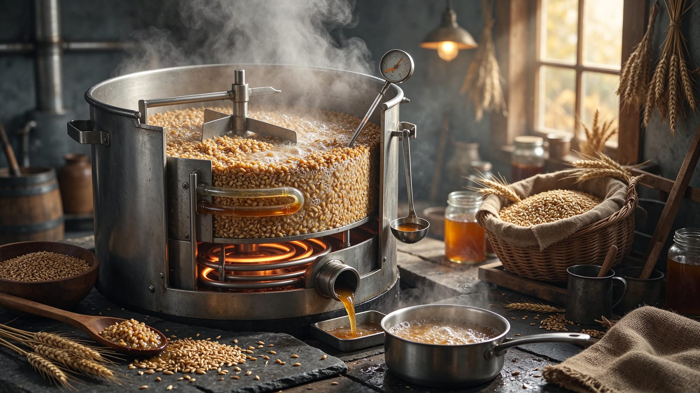

# 糖化

糖化（saccharification）把谷物中的淀粉拆成酵母能利用的糖。淀粉本身是葡萄糖的聚合物，颗粒被蛋白质与脂质包裹，直接加酵母几乎不会发酵。只有先糊化、再经酶水解为葡萄糖、麦芽糖与麦芽三糖，糖才能进入[发酵](ref:fermentation)。啤酒、威士忌、白酒与清酒都绕不开这一步，差别在于酶从哪来、在什么介质里作用。

图：谷物糖化的编辑插图：蒸煮罐、蒸汽、加热结构与取样；AI 辅助绘制，不是工厂实拍。 图片：Hejiu 编辑团队，项目自有。

## 工序定位

糖化夹在原料准备与发酵之间。上游是麦芽制备或蒸粮、[制曲](ref:qu-making)，下游是过滤、冷却与接种。它既包括淀粉的物理糊化，也包括酶的水解，因此不能简单理解为“加热溶解”。在啤酒厂，糖化与麦汁过滤常被合称糖化车间；在白酒厂，蒸粮、摊晾、加曲与入窖构成另一套节奏，糖化与发酵往往在同一窖池内并行。

## 步骤与参数

啤酒的典型参数是：料水比 2.5–4 L/kg，糖化 pH 5.2–5.5；62–65 °C 休止 30–60 分钟，让 β-淀粉酶把淀粉切成麦芽糖；70–72 °C 休止 20–40 分钟，让 α-淀粉酶继续糊精化；75–78 °C 进行糖化终止。上述区间是本页参考资料中酿造工具书与行业协会资料的常见表述，酒厂会按麦芽溶解度和目标酒体调整。白酒的蒸粮在常压蒸汽下约 100 °C，清酒蒸米约 40–60 分钟，米曲培养常控制在 30–38 °C。

## 机制：糊化与酶解

糊化是淀粉颗粒吸水、结晶区崩解、直链与支链淀粉变得可被酶接近的过程。大麦淀粉的糊化温度大致在 60–65 °C 起步，因此糖化休止必须落在糊化之后。α-淀粉酶随机切断 α-1,4 糖苷键，把长链切成糊精，降低醪液黏度；β-淀粉酶从非还原端逐个切下麦芽糖，决定可发酵糖的比例；极限糊精酶处理分支点。曲霉与根霉分泌的葡萄糖淀粉酶则能从链端切出葡萄糖，这就是白酒与清酒可以“边糖化边发酵”的酶学基础。

## 设备与变体

啤酒厂使用辊式粉碎机、糖化锅、过滤槽或压滤机、煮沸锅与板式冷却器；浸出糖化法靠单一或分段升温，煮出糖化法取出部分醪液煮沸再并回，适合溶解不足的麦芽。威士忌多用半滤式糖化槽，追求清澈麦汁与可发酵性。白酒使用甑桶、摊晾床与窖池，清酒使用连续蒸米机与曲室。设备差异影响升温速率、氧化程度与过滤效率，把啤酒糖化线直接套到固态白酒上并不可行。

## 失败模式与判断

最常用的终点判据是碘液显色：滴入碘液后仍呈蓝黑，说明还有淀粉残留；呈红棕或黄色，说明糊精化基本完成。糖化不足会表现为出糖率低、麦汁比重不达标、发酵后残糖异常；糖化过度则让酒体变薄、泡沫支撑变差。过滤困难常来自麦芽溶解不足、粉碎过细或休止温度过高；pH 高于 5.8 时，多酚与硅酸盐溶出增加，带来涩味与浑浊。上述现象需要与原料批次和糖化曲线对照，不能只凭单一指标归因。

## 对风味的影响

糖谱决定酒精与残糖的比例，也决定口感厚度。可发酵糖比例高，成品更干、酒精感更突出；糊精比例高，酒体更饱满、泡沫更持久，但残糖也可能带来甜腻。高温休止偏向糊精，低温休止偏向麦芽糖。麦芽的烘烤度还会带入面包、饼干、焦糖与坚果气息。在[啤酒](ref:beer)中，糖化温度是调节酒体的主要旋钮；在[威士忌](ref:whisky)中，它影响发酵效率与蒸馏前的香气基础；在[白酒](ref:baijiu)中，蒸粮的熟度与曲的酶活决定粮香与出酒率。

## 对稳定性的影响

糖化决定的可发酵糖与糊精比例，会一路影响微生物稳定性。残糖偏高而装瓶前未做稳定处理，瓶中可能再次发酵；糊精过多则增加冷混浊与微生物营养来源。糖化 pH 过高会溶出更多多酚，增加后期蛋白质-多酚浑浊的风险；pH 过低则抑制酶活，延长糖化时间。清酒与白酒的固态醪液水分低，糖化与发酵同步，酸败风险更多来自温度失控与杂菌，而不是糖化终点本身。

## 常见误区

第一，把糖化当成“把淀粉煮化”，忽略酶解需要特定温度窗口。第二，认为温度越高出糖越多，实际上超过 80 °C 后酶迅速失活。第三，只看碘液颜色就判定完成，忽略不同谷物糊化温度的差异。第四，把未发芽谷物直接大量替代麦芽，却不补酶，导致糖化无力。第五，把糖化与发酵混为一谈，无法解释固态白酒为何能边糖化边发酵。

糖化是把淀粉分解为可发酵糖的工序：麦芽酶、曲霉酶与温度、pH、料水比共同决定糖谱。糖化不足，发酵缺糖、出酒率低；糖化过度或温度失控，可能带来糊味与过滤困难。它是发酵的前置条件，不等于“加糖”，也不能只看最终酒精度判断做得是否好。

## 另见

- [发酵](ref:fermentation)：糖进入酵母代谢后的乙醇与风味生成。
- [制曲](ref:qu-making)：曲霉与根霉提供糖化酶的中国路径。
- [啤酒](ref:beer)、[威士忌](ref:whisky)、[白酒](ref:baijiu)：三种不同介质下的糖化组织方式。

对照阅读：[发酵](ref:fermentation)、[啤酒](ref:beer)。

**关键事实。**

| 项目 | 内容 |
| --- | --- |
| 一句话定位 | 把谷物等原料中的淀粉分解为可发酵糖的工序；麦芽酶、曲霉酶与温度、pH、料水比共同决定糖谱，并影响酒体、出酒率与发酵能否顺利收尾 |
| 适用对象 | 啤酒、威士忌、白酒 |

**来源与边界。** 本页关于「糖化」的关键事实，主要由以下来源交叉核对：国家市场监督管理总局、国家标准化管理委员会（白酒糖化、制曲与发酵工艺术语）、Oxford University Press（提供关于糖化、酶与麦芽糊化参数的条目）、Encyclopaedia Britannica（提供关于麦芽粉碎、糖化与过滤的条目）等 5 条来源。价格、批次与状态会变，涉及这些字段时以页面所列来源的最新版本为准。正文为项目自写，来源只作核验，不复制原文。

**并读。** 把「糖化」与「发酵」、「制曲」、「啤酒」放在一起读时，先确认它们是同一层级还是上下游关系：先确认目的与步骤，再比较设备、温度、时间与副产物。本页负责给出工艺的基本坐标，对照条目补上具体案例与差异；读完再回到本页，才能分清哪些差别属于工艺本身，哪些只是产地、批次或品牌选择。
