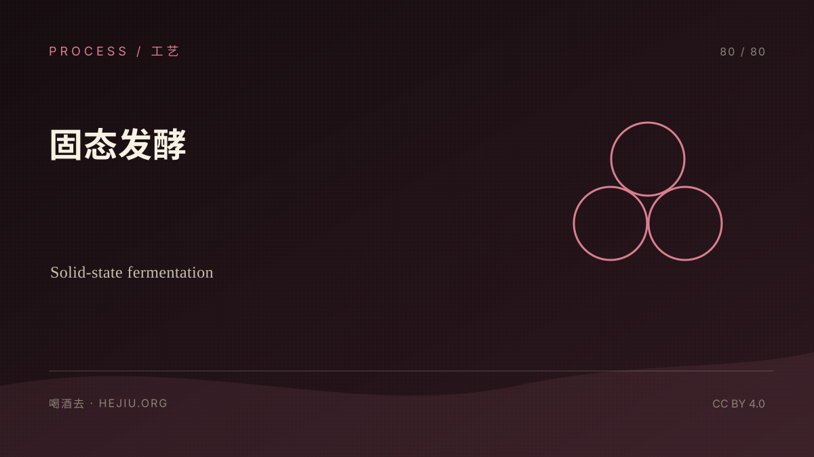

# 固态发酵

固态发酵是白酒[发酵](ref:fermentation)的一种形态：发酵基质含水率较低，粮醅以固态存在，微生物在粮粒、曲粉与填充料构成的疏松体系中生长。中国白酒的固态法白酒以此为核心，GB/T 15109-2021《白酒工业术语》与 GB/T 17204-2021《饮料酒术语和分类》给出了相关术语与分类框架。

图：固态发酵 类型示意图。图片：Doubao Seedream 5.0 AI 辅助绘制（项目自有），不是固态发酵的实拍。

## 定义与边界

按发酵基质的形态，行业通常区分固态法、半固态法与液态法。固态法的酒醅不呈流动状态，靠翻拌、装甑与容器结构维持透气；半固态法与液态法则让醪液在液相中发酵，传质更均匀、生产效率更高。

三者是不同的工艺路线，不是“传统”与“现代”的道德标签。GB/T 15109-2021 的修订与配套标准明确，固态法白酒不得添加食用酒精及非自身发酵产生的呈色呈香呈味物质；这条边界回答的是“能不能叫固态法白酒”，不是“哪种工艺更好喝”。

## 工艺位置

固态发酵不是孤立的一步，而是一串工序的中段：原料经润料、蒸煮糊化，摊凉后加曲拌醅，再入窖、入缸或入槽发酵。发酵结束后，酒醅进入[蒸馏](ref:distillation)，部分工艺还会把粮与酒同蒸，或采用续糟、回醅等方式循环使用酒醅。

[制曲](ref:qu-making)决定糖化与发酵的微生物基础；[堆积发酵](ref:stacked-fermentation)则是在入窖前让酒醅在开放环境中升温、扩培。酱香型白酒的高温堆积、浓香型白酒的泥窖固态发酵、清香型白酒的地缸发酵，都是固态发酵在不同容器与温控条件下的具体形态。

## 容器与形态

常见容器包括[泥窖](ref:fermentation-pit)、石窖、地缸与砖窖。泥窖强调窖泥中长期培养的微生物群落，通常与浓香型白酒联系紧密；石窖常用于酱香型白酒；地缸把陶缸埋入地下，强调隔离、洁净与温度缓冲。

容器不是唯一变量。原料粉碎度、入窖水分、酸度、淀粉含量、曲的用量与培菌状态、环境温度，都会改变发酵进程。把“某种容器”直接等同于“某种风味”，会忽略这些参数。

## 微生物与风味

固态体系的微生物来源是复合的：曲带入霉菌、酵母与细菌，窖泥或缸壁提供长期定殖的菌群，环境空气与操作工具也会参与接种。开放式的操作让菌群具有本地性，也让批次差异更难完全消除。

风味物质的生成发生在发酵与蒸馏两个阶段。发酵阶段产生醇、酸、酯、醛等前体与中间产物；蒸馏阶段按沸点与溶解度把它们分级收集。固态基质的不均匀性会让不同层次、不同位置的酒醅呈现差异，这正是“分层取酒”“量质摘酒”存在的理由。

固态发酵的质量控制，最终落在入池与出池的一组化验指标上：水分、酸度、淀粉含量、酒精度与发酵升温曲线。入池水分偏高，升温快、香气容易发闷；水分偏低，糖化与发酵不充分，出酒率下降。酸度既抑制杂菌，也为酯类合成提供前体，过高则会抑制酵母。生产上把这些指标与入池温度、曲粉用量、粮醅比一起记录，作为下一轮配料与续糟的依据。[发酵](ref:fermentation)的通用原理在这里表现为“以温定水、以酸控温”的经验规则，具体限值因香型、季节与厂规而异，应以企业工艺文件与执行标准为准。

## 与液态法的比较

液态法发酵的传质、传热更均匀，温度与酸度更容易控制，适合大规模稳定生产；固态法的操作更依赖人工经验，批次波动更大，但能提供更复杂的香气层次与口感结构。

两种路线各有适用场景。用“固态一定优于液态”做绝对判断，既不准确，也不利于理解产品差异。更可靠的做法是看标签上的执行标准、产品类型与生产者说明，再结合自己的风味偏好。

## 常见误区

第一，把固态发酵等同于“纯粮”。原料是否纯粮、是否添加其它物质，要看执行标准与标签，不由“固态”二字自动保证。
第二，把地缸、泥窖、石窖混为一谈。容器不同，微生物来源与温控方式不同。
第三，认为固态法一定更香。香气复杂度与工艺管理有关，管理与原料不到位时，固态法也可能出现杂味。
第四，把“传统工艺”当成质量等级。传统描述的是工艺路径，不是评分。
第五，忽略蒸馏对风味的二次塑造。发酵得到的只是基础，摘酒与勾调同样决定成品。

对照阅读：[白酒](ref:baijiu)、[堆积发酵](ref:stacked-fermentation)。

## 延伸阅读

- [白酒](ref:baijiu)：固态发酵所在的酒种框架。
- [制曲](ref:qu-making)：微生物与酶系的来源。
- [堆积发酵](ref:stacked-fermentation)：酱香型白酒入窖前的开放培菌环节。
- [发酵](ref:fermentation)与[蒸馏](ref:distillation)：固态发酵的前后工序。
- [泥窖](ref:fermentation-pit)：浓香型白酒的典型容器。
- [高粱](ref:sorghum)：固态法白酒最常见的原料之一。

**来源与边界。** 本页关于「固态发酵」的关键事实，主要由以下来源交叉核对：国家市场监督管理总局、国家标准化管理委员会（固态发酵、固态法白酒与相关工艺术语的边界；未复制标准正文；饮料酒分类中发酵酒、蒸馏酒与配制酒的框架；未复制标准正文）、新华网（固态法白酒不得添加食用酒精及非自身发酵产生的呈色呈香呈味物质的公开表述）、中国酒业协会（行业对固态法、半固态法与液态法的通用表述；未复制协会文本）等 6 条来源。价格、批次与状态会变，涉及这些字段时以页面所列来源的最新版本为准。正文为项目自写，来源只作核验，不复制原文。

**并读。** 把「固态发酵」与「白酒」、「制曲」、「堆积发酵」放在一起读时，先确认它们是同一层级还是上下游关系：先确认目的与步骤，再比较设备、温度、时间与副产物。本页负责给出工艺的基本坐标，对照条目补上具体案例与差异；读完再回到本页，才能分清哪些差别属于工艺本身，哪些只是产地、批次或品牌选择。

**适用边界。** 对「固态发酵」而言，设备、温度与时间参数随生产商变化；本页说明目的与原理，不是操作手册。

**更新提示。** 「固态发酵」最近核对于 2026-11-05；设备、温度、时间与操作细节会因工艺版本不同，实践前以设备说明与专业文献为准。

**编者注。** 本页把「固态发酵」作为工艺条目处理：定义、流程与关键数字以正文表格为准，与「白酒」、「制曲」的差异用对照阅读验证；遇到价格、批次或地址，回到页面所列来源核对。
