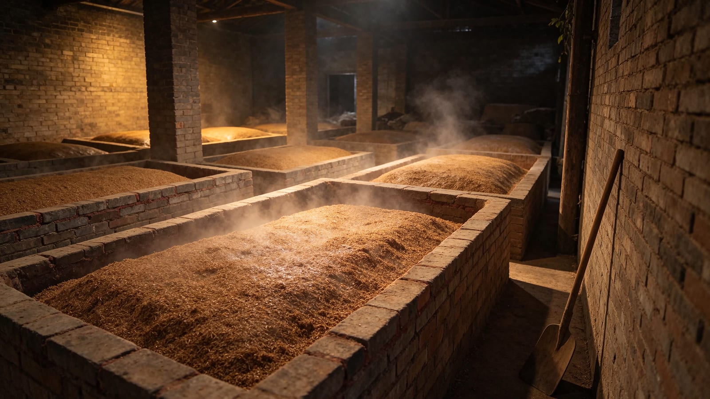

# 堆积发酵

堆积发酵是白酒生产中的一个开放式工艺环节，指把拌曲后的物料在入池发酵前堆放一段时间。GB/T 15109-2021《白酒工业术语》给出的定义正是“将入池发酵前的物料堆放一定时间的工艺过程”。它最常与酱香型白酒联系在一起，但在兼香、芝麻香等工艺路线中也能见到类似安排。

图：堆积发酵的编辑插图：砖砌发酵房中的粮堆与蒸汽；AI 辅助绘制，不是车间实拍。 图片：Hejiu 编辑团队，项目自有。

## 在工艺中的位置

以酱香型白酒的典型流程为例，顺序大致是：蒸煮、摊凉、拌曲、堆积、入窖、封窖、窖内发酵、蒸馏取酒。堆积位于“拌曲之后、入窖之前”，是酒醅从高温、开放的环境过渡到密闭、厌氧环境的中间站。

这个位置决定了它的双重任务：一方面让微生物在醅料中扩大培养，另一方面通过升温与物质转化，为窖内发酵准备更合适的基质。把它看成“发酵前的准备”或“发酵的一部分”都不算错，但它与窖内发酵的环境条件完全不同。

## 目的与原理

堆积的目的通常概括为四点。第一，扩大培养：拌曲后的酒醅在开放环境中网罗空气与场地中的微生物，霉菌、酵母和细菌在醅料中继续繁殖。第二，升温：微生物代谢产热，堆体温度上升，耐热菌群获得优势。第三，物质转化：淀粉适度分解，糖、氨基酸与风味前体在高温条件下发生变化。第四，调节状态：水分、酸度与氧气条件在堆积过程中趋于适合入窖。

这些目的之间并不总是同步。温度升得太快，可能让部分微生物失活；升温不足，则达不到工艺想要的香气基础。因此，堆积不是“堆起来等一等”这么简单，而是需要观察温度曲线与醅料状态的经验环节。

## 操作流程

基本操作包括：拌曲均匀、控制加水量、按一定形状堆料、观察升温、适时翻堆、达到工艺要求后入窖。堆的形状、松紧、高度与场地条件都会影响散热与供氧，进而影响温度分布。

翻堆是关键技术动作。堆体不同部位的温湿度并不一致，翻堆可以让物料重新混合、散热与换气，避免局部过热或长期低温。翻堆时机通常依据温度与感官判断，而不是固定钟点。

## 关键参数

GB/T 10781.4-2024《白酒质量要求 第4部分：酱香型白酒》对酱香工艺给出了可核对的描述：高温大曲制曲最高品温大于 60 °C；高温堆积的顶温最高可达 50 °C 或以上，一个制酒生产周期不少于六个轮次堆积发酵；入窖后密闭发酵，窖宜为石窖泥底，传统为八个轮次窖内发酵，窖内发酵时间不少于 30 天。

这些数字描述的是工艺框架，不是所有企业的统一参数。实际生产中，季节、场地、醅料水分与曲的用量都会让温度曲线出现差异。把标准里的描述当成“唯一正确温度”，反而会误读工艺。

## 与窖内发酵的区别

堆积发酵是开放式的，接触空气，以升温、扩培和物质转化为主要目标；窖内发酵是密闭的，以厌氧产酒和酯化为主。两者在氧气、温度、容器与时间上都不同。

以酱香型白酒为例，堆积通常持续数天，窖内发酵则以月计；堆积结束后要入窖并用窖泥或专用材料封窖，形成厌氧环境。把它们混为一谈，就无法解释为什么同一个轮次里会有两次“发酵”。

## 对风味的影响

堆积阶段形成的微生物群落与代谢产物，会成为后续窖内发酵的起点。高温条件常被用来解释酱香型白酒中的焙烤、坚果与焦香类气味，但风味是制曲、堆积、窖内发酵、蒸馏、贮存与勾调共同作用的结果，不能把某一类香气单独归给堆积。

堆积控制得好，酒醅的香气更丰富、发酵更稳定；控制不好，则可能出现升温过猛、局部烧醅、酸度异常或杂菌污染。风味的差异往往来自这些细节，而不是某个单一名词。

## 常见误区

第一，堆得越高越好。堆体过高会影响散热与供氧，增加局部过热风险。
第二，顶温越高越好。温度超出工艺范围会损伤微生物活性。
第三，所有白酒都要堆积。堆积是特定香型与工艺路线的环节，并非白酒的通用步骤。
第四，堆积结束就等于发酵完成。堆积之后仍要入窖，窖内发酵才承担主要的酒精生成。
第五，只看温度，不看醅料状态。水分、酸度、曲的用量与场地条件同样重要。

对照阅读：[白酒](ref:baijiu)、[窖池](ref:fermentation-pit)。

## 延伸阅读

- [酱香型白酒](ref:sauce-aroma)：以高温堆积与多轮次发酵为特征的香型。
- [白酒](ref:baijiu)：白酒的定义、原料与工艺主干。
- [窖池](ref:fermentation-pit)：堆积之后承接窖内发酵的容器。
- [制曲](ref:qu-making)：堆积所用大曲的微生物与酶系基础。
- [发酵](ref:fermentation)：发酵的一般原理与工艺框架。
- [茅台酒](ref:moutai)：传统酱香工艺的代表性产品。
- [GB/T 15109-2021《白酒工业术语》](ref:gbt-15109)：堆积与轮次定义的来源。

**关键事实。**

| 项目 | 内容 |
| --- | --- |
| 一句话定位 | 把拌曲后的酒醅在入窖前堆放一段时间、借助自然升温扩大培养微生物的开放式工艺环节，常见于酱香型白酒 |
| 适用对象 | 白酒、酱香型白酒 |

**来源与边界。** 本页关于「堆积发酵」的关键事实，主要由以下来源交叉核对：国家市场监督管理总局、国家标准化管理委员会（堆积、轮次与下沙等术语定义；未复制标准正文；高温大曲、高温堆积与窖内发酵的工艺描述；未复制标准正文）、贵州省市场监督管理局（标准发布、实施日期与工艺要点；未复制解读原文）、中国贵州茅台酒厂（集团）有限责任公司（传统工艺中堆积与轮次的表述）等 5 条来源。价格、批次与状态会变，涉及这些字段时以页面所列来源的最新版本为准。正文为项目自写，来源只作核验，不复制原文。

**并读。** 把「堆积发酵」与「白酒」、「酱香型白酒」、「窖池」放在一起读时，先确认它们是同一层级还是上下游关系：先确认目的与步骤，再比较设备、温度、时间与副产物。本页负责给出工艺的基本坐标，对照条目补上具体案例与差异；读完再回到本页，才能分清哪些差别属于工艺本身，哪些只是产地、批次或品牌选择。
