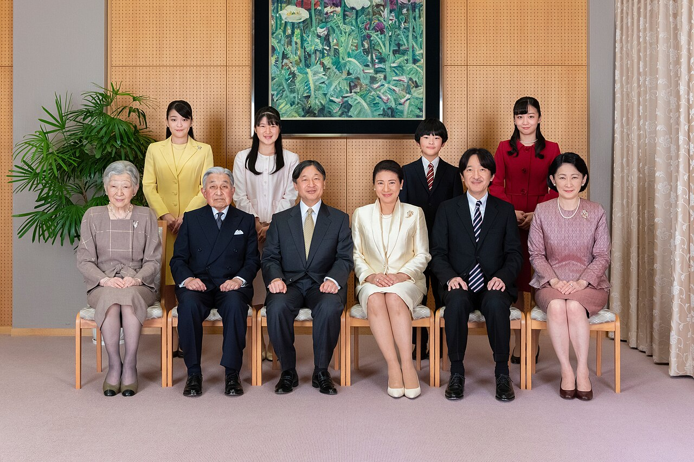

# 王朝酒业

王朝酒业（Dynasty Fine Wines Group，股份代号 828）是 1980 年在天津成立的中法合营葡萄酒企业的延续。它先是一家有明确股东、有厂区、有定期披露义务的上市公司，其次才是货架上的“王朝”葡萄酒。阅读这家企业，需要把股东层、上市公司层、生产厂址与具体产品分开，否则很容易用一句“老牌合资企业”覆盖掉四十多年的结构变化。

图：王朝酒业。图片：日本国政府，CC BY 4.0，via Wikimedia Commons（[原图页面](https://commons.wikimedia.org/wiki/File:The_Imperial_Family_of_Japan,_2021.jpg)）。

> **先给结论**
> **一句话：** 这页判断王朝酒业的工艺特点，以及参观能看到什么。
>
> - **适合谁：** 想了解王朝酒业的工艺、产品和参观边界的人。
> - **不适合谁：** 只想要购买链接、不关心工艺和参观规则的人。
> - **先看这两点：**
>   - 上市公司主体为王朝酒业集团有限公司，在香港联合交易所主板上市，股份代号 828。
>   - 2025 年中期报告披露，截至 2025 年 6 月 30 日，天津食品集团有限公司持有 42.80% 股份，人头马亚太有限公司持有 23.90%，其余为公众股东。

## 公司身份与上市地

上市公司主体为王朝酒业集团有限公司，在香港联合交易所主板上市，股份代号 828。注册地与主要生产基地位于天津，业务涵盖葡萄种植、葡萄酒酿造、灌装与销售，产品以“王朝”品牌进入内地市场及部分海外市场。

公司层与产品层不是同一回事。讨论股权、董事会与定期报告时，指向的是上市主体；讨论某个酒庄、某条灌装线或某个系列时，指向的是下属经营主体。瓶标上的生产商会写明全称与地址，这是核对责任主体的第一手信息。

## 股权结构：天津食品与人头马

2025 年中期报告披露，截至 2025 年 6 月 30 日，天津食品集团有限公司持有 42.80% 股份，人头马亚太有限公司持有 23.90%，其余为公众股东。两者合计构成公司的核心股东结构。

这组比例说明两件事。第一，王朝的控股权在天津地方国资体系内，经营决策与地方产业政策关联紧密；第二，法国人头马方面仍保留重要少数股权，合资基因没有消失。持股比例会随增发、回购与股东增减持变化，引用时必须标注报告期，不能用旧比例描述当前结构。

## 1980 年合资起点

1980 年，天津方面与法国方面合资设立中法合营王朝葡萄酿酒有限公司，这是改革开放后较早的葡萄酒合资项目之一。当时国内葡萄酒以甜型、半甜型为主，合资厂引入干型酒工艺、进口设备与酒庄管理概念，也带来葡萄品种与栽培技术的更新。

合资的意义不只是资本。它把“酒庄”“年份”“品种”这些概念带入国内渠道，也训练了第一批掌握现代酿造流程的技术人员。把这段历史简单写成“引进法国技术”，会漏掉组织方式与市场教育层面的变化。

## 从合资厂到上市公司

1990 年代，王朝扩建产能、丰富产品线，在干白之外增加干红与起泡酒。此后企业完成股份制改造，并在香港上市，取得独立融资渠道。上市带来的变化是信息披露、公司治理与投资者关系，而不只是资金。

从合资厂到上市公司，组织形式至少变了三次：合资经营企业、股份有限公司、上市集团。三层结构叠加在同一条产品线上，容易被简化，从而忽略不同阶段的责任主体与披露口径。

## 天津产区与厂区

天津位于华北平原东部、海河流域下游，属暖温带半湿润季风气候，生长季热量充足，采收期降雨集中。葡萄园主要分布在天津郊区与周边县市，主栽品种包括霞多丽、贵人香、赤霞珠与梅洛。

厂区承担发酵、陈酿、灌装与仓储。葡萄酒的产地表达看葡萄来源，而不是灌装地；同一厂区可以处理不同产区的原料，标签上的“产地”与“生产商地址”要分别阅读，不能互相替代。

## 产品结构与产能

产品覆盖[干白](ref:white-wine)、[干红](ref:red-wine)、半干、甜型与[起泡酒](ref:sparkling-wine)，价格从日常餐酒延伸到礼盒装。干白是王朝的传统强项，干红随市场结构变化而扩充，起泡酒始终是较小的品类。

产能由发酵罐、储酒罐、灌装线与仓储共同决定，实际产量还受原料供应与订单节奏约束。企业披露的产能是设计口径，与某一年份的实际产量不是一回事，讨论“产能利用率”时要看清统计年份。

## 2025 年经营表现

2025 年全年业绩公告于 2026 年 3 月 26 日发布，基本每股盈利 0.97 港仙，上一年度为 2.37 港仙。2025 年中期报告显示，现金及现金等价物为 85,600 千港元，负债资产比率由 44% 降至 34%。

这些数字描述的是上市公司整体，不是某个产品系列。盈利下滑与行业需求、渠道库存和产品结构有关，单看一年的每股盈利不足以判断长期竞争力，需要结合收入、毛利率与现金流一起读。

## 渠道与销售组织

王朝长期依赖餐饮、商超、团购与经销体系，礼盒与宴席场景占比高。这种结构带来较强的区域品牌认知，也让销售更容易受渠道库存与促销节奏影响。

销售组织按区域与渠道划分，经销商承担铺货与终端维护，厂家负责品牌投入与价格管理。渠道层级越多，价格秩序越难统一，窜货与低价冲击是国产葡萄酒企业共同面对的难题。

## 治理与关联交易

作为香港上市公司，王朝须按上市规则披露董事、主要股东、关联交易与持续关连交易。与股东方之间的采购、销售或品牌授权，若达到披露门槛，会在公告中列明具体内容与金额。

治理结构的关键不是董事人数，而是股东、董事会与管理层之间的权责边界。国资股东、外资股东与公众股东同时存在，重大事项需要平衡三方诉求，决策节奏因此与纯民营企业不同。

## 争议与风险

第一是需求端压力。国产葡萄酒整体产量与消费处于调整期，进口酒与白酒挤压了佐餐酒场景。第二是产品结构，干白占比高既是特色，也意味着对白葡萄酒消费习惯的依赖。第三是股东关系，外资少数股权的长期安排存在不确定性。第四是品牌老化，年轻消费者对“王朝”的认知弱于上一代。

这些风险不构成对企业的定性判断，只是阅读财报与新闻时应当保留的观察角度。把风险写成结论，或者把宣传写成事实，都不适合百科条目。

## 与品牌页的分工

本页处理的是公司层：股东是谁、在哪上市、厂区在哪、报表怎么读。品牌页处理的是产品层：定位、系列、价格带、包装与消费者认知。两者混写，会出现“用股权结构解释酒体风格”或“用产品广告解释公司治理”的错位。

同名条目在不同层级同时存在，是这套内容结构的有意设计。读到“王朝”二字时，先确认说的是上市公司、生产企业还是某一瓶酒，再判断信息是否适用于当前问题。

## 常见误解

第一，把“中法合营”当成法国品牌。王朝在中国注册、在中国生产，法国方是股东与技术合作方。
第二，把上市公司等同于集团全部业务。报表口径只覆盖上市主体。
第三，把灌装地当葡萄产地。原料可能来自合同基地或外购。
第四，用某一年每股盈利判断企业好坏。需要看多年趋势与现金流。
第五，认为股权比例一成不变。比例随报告期变化，引用必须注明日期。

对照阅读：[中国](ref:china)、[红葡萄酒](ref:red-wine)。

## 延伸阅读

- [中国](ref:china)：葡萄酒产业的宏观背景。
- [葡萄酒](ref:wine)：大类、产地与标签规则。
- [红葡萄酒](ref:red-wine)与[白葡萄酒](ref:white-wine)：王朝的主要产品类型。
- [起泡酒](ref:sparkling-wine)：二次发酵工艺。
- [发酵](ref:fermentation)与[橡木桶陈年](ref:oak-ageing)：影响风格的关键环节。

**关键事实。**

| 项目 | 内容 |
| --- | --- |
| 一句话定位 | 1980 年在天津成立的中法合营葡萄酒企业的延续，现为在香港上市的王朝酒业集团，股份代号 828；截至 2025 年 6 月 30 日，天津食品集团持股 42.80%、人头马亚太持股 23.90% |
| 成立 | 1980 |
| 类型 | 葡萄酒生产企业（上市公司） |
| 官网 | dynasty-wines.com |
