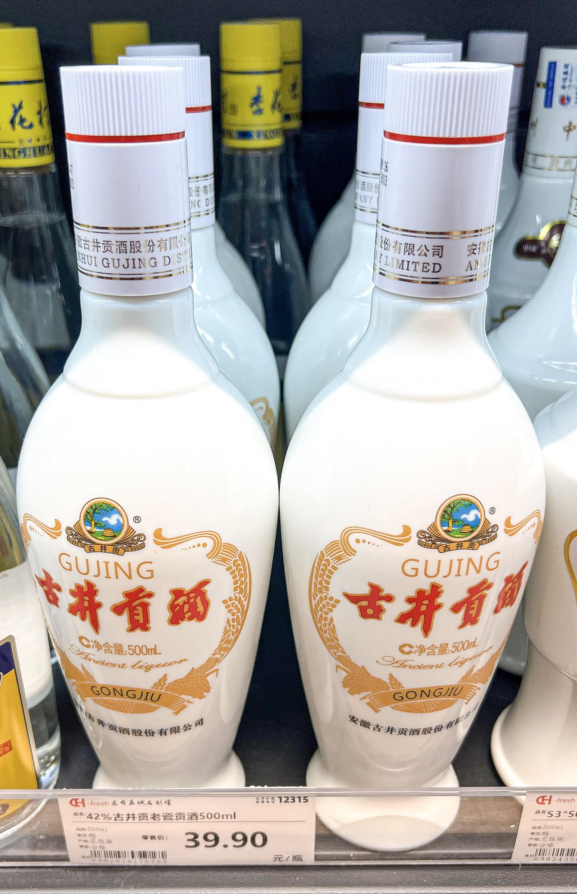

# 安徽古井贡酒股份有限公司

安徽古井贡酒股份有限公司是一家以白酒生产和销售为主业的上市公司，注册地址与办公地址均在安徽省亳州市古井镇。公司公开披露资料显示，其 A 股代码为 000596，B 股代码为 200596，均于 1996 年在深圳证券交易所上市。

图：安徽古井贡酒股份有限公司相关实景照片。图片：N509FZ，CC BY-SA 4.0，via Wikimedia Commons（[原图页面](https://commons.wikimedia.org/wiki/File:Gujing_Gongjiu_at_a_supermarket_in_Beijing_(20241109164639).jpg)）。

## 公司身份

本页记录生产者身份：公司名称、注册地、上市信息与主营业务。它不评价具体产品的风味，也不复制企业的宣传文案。公司层面的可核实信息与品牌故事、产品品鉴分属不同层级，混在一起会让读者误把叙事当作事实。

“古井贡酒”既是品牌，也是公司名称的一部分。公司持有品牌，但品牌的市场表达由产品线承载。理解这种关系，可以避免把“公司上市”直接等同于“某一款酒更好”。

## 上市与治理

A 股与 B 股同时上市，意味着公司需要按监管要求披露定期报告、关联交易与重大事项。公开披露资料是核对公司身份与经营信息的可靠来源，但披露内容不等于产品品质评价。

公司治理结构、管理层与股权信息会随时间变化，本页不逐一列举，以免过期信息误导。读者应以交易所与公司公告的最新版本为准。涉及投资判断，本页不提供任何建议。

## 生产与厂址

公司生产与办公地址位于亳州市古井镇。古井镇是浓香型白酒的核心产地，水源、窖池与制曲环境构成生产基础。具体厂区布局、产能与工艺参数属于企业信息，公开资料有限。

生产主体与产地是两个概念：公司注册在古井镇，不等于所有产品都在同一厂区灌装；代工、分装与不同生产基地的情况应以标签上的生产厂址为准。标签信息是消费者核对产地最直接的方式。

厂区内的制曲、酿酒、贮存与灌装环节相互衔接，形成较长的生产周期。白酒生产对水质、蒸汽与电力有稳定需求，规模企业通常自建或联建配套设施，这也是产业集聚形成的原因之一。

## 品牌与产品层级

[古井贡酒](ref:gujing)是公司体系内的品牌，具体产品线和规格属于其他实体。品牌记录负责名称、品牌关系与对外入口；产品记录负责具体产品、酒精度、规格与所属品牌；本页只保留公司层面的可核实信息。

这种分层不是为了增加复杂度，而是为了避免把“公司—品牌—产品”混为一谈。公司可以拥有多个品牌，品牌可以拥有多个系列，系列下还有不同度数与容量的产品。层级清楚，信息才可核对。

## 与产区的关系

公司位于[亳州市](ref:bozhou)，属于安徽白酒产区的一部分。亳州的药业与酒业并存，形成了独特的产业面貌；产区页对地理、气候与产业有更完整的说明。

[浓香型白酒](ref:strong-aroma)的窖池与续糟工艺，是产区传统的一部分。公司在这一传统之上组织生产与品牌运营。产区不是单一因素，气候、水、原料、工艺与长期实践共同作用，企业则负责把这些条件转化为稳定产品。

## 参访与地点

公司所在的亳州还有独立的参访地点记录：[古井酒文化博物馆](ref:museum)。博物馆是地点实体，与生产者通过关系连接；“公司在此地”不等于“博物馆当前开放”，开放信息以地点页来源与官方公告为准。

参访时尊重厂区与博物馆规定，不进入未开放区域，不拍摄禁止拍摄的设施。涉及购买，应通过正规渠道并核对防伪信息。本页不提供开放时间、门票或交通承诺，以免过期信息造成误导。

## 公开信息的边界

本页只写可核实的公司身份、地址、上市信息与层级关系。营收、利润、股价、产能与市场份额等数据会随时间变化，且需要完整上下文，因而不在本页展开。读者应查阅公司定期报告与监管披露。

“中华老字号”“名牌”等称号需要具体颁发机构与年份才能核实，本页不将其作为事实陈述。品牌历史中的传说性内容，应与可核实的档案分开呈现。

## 常见误区

第一，把公司上市等同于产品品质。两者不是同一层面的判断。
第二，认为公司名称就是品牌。公司、品牌与产品是三个层级。
第三，把注册地等同于所有产品的产地。应以标签上的生产厂址为准。
第四，用宣传文案替代公开披露。两者性质不同。
第五，把博物馆参访当作生产参观。展览与生产区域并不相同。

对照阅读：[亳州市](ref:bozhou)、[古井贡酒](ref:gujing)。

## 延伸阅读

- [古井贡酒](ref:gujing)：公司体系内的品牌与产品入口。
- [亳州市](ref:bozhou)：产区地理、产业与参访信息。
- [古井酒文化博物馆](ref:museum)：参访地点与展览信息。
- [浓香型白酒](ref:strong-aroma)：产区传统所依托的工艺框架。

**关键事实。**

| 项目 | 内容 |
| --- | --- |
| 一句话定位 | 位于安徽省亳州市古井镇的白酒生产企业，古井贡酒品牌的生产主体；本页区分公司身份、品牌与具体产品 |
| 成立 | 1996 |
| 类型 | 上市公司 |
| 官网 | gujing.com |

**来源与边界。** 本页关于「安徽古井贡酒股份有限公司」的关键事实，主要由以下来源交叉核对：巨潮资讯网上市公司公开资料（公司身份、注册地址与上市信息）、安徽古井集团（企业与品牌公开信息）、亳州市人民政府（参访地点公开信息）等 7 条来源。产品、地址或营业状态变化较快时，以 gujing.com 的最新页面为准；价格、批次与状态会变，涉及这些字段时以页面所列来源的最新版本为准。正文为项目自写，来源只作核验，不复制原文。

**并读。** 把「安徽古井贡酒股份有限公司」与「亳州市」、「古井酒文化博物馆」、「古井贡酒」放在一起读时，先确认它们是同一层级还是上下游关系：先确认企业与产品线，再比较产区、工艺与价格带。本页负责给出生产商的基本坐标，对照条目补上具体案例与差异；读完再回到本页，才能分清哪些差别属于生产商本身，哪些只是产地、批次或品牌选择。

**适用边界。** 对「安徽古井贡酒股份有限公司」而言，企业结构、资产与品牌组合会变；历史年份与当前运营要分开看。
