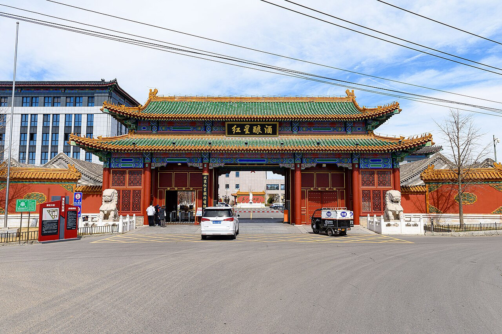

# 北京红星股份有限公司

北京红星股份有限公司位于北京市怀柔区，是一家以白酒为主业的生产企业。它的前身是 1949 年 5 月成立的华北酒业专卖公司实验厂，是北京第一家国营酿酒厂，主要产品属[白酒](ref:baijiu)，代表产品见[红星二锅头蓝瓶](ref:blue-bottle)与[红星](ref:brand)品牌条目。

图：北京红星股份有限公司。图片：N509FZ，CC BY-SA 4.0，via Wikimedia Commons（[原图页面](https://commons.wikimedia.org/wiki/File:Beijing_Red_Star_Distillery_(20250321124229).jpg)）。

## 公司身份

本页记录生产者层级：企业名称、厂址、成立时间与组织形式。红星股份是生产与经营主体，承担商标持有、产品生产与市场销售；讨论“红星”时，要先分清说的是公司、品牌还是一瓶酒。

公开资料把企业的直接起点定在 1949 年 5 月。此前北京的二锅头酿造以私营烧锅为主，1949 年建厂后，企业收编源升号等十二家老酒坊，把分散的作坊技艺集中到国营酒厂。这个“收编”过程，是理解红星技艺来源的关键。

## 产区与厂址

北京位于华北平原北端，潮白河与永定河冲积平原提供了粮食与水源条件。二锅头工艺在北京形成并延续，城区老厂址位于建国路一带，如今只保留红星大厦；主要生产区域在怀柔区，北京二锅头酒博物馆也建在怀柔红星路 1 号。

“产区”在这里不只是地理概念，也是城市与工艺的关系。北京并非传统意义上的白酒主产省，但二锅头以清香路线、爽冽口感和大众价格带，形成了独立的地方酒类传统。

## 品牌与产品

企业的主要品牌是[红星](ref:brand)，产品以二锅头为核心，覆盖不同度数、容量与价格带。[红星二锅头蓝瓶](ref:blue-bottle)是其中流通面较广的产品之一，常见 43% vol、500 mL，属清香型路线。

企业也生产其他系列与礼盒产品。不同产品线的香型、执行标准与原料结构可能不同，不能用一款产品的风格概括整个企业。购买时应回到瓶身标签核对生产商、香型、酒精度、净含量与执行标准。

## 工艺传统

北京二锅头酒传统酿造技艺的核心，是“掐头去尾取中段”。蒸馏时第一次流出的酒（酒头）与最后流出的酒（酒尾）单独处理，取中间段作为成品基酒；传统上以第二次换入冷水后流出的酒为准，“二锅头”由此得名。

红星公开资料描述的工艺路径是：以红高粱为原料，大麦、豌豆制成的大曲为糖化发酵剂，采用混蒸混烧、老五甑工艺，低温流酒、看花接酒，再经陶坛贮存与勾调。这套路径与清香型白酒的“清蒸清烧”传统相通，但具体参数因产品线而异。

2008 年，红星申报的“北京二锅头酒传统酿造技艺”入选国家级非物质文化遗产名录。非遗认定针对的是技艺与传承人体系，不等于对某一瓶酒的质量评级。

## 历史沿革

1949 年 5 月，华北酒业专卖公司实验厂成立，随后酿出第一批红星牌二锅头，作为新中国成立献礼；公开资料称红星是唯一参加开国大典的酒企。此后企业逐步整合北京二锅头生产资源，形成以二锅头为核心的产品体系。

2008 年，二锅头传统酿造技艺列入国家级非遗，红星原厂长高景炎被认定为该技艺的国家级代表性传承人。此后企业通过博物馆、工业旅游与产品线扩展，把这套技艺转化为可参观、可体验的公共文化资源。

## 时间线

- 1680 年：赵氏三兄弟创办源升号，改革烧酒工艺，被后世视为二锅头工艺的源头。
- 1949 年：华北酒业专卖公司实验厂成立，收编十二家老酒坊，酿出第一批红星二锅头。
- 2008 年：北京二锅头酒传统酿造技艺入选国家级非物质文化遗产名录。

## 参访信息

北京二锅头酒博物馆位于北京市怀柔区红星路 1 号，由企业建设，以展示二锅头传统酿造技艺为主题，公开资料标注为国家 AAA 级景区。开放时间、预约方式与票价以运营方当期公告为准，本页不提供未经核实的电话或行程报价。

## 常见误区

第一，把 1949 年当作二锅头工艺的起点。工艺源头可溯至 1680 年的源升号，1949 年是国营酒厂的起点。
第二，把“二锅头”当作红星专属。它是工艺与品类名称，其他企业也可生产。
第三，把国家级非遗当作产品质量认证。它针对技艺与传承体系。
第四，把红星只当作光瓶酒企业。企业也有不同价位与礼盒产品。
第五，用价格或包装判断真伪。防伪、渠道与标签更可靠。

北京红星股份有限公司是北京二锅头传统酿造技艺的重要企业，前身与国营酿酒体系有关；它的身份重点是生产商与技艺传承，不是“所有二锅头”的代名词。红星、北京二锅头与具体产品线分属不同层级；读历史时要区分企业成立、技艺认定与品牌推广三条线。

对照阅读：[中国](ref:china)、[红星](ref:brand)。

## 延伸阅读

- [红星](ref:brand)：品牌结构与产品线。
- [红星二锅头蓝瓶](ref:blue-bottle)：具体规格、工艺与风味。
- [白酒](ref:baijiu)：大类与香型体系。
- [二锅头](ref:erguotou)：同类产品的工艺与品类背景。
- [中国](ref:china)：中国酒类版图与产区组织。

**关键事实。**

| 项目 | 内容 |
| --- | --- |
| 一句话定位 | 位于北京市怀柔区的白酒生产企业，前身为 1949 年 5 月成立的华北酒业专卖公司实验厂，是北京第一家国营酿酒厂，以红星二锅头与北京二锅头酒传统酿造技艺闻名 |
| 成立 | 1949 |
| 类型 | 白酒生产企业 |
| 官网 | redstarwine.com |

**来源与边界。** 本页关于「北京红星股份有限公司」的关键事实，主要由以下来源交叉核对：北京红星股份有限公司（1949 年建厂、收编老酒坊与献礼酒表述；由原条目末尾参考资料迁移，未逐条复核访问日期）、北京一轻控股有限责任公司（华北酒业专卖公司实验厂的成立时间与老厂址；由原条目末尾参考资料迁移，未逐条复核访问日期）、北京二锅头酒博物馆（源升号源流与 2008 年国家级非物质文化遗产信息；原料、大曲、老五甑与摘酒方式）。产品、地址或营业状态变化较快时，以 redstarwine.com 的最新页面为准；价格、批次与状态会变，涉及这些字段时以页面所列来源的最新版本为准。正文为项目自写，来源只作核验，不复制原文。
