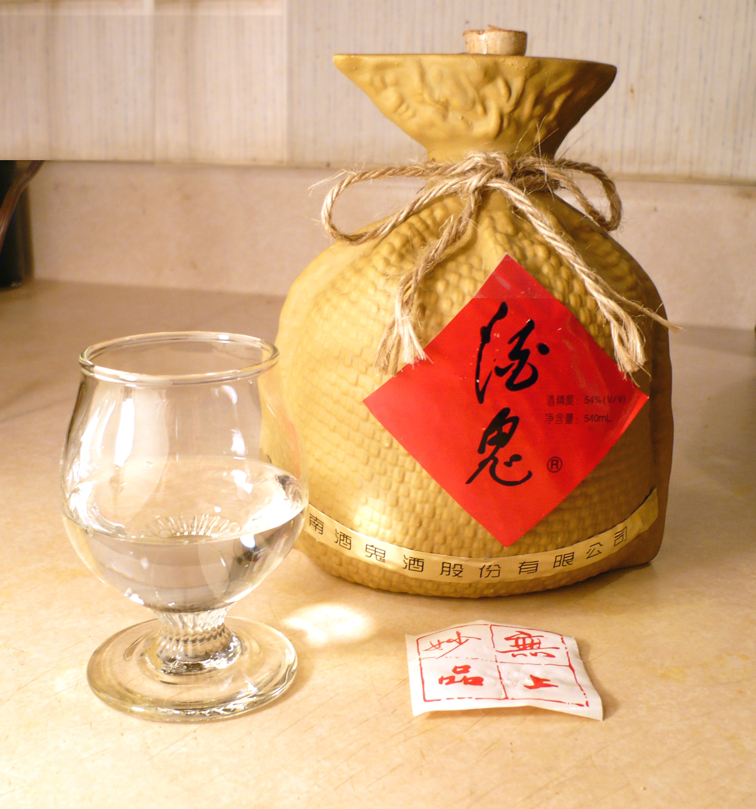

# 酒鬼酒股份有限公司

酒鬼酒股份有限公司是位于湖南吉首的馥郁香型白酒生产企业。公司前身为始建于 1956 年的吉首酒厂，1997 年在深圳证券交易所上市，2016 年成为中粮集团成员企业。企业以“酒鬼酒”为核心品牌，产品包括内参、酒鬼与湘泉等系列。

图：酒鬼酒股份有限公司相关实景照片。图片：Badagnani，CC BY 3.0，via Wikimedia Commons（[原图页面](https://commons.wikimedia.org/wiki/File:Jiugui.jpg)）。

## 公司身份

酒鬼酒的生产者层级要穿过三层：上市公司承担生产、销售与披露，中粮集团通过股权链条实际控制，品牌与具体产品再往下分。讨论“酒鬼酒”时，要先分清说的是上市公司、品牌还是一瓶具体的酒。

“酒鬼酒”既是公司简称，也是品牌名与产品名。讨论时要分清说的是上市公司、品牌还是一瓶具体的酒。公司的注册地在湖南吉首，生产与灌装地点则应按标签核对。

## 产区与厂址

吉首位于湖南西部、武陵山区腹地，属亚热带湿润气候，山地起伏、湿度较高、四季分明。湘西地区多民族聚居，地方饮食与酿酒传统为品牌叙事提供了文化背景。

产区条件影响原料与微生物环境，但不自动决定酒质。馥郁香型的形成依赖原料配比、曲药、窖池与贮存方式，具体工艺属于企业技术体系，不能只用“湘西”两个字概括。

厂址在吉首不等于所有产品都用同一车间或同一批基酒。不同产品线的原料、贮存时间与勾调方案不同，具体信息应以标签与企业公开资料为准。

## 品牌与产品

核心品牌为酒鬼酒，公开产品资料列出的主要系列包括内参、酒鬼与湘泉。内参定位高端，酒鬼覆盖商务与礼赠场景，湘泉面向更广的消费群体。三者共享生产体系，但价格带与渠道不同。

产品线的度数、容量、包装与价格会随年份与渠道调整，部分产品还有纪念版或区域版本。购买时应核对瓶身标签上的产品名称、酒精度、净含量、原料、生产商与执行标准，而不是只看陶瓷瓶或包装造型。

酒鬼酒的品牌组合包括“酒鬼酒”“湘泉”与高端“内参”，价格带从大众到礼赠。品牌名与产品名有时重叠，读标签时应看具体系列与度数；集团与上市公司负责生产与披露，品牌只回答定位。

## 工艺特色

馥郁香型是企业在公开资料中强调的香型定位，其工艺路线通常被描述为融合浓香、清香与酱香的特点：多粮配料、制曲、泥窖固态发酵、蒸馏摘酒、陶坛或洞藏贮存与勾调。不同环节的参数组合，形成“前浓、中清、后酱”的层次感。

“洞藏”是企业公开叙述中的贮存特色，指在特定环境中贮存基酒。贮存环境影响酒体的挥发与老熟，但“洞藏”不是法定等级，具体贮存时间与比例属于企业配方。

酒鬼酒的馥郁香来自制曲、发酵与陈酿的组合，但工艺叙述不能替代具体产品。内参、酒鬼酒与湘泉的基酒等级、贮存时间与勾调比例不同，价格与风格也随之变化，买时仍要回到瓶标。

## 历史沿革

1956 年，吉首酒厂建立，是湘西州较早的作坊酒厂之一。1997 年，公司在深圳证券交易所上市，进入资本市场。2016 年，中粮集团有限公司成为公司实际控制人，企业进入央企体系。

企业公开叙述把酒鬼酒称为馥郁香型工艺白酒的始创者与标准制定参与者，并把陶瓷包装与文化营销作为品牌特色。这些叙述说明品牌定位与文化策略，不等于每一款产品都获得同一评价。

## 时间线

- 1956 年：吉首酒厂建立。
- 1997 年：在深圳证券交易所上市。
- 2016 年：中粮集团成为实际控制人。

## 常见误区

第一，把 1956 年当作股份公司的成立年份。1956 年是前身酒厂的起点。
第二，把“酒鬼酒”只当作品牌。它同时是公司简称、品牌名与产品名。
第三，把馥郁香型当作浓香或酱香的别名。它是独立的香型定位。
第四，把“洞藏”当作法定等级。它是企业贮存表述，具体时间与比例应以公开资料为准。
第五，把吉首厂址当作所有产品的原料产地。应以标签上的生产商与产地为准。

酒鬼酒股份有限公司位于湖南吉首，以馥郁香型白酒为核心；企业前身、上市时间与中粮集团成员身份是公司史，不是瓶中酒龄。馥郁香型强调多香融合，但“融合”不是把几种酒直接勾兑；具体产品的原料、工艺与等级仍要看瓶标与执行标准。馥郁香型的“多香融合”发生在发酵与蒸馏过程中，不是把几种香型酒倒在一起；酒鬼酒的产品线还跨越不同度数与价格带。把公司身份、香型与单品分开，才能避免用一句市场口号概括全部产品。

对照阅读：[中国](ref:china)、[制曲](ref:qu-making)。

## 延伸阅读

- [中国](ref:china)：中国酒类版图与产区组织。
- [白酒](ref:baijiu)：白酒的大类与基本工艺。
- [制曲](ref:qu-making)：白酒工艺的起点。

相关条目：[白酒](ref:baijiu)。

把酒鬼酒放回湘西白酒的产区与制曲语境，可对照[中国](ref:china)与[制曲](ref:qu-making)。

**关键事实。**

| 项目 | 内容 |
| --- | --- |
| 一句话定位 | 位于湖南吉首的馥郁香型白酒生产企业；前身为始建于 1956 年的吉首酒厂，1997 年在深圳证券交易所上市，2016 年成为中粮集团成员企业 |
| 成立 | 1997 |
| 类型 | 白酒生产企业（上市公司） |

**来源与边界。** 本页关于「酒鬼酒股份有限公司」的关键事实，主要由以下来源交叉核对：酒鬼酒股份有限公司（公司名称、上市地与主营产品；证券代码与深交所上市信息）、启信宝（1956 年前身、1997 年上市与 2016 年中粮集团成员企业）、Encyclopaedia Britannica（补充核对条目背景、术语与制度口径）。价格、批次与状态会变，涉及这些字段时以页面所列来源的最新版本为准。正文为项目自写，来源只作核验，不复制原文。

**并读。** 把「酒鬼酒股份有限公司」与「中国」、「白酒」、「制曲」放在一起读时，先确认它们是同一层级还是上下游关系：先确认企业与产品线，再比较产区、工艺与价格带。本页负责给出生产商的基本坐标，对照条目补上具体案例与差异；读完再回到本页，才能分清哪些差别属于生产商本身，哪些只是产地、批次或品牌选择。
