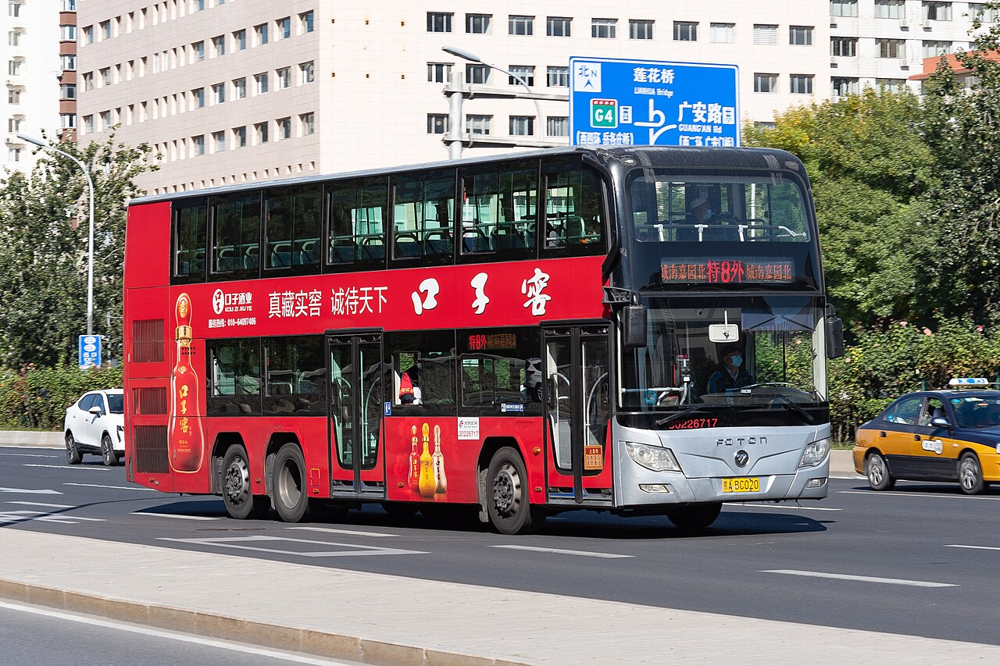

# 安徽口子酒业股份有限公司

安徽口子酒业股份有限公司是位于安徽淮北的兼香型白酒生产企业。企业地处隋唐大运河文化带与黄淮河名酒带，2015 年 6 月 29 日在上海证券交易所挂牌上市，是兼香型白酒第一家上市企业。公司拥有口子窖、老口子、口子坊与口子酒等品牌产品。

图：安徽口子酒业股份有限公司。图片：N509FZ，CC BY-SA 4.0，via Wikimedia Commons（[原图页面](https://commons.wikimedia.org/wiki/File:30226717_at_Liuliqiaonan_(20201017130410).jpg)）。

## 公司身份

口子窖的生产者层级以股份公司为核心：它承担生产、销售与信息披露，品牌是市场标识，具体产品还要落到瓶装规格与度数。讨论“口子窖”时，要先分清说的是公司、品牌还是一瓶酒。

“口子”是淮北一带的地方称谓，与河流交汇、集镇路口的地理形态有关。“口子窖”把地名与窖池结合，既指向产地，也指向工艺传统。这类名称属于文化与品牌资源，不能替代对生产主体与标签的核对。

## 产区与厂址

淮北位于安徽北部、黄淮平原南缘，属暖温带半湿润季风气候，四季分明、降水适中。企业把所在区域描述为隋唐大运河文化带与黄淮河名酒带，强调产区的历史交通与酿造传统。

产区环境会影响原料与微生物环境，但不自动决定酒质。兼香型白酒的风味还取决于原料配比、曲药、窖池、发酵与贮存。具体产品的原料与产地，应以标签上的信息为准。

厂址在淮北不等于所有产品都用同一车间或同一批基酒。不同产品线的原料、贮存时间与勾调方案不同，企业公开资料与标签是判断具体产品的依据。

## 品牌与产品

公开产品资料列出口子窖、老口子、口子坊与口子酒等系列。口子窖定位较高，覆盖商务与礼赠场景；老口子、口子坊与口子酒覆盖大众宴席与日常饮用。

就「安徽口子酒业股份有限公司」而言，产品线的度数、容量、包装与价格会随年份与渠道调整，部分产品还有区域版本或节庆版本。购买时应核对瓶身标签上的品牌、产品名称、酒精度、净含量、原料、生产商与执行标准，而不是只看包装。

口子酒业以“口子窖”为主品牌，另有“口子酒”等产品线；同一品牌下从五年、十年到更高年份，价格带不同，但不等于质量等级。买酒时先看产品名与度数，再看品牌。

## 工艺特色

兼香型白酒的工艺路线通常兼有浓香与酱香的特点：多粮配料、制曲、泥窖或石窖发酵、续糟配料、甑桶蒸馏、分段摘酒、陶坛贮存与勾调。不同企业会在高温曲、中温曲、发酵周期与贮存方式上形成自己的组合。

“兼香”是风格定位，不是把浓香与酱香简单相加。香气层次、入口厚度与回味长度取决于具体的原料、曲药与工艺参数，不能只凭香型名称判断酒体。

口子窖的兼香来自多粮、多曲与发酵工艺的组合，但工艺描述不能替代具体产品。五年、十年与更高年份系列的基酒等级、贮存时间与勾调比例不同，同名“口子窖”也可能对应不同产品线。

## 历史沿革

企业公开资料把品牌渊源追溯到濉溪一带的酿酒传统，并以建厂以来的发展作为企业史主线。2015 年 6 月 29 日，安徽口子酒业股份有限公司在上海证券交易所挂牌上市，成为 A 股白酒板块第 17 家、兼香型白酒第 1 家上市公司。

这些节点说明企业从地方酒厂到上市公司的变化。上市时间不等于建厂时间，也不等于濉溪酿酒文化的起点；讨论品牌历史时，应把企业沿革、产区传统与产品迭代分开。

## 时间线

- 2015 年：在上海证券交易所挂牌上市。

## 常见误区

第一，把 2015 年当作建厂年份。2015 年是上市年份。
第二，把“兼香”当作浓香与酱香的简单混合。它是独立的风格定位与工艺组合。
第三，把濉溪的酿酒传统长度当作现代公司历史。产区传统与公司沿革是不同尺度。
第四，把“口子”当作单一品牌。公司下还有老口子、口子坊与口子酒等系列。
第五，把价格当作质量等级。价格是市场定位，不是工艺标准。

安徽口子酒业股份有限公司位于淮北，以兼香型白酒为核心，并较早进入资本市场；企业身份、品牌“口子窖”与具体产品线要分开。兼香型的工艺边界由标准与产区实践共同定义，不能因为公司是兼香型代表，就把旗下所有产品都当成同一香型或同一等级。口子窖的兼香风格来自制曲、窖池与勾调的长期实践，不是把浓香与酱香成品简单相加；公司上市与品牌历史也不能直接说明某一瓶的等级。读产品要回到原料、执行标准与具体系列。

对照阅读：[安徽省](ref:anhui)、[制曲](ref:qu-making)。

## 延伸阅读

- [安徽](ref:anhui)：徽酒产区与白酒版图。
- [白酒](ref:baijiu)：白酒的大类与基本工艺。
- [制曲](ref:qu-making)：白酒工艺的起点。

相关条目：[白酒](ref:baijiu)。

把口子窖放回徽酒产区与制曲语境，可对照[安徽](ref:anhui)与[制曲](ref:qu-making)。

**关键事实。**

| 项目 | 内容 |
| --- | --- |
| 一句话定位 | 位于安徽淮北的兼香型白酒生产企业；2015 年 6 月在上海证券交易所上市，是兼香型白酒第一家上市企业，拥有口子窖、老口子等品牌 |
| 类型 | 白酒生产企业（上市公司） |
| 官网 | kouzi.com |

**来源与边界。** 本页关于「安徽口子酒业股份有限公司」的关键事实，主要由以下来源交叉核对：安徽口子酒业股份有限公司（兼香型定位与 2015 年上市；上市日期、股票代码与产品系列）。产品、地址或营业状态变化较快时，以 kouzi.com 的最新页面为准；价格、批次与状态会变，涉及这些字段时以页面所列来源的最新版本为准。正文为项目自写，来源只作核验，不复制原文。

**并读。** 把「安徽口子酒业股份有限公司」与「安徽省」、「白酒」、「制曲」放在一起读时，先确认它们是同一层级还是上下游关系：先确认企业与产品线，再比较产区、工艺与价格带。本页负责给出生产商的基本坐标，对照条目补上具体案例与差异；读完再回到本页，才能分清哪些差别属于生产商本身，哪些只是产地、批次或品牌选择。

**适用边界。** 对「安徽口子酒业股份有限公司」而言，企业结构、资产与品牌组合会变；历史年份与当前运营要分开看。
