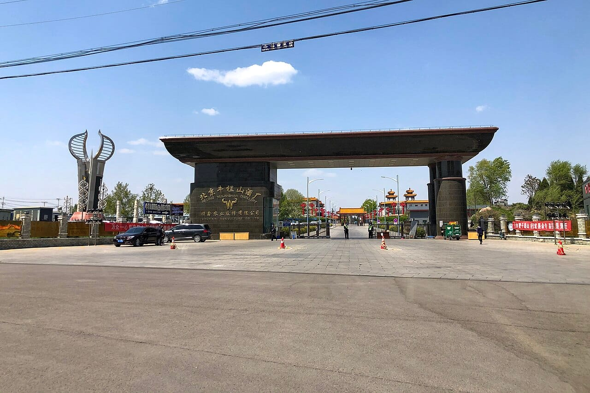

# 北京顺鑫农业股份有限公司牛栏山酒厂

北京顺鑫农业股份有限公司牛栏山酒厂位于北京市顺义区牛栏山镇，是一家以白酒为主业的生产企业。它的前身是 1952 年 10 月成立的国营牛栏山制酒厂，现为顺鑫农业旗下的分公司，主要产品属[白酒](ref:baijiu)，品牌与产品线见[牛栏山](ref:brand)条目。

图：北京顺鑫农业股份有限公司牛栏山酒厂。图片：N509FZ，CC BY-SA 4.0，via Wikimedia Commons（[原图页面](https://commons.wikimedia.org/wiki/File:Niulanshan_Distillery_headquarters_(20200424130839).jpg)）。

## 公司身份

本页记录生产者层级：企业名称、厂址、成立时间与组织形式。牛栏山酒厂是顺鑫农业的分公司，负责生产与产品运营；上市公司是资本与信息披露主体。讨论“牛栏山”时，要先分清说的是上市公司、酒厂、品牌还是一瓶酒。

公开资料对建厂时间的表述集中在 1952 年 10 月，企业叙事把解放后对当地“公利”“富顺成”“义信”“魁盛”等老烧锅的合营筹备作为前史。老烧锅是工艺与地名传统的来源，不等于现代公司的注册时间。

## 产区与厂址

顺义位于北京东北部，潮白河冲积平原，地下水与粮食供给条件适合酿酒。牛栏山镇以酿酒传统得名，二锅头工艺在当地延续数百年，企业公开资料把这套技艺列为国家级非物质文化遗产。

“产区”在这里既是地理概念，也是工艺传统。北京并非白酒主产省的经典叙事中心，但二锅头工艺以清香型路线和大众价格带形成了独立的市场位置；把北京排除在白酒产区之外，会忽略这条地方工艺脉络。

## 产品与工艺

企业产品分为几条路线：以二锅头工艺为核心的清香型产品、以牛栏山陈酿为代表的浓香型产品，以及百年牛栏山等礼赠与宴席产品。不同产品线的香型、执行标准与价格带不同，不能用一条产品线的风格概括全部。

二锅头工艺的关键是蒸馏时“掐头去尾取中段”，第二次换入冷水后流出的酒称为“二锅头”。这套工艺强调干净、爽冽与性价比，和泥窖续糟的浓香型路线不同。

浓香型产品则采用泥窖发酵、续糟配料与混蒸混烧，具体工艺与原料以产品标签为准。同一企业可以同时生产不同香型，这是产品结构，不是工艺矛盾。

## 历史与市场

1952 年国营牛栏山制酒厂成立，此后逐步形成以二锅头为核心的产品体系。1998 年，母公司北京顺鑫农业股份有限公司在深圳证券交易所上市，牛栏山酒厂成为其白酒业务的重要生产主体。

企业公开资料强调“中华老字号”“中国驰名商标”和二锅头传统酿制技艺的国家级非遗身份。这些认定针对品牌、商标与技艺，不等于对某一瓶酒的质量评级。

牛栏山长期以大众价格带与高铺市率著称，产品覆盖光瓶酒、宴席与礼赠。价格随渠道与供需变化，本页不给出具体数字。把销量当作质量证明，或把“陈酿”当作酒龄，都是常见误读。

## 选购与保存

购买时优先选择正规渠道，核对防伪、生产商与批次。不同产品线的香型与执行标准不同，应回到标签核对，避免把“牛栏山”三个字当作同一款酒。整箱购买还应检查封条与储存条件。

牛栏山以清香型为主，香气清、挥发快，开瓶后更应尽快喝完；未开瓶可常温、避光、直立，不必冷藏。家庭存放难以复制酒厂贮存条件，购买年份不等于品质升级。

## 常见误区

第一，把牛栏山只当作二锅头品牌。企业同时生产浓香型产品。
第二，把“陈酿”当作酒龄保证。它是产品名。
第三，把中华老字号当作产品质量认证。它针对品牌与技艺。
第四，把 1952 年当作所有产品线的起点。不同产品线形成时间不同。
第五，用价格或包装判断真伪。防伪、渠道与标签更可靠。

北京顺鑫农业股份有限公司牛栏山酒厂是顺鑫农业旗下的白酒生产单位，位于顺义牛栏山镇；它的身份是生产商与二锅头工艺传承者，不是独立上市公司。牛栏山品牌覆盖二锅头与浓香型陈酿等不同产品线，读“牛栏山”时要先看具体品类与生产商。二锅头工艺强调掐头去尾与中段取酒，浓香陈酿则依赖窖池与续糟发酵，两者不能共用同一套风味描述。核对生产商时，还要看分公司、品牌授权与瓶标上的实际生产地址。

对照阅读：[中国](ref:china)、[牛栏山](ref:brand)。

## 延伸阅读

- [牛栏山](ref:brand)：品牌结构与产品线。
- [白酒](ref:baijiu)：大类与香型体系。
- [中国](ref:china)：中国酒类版图与产区组织。
- 二锅头：掐头去尾取中段的蒸馏传统。
- 清香型白酒：二锅头工艺所属的香型路线。
- [浓香型白酒](ref:strong-aroma)：牛栏山陈酿所属的香型路线。

**关键事实。**

| 项目 | 内容 |
| --- | --- |
| 一句话定位 | 位于北京市顺义区牛栏山镇的白酒生产企业，前身为 1952 年成立的国营牛栏山制酒厂，现为顺鑫农业旗下分公司，以二锅头工艺与牛栏山陈酿等产品知名 |
| 成立 | 1952 |
| 类型 | 白酒生产企业（上市公司分公司） |
| 官网 | shunxinholdings.com |

**来源与边界。** 本页关于「北京顺鑫农业股份有限公司牛栏山酒厂」的关键事实，主要由以下来源交叉核对：新华网（建厂时间、分公司关系与老字号、非遗信息；由原条目末尾参考资料迁移，未逐条复核访问日期）、北京顺鑫控股集团有限公司（二锅头传统酿制技艺与国家级非物质文化遗产表述；由原条目末尾参考资料迁移，未逐条复核访问日期）、百度百科（厂址与建厂年份的公开表述；由原条目末尾参考资料迁移，未逐条复核访问日期）。产品、地址或营业状态变化较快时，以 shunxinholdings.com 的最新页面为准；价格、批次与状态会变，涉及这些字段时以页面所列来源的最新版本为准。正文为项目自写，来源只作核验，不复制原文。

**并读。** 把「北京顺鑫农业股份有限公司牛栏山酒厂」与「中国」、「白酒」、「牛栏山」放在一起读时，先确认它们是同一层级还是上下游关系：先确认企业与产品线，再比较产区、工艺与价格带。本页负责给出生产商的基本坐标，对照条目补上具体案例与差异；读完再回到本页，才能分清哪些差别属于生产商本身，哪些只是产地、批次或品牌选择。
