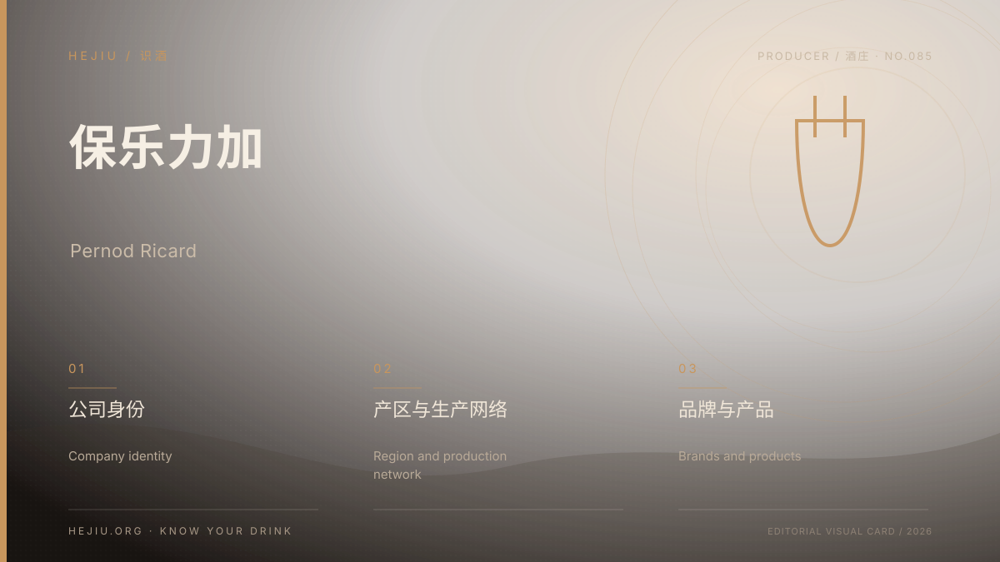

# 保乐力加

保乐力加（Pernod Ricard）是 1975 年由保乐与力加两家法国茴香酒企业合并而成的跨国葡萄酒与烈酒集团，总部位于巴黎。旗下拥有绝对伏特加、芝华士、百龄坛、马爹利等品牌，业务覆盖生产、分销与品牌运营。

图：保乐力加栏目示意图。项目自产或类别插图，用于酒吧与酒类语境，不是该对象的实拍。

## 公司身份

本页记录生产者层级：企业名称、所在地、历史起点与组织形式。集团是生产、分销与品牌运营主体，讨论“保乐力加”时，要先分清说的是集团、子公司还是某个品牌。

集团在巴黎泛欧交易所上市，业务分为葡萄酒与烈酒两大板块，覆盖自有酒厂、代理品牌与全球分销网络。合并形成的集团结构意味着，同一个品牌的生产与销售可能由不同国家和地区的子公司承担。

## 产区与生产网络

集团总部在法国，生产与灌装网络分布在全球多个产区。苏格兰威士忌、爱尔兰威士忌、干邑、香槟与伏特加等品类，各自依托不同产区的原料、蒸馏与陈酿条件。

就「保乐力加」而言，产区条件落到成品上，体现为原料、蒸馏方式、陈酿环境与法规要求。讨论某款产品时，应说明它属于哪个品类、在哪个产区完成关键工序，而不是用集团总部所在地一概而论。

## 品牌与产品

集团品牌组合跨度较大：绝对伏特加以冬小麦与连续蒸馏为特点，芝华士与百龄坛属于苏格兰调和威士忌，马爹利属于干邑，必富达属于伦敦干金酒，巴黎之花属于香槟。

就「保乐力加」而言，品牌层级与集团层级不同：品牌回答“叫什么、面向谁”，集团回答“谁持有商标、谁组织生产与分销”。同一集团下的品牌风格差异很大，不能用一个标准去概括。

## 工艺特色

不同品类的工艺路径不同：威士忌依赖[蒸馏](ref:distillation)与橡木桶陈酿，干邑依赖铜制壶式蒸馏与橡木桶，伏特加依赖连续蒸馏与过滤，香槟依赖瓶内二次发酵。

调和是集团多品牌、多酒厂结构下的核心能力之一，[调配](ref:blending)把不同酒厂、不同年份的原酒组合成稳定风格。具体配方属于企业信息，标签通常只披露部分内容。

## 历史沿革

1975 年，保乐与力加合并，形成以茴香酒起家的法国酒类集团。此后通过收购与整合，逐步进入苏格兰威士忌、干邑、香槟与伏特加等品类，形成今天的品牌组合。

公开资料显示，集团在中国市场设有保乐力加中国，负责进口、分销与品牌运营，并在四川峨眉山投资建设麦芽威士忌酒厂（叠川），这是其在中国本土生产威士忌的重要布局。

## 时间线

- 1975 年：保乐与力加合并，集团成立。
- 20 世纪后期：通过收购进入威士忌、干邑、香槟等品类。
- 近年：在中国四川峨眉山建设麦芽威士忌酒厂。

## 产业与市场

跨国酒类集团的优势在于品牌组合与分销网络，挑战在于品类周期与渠道结构差异。威士忌、干邑与香槟的消费场景不同，同一集团需要用不同的价格带与渠道去运营。

就「保乐力加」而言，讨论价格时应说明是官方建议价、免税渠道价还是餐饮渠道价，不能用一个数字概括全球市场。本页不给出具体价格。

## 常见误区

第一，把集团当作一个品牌。集团是商标持有与运营主体，旗下品牌风格各异。

第二，把总部所在地当作所有产品的产区。关键工序可能在别的国家完成。

第三，把集团规模当作单瓶品质保证。品质取决于具体产品与批次。

第四，把调和威士忌当作低端酒。调和是工艺路线，不等于等级。

第五，用价格或包装判断真伪。渠道、防伪与标签更可靠。

保乐力加是法国跨国葡萄酒与烈酒集团，由两家茴香酒企业合并形成；它的身份重点在品牌组合、分销网络与生产网络，而不是单一酒厂。绝对伏特加、芝华士、百龄坛、马爹利等品牌分属不同品类与产地；集团归属不等于配方、原料或酿造地点相同。集团旗下品牌可能共用分销与采购体系，却仍由不同酒厂、不同原料与不同法规生产；并购只改变所有权，不会自动统一配方。读产品时应回到品牌、产地与标签，而不是用集团名替代生产信息。

对照阅读：[法国](ref:france)、[利口酒](ref:liqueur)。

## 延伸阅读

- [法国](ref:france)：集团总部所在地与葡萄酒、烈酒的产区背景。
- [威士忌](ref:whisky)：芝华士、百龄坛所属品类。
- [利口酒](ref:liqueur)：集团早期起家的茴香酒与利口酒传统。
- [伏特加](ref:vodka)：绝对伏特加所属品类。
- [蒸馏](ref:distillation)：威士忌、干邑与伏特加的共同核心。
- [调配](ref:blending)：调和威士忌与品牌稳定性的工艺基础。
- [酒精度](ref:abv)：理解不同品类与产品的强度表达。

**关键事实。**

| 项目 | 内容 |
| --- | --- |
| 一句话定位 | 1975 年由保乐与力加两家法国茴香酒企业合并而成的跨国葡萄酒与烈酒集团，总部位于巴黎，旗下拥有绝对伏特加、芝华士、百龄坛、马爹利等品牌 |
| 成立 | 1975 |
| 类型 | 跨国酒类集团 |
| 官网 | pernod-ricard.com |

**来源与边界。** 本页关于「保乐力加」的关键事实，主要由以下来源交叉核对：Pernod Ricard（1975 年合并、总部位置与旗下品牌组合；集团投资与年度报告信息的发布渠道）、保乐力加中国（中国市场布局与产品线）、Encyclopaedia Britannica（补充核对条目背景、术语与制度口径）。产品、地址或营业状态变化较快时，以 pernod-ricard.com 的最新页面为准；价格、批次与状态会变，涉及这些字段时以页面所列来源的最新版本为准。正文为项目自写，来源只作核验，不复制原文。

**并读。** 把「保乐力加」与「法国」、「威士忌」、「利口酒」放在一起读时，先确认它们是同一层级还是上下游关系：先确认企业与产品线，再比较产区、工艺与价格带。本页负责给出生产商的基本坐标，对照条目补上具体案例与差异；读完再回到本页，才能分清哪些差别属于生产商本身，哪些只是产地、批次或品牌选择。

**适用边界。** 对「保乐力加」而言，企业结构、资产与品牌组合会变；历史年份与当前运营要分开看。

**更新提示。** 「保乐力加」最近核对于 2026-11-21；产品线、价格带与包装会变，购买前以官方产品页为准。
