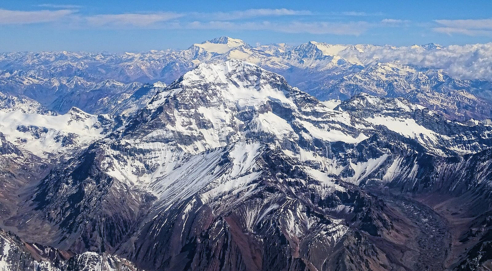

# 阿空加瓜谷

阿空加瓜谷（Valle del Aconcagua）是智利 Aconcagua 产区内陆的葡萄酒子产区，位于圣地亚哥以北。它以 Cabernet Sauvignon、Carmenère 与 Syrah 的红葡萄酒为主，也生产 Chardonnay 与 Sauvignon Blanc。Aconcagua 河从安第斯山流向太平洋，河谷地形与海陆风共同塑造了产区的温度梯度。

图：阿空加瓜谷相关实景照片。图片：Bjørn Christian Tørrissen，CC BY-SA 4.0，via Wikimedia Commons（[原图页面](https://commons.wikimedia.org/wiki/File:Aconcagua2016.jpg)）。

## 定义与范围

按智利第 464 号法令，Aconcagua 是一个 Región，下含 Valle del Aconcagua、Valle de Casablanca、Valle de San Antonio 等 Subregión。阿空加瓜谷指其中的 Valle del Aconcagua 子产区，范围覆盖 San Felipe de Aconcagua、Los Andes 与 Quillota 三省。

子产区内按市镇划分 Áreas，包括 Panquehue、Quillota 与 Hijuelas 等。Casablanca 与 San Antonio 是同级但独立的 Subregión，不属于阿空加瓜谷。

按 Wines of Chile 的品种面积口径，阿空加瓜谷主要品种合计约 1,500 公顷：Cabernet Sauvignon 402 公顷、Carmenère 219 公顷、Sauvignon Blanc 202 公顷、Syrah 189 公顷、Chardonnay 171 公顷、Pinot Noir 154 公顷，另有 Petit Verdot、Merlot 与 Malbec 等。SAG 2024 年统计的 Aconcagua 产区（含 Casablanca 与 San Antonio）合计 7,738.9 公顷，两者口径不同。

## 「阿空加瓜谷」的时间线
阿空加瓜谷的葡萄种植在 19 世纪已有记录，河谷的灌溉条件与交通位置使其成为早期葡萄酒产区之一。20 世纪后期，产区经历品种更新与出口扩张，Cabernet Sauvignon 与 Merlot 的面积增加。

1990 年代以后，Syrah 在内陆温暖地块获得关注，Carmenère 也被重新识别并扩大种植。产区的现代形象与安第斯山麓的砾石地块、昼夜温差和精品红葡萄酒密切相关。

## 地理与气候

阿空加瓜河从安第斯山向北流，再向西入海，河谷由山麓、阶地与近海低地组成。内陆谷地海拔较高、日照充足，白天温暖、夜间降温明显，昼夜温差大；近海的 Quillota 与 Hijuelas 一带海拔较低，受海风与晨雾影响，温度更温和、成熟更慢。

地中海气候带来干燥的夏季与集中的冬季降雨。灌溉依赖河流与地下水，干旱年份的水资源分配会影响产量与成熟。海拔、坡向与距海距离共同决定微气候，同一子产区内不同 Áreas 的风格差异明显。

土壤以河流冲积物、山麓崩积物与坡地风化岩为主。谷底土层深厚、保水较好；山麓地块砾石与岩石比例高、排水快，适合 Cabernet Sauvignon 与 Syrah 的根系生长。这些差异构成[风土](ref:terroir)基础。

## 法定 Áreas

阿空加瓜谷的 Áreas 以市镇边界划定：

- Panquehue：位于安第斯山麓，海拔与砾石地块带来明显的昼夜温差，红葡萄表现突出。
- Quillota：靠近海岸的低地，受海洋影响更强，温度较温和。
- Hijuelas：介于内陆与近海之间，地块差异较大，红白品种都有种植。

就「阿空加瓜谷」而言，Áreas 是法定地理名称，不是质量等级。酒标上更具体的地名通常意味着更集中的原料来源，但不必然代表更高品质。

## 品种与原料

Cabernet Sauvignon 是阿空加瓜谷面积最大的品种，常带黑加仑、香料与矿物气息；Carmenère 带红果、青椒与香料，单宁柔和；Syrah 在内陆温暖地块表现饱满，带黑莓、胡椒与花香。Merlot、Petit Verdot 与 Malbec 常用于混酿。

白葡萄以 Sauvignon Blanc、Chardonnay 与 Pinot Noir 为主，近海地块更适合清爽风格。原料是[葡萄](ref:grape)。品种结构与海拔、灌溉条件和市场需求有关，不能简单等同于风格保证。

产区以赤霞珠、佳美娜与西拉为主，安第斯山的雪水与高海拔温差影响成熟节奏，同一谷地内的冲积扇与山坡也分出不同微气候。

## 「阿空加瓜谷」怎么做出来
红葡萄经除梗与温控[发酵](ref:fermentation)，Cabernet Sauvignon 与 Syrah 常采用较长浸渍与压帽，随后在法国或美国[橡木桶](ref:oak-ageing)中陈年。混酿比例、采收时间与浸渍强度是风格差异的主要来源。

白葡萄低温发酵。Chardonnay 部分经橡木桶与酒泥搅拌；Sauvignon Blanc 多在不锈钢罐中发酵，以保留酸度与香气。

## 法规与酒标

就「阿空加瓜谷」而言，智利葡萄酒的产地标识受第 464 号法令与相关法规管理。D.O. 酒款须来自划定产区；酒标标注品种时，传统品种在混酿中须至少占 85%。Reserva、Gran Reserva 等术语没有统一的陈年或质量强制标准，不能当作法定质量等级。

Región、Subregión、Zona 与 Área 是不同层级的法定地理名称。阿空加瓜谷是 Subregión，Casablanca 与 San Antonio 是同级但不同的 Subregión，酒标上不能混用。

## 「阿空加瓜谷」的酒标与喝法
酒标应核对 D.O. 名称、品种、[年份](ref:vintage)、[酒精度](ref:abv)、容量与装瓶者。标注[单一品种](ref:single-varietal)的酒款须满足品种比例；混酿按法规列出品种。Cabernet Sauvignon 与 Syrah 建议 16–18 摄氏度，Carmenère 建议 16–18 摄氏度，Chardonnay 建议 10–12 摄氏度，Sauvignon Blanc 建议 8–10 摄氏度。

Cabernet Sauvignon 与 Syrah 适合红肉、烤肉与香料风味菜肴；Carmenère 适合炖菜与禽肉；Chardonnay 适合海鲜与奶油类菜肴；Sauvignon Blanc 适合海鲜与沙拉。开瓶后冷藏并尽快喝完。本页关于阿空加瓜谷的内容涉及酒精饮料；过量饮酒有害健康，未成年人不应饮酒。

## 「阿空加瓜谷」容易被读错的地方
第一，把阿空加瓜谷与 Casablanca 混为一谈。两者都是 Aconcagua 产区下的 Subregión，但边界与气候不同。
第二，认为阿空加瓜谷只产红葡萄酒。近海 Áreas 也生产白葡萄酒与清爽风格的红葡萄酒。
第三，把 Reserva 当成质量等级。智利没有统一的 Reserva 陈年标准。
第四，以为海拔越高越好。海拔改变温度与温差，但品种与年份匹配才决定品质。
第五，把 Área 名称当成品牌。Área 是法定地理名称，酒庄名与品牌名是另一回事。

对照阅读：[葡萄酒](ref:wine)、[红葡萄酒](ref:red-wine)。

**关键事实。**

| 项目 | 内容 |
| --- | --- |
| 一句话定位 | 智利 Aconcagua 产区内 Valle del Aconcagua 子产区，范围覆盖 San Felipe de Aconcagua、Los Andes 与 Quillota 三省，法定 Áreas 包括 Panquehue、Quillota 与 Hijuelas；按 Wines of Chile 的品种面积口径，主要品种合计约 1,500 公顷，以 … |
| 层级 | 其他 |
| 所属 | 智利 |
| 国家代码 | CL |

**来源与边界。** 本页关于「阿空加瓜谷」的关键事实，主要由以下来源交叉核对：Servicio Agrícola y Ganadero (SAG), Chile（Región de Aconcagua、Valle del Aconcagua 子产区、三省范围与 Áreas 划分；2018 年修订后 Valle del Aconcagua 的边界与 Áreas）、Wines of Chile（阿空加瓜谷的品种面积、气候、土壤与风格描述）。价格、批次与状态会变，涉及这些字段时以页面所列来源的最新版本为准。正文为项目自写，来源只作核验，不复制原文。

## 参考资料
- [葡萄酒](ref:wine)：理解阿空加瓜谷的类别、年份与产地规则的入口。
- [红葡萄酒](ref:red-wine)与[白葡萄酒](ref:white-wine)：阿空加瓜谷两大酒类的基本框架。
- [赤霞珠](ref:cabernet)、[西拉](ref:syrah)与[梅洛](ref:merlot)：产区的核心红品种。
- [霞多丽](ref:chardonnay)、[长相思](ref:sauvignon-blanc)与[黑皮诺](ref:pinot-noir)：近海地块的白葡萄与凉爽风格。
- [葡萄](ref:grape)：酿酒葡萄的结构与成熟指标。
- [发酵](ref:fermentation)：红葡萄浸渍与白葡萄低温发酵。
- [酸度](ref:acidity)：昼夜温差与海风对酸度的影响。
- [风土](ref:terroir)：冲积物、崩积物与坡地风化岩的差异。
- [橡木桶陈年](ref:oak-ageing)：Cabernet Sauvignon 与 Syrah 的桶陈。
- [干型](ref:dry)：智利白葡萄酒的干型定位。
- [年份](ref:vintage)：阿空加瓜谷的年份差异与干旱影响。
- [单一品种](ref:single-varietal)：品种标注的比例规则。
- [酒精度](ref:abv)：酒标上 % vol 的含义。

## 相关图像

图：长相思相关实景照片。图片：Geolina163 + 1971markus，CC BY-SA 4.0，via Wikimedia Commons（[原图页面](https://commons.wikimedia.org/wiki/File:HBLA_Klosterneuburg_Sauvignon_Blanc_2.jpg)）。关联图像：阿空加瓜谷。

图：葡萄。图片：Vyacheslav Argenberg，CC BY 4.0，via Wikimedia Commons（[原图页面](https://commons.wikimedia.org/wiki/File:Grapes,_Rostov-on-Don,_Russia.jpg)）。关联图像：阿空加瓜谷。
