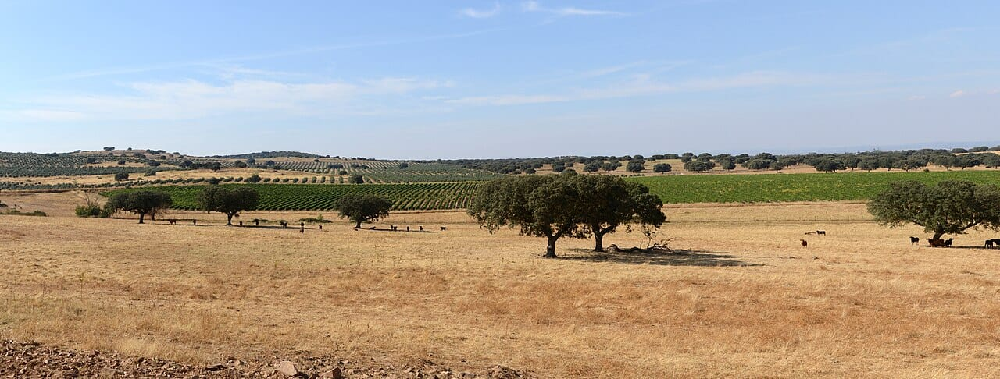

# 阿连特茹

葡萄牙中南部的大区，气候炎热干燥、土壤从花岗岩到片岩与黏土；以阿拉戈内斯（丹魄）、特林卡德拉与紫北塞为主，是葡萄牙最容易被忽视、也最有性价比的红酒产区之一。

图：Alentejo：Alentejo September 2013-1（Wikimedia Commons）。图片：Alvesgaspar，CC BY-SA 3.0，via Wikimedia Commons（[原图页面](https://commons.wikimedia.org/wiki/File:Alentejo_September_2013-1.jpg)）。

> **先给结论**
> **一句话：** 这页判断阿连特茹的风味与旅行价值，以及怎么安排。
>
> - **适合谁：** 正在比较阿连特茹与其他产区、准备买酒或安排旅行的人。
> - **不适合谁：** 只想要“哪个产区最贵”的结论、不关心风格和年份的人。
> - **先看这两点：**
>   - 读标先分辨 PDO 子产区名与 Alentejano PGI，再看品种、年份与生产者；Reserva 等陈酿等级在葡萄牙有法定要求。
>   - Rota dos Vinhos do Alentejo 串联各酒庄村；经典路线从世界遗产古城埃武拉，经雷根古什-德莫萨拉斯到维迪盖拉；山城蒙萨拉斯俯瞰阿尔克瓦水库。

## 先划清「阿连特茹」的边界
阿连特茹位于[葡萄牙](ref:portugal)中南部，北接贝拉大区，东邻西班牙，南抵阿尔加维，约占国土三分之一，辖贝雅、埃武拉、波塔莱格雷三个行政区，是葡萄牙面积最大的葡萄酒产区之一。产区酒分两级：八个 PDO（DOC）子产区——波塔莱格雷、博尔巴、雷东多、雷根古什、埃武拉、维迪盖拉、格兰雅-阿马雷莱雅、莫拉——以及覆盖全境的 Alentejano PGI（旧称 Vinho Regional Alentejano）。

PDO 对允许品种、单产与陈酿期要求更严格；PGI 规则较宽松，允许西拉、赤霞珠、小维多等国际品种与本土品种混酿。不少现代酒庄主动选择 PGI 标签，换取品种与工艺上的自由度；酒标只写 Alentejo 而不标子产区时，果实可能来自多个子产区，风格取多地块之长。

对消费者，子产区名、地块名与生产者名比大区名更能指示风格方向；同一大区内，平原旱地的饱满混酿与北部高海拔的清瘦白酒可以差异很大。

## 历史与命名

考古证据显示，葡萄酒在罗马人抵达南部葡萄牙之前已进入当地日常。塔特西人被认为最早驯化葡萄、引入酿酒方法，其后腓尼基人与希腊人相继留下双耳陶容器遗存；真正把栽培与酿酒方法系统化的是罗马人，陶缸（talha de barro）发酵贮藏的传统也由他们传入，并在阿连特茹延续至今。

8 世纪摩尔人进入伊比利亚半岛后，当地酒文化一度衰落；葡萄牙王国建立后，王室与新设修会推动葡萄回归。16 世纪，埃武拉的 Peramanca 名酒、贝雅白酒与阿尔维托、维亚纳、维拉德弗拉迪斯的 palhete 风行；17 世纪阿连特茹酒与贝拉、埃斯特雷马杜拉酒并列葡萄牙最知名酒款。彭巴尔侯爵设立杜罗总公司后，多项措施强制拔除包括阿连特茹在内多地葡萄，产区由此转入沉寂。

19 世纪中叶垦荒与农业复兴带动葡萄园重植。1888 年，维迪盖拉 Quinta das Relíquias 的一款白酒在柏林博览会获大奖章；1895 年葡萄牙第一家社会酒庄（早期合作社）在维亚纳杜阿连特茹成立。此后根瘤蚜、两次世界大战、经济危机与改种小麦的“面包篮”运动使葡萄园大幅萎缩。1940 年代末，国家葡萄酒委员会扶持下产区逐步恢复；ATEVA 于 1983 年成立，首批阿连特茹 DOC 于 1988 年完成规范，PROVA 于 1997 年建立质量控制体系；国产多瑞加（Touriga Nacional）于 1980 年代引入本区。

## 「阿连特茹」的地理与风土
整体是起伏平缓的平原与低丘，软木橡树林、橄榄园与葡萄园交错铺开。气候属大陆性地中海型：夏季炎热干燥，盛夏可达 40°C 上下，冬季温和；内部平原日较差大，大西洋海风在维迪盖拉一带缓解暑热。

土壤类型多样。北部波塔莱格雷以花岗岩为主、间杂小片岩，葡萄园沿圣马梅德山脉山麓分布，部分陡坡海拔超过 1,000 m；博尔巴有大理石露头与红色片岩；雷东多受奥萨山脉庇护，多座山峰超过 600 m；雷根古什为贫瘠片岩与乱石地；埃武拉为棕褐色地中海土；维迪盖拉以花岗岩与片岩为主；格兰雅-阿马雷莱雅与莫拉为黏土、片岩与石灰岩，土层薄、降水稀少。

海拔、坡向、排水与靠近阿尔克瓦水库等条件，把大平原切成风格不同的小块；干旱年份水源管理与单产控制直接反映在酒的浓度与平衡上。

## 原料与风格

红葡萄约占 65%，主力为阿拉戈内斯（即[丹魄](ref:tempranillo)）、特林卡德拉、紫北塞、国产多瑞加、卡斯泰朗，另有莫雷托、丁塔·卡伊阿达以及西拉、赤霞珠、小维多等国际品种。白葡萄中安唐·瓦兹是最重要的本土品种；按官方统计，白葡萄总面积 4,872.2 ha，其中安唐·瓦兹 1,251.2 ha 占 25.7%，西里亚/鲁派罗 872.4 ha 占 17.9%，阿林托 776.5 ha 占 15.9%，其余有 Rabo de Ovelha、Fernão Pires、Verdelho 与 Gouveio。

传统以多品种混酿为主：阿拉戈内斯提供骨架与深色果味，特林卡德拉带来酸度与香料感，紫北塞加深颜色与单宁。近年单一品种酒、[橡木](ref:oak)桶陈酿与陶缸传统风格并行。陶缸法源自古罗马，缸体可达 2 m 高、容量 2,000 L，内壁以天然松脂 pês 防渗；成酒果味直接、少新橡木痕迹。

风格上常见饱满酒体、扎实结构与圆润单宁，果香丰沛；白酒分两路：安唐·瓦兹呈热带果香与饱满酒体，阿林托混酿以柑橘酸与矿物感见长。与杜罗波特等[加强酒](ref:fortified)不同，阿连特茹主线是静止餐酒，本地几乎不出产波特式产品。

## 代表生产者与酒款

Herdade do Esporão 位于雷根古什-德莫萨拉斯，庄园边界最早确立于 1267 年，1973 年由 José Roquette 与 Joaquim Bandeira 购入并启动酿酒项目，土地约 1,800 ha；Reserva 红款是酒庄 1985 年推出的第一款酒，混酿紫北塞、阿拉戈内斯、西拉、特林卡德拉、赤霞珠与 Touriga Franca，经 12 个月橡木桶陈酿。

Cartuxa 位于埃武拉，隶属于 1963 年成立的欧热尼奥·德·阿尔梅达基金会；名号来自 1598 年起在此修行的加尔都西会修道院，酒庄酒款 1986 年首次生产，红款混酿紫北塞、特林卡德拉与阿拉戈内斯，种在花岗岩与片岩土上。

Cortes de Cima 位于维迪盖拉，由丹麦裔美国夫妇 Carrie 与 Hans Jorgensen 于 1980 年代抵达后定居，1991 年种下首批葡萄园，1996 年采收，1998 年推出第一款酒；庄园连片土地约 400 ha，酒款多按较宽松的 PGI 规则出品，以西拉与多品种混酿见长。其余值得留意的还有埃什特雷莫什的 Quinta do Mouro、阿兰德鲁阿尔的 Herdade dos Grous；合作社、家族庄园与外来资本在本区长年并存。

## 「阿连特茹」的上桌方式
阿连特茹[红酒](ref:red)酒体饱满、单宁圆润，适合配当地烤羊肉、炖肉、香肠与硬奶酪；高酸的特林卡德拉混酿可搭烤禽与带香料的菜肴；安唐·瓦兹白酒配海鲜、白肉与软奶酪，阿林托混酿更适合作开胃酒配凉菜。

陶缸传统酒风格偏自然、果味直接，饮用温度略低于重橡木红酒；橡木陈酿款开瓶后可短暂醒酒。本地菜炖野猪、黑豆、香肠、橄榄油与面包，和本地酒共享同一套食材与调味。

温度与杯型上，饱满红酒约 16–18°C，白酒 10–12°C；宽口杯放大气息，年轻果酒不必长时间醒酒。

## 选购、标签与误区

读标先分辨 PDO 子产区名与 Alentejano PGI，再看品种、年份与生产者；Reserva 等陈酿等级在葡萄牙有法定要求。PGI 不等于低档，许多现代名庄主动选择 PGI 换取品种与工艺自由。

年份差异在平原产区同样明显：热浪与采收期降雨会改变成熟度；同一年份对比两家酒庄的同一品种，比跨年份更易看出地块与土壤差异。价格带通常低于杜罗与波特，日常餐酒与有陈年潜力的酒款并存。

储存以温度稳定为先；开瓶后轻白酒通常可放 1–3 天，重红酒更久。

## 「阿连特茹」周边怎么走
Rota dos Vinhos do Alentejo 串联各酒庄村；经典路线从世界遗产古城埃武拉，经雷根古什-德莫萨拉斯到维迪盖拉；山城蒙萨拉斯俯瞰阿尔克瓦水库，是途中视野最好的停留点。

产区内部车程长，中心城镇到山间庄园常需 30–60 分钟，单次品鉴 60–90 分钟，一天排三个点已较紧；采收季在北半球秋季 9 至 10 月，酒庄最忙，周末开放时间变化大，出发前通过官网或产区协会确认预约与费用。

参观时预约、准时、不酒后驾车，不进入作业车间与地块；软木栎林、橄榄园与历史城镇可与酒庄串联安排。

- 相关条目：[portugal](ref:portugal)、[tempranillo](ref:tempranillo)、[red-wine](ref:red)、[oak-ageing](ref:oak)、[fortified-wine](ref:fortified)。
