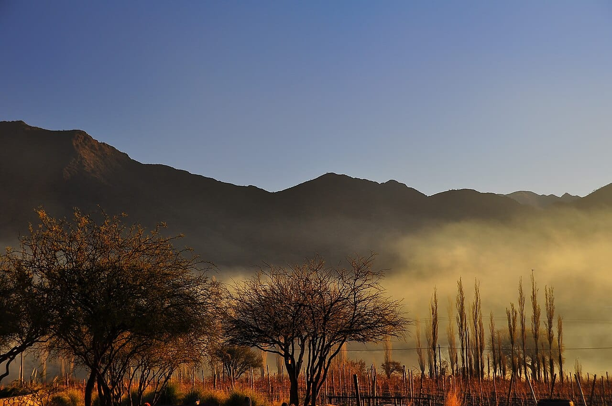
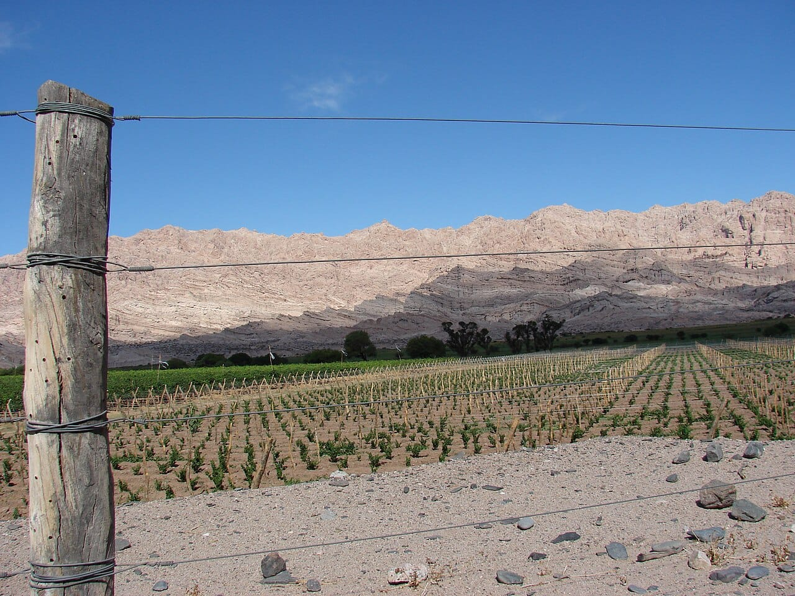
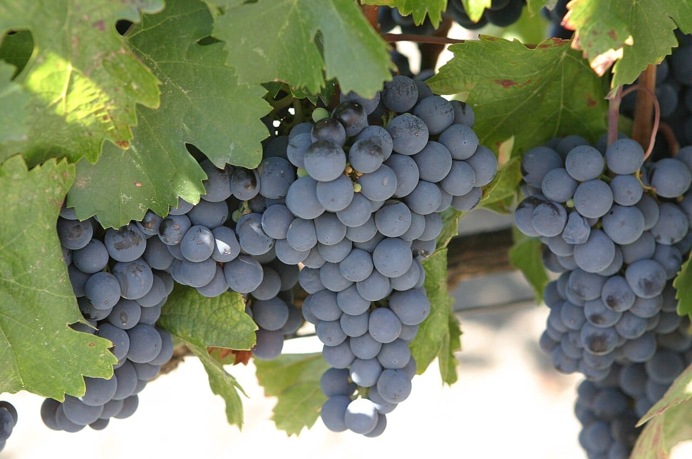

# 阿根廷

阿根廷是南美洲第二大葡萄酒生产国、按产量计也是全球第五大产酒国，葡萄园沿安第斯山脉东麓从西北高海拔山谷铺到巴塔哥尼亚冷凉河谷；马尔贝克是国际招牌品种，特浓情、赤霞珠、霞多丽、西拉与起泡酒同样构成产区版图。

图：Argentina：Miraluna Vineyard, Cachi, Argentina (7126977841)（Wikimedia Commons）。图片：Rod Waddington from Kergunyah, Australia，CC BY-SA 2.0，via Wikimedia Commons（[原图页面](https://commons.wikimedia.org/wiki/File:Miraluna_Vineyard,_Cachi,_Argentina_(7126977841).jpg)）。

## 先划清「阿根廷」的边界
阿根廷的葡萄酒版图不是单一河谷，而是沿安第斯山展开的绿洲带。门多萨省贡献全国约 71.7% 的葡萄园，圣胡安约 19.7%，拉里奥哈约 3.4%，萨尔塔约 1.9%，内乌肯、里奥内格罗等巴塔哥尼亚省份占余下份额；这些省份分属库约、西北高原与巴塔哥尼亚三个气候带，标签上的省名比笼统的“阿根廷”更能说明风格。西北各省沿安第斯山脊排列，巴塔哥尼亚则向东延伸到大西洋沿岸，南北跨度超过两千公里，纬度与海拔共同造成了风格分化。

1999 年第 25.163 号法律固定了产区标识制度，由国家葡萄研究院（INV）主管；省、河谷与产区（乌科谷、卢汉德库约、迈普）是常用地理单位。酒标地名只说明果实来源，不等于等级排序。门多萨内部还有迈普、卢汉德库约与乌科谷（图蓬加托、图努扬、圣卡洛斯）等次级分区；西北萨尔塔以卡法亚特产区为核心，巴塔哥尼亚以内乌肯、里奥内格罗的冷凉风格见长。

## 历史与命名

1853 年，在省长萨米恩托支持下，法国农艺师米歇尔·艾梅·普热把包括马尔贝克在内的法国品种带到门多萨试种；马尔贝克此后扎根，并在一个多世纪后成为阿根廷最具代表性的红葡萄。20 世纪大部分时间，国产酒以大众市场和散装酒为主，高产品种切雷萨、克里奥拉格兰德曾占很大比例。

1970 年代后出口打开，1990 年代尼古拉斯·卡帝那系统研究高海拔种植；1994 年他在瓜尔塔亚拉里近海拔 1,500 米处种下马尔贝克葡萄园。1993 年卢汉德库约成为门多萨第一个受管控产区；2000 年后，巴塔哥尼亚冷凉酒款与萨尔塔高海拔特浓情逐渐在国际市场获得独立位置。早期葡萄园多靠修渠引山雪水浇灌，这套灌溉系统后来成为门多萨葡萄园的基础骨架，也决定了地块只能沿水渠分布。

## 「阿根廷」的地理与风土
核心产区的共同底色是干燥、强光与灌溉。门多萨年降雨不足 200 毫米，靠安第斯融雪与水渠灌溉，全年晴天接近 300 天；干燥压低病害，紫外线加厚果皮，昼夜温差保留酸度。门多萨葡萄园多在海拔 600 至 1,500 米，乌科谷部分地块 900 至 1,700 米，萨尔塔卡法亚特接近 3,000 米。

中部多冲积沙砾与黏土底土，高海拔地块以砾石、砂质冲积物为主，根系深入找水；靠河平地早熟偏肥，高处坡地晚熟、酸度纹理更好。夏季冰雹是门多萨内陆常见风险，西北高原有花期霜冻。巴塔哥尼亚靠纬度降温，适合黑皮诺、霞多丽；萨尔塔靠海拔降温，是特浓情与高海拔马尔贝克的典型环境。山谷里的小支流与低洼地带湿度偏高，花期与成熟期容易结露，坡地与高台则靠空气流通降低病害。

## 原料与风格

2024 年 INV 统计，马尔贝克全国约 47,064 公顷，占葡萄园约 23.5%，为第一大品种，其中约 84.7% 集中在门多萨。其他红葡萄有赤霞珠、博纳达、西拉、丹娜、梅洛；白葡萄以霞多丽、特浓情为主，长相思、雷司令在冷凉产区增长。博纳达是本地传统红葡萄，常与马尔贝克调配，增加果香与酸度层次。

典型马尔贝克是深色果味、紫罗兰花香、柔软单宁与饱满酒体；高海拔地块酸度、矿物感与回味更清晰，平原地块果味更甜、酒精度更高。特浓情香气直接，常有白花、柑橘与蜂蜜气息；霞多丽可走清爽矿石风格，也有橡木桶发酵的丰满版本。橡木陈酿 (ref:oak) 从几个月到两年以上不等，精品款具备数年到十余年陈年空间。

## 代表生产者与酒款

代表酒庄包括 Catena Zapata（高海拔研究与精品马尔贝克参照）、Zuccardi（乌科谷系列与梯田葡萄园）、Achaval-Ferrer（高海拔单一园）；巴塔哥尼亚的 Chacra 代表内乌肯冷凉黑皮诺与霞多丽，萨尔塔的 Colomé 是西北高海拔老牌酒庄。

阿根廷的这些名字不是官方分级，而是市场长期形成的参照。旗舰与单一园价高量小，家族酒庄入门款更易找到；合作社与大酒商承担大众产量，精品酒庄在地块、克隆与低产上差异化。马尔贝克 (ref:malbec) 是认识阿根廷红葡萄酒 (ref:red) 的起点，霞多丽 (ref:chardonnay) 可对照不同海拔的差别。

## 「阿根廷」的上桌方式
红葡萄酒通常 16 至 18 摄氏度饮用，过高放大酒精与熟果味，偏低单宁更紧；年轻果味款不必久醒，结构强的旗舰款可提前半小时到一小时透气。白葡萄酒与起泡酒 8 至 12 摄氏度饮用，特浓情稍凉上杯。

搭配围绕烤肉：烤牛肉、烤肠、羊排、烤小山羊与肉馅饼配马尔贝克或高海拔混酿，油脂炭火接上黑莓、香料与柔软单宁；香草辣酱菜式选果味更成熟、单宁更柔的酒。霞多丽配烤禽、奶油酱海鲜与意面，特浓情适合前菜与海鲜。

## 选购、标签与误区

读标签先看地名层级：国家、省、河谷或产区。“Mendoza”下还要分清乌科谷、卢汉德库约、迈普；单一园、地块名与自有园比例比“老藤”“手工采摘”等宣传语更说明来源。

高酒精度不等于成熟度或品质：不少红葡萄酒在 14% 上下，平衡取决于酸度、单宁与果味是否同时到位。马尔贝克也不是固定味道，平原、高海拔与冷凉产区差别很大；冰雹、热浪、霜冻与采收雨都会改变年份产量与成熟度，购买时留意进口商与储存条件。

## 「阿根廷」周边怎么走
门多萨市是主基地：到卢汉德库约约半小时，到乌科谷各镇约一小时；品鉴一般预约制，单次留 60 至 90 分钟，一天两三家加午餐较从容。采收季（南半球 3 至 4 月）最忙，开放时间应提前确认。

西北可从萨尔塔沿 40 号公路前往卡法亚特；巴塔哥尼亚产区距门多萨更远，适合单独安排内乌肯或里奥内格罗行程。不驾车可参加门多萨出发的小团；葡萄园土路与品鉴室门槛对行动不便者不一定友好，出行前先问无障碍与洗手间位置。

- 相关条目：[salta](ref:salta)、[malbec](ref:malbec)、[chardonnay](ref:chardonnay)、[red-wine](ref:red)、[oak-ageing](ref:oak)。
- 阿根廷内陆产区依赖融雪灌溉，出行前可在酒庄官网或 INV 公布的产区名录上核对当年开放安排与地址。

对照阅读：[萨尔塔](ref:salta)、[霞多丽](ref:chardonnay)。

## 相关图像

图：Salta：Angastaco Salta（Wikimedia Commons）。图片：CarlosA.Barrio，CC BY-SA 4.0，via Wikimedia Commons（[原图页面](https://commons.wikimedia.org/wiki/File:Angastaco_Salta.JPG)）。关联图像：阿根廷。

图：马尔贝克。图片：Ian L，CC BY 2.0，via Wikimedia Commons（[原图页面](https://commons.wikimedia.org/wiki/File:Malbec_grapes.jpg)）。关联图像：阿根廷。
