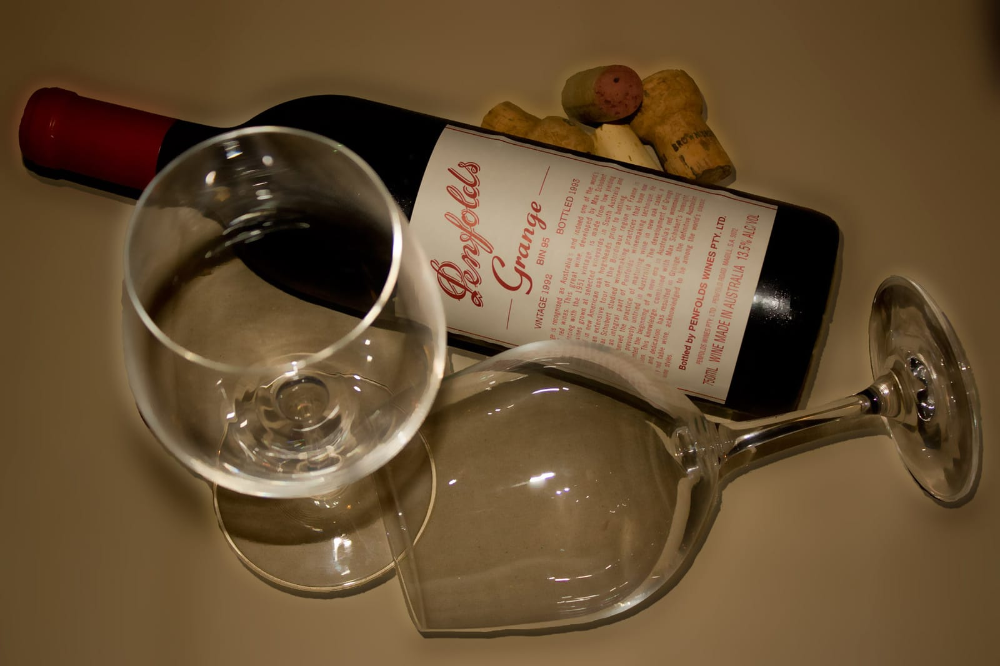
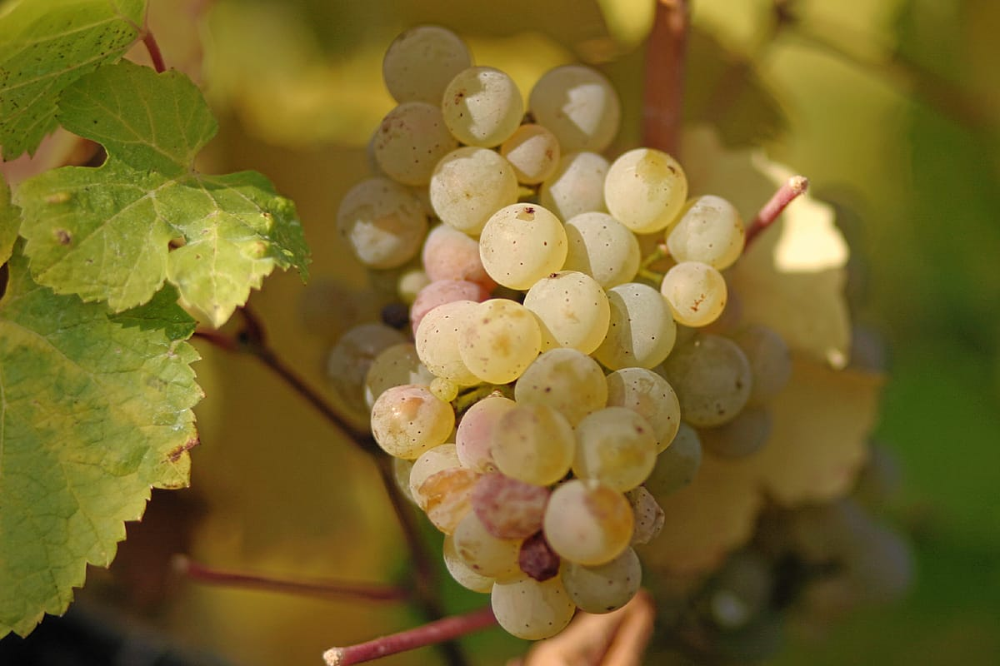

# 澳大利亚

澳大利亚是南半球重要的葡萄酒生产国，产区集中在南部沿海与东南部。它的葡萄酒以成熟果味、清晰的品种表达与稳定的品质著称，西拉、雷司令与霞多丽都有国际影响。与欧洲不同，澳大利亚的产区标识采用 GI 体系，理解 GI 与酒标的关系，是阅读澳大利亚葡萄酒的起点。

图：澳大利亚。摄影：Renmark South Australia Vineyard。署名：Feral Arts，CC BY 2.0，来自 Wikimedia Commons（[来源](https://commons.wikimedia.org/w/index.php?curid=9069567)）。

## 地理与气候

澳大利亚大陆面积广阔，内陆干旱，人口与农业集中在沿海。葡萄酒产区主要分布在南纬 30 至 40 度之间的南部地带：东南部包括南澳、维多利亚与新南威尔士，西南部以西澳为主，塔斯马尼亚位于更南的凉爽岛屿。地中海气候、海洋性气候与大陆性气候在此交叠。

热量与水分是主要变量。温暖产区的果实成熟度高、果味饱满，需要通过采收时间与海拔保留酸度；凉爽产区如塔斯马尼亚与部分高海拔地块，酸度更高、成熟期更长。干旱与 bushfire 烟雾是部分年份的现实风险，会影响产量与风味。

## 「澳大利亚」的时间线
澳大利亚的葡萄酒业始于 19 世纪的欧洲移民，早期以种植与日常饮用为主。20 世纪后期，技术投入、灌溉管理与国际市场推广推动了产业扩张。1980 年代以后，澳大利亚葡萄酒以稳定的品质与清晰的品种标签进入出口市场，南澳与维多利亚的产区逐渐形成国际认知。

## 葡萄酒产区

- 南澳：巴罗萨谷、麦克拉伦谷、克莱尔谷与库纳瓦拉，西拉与赤霞珠代表性强。
- 维多利亚：雅拉谷、摩宁顿半岛与格兰屏，风格从清爽到浓郁都有。
- 新南威尔士：猎人谷以赛美蓉与西拉著称。
- 西澳：玛格丽特河与天鹅谷，地中海气候下的红白葡萄酒。
- 塔斯马尼亚：凉爽海洋性气候，适合起泡酒与黑皮诺。

## 「澳大利亚」的品种与风格坐标
[西拉](ref:syrah)是澳大利亚最具代表性的红品种，在巴罗萨谷常呈现成熟黑莓、甘草与香料气息，在凉爽产区则更紧致、胡椒感更明显。[雷司令](ref:riesling)在克莱尔谷与伊登谷表现突出，酸度高、带柑橘与矿物气息；[霞多丽](ref:chardonnay)从清爽型到经橡木桶发酵的浓郁型都有。

[红葡萄酒](ref:red-wine)与[白葡萄酒](ref:white-wine)的风格受产区热量与酿造方式影响。[橡木桶陈年](ref:oak-ageing)在澳大利亚红葡萄酒中常见，新桶比例与桶型会改变香气与结构。品种标签通常较清晰，但混酿也很普遍，阅读酒标时要注意品种比例与产区来源。

## 代表酒款

[奔富葛兰许](ref:grange)是澳大利亚西拉混酿的代表，以多产区调配、长陈年与浓郁风格著称；[奔富 Bin 389](ref:bin389)则以赤霞珠与西拉混酿、橡木桶陈年形成更日常的风格。两者说明同一品牌可以通过不同配方与陈年策略覆盖不同价格与场景。

具体酒款还会受年份、产区与装瓶批次影响。产区页描述地理与制度框架，酒款页记录具体产品。

## 法规与分级

澳大利亚葡萄酒的产区标识以 GI（Geographical Indication）为核心，由 Wine Australia 管理。GI 规定地理边界，酒标标注产区需要满足原料比例要求；它与欧洲的 AOP/PDO 不同，不规定品种、产量或酿造方法。澳大利亚没有全国统一的酒庄分级制度，市场评价更多来自酒庄历史、酒款表现与媒体评分。

阅读酒标时，要区分国家名、GI 名、酒庄名与品牌名。“South Australia”“Barossa Valley”等名称的覆盖范围不同，不能把大产区名称当成具体地块。

## 气候与土壤数据

| 区域 | 气候 | 主要土壤 | 代表酒类 |
| --- | --- | --- | --- |
| 东南部（南澳、维多利亚、新南威尔士） | 地中海与温带海洋性 | 石灰岩、砂土、砾石 | 西拉、赤霞珠、霞多丽 |
| 西南部（西澳） | 地中海 | 花岗岩、砾石 | 红白葡萄酒 |
| 塔斯马尼亚 | 凉爽海洋性 | 玄武岩、黏土 | 起泡酒、黑皮诺 |
| 北部与内陆 | 亚热带至干旱 | 冲积土、砂土 | 啤酒等非葡萄酒产业 |

这张表是宏观对照，具体地块的土壤、海拔与朝向仍需看单个 GI。把大区气候当成酒款风格保证，会忽略产区内部的差异。

## 加强酒与其他酒类

澳大利亚也生产[加强酒](ref:fortified)，如以麝香与设拉子为基础的甜型加强酒，风格接近葡萄牙的波特与传统甜酒。啤酒与精酿产业在沿海城市发展迅速，但澳大利亚的国际形象仍以葡萄酒为主。不同酒类的原料与法规不同，不能混为一谈。

## 市场与饮用

澳大利亚是重要的葡萄酒出口国，出口市场覆盖欧洲、北美与亚洲。[葡萄酒](ref:wine)的价格跨度很大，从日常餐酒到长期陈年的名庄酒都有。红葡萄酒适合搭配肉类与烧烤，白葡萄酒适合海鲜与轻食，加强酒则适合餐后与甜点场景。

饮用温度与开瓶后的保存会影响体验。对具体酒款，酒标上的 GI、年份、品种与酒精度，是最直接的信息来源。

## 「澳大利亚」容易被读错的地方
第一，澳大利亚酒都是浓郁果味。凉爽产区与高海拔地块也能产出清爽、酸度高的酒。

第二，GI 等于质量等级。GI 只是地理边界，不规定质量或品种。

第三，澳大利亚只有西拉。雷司令、霞多丽、赤霞珠等都有重要地位。

第四，年份对澳大利亚酒不重要。部分酒款仍受年份与产区气候影响。

第五，加强酒都是甜酒。加强酒从干型到甜型都有，风格取决于工艺与陈年。

对照阅读：[葡萄酒](ref:wine)、[白葡萄酒](ref:white-wine)。

**关键事实。**

| 项目 | 内容 |
| --- | --- |
| 一句话定位 | 南半球重要的葡萄酒生产国，以东南部与西南部产区为核心；西拉、雷司令与霞多丽风格鲜明，产区标识采用 GI 体系 |
| 层级 | 国家 |
| 国家代码 | AU |

**来源与边界。** 本页关于「澳大利亚」的关键事实，主要由以下来源交叉核对：Wine Australia（澳大利亚葡萄酒产区、GI 体系与行业统计的公开信息）、International Organisation of Vine and Wine (OIV)（全球葡萄酒生产与品种统计的基本口径）、Oxford University Press（提供关于澳大利亚产区、品种与葡萄酒历史的条目；由原条目末尾参考资料迁移，未逐条复核访问日期）。价格、批次与状态会变，涉及这些字段时以页面所列来源的最新版本为准。正文为项目自写，来源只作核验，不复制原文。

## 参考资料
- [葡萄酒](ref:wine)：理解澳大利亚的分类、酿造与产区框架。
- [红葡萄酒](ref:red-wine)与[白葡萄酒](ref:white-wine)：两类基本风格与工艺。
- [西拉](ref:syrah)：澳大利亚最具代表性的红品种。
- [雷司令](ref:riesling)与[霞多丽](ref:chardonnay)：澳大利亚白葡萄酒的核心品种。
- [奔富葛兰许](ref:grange)与[奔富 Bin 389](ref:bin389)：西拉混酿的代表酒款。
- [橡木桶陈年](ref:oak-ageing)：澳大利亚红葡萄酒的桶陈传统。
- [加强酒](ref:fortified)：澳大利亚甜型加强酒的类型。

## 相关图像

图：奔富葛兰许相关实景照片。图片：Rexness，CC BY-SA 2.0，via Wikimedia Commons（[原图页面](https://commons.wikimedia.org/wiki/File:Penfold%27s_Grange_(4553358229).jpg)）。关联图像：澳大利亚。

图：雷司令。图片：No machine-readable author provided. T.o.m.~commonswiki assumed (based on copyright claims).，CC BY-SA 3.0，via Wikimedia Commons（[原图页面](https://commons.wikimedia.org/wiki/File:Riesling_grapes_leaves.jpg)）。关联图像：澳大利亚。
