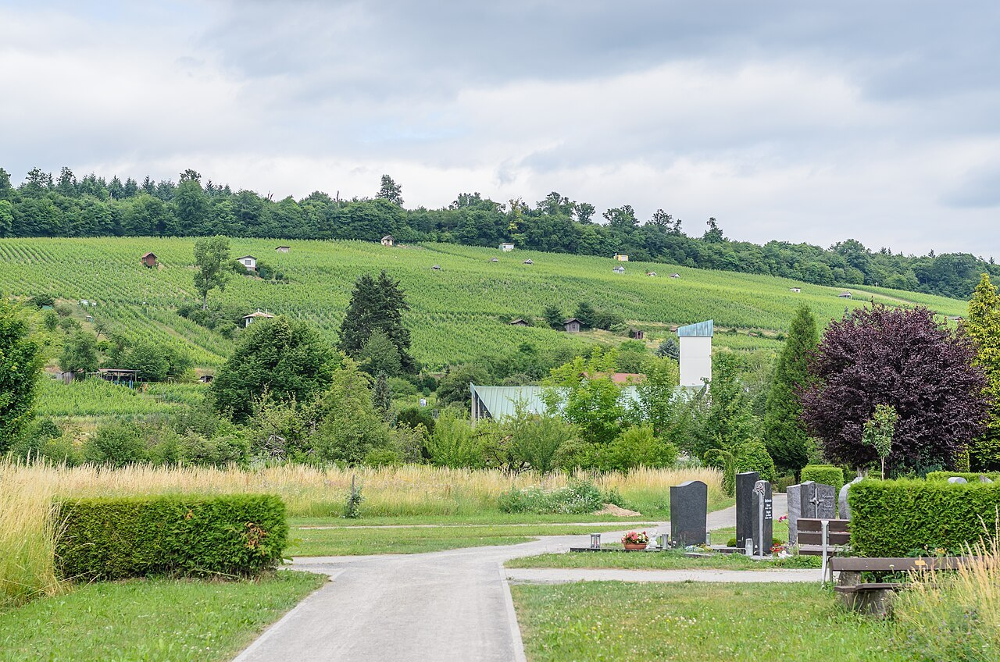

# 巴登

巴登（Baden）是德国西南部的法定产区，从北部的陶伯弗兰肯（Tauberfranken）沿莱茵平原延伸到南部的博登湖（Bodensee），全长约 400 公里，2025 年约 15,100 公顷，是德国最南端、面积第三大的产区。

图：巴登。摄影：File:Weingarten (Baden) vineyards and cemetery.jpg。署名：Bradley Rentz，CC BY-SA 4.0，来自 Wikimedia Commons（[来源](https://commons.wikimedia.org/w/index.php?curid=62119162)）。

## 定义与范围

巴登是受保护的法定产区名称，葡萄必须来自划定的九个分区，并在区内酿造。产区的狭长形状意味着气候、土壤与品种差异巨大，酒标上的分区名往往比“Baden”本身更能说明风格。

巴登以红葡萄酒见长，Spätburgunder 是最重要的红葡萄；白葡萄以 Müller-Thurgau、Gutedel、Riesling、Grauburgunder 与 Weißburgunder 为主。

## 「巴登」的时间线
巴登的葡萄种植可追溯到罗马时期，中世纪修道院与诸侯宫廷推动了莱茵平原与 Kaiserstuhl 的坡地开垦。19 世纪，巴登大公国建立了葡萄种植与酿造机构，合作社体系也在这一时期发展。

20 世纪后期，巴登从以产量为导向转向质量分级，Spätburgunder 的红酒路线与 Gutedel 的地方白葡萄路线同时得到强化。如今产区既保留合作社的大众市场，也有一批小型酒庄专注地块与老藤。

## 地理与气候

巴登沿莱茵河上游平原展开，西侧是莱茵河与法国阿尔萨斯，东侧是黑森林。平原与山地之间形成狭长的向阳坡地，光照充足、降雨较少，是德国最温暖的产区之一。

土壤高度多样：Kaiserstuhl 为火山岩与火山灰，Breisgau 与 Tuniberg 多石灰岩，Kraichgau 以黄土为主，Markgräflerland 有片麻岩与花岗岩，博登湖一带为冰川砾石与黏土。排水、保热与pH 差异直接反映在酒体与酸度上。

博登湖对南部气候有调节作用，延长生长季并降低霜冻风险；北部陶伯弗兰肯更靠内陆，成熟期更短。

## 九个分区

巴登分为九个分区，从北到南依次是：

- Tauberfranken：最北端，靠近弗兰肯，气候较冷，以白葡萄与轻盈红酒为主。
- Badische Bergstraße：海德堡与曼海姆之间，坡地朝西，黄土与花岗岩。
- Kraichgau：莱茵河与内卡河之间的丘陵，黄土土壤，产量较大。
- Ortenau：从巴登-巴登到奥芬堡，雷司令与 Spätburgunder 表现突出。
- Breisgau：弗赖堡周边，石灰岩坡地，红白兼有。
- Kaiserstuhl：莱茵平原中的火山丘，温暖干燥，是巴登红酒的核心。
- Tuniberg：Kaiserstuhl 南侧的低丘，石灰岩与黄土，风格更轻。
- Markgräflerland：巴塞尔与弗赖堡之间，Gutedel 的传统家园。
- Bodensee：博登湖沿岸，冰川砾石，气候受湖体调节。

分区是地理与风格描述，不是等级排序；同一分区内部的地块差异同样明显。

陶伯弗兰肯（Tauberfranken）以 Müller-Thurgau 与 Spätburgunder 为主，气候比南部更接近弗兰肯，酒体也更紧。

## 品种与原料

Spätburgunder（黑皮诺）是巴登最重要的红葡萄，Kaiserstuhl 与 Ortenau 的表现尤为突出。Gutedel（Chasselas）在 Markgräflerland 有数百年历史，酒体轻、酸度温和，是地方标志。

白葡萄还包括 Müller-Thurgau、Riesling、Grauburgunder、Weißburgunder 与 Chardonnay；红葡萄有少量 Cabernet 系品种与 Merlot，多用于调配。原料是[葡萄](ref:grape)。

Kaiserstuhl 的火山岩与 Breisgau 的石灰岩，让同一产区内的 Spätburgunder 呈现不同的单宁与酸度；Gutedel 则在 Markgräflerland 的暖坡上保留更轻的酒体。

## 「巴登」怎么做出来
红葡萄带皮[发酵](ref:fermentation)，浸渍时间与温度决定颜色、单宁与果味；部分酒庄使用开放槽与人工压帽，随后在旧橡木桶中陈年。Spätburgunder 的风格从轻盈果味到结构型都有。

白葡萄低温发酵以保留香气与[酸度](ref:acidity)；Gutedel 通常尽早装瓶，强调清爽；Riesling 与 Grauburgunder 可经酒泥接触增加质感。这里的[橡木桶](ref:oak-ageing)更多用于红酒结构与白葡萄酒的质感，而非单纯增加香草味。

红葡萄酒通常允许苹果酸乳酸发酵以柔化酸度，白葡萄酒则视风格而定。

## 分级与法规

就「巴登」而言，德国葡萄酒分为 Wein、Landwein、Qualitätswein 与 Prädikatswein。Prädikatswein 按采收成熟度分为 Kabinett、Spätlese、Auslese、Beerenauslese、Trockenbeerenauslese 与 Eiswein 六级；等级描述葡萄汁含糖量，不决定成酒甜度。

酒标上的 trocken 指残糖不超过 9 g/L，halbtrocken 指 9–18 g/L；feinherb 是未入法的常用说法。巴登的日常酒款多为干型，甜型集中在 Prädikat 的高级别与 Eiswein。

“Großes Gewächs”与“Erste Lage”是 VDP 等生产者组织的私法分级，不是国家法定等级；购买时应与 Prädikat 等级、分区与地块分开理解。

## 「巴登」的酒标与喝法
酒标应核对产区名 Baden、分区（Bereich）、村庄与地块、品种、年份、酒精度、容量与装瓶者。Spätburgunder 也可能写作“Blauer Spätburgunder”，两者指同一品种。

Spätburgunder 建议 14–16 摄氏度饮用，Gutedel 与清爽白葡萄酒建议 8–10 摄氏度。红酒适合禽类、蘑菇、猪肉与中等强度红肉；Gutedel 适合鱼类、沙拉与清淡前菜。开瓶后冷藏并尽快喝完。本页关于巴登的内容涉及酒精饮料；过量饮酒有害健康，未成年人不应饮酒。

## 「巴登」容易被读错的地方
第一，认为巴登只是红葡萄酒产区。白葡萄仍占相当大的比重，Gutedel 与 Müller-Thurgau 是日常主力。
第二，把 Kaiserstuhl 的火山土当成质量保证。土壤影响风格，但年份、地块与栽培决定最终质量。
第三，认为 Gutedel 是低端品种。它在 Markgräflerland 有独立的历史与风格传统。
第四，把“Baden”当成单一风格。九个分区从陶伯弗兰肯到博登湖差异极大。
第五，把 Großes Gewächs 当成国家等级。它是生产者组织的私法标识。

巴登是德国西南部的葡萄酒产区，不是奥地利巴登；德语酒标上的 Baden 与 Badischer 也可能出现在不同语境，需看完整产地标识，不能只认单词。

九个分区土壤差异很大，Spätburgunder 不是全区统一风格；Kaiserstuhl 的火山岩与博登湖砾石要分开看。

**关键事实。**

| 项目 | 内容 |
| --- | --- |
| 一句话定位 | 德国西南部的法定产区，从陶伯弗兰肯沿莱茵平原延伸到博登湖，全长约 400 公里、2025 年约 15,100 公顷，是德国面积第三大的产区，分为九个分区；Kaiserstuhl 的火山岩、Breisgau 与 Tuniberg 的石灰岩、Markgräflerland 的片麻岩与博登湖的冰川砾石构成多样土壤，Spätburgunder 是最重要的红葡萄，Gu… |
| 层级 | 其他 |
| 所属 | 德国 |
| 国家代码 | DE |

**来源与边界。** 本页关于「巴登」的关键事实，主要由以下来源交叉核对：Wines of Germany / Deutsches Weininstitut（产区范围、九个分区与主要品种）、European Union（Prädikatswein 的类别、最低残糖与酒精度规则）、Badischer Weinbauverband（分区与地方品种信息）等 4 条来源。价格、批次与状态会变，涉及这些字段时以页面所列来源的最新版本为准。正文为项目自写，来源只作核验，不复制原文。

## 参考资料
- [德国](ref:germany)：巴登所属的国家产区框架。
- [葡萄酒](ref:wine)：理解巴登的类别、年份与产地规则的入口。
- [白葡萄酒](ref:white-wine)：Gutedel 与 Müller-Thurgau 所属的类别。
- [红葡萄酒](ref:red-wine)：Spätburgunder 所属的类别。
- [葡萄](ref:grape)：酿酒葡萄的结构与成熟指标。
- [发酵](ref:fermentation)：带皮发酵与苹果酸乳酸发酵的作用。
- [酸度](ref:acidity)：巴登白葡萄酒酸度与配餐的关系。
- [酒精度](ref:abv)：不同品种与风格在标签上的酒精度差异。
- [橡木桶陈年](ref:oak-ageing)：Spätburgunder 陈年中的桶的角色。

## 相关图像

图：德国类别配图。图片：Renardo la vulpo，CC0，via Wikimedia Commons（[原图页面](https://commons.wikimedia.org/wiki/File:M%C3%BCnchen,_Oktoberfest_2022,_Fischer-Vroni_v_S,_1.jpeg)）。关联图像：巴登。

图：酸度（acidity）。图片：Chemicalinterest，Public domain，via Wikimedia Commons（[原图页面](https://commons.wikimedia.org/wiki/File:Zn_reaction_with_HCl.JPG)）。关联图像：巴登。
