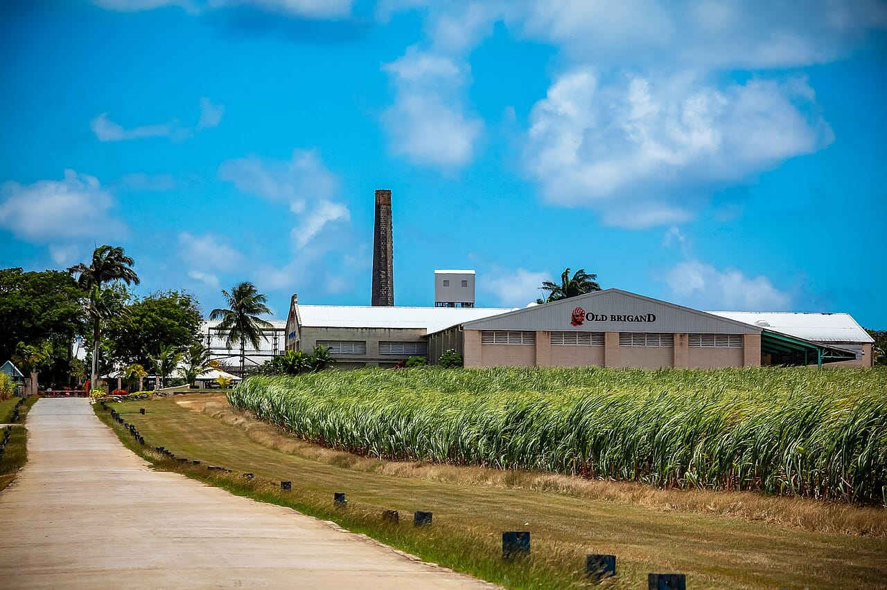
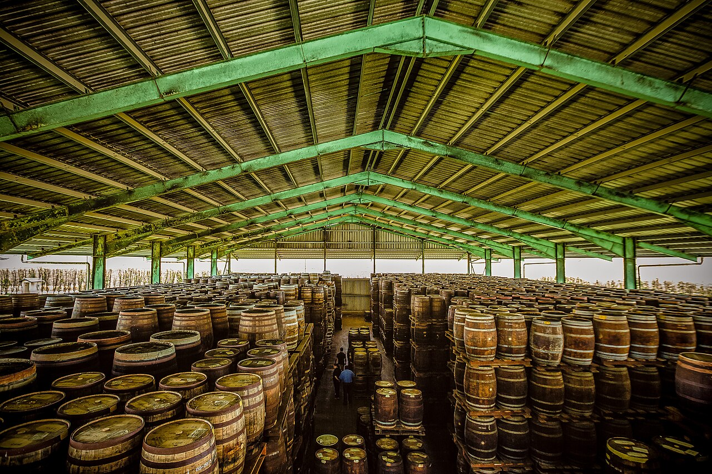

# 巴巴多斯

巴巴多斯是加勒比海小安的列斯群岛中的岛国，也是[朗姆酒](ref:rum)历史最悠久的产区之一。它以糖蜜为原料，常用壶式与柱式蒸馏的调配，再经热带陈年，形成比牙买加高酯风格更平衡、更易饮的酒体。

图：巴巴多斯地区的一处实景。图片：Unknown author Unknown author，CC BY 2.5，via Wikimedia Commons（[原图页面](https://commons.wikimedia.org/wiki/File:Foursquare_Rum_Distillery.jpg)）。这张照片来自巴巴多斯产区内已核实条目，用于说明当地风貌，不是巴巴多斯的全区域地图。

## 地理与甘蔗

巴巴多斯位于加勒比海东部，地势平缓，以珊瑚石灰岩为主，地下水经过岩层过滤，矿物质含量较低。这样的水质与热带气候适合甘蔗种植与制糖，糖蜜因此成为朗姆酒产业的稳定原料。

甘蔗在 17 世纪随加勒比种植园经济扩张而成为岛上的主要作物。糖厂与酒厂的共生关系延续至今：糖蜜的供应、发酵管理与蒸馏能力共同决定产区规模。把海岛气候直接等同于风味，会忽略发酵与蒸馏的作用。

## 朗姆历史

巴巴多斯的朗姆酒生产与 17 世纪的糖业和跨大西洋贸易相连。糖蜜发酵蒸馏后便于运输，朗姆酒成为船员、港口与种植园经济的一部分。18 世纪，朗姆酒贸易扩张，巴巴多斯逐渐形成成熟的蒸馏与陈年传统。

蒙盖伊（Mount Gay）常被称为持续经营历史最久的朗姆酒品牌之一，其起源可追溯到 1703 年。这类历史叙事说明产区的连续性，但不构成质量排名；品牌历史与瓶中风味是两件事。

## 原料与发酵

巴巴多斯朗姆酒主要使用糖蜜，加水稀释后接种酵母进行[发酵](ref:fermentation)。发酵时间与菌种选择影响酯类与酸类的生成，但整体风格通常比牙买加更克制：果香存在，却不以强烈的“溶剂感”为主导。

部分生产者强调不添加糖与焦糖色，让甜感与颜色更多来自原料与桶陈；另一些产品会使用少量添加物以调整口感。是否添加、如何标示，应以标签与生产者的公开说明为准，不能仅凭甜度判断。

## 蒸馏与风格

巴巴多斯朗姆酒常见壶式与柱式蒸馏的组合。壶式蒸馏保留更多酯类与厚重酒体，柱式蒸馏得到更轻盈、干净的产品，调配比例决定最终风格。与牙买加的高酯传统相比，巴巴多斯更强调平衡、结构与适饮性。

“巴巴多斯朗姆”作为地理标志的讨论，涉及原料、产地与陈年要求，具体条款以官方文本为准。地理标志说明来源与规则符合性，不是质量评分；符合规则的产品之间仍有风格与价格差异。

## 生产者与产区

岛上的主要生产者包括蒙盖伊、Foursquare 与西印度朗姆酒厂等。不同酒厂在蒸馏器、发酵时间与陈年策略上差异明显：有的强调壶式重酒体，有的以柱式轻盈风格为主，有的以不添加糖的纯净路线著称。

生产者名称可以帮助理解风格取向，但不是等级。购买时应看原料、蒸馏方式、陈年声明、酒精度与是否标注添加物，而不是只认岛名或品牌。

## 陈年与饮用

巴巴多斯朗姆酒在橡木桶中热带陈年，参见[橡木桶陈年](ref:oak-ageing)。高温与高湿让蒸发加快，数年即可带来明显颜色与香草、焦糖、干果风味；桶型与新旧比例影响单宁与香料感。

陈年朗姆适合纯饮或加少量水；白朗姆适合调酒，常见酒精度在 40% vol 左右，具体以标签为准。朗姆潘趣是当地常见的混合饮法，糖、青柠、水与香料的平衡比酒精度更重要。颜色深浅不能单独判断陈年长度。

## 常见误区

第一，认为巴巴多斯朗姆都很甜。甜感更多来自陈年、添加物或调酒配方。
第二，把品牌历史当成质量保证。历史说明连续性，不保证偏好。
第三，认为产地名称就是等级。地理标志说明来源与规则。
第四，把壶式与柱式对立。调配两者是产区常见做法。
第五，忽视添加物标示。糖与焦糖色会影响口感与外观。

巴巴多斯的朗姆风格来自糖蜜、壶式与柱式蒸馏的调配，以及热带陈年带来的快速演化；它既有厚重酯香，也有较轻盈的调和型产品。产地名称说明产区与规则，不是质量等级；读酒标时要看原料、蒸馏方式、陈年与是否加糖，不能只凭岛名判断。热带陈年会让酒液在较短时间内获得更多氧化与挥发变化，但陈年速度不等于陈年质量；壶式与柱式原酒的配比、是否加糖以及装瓶酒精度，都会改变最终口感。把岛名当成风格保证，容易忽略这些具体选择。

对照阅读：[朗姆酒](ref:rum)、[蒸馏](ref:distillation)。

## 延伸阅读

- [朗姆酒](ref:rum)：朗姆酒的原料、蒸馏与类别框架。
- [发酵](ref:fermentation)：发酵时间与菌种对香气的影响。
- [蒸馏](ref:distillation)：壶式与柱式蒸馏的差别。
- [橡木桶陈年](ref:oak-ageing)：热带陈年与风味形成。

**关键事实。**

| 项目 | 内容 |
| --- | --- |
| 一句话定位 | 加勒比海岛国与朗姆酒的重要产区，以糖蜜、壶式与柱式蒸馏的调配和热带陈年形成较平衡的风格；产地名称不是质量等级 |
| 层级 | 国家 |
| 国家代码 | BB |

**来源与边界。** 本页关于「巴巴多斯」的关键事实，主要由以下来源交叉核对：Barbados Rum（巴巴多斯朗姆酒的原料、蒸馏与陈年表达）、WIRSPA（加勒比朗姆酒的生产背景与地理标志讨论）、European Union（朗姆酒的原料类别与最低酒精度）等 4 条来源。价格、批次与状态会变，涉及这些字段时以页面所列来源的最新版本为准。正文为项目自写，来源只作核验，不复制原文。

**并读。** 把「巴巴多斯」与「朗姆酒」、「发酵」、「蒸馏」放在一起读时，先确认它们是同一层级还是上下游关系：先确认边界与法定分类，再比较气候、土壤、海拔与代表酒款。本页负责给出产区的基本坐标，对照条目补上具体案例与差异；读完再回到本页，才能分清哪些差别属于产区本身，哪些只是产地、批次或品牌选择。

**适用边界。** 对「巴巴多斯」而言，产区边界、面积与法定分类会随法规更新；气候描述是长期趋势，不是某一年的天气预报。

**更新提示。** 「巴巴多斯」最近核对于 2026-11-05；面积、法定分类、标签规则与年份表现会变，引用前以法规与产区官方文本为准。

## 相关图像

图：四方朗姆酒厂的橡木桶仓库，热带陈年与桶型共同塑造朗姆风格。图片：Unknown author Unknown author，CC BY 2.5，via Wikimedia Commons（[原图页面](https://commons.wikimedia.org/wiki/File:Foursquare_Rum_Distillery_Barrel_Warehouse.jpg)）。关联图像：巴巴多斯。

图：发酵。图片：Tjhackmann，CC BY-SA 4.0，via Wikimedia Commons（[原图页面](https://commons.wikimedia.org/wiki/File:Phylogenetic_tree_of_bacteria_and_archaea,_highlighting_those_that_carry_out_fermentation.png)）。关联图像：巴巴多斯。
