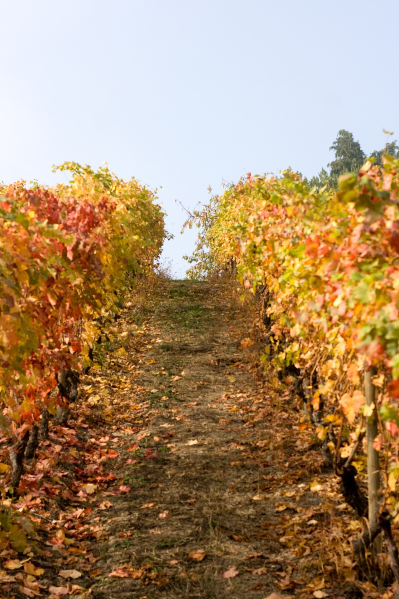

# 巴罗洛

巴罗洛（Barolo）是意大利皮埃蒙特库内奥省朗格丘陵的红葡萄酒保证法定产区（DOCG），1980 年 7 月 1 日由总统令升格，法定只能使用 100% 内比奥罗（Nebbiolo）酿造。产区以巴罗洛、卡斯蒂廖内法莱托与塞拉伦加达尔巴三个完整市镇为核心，另含蒙福特达尔巴、诺韦洛、拉莫拉、韦尔杜诺、格林扎内卡武尔、迪亚诺达尔巴、凯拉斯科与罗迪八个市镇的部分地块，共 11 个市镇。

图：巴罗洛。图片：Biskuit，CC BY-SA 2.0，via Wikimedia Commons（[原图页面](https://commons.wikimedia.org/wiki/File:Cascin_Adelaide_Barolo_%26_decanter.jpg)）。

## 定义与范围

酒标上的 Barolo 只能用于来自划定区域、并在区内完成酿造与法定陈年的静止红[葡萄酒](ref:red-wine)。产区位于[意大利](ref:italy)西北部的[皮埃蒙特](ref:piedmont)，葡萄园只允许建在丘陵坡地，谷底、平地、潮湿或日照不足的地块被明确排除。

自 2010 年 9 月 30 日部令起，巴罗洛可以在地名之后加注附加地理单元（MGA），也可进一步加注 vigna（葡萄园名）。这类标注是可选的，不构成法定分级；不标注 MGA 的巴罗洛同样是 DOCG。

## 历史脉络

内比奥罗的种植史远早于巴罗洛这个名字。巴罗洛最初是朗格丘陵中的一个村庄与贵族家族名称，19 世纪以后才逐渐成为这一类酒的代称；19 世纪下半叶，本地酒庄与皮埃蒙特的政治精英推动了以纯内比奥罗酿造、可长期陈年的红酒风格。

1933 年部令首次以文字划定葡萄来源范围；1966 年 4 月 23 日总统令授予 DOC 地位，公报号为 145，日期为 1966 年 6 月 14 日。1980 年 7 月 1 日总统令将其升为 DOCG，公报号为 21，日期为 1981 年 1 月 22 日。此后 2010 年、2011 年、2014 年与 2015 年又有多轮修订，MGA 体系正是 2010 年修订的产物。

MGA 把村名之外的单一坡地与历史地块名纳入官方附件，使酒标可以标注更具体的地理来源；标注 MGA 与 vigna 的酒同时必须满足更低的产量与更高的自然酒精度。

## 地理与气候

巴罗洛位于塔纳罗河以南的朗格丘陵，葡萄园海拔被限定在 170 至 540 米之间。坡向对成熟影响很大，生产规程规定新植园不得选在正北朝向的陡坡，这与内比奥罗晚熟、需要充足热量与光照的特性直接相关。

土壤被描述为黏土、石灰质与硅质土壤的组合，来自不同地质时期的泥灰岩、砂岩与凝灰岩风化层。这类土壤排水性好、肥力不高，能限制产量并让根系深扎；不同坡位的土层厚度与石灰质比例，是同一村庄内部风格差异的重要原因。

气候属大陆性，冬季寒冷、夏季温暖，秋季昼夜温差大，清晨常起雾，内比奥罗的名字常被认为与雾有关。塔纳罗河谷带来一定的空气流动与调节作用，但年份差异仍然明显：成熟不足的年份酸度高、单宁生硬，成熟充分的年份香气更开放、结构更完整。西部拉莫拉、巴罗洛一带坡面较缓，酒体通常更芳香；东部塞拉伦加达尔巴、蒙福特达尔巴一带坡地更陡、土壤更贫瘠，酒体更紧实、陈年潜力更长。这是风格印象，不是法规分级。

## 品种与栽培

巴罗洛法定只能使用[内比奥罗](ref:nebbiolo)。这一品种发芽早、成熟晚，果皮薄而单宁与酸度高，酒色偏淡，年轻时常见玫瑰、红果与香料，陈年后发展出焦油、皮革、松露与干花的气息。

新植或补植园的种植密度不得低于每公顷 3,500 株，修剪限定为传统的 counter espalier 与 Guyot，禁止人工催熟。产量上限为每公顷 8 吨；若标注 MGA 与 vigna，则降至 7.2 吨/公顷，最低自然酒精度从 12.5% 提高到 13.0%。年轻葡萄园另有递减上限：第 3 年 4.3 吨/公顷、第 4 年 5.0 吨/公顷、第 5 年 5.8 吨/公顷、第 6 年 6.5 吨/公顷，且都要求 13.0% 的最低自然酒精度。这些规则把地块标注与更严格的栽培约束绑定在一起。

## 酿造与陈年

酿造与法定陈年必须在产区内完成，只有符合条件、且能证明长期经营葡萄园的企业，才可能获准在指定市镇的设施中作业。出酒率上限为 70%，即 56 百升/公顷；法定陈年结束后仍不得超过 68%，即 54.4 百升/公顷。

普通巴罗洛须在木桶中至少 18 个月，总陈年至少 38 个月，从采收当年的 11 月 1 日起算；Riserva 的木桶时间同为 18 个月，但总陈年须达 62 个月。上市日期分别为采收后第 4 年的 1 月 1 日与第 6 年的 1 月 1 日。上市时最低总酒精度为 13.0%，总酸不低于 4.5 克/升，无糖干浸出物不低于 22 克/升。

法律没有规定新桶比例或桶型，传统大橡木桶与小型法式桶都合法，这正是同一 MGA 内风格分化的重要原因；[橡木桶陈年](ref:oak-ageing)在这里是结构整合手段，而不是风格标签。以巴罗洛为基酒、加入金鸡纳树皮等香料浸提的加香酒可以标注 Barolo Chinato，它属于另一类产品。

## 分级与法规

巴罗洛只有 DOCG 一层，MGA 不是行政分级，Riserva 也不是地块等级。Riserva 的差别在于更长的总陈年与更晚的上市时间；同一地块可以同时生产普通版与 Riserva，二者不是更好的一块地与更差的一块地的关系。

标注 MGA 与 vigna 时，产量上限降至 7.2 吨/公顷，最低自然酒精度升至 13.0%，年轻葡萄园另有 4.3 至 6.5 吨/公顷的阶段上限。酒标越具体，栽培约束越严格；但约束严格并不自动等于品质更高，年份与酿造仍然起决定作用。

酒标必须出现 Barolo 与 DOCG 字样，MGA 与 vigna 为可选信息。若只写 Barolo，消费者无法据此判断具体村庄；若写 MGA，则应能在生产规程附件中找到对应名称。Riserva 须在完成法定陈年后由生产者主动申请认证，不是所有长陈年酒都自动成为 Riserva。

## 风格与饮用

年轻巴罗洛颜色偏石榴红，香气以玫瑰、红樱桃、覆盆子与香料为主，单宁明显、酸度高，口感紧致。随着陈年，焦油、皮革、干花、松露与泥土气息逐渐出现，结构从硬转为细，这是内比奥罗在高酸高单宁基础上缓慢演化的结果。

饮用温度通常建议在 16 至 18 摄氏度，年轻酒款可提前醒酒，老酒则宜减少暴露时间以避免香气过快散失。配餐适合炖牛肉、野味、菌菇与陈年硬质奶酪；高酸与高单宁能切开油脂，也能承受松露与菌菇的泥土风味。

选购时先确定村庄或 MGA，再核对年份与陈年方式，比只看 Barolo 字样更有效。

对照阅读：[意大利](ref:italy)、[内比奥罗](ref:nebbiolo)。

## 参考资料

- [意大利](ref:italy)：国家级产区与 DOCG 体系。
- [皮埃蒙特](ref:piedmont)：巴罗洛所在的行政区与大区葡萄酒框架。
- [内比奥罗](ref:nebbiolo)：巴罗洛唯一法定品种。
- [红葡萄酒](ref:red-wine)：巴罗洛的类别、单宁与酿造概览。
- [橡木桶陈年](ref:oak-ageing)：桶型、桶龄与微氧化的作用。
- [风土](ref:terroir)：坡向、土壤与地块差异的讨论框架。

## 相关图像

图：Piedmont vineyard in autumn。图片：Giorgio Montersino，CC BY-SA 2.0，via Wikimedia Commons（[原图页面](https://commons.wikimedia.org/w/index.php?curid=5816942)）。关联图像：巴罗洛。

图：内比奥罗。图片：Hanna，CC BY 2.0，via Wikimedia Commons（[原图页面](https://commons.wikimedia.org/wiki/File:Close_up_of_Nebbiolo_cluster_in_Italy.jpg)）。关联图像：巴罗洛。
