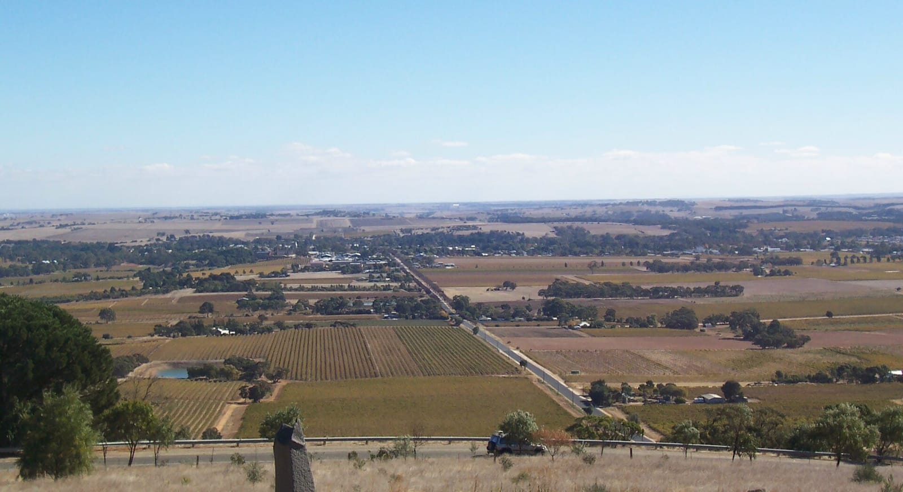

# 巴罗萨

巴罗萨（Barossa）是南澳最著名的葡萄酒产区，位于阿德莱德东北，以 Shiraz、老藤与浓郁的红葡萄酒风格闻名。它不是一个单一 GI，而是由 Barossa Valley 与 Eden Valley 两个区组成。

图：巴罗萨相关实景照片。图片：No machine-readable author provided. ScottDavis assumed (based on copyright claims).，CC BY-SA 3.0，via Wikimedia Commons（[原图页面](https://commons.wikimedia.org/wiki/File:Tanunda.jpg)）。

## 定义与范围

巴罗萨位于南澳大利亚州，阿德莱德东北约一小时车程。在澳大利亚 GI 层级中，Barossa 是一个 zone，下含两个 region：Barossa Valley 与 Eden Valley。两个 region 各自有独立的 GI 边界与酒标规则。

Barossa Valley GI 面积 578 平方公里，葡萄园 11,609 公顷；Eden Valley GI 面积 591 平方公里，葡萄园 2,169 公顷。两个区合计约 1.4 万公顷葡萄园，是澳大利亚最重要的红葡萄酒产区之一。

## 「巴罗萨」的时间线
19 世纪 40 年代，欧洲移民在巴罗萨定居并建立葡萄园。Wine Australia 的记录显示，当地仍有 1843 年种植的 Shiraz，被认为是世界上最古老的 Shiraz 之一。19 世纪后期，产区的葡萄园与酒庄体系逐步成形。

20 世纪前期经历病害、经济波动与市场变化，但巴罗萨的老藤资源得以保留。20 世纪后期，Shiraz 与 GSM 混酿在国际市场获得认知，巴罗萨成为澳大利亚红葡萄酒的代表产区。

## 地理与气候

巴罗萨属地中海气候：夏季炎热干燥、冬季温和多雨。Barossa Valley 谷底温暖，1 月均温约 21.9 摄氏度，生长季降雨仅约 220 毫米；周边山地海拔升高，形成更凉爽的中气候（mesoclimate），Eden Valley 的生长季降雨约 229 毫米，成熟与采收期明显更凉。

海拔差异是理解巴罗萨的关键。Barossa Valley 葡萄园分布在海拔 112 至 596 米，Eden Valley 在 219 至 632 米。谷底热量充足，适合充分成熟的 Shiraz 与 Grenache；高海拔地块昼夜温差更大，酸度保留更好，适合 Riesling 与结构更紧致的红葡萄酒。

土壤以低肥力的黏壤土到砂土为主，颜色从灰、棕到红。Barossa Valley 的土壤排水与保水差异明显，底土酸度会限制根系生长；Eden Valley 多铁石与石英砾石，坡地还有风化的云母片岩，保水能力较低。这些差异构成[风土](ref:terroir)基础。

## 子产区

Barossa 的两个 region 在气候与品种上差异明显：

- Barossa Valley：谷底与低坡温暖，Shiraz 约占种植面积一半，Cabernet Sauvignon 与 Grenache 也重要；Grenache 常与 Shiraz、Mataro 混酿为 GSM。
- Eden Valley：海拔更高、成熟期更凉，Riesling 是最重要的白品种，Shiraz 是最重要的红品种；Riesling 带明显的青柠气息，可陈年十年以上。

两个 region 内部没有注册的次级产区，酒标上的具体地名多为地块俗称。不要把酒庄名、品牌名与 GI 名称混为一谈。

## 品种与原料

Shiraz 是巴罗萨最具代表性的品种，在 Barossa Valley 约占葡萄园的一半。成熟的黑莓、李子、甘草与香料是常见描述，酒体饱满、单宁丰沛。Cabernet Sauvignon 在较凉爽地块表现更好，风格比库纳瓦拉与玛格丽特河更成熟、单宁更柔。Grenache 带成熟的覆盆子与胡椒气息，常用于混酿。

Eden Valley 以 Riesling 与 Shiraz 为核心，另有 Chardonnay 与 Cabernet Sauvignon。原料是[葡萄](ref:grape)。老藤是巴罗萨的重要资源，但老藤不等于高品质：同一地块的年份、栽培与酿造同样重要。

## 「巴罗萨」怎么做出来
红葡萄经除梗与温控[发酵](ref:fermentation)，浸渍时间依品种与风格调整。Shiraz 常采用较长时间浸渍与压帽，以提取颜色与单宁，随后在法国或美国[橡木桶](ref:oak-ageing)中陈年，新桶比例因酒庄而异。Grenache 单宁较轻，常与 Shiraz、Mataro 共同发酵或分别陈年后调配。

白葡萄低温发酵。Riesling 多用不锈钢罐以保留酸度与香气，部分酒款保留少量残糖；Chardonnay 部分经橡木桶与酒泥搅拌。起泡酒在巴罗萨也有生产，但规模有限。

## 法规与酒标

澳大利亚葡萄酒的产区标识以 GI 为核心，由 Wine Australia 管理。单一产区、品种或年份标注时，酒款至少 85% 须来自所标注的产区、品种或年份；混酿须在酒标上标明，主要来源排在前。Barossa、Barossa Valley 与 Eden Valley 是不同层级的 GI 名称，覆盖范围不同。

Barossa Old Vine Charter 于 2009 年由 Barossa Grape & Wine Association 推行，把老藤按树龄分为四档：Old Vine（35 年以上）、Survivor Vine（70 年以上）、Centenarian Vine（100 年以上）、Ancestor Vine（125 年以上）。这是自愿性的行业标识，不是法定质量等级，也不改变 GI 的产地规则。

澳大利亚没有全国统一的酒庄分级。市场评价更多来自酒庄历史、酒款表现与媒体评分，而不是某个官方等级。

## 「巴罗萨」的酒标与喝法
酒标应核对 GI 名称、品种、[年份](ref:vintage)、[酒精度](ref:abv)、容量与装瓶者。标注[单一品种](ref:single-varietal)的酒款须达到 85% 品种比例；混酿按法规列出品种。Shiraz 与 GSM 建议 16–18 摄氏度，Riesling 建议 8–10 摄氏度，Chardonnay 建议 10–12 摄氏度。

Shiraz 适合烤肉、红肉与硬质奶酪；Grenache 与 GSM 适合禽肉、炖菜与香料风味菜肴；Riesling 适合海鲜、亚洲料理与辛辣食物。开瓶后冷藏并尽快喝完。本页关于巴罗萨的内容涉及酒精饮料；过量饮酒有害健康，未成年人不应饮酒。

## 「巴罗萨」容易被读错的地方
第一，把 Barossa 当成一个单一产区。Barossa 是 zone，Barossa Valley 与 Eden Valley 是两个不同的 region。
第二，认为巴罗萨只有 Shiraz。Shiraz 占主导，但 Grenache、Cabernet Sauvignon、Riesling 与 Chardonnay 都有重要地位。
第三，把老藤当成质量等级。Old Vine Charter 是自愿标识，老藤不等于更好的酒。
第四，以为巴罗萨全境都炎热。谷底温暖，但 Eden Valley 与高海拔地块明显更凉。
第五，把 GI 名称当成品牌。GI 是地理边界，酒庄名与品牌名是另一回事。

**关键事实。**

| 项目 | 内容 |
| --- | --- |
| 一句话定位 | 南澳阿德莱德东北的葡萄酒产区，GI 层级上 Barossa 为包含 Barossa Valley 与 Eden Valley 两个区的 zone；Barossa Valley GI 578 平方公里、葡萄园 11,609 公顷，海拔 112–596 米，Shiraz 约占种植面积一半 |
| 层级 | 其他 |
| 所属 | 澳大利亚 |
| 国家代码 | AU |

**来源与边界。** 本页关于「巴罗萨」的关键事实，主要由以下来源交叉核对：Wine Australia（GI 面积、葡萄园面积、海拔、生长季降雨、1 月均温、品种结构与 1843 年老藤信息；Eden Valley 的 GI 面积、葡萄园面积、海拔、降雨、土壤与品种信息）、Barossa Grape & Wine Association（Old Vine Charter 的 35、70、100、125 年四档划分）。价格、批次与状态会变，涉及这些字段时以页面所列来源的最新版本为准。正文为项目自写，来源只作核验，不复制原文。

## 参考资料
- [葡萄酒](ref:wine)：理解巴罗萨的类别、年份与产地规则的入口。
- [红葡萄酒](ref:red-wine)与[白葡萄酒](ref:white-wine)：巴罗萨两大酒类的基本框架。
- [西拉](ref:shiraz)：巴罗萨最具代表性的红品种。
- [雷司令](ref:riesling)：Eden Valley 的核心白品种。
- [歌海娜](ref:grenache)：GSM 混酿的重要组成部分。
- [葡萄](ref:grape)：酿酒葡萄的结构与成熟指标。
- [发酵](ref:fermentation)：红葡萄浸渍与白葡萄低温发酵。
- [酸度](ref:acidity)：高海拔与昼夜温差对酸度的影响。
- [风土](ref:terroir)：谷底、坡地与土壤差异如何形成两个 region。
- [橡木桶陈年](ref:oak-ageing)：Shiraz 的桶型与新桶比例。
- [干型](ref:dry)：Riesling 从干型到保留残糖的风格。
- [年份](ref:vintage)：巴罗萨的年份差异与干旱影响。
- [单一品种](ref:single-varietal)：85% 品种标注规则。
- [酒精度](ref:abv)：酒标上 % vol 的含义。

## 相关图像

图：雷司令。图片：No machine-readable author provided. T.o.m.~commonswiki assumed (based on copyright claims).，CC BY-SA 3.0，via Wikimedia Commons（[原图页面](https://commons.wikimedia.org/wiki/File:Riesling_grapes_leaves.jpg)）。关联图像：巴罗萨。

图：歌海娜。图片：Jules Troncy，Public domain，via Wikimedia Commons（[原图页面](https://commons.wikimedia.org/wiki/File:Grenache_N.jpg)）。关联图像：巴罗萨。
