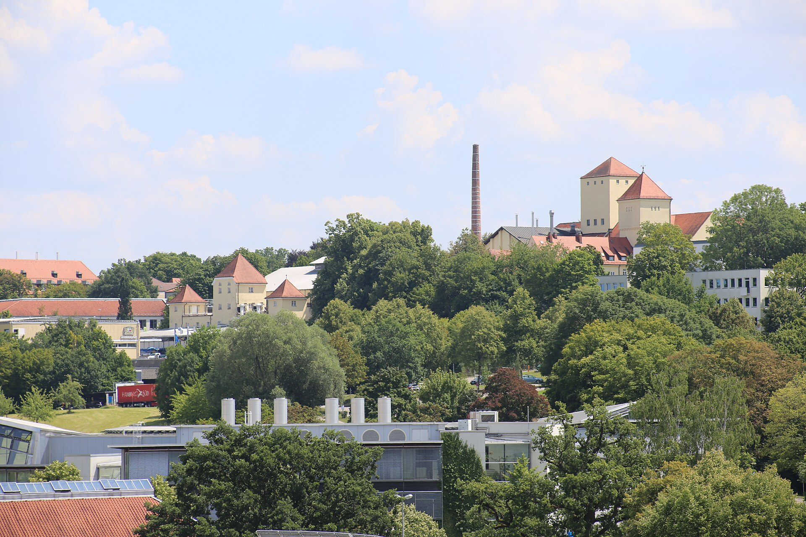
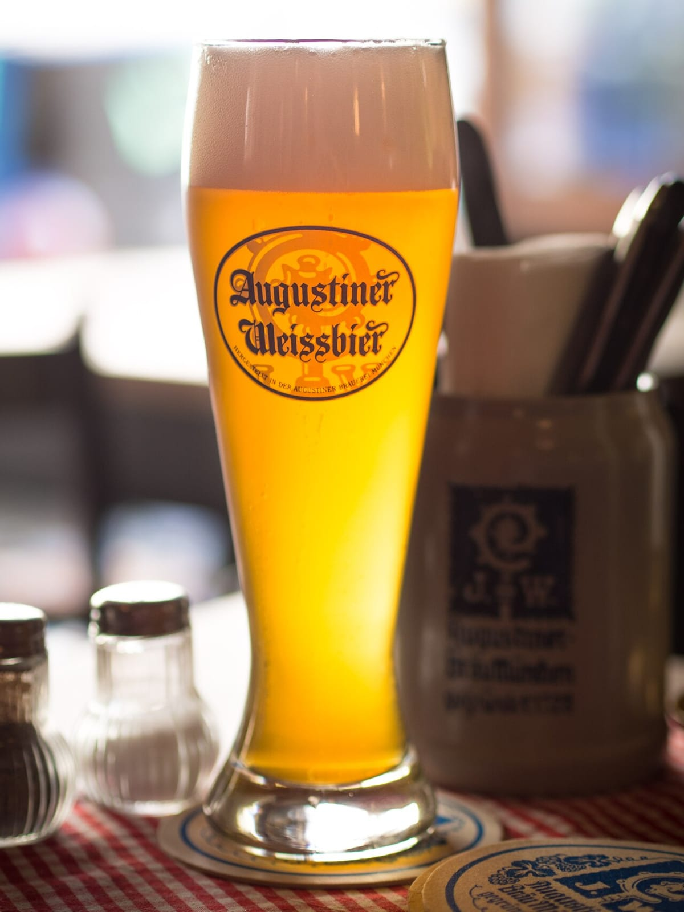

# 巴伐利亚

巴伐利亚（Bavaria）是德国南部最大的联邦州，也是世界上啤酒法规最著名的地区之一。慕尼黑、纽伦堡、班贝格与拜罗伊特各自有清晰的啤酒传统，从清澈的拉格到烟熏啤酒、小麦啤酒与浓烈双料博克。理解巴伐利亚啤酒，既要看 1516 年的《啤酒纯度法》，也要看它今天如何被解释、被例外、被绕开。

图：巴伐利亚地区的一处实景。图片：Christian Schranner，CC BY-SA 4.0，via Wikimedia Commons（[原图页面](https://commons.wikimedia.org/wiki/File:%C3%9Cberblick_der_Bayerischen_Staatsbrauerei_Weihenstephan.jpg)）。这张照片来自巴伐利亚产区内已核实条目，用于说明当地风貌，不是巴伐利亚的全区域地图。

## 南部德国的啤酒地理

巴伐利亚的啤酒产业分成几个重心。上巴伐利亚以慕尼黑为核心，酒厂规模大、出口比例高；下巴伐利亚与上普法尔茨保留大量中小酒厂；弗兰肯（Franken）则是密度最高的区域，乡镇酒厂与自家酒窖文化仍然存在。阿尔卑斯山北麓的水源偏硬、富含碳酸盐，历史上更适合深色拉格；北部与东部的花岗岩、砂岩地区水质较软，更适合清爽的皮尔森。水质差异是理解地方风格的第一把钥匙。

## 《啤酒纯度法》的由来

1516 年，巴伐利亚公爵威廉四世与路德维希十世在因戈尔施塔特颁布《啤酒纯度法》（Reinheitsgebot），规定啤酒只能使用大麦、啤酒花与水。它常被描述为“世界最早的食品安全法”，但最初也带有价格与原料管制的目的：小麦与黑麦被保留给面包，酿造不得挤占粮食。当时酵母的作用尚未被认识，直到 19 世纪巴斯德的研究之后，酵母才被正式列入允许原料。

## 从地方条例到联邦法律

1906 年，纯度法在全德意志帝国范围内生效；1952 年的《啤酒税法》把它写入联邦层面；1993 年的《临时啤酒法》沿用至今。现行规则区分下发酵与上层发酵：下发酵啤酒只允许水、麦芽、啤酒花与酵母；上层发酵啤酒则可以使用其他糖源与原料。这一区分常被忽略，却是理解德国啤酒法实际边界的关键。纯度法也不是“所有啤酒都必须遵守”的绝对命令，欧盟单一市场原则允许在其他成员国合法生产的啤酒进入德国销售。

## 原料与水

巴伐利亚大麦多为冬大麦或春大麦，经发芽、烘干后使用；小麦啤酒以小麦麦芽为主体，比例通常在一半左右。啤酒花主要来自哈拉道（Hallertau），这是世界上最大的连续啤酒花种植区，面积约 1.7 万公顷，以温和的草本与香料香型著称。慕尼黑的水偏硬，适合深色麦芽与较重的酒体；北部弗兰肯的水更软，皮尔森与清爽拉格更容易做干净。酵母方面，下发酵酵母在低温下工作，发酵时间长、风味干净；小麦啤酒酵母则产生香蕉与丁香般的酯香与酚香。

## 慕尼黑与经典风格

慕尼黑的代表风格是清亮拉格（Helles）：淡金色、麦芽甜、苦味温和，适合大量饮用；深色拉格（Dunkel）以慕尼黑麦芽为特征，带烤面包与可可气息；三月啤酒（Märzen）与节庆啤酒（Festbier）酒体更饱满，是十月啤酒节的主力。皮尔森在巴伐利亚也广泛生产，但通常比捷克版本更干、更苦。双料博克（Doppelbock）源自慕尼黑的修道院酿造传统，酒精度高、残糖多，常以“-ator”结尾命名。

## 小麦啤酒

小麦啤酒（Weißbier）是巴伐利亚最具辨识度的风格之一，以小麦麦芽与下发酵酵母酿成，常见香蕉、丁香、面包与柑橘气息。传统瓶装小麦啤酒会保留酵母，饮用前轻轻摇匀；过滤版本则更清澈、更易饮。小麦啤酒在巴伐利亚有独立的酒馆文化，常配白香肠与早餐，这与德国其他地区的啤酒习惯不同。

## 弗兰肯与烟熏啤酒

弗兰肯的班贝格是烟熏啤酒（Rauchbier）的核心产地。麦芽在明火烘烤中吸收烟熏味，酒体呈深琥珀色，带火腿、篝火与烤面包气息。Schlenkerla 与 Spezial 是两家常被提到的历史酒厂，前者以连续生产与酒馆文化著称，后者风格更细腻。弗兰肯还有大量乡镇酒厂，每家每年只生产少量啤酒，季节性与地方性极强，这与慕尼黑的大型工业酒厂形成对照。

## 酒厂、节庆与市场

巴伐利亚有世界最古老的仍在运营的酒厂之一：弗赖辛的 Weihenstephan 可追溯到 1040 年；慕尼黑的 Augustiner 始于 1328 年，Hofbräuhaus 始于 1589 年，Paulaner 始于 1634 年。1810 年，慕尼黑首次举办十月啤酒节，今天它已成为全球最大的啤酒节之一。市场方面，德国啤酒消费长期下降，无酒精啤酒与精酿风格增长；巴伐利亚大型酒厂依赖出口与品牌，小型酒厂则依靠地方忠诚度与酒窖直售。

## 常见误区

第一，认为《啤酒纯度法》禁止一切其他原料。上层发酵啤酒与现代法规都留有空间。第二，把纯度法当成质量保证。原料清单不等于工艺水平。第三，认为巴伐利亚只有小麦啤酒。清亮拉格才是日常主力。第四，把慕尼黑硬水当成所有巴伐利亚的水质。弗兰肯与东部的水更软。第五，认为烟熏啤酒是巴伐利亚全境风格。它主要集中在班贝格。第六，把十月啤酒节当成啤酒风格的名称。节庆啤酒是独立风格，与三月啤酒相近但不相同。

对照阅读：[德国](ref:germany)、[拉格啤酒](ref:lager)。

## 延伸阅读

- [德国](ref:germany)：德国啤酒法与啤酒文化的总体框架。
- [啤酒](ref:beer)与[拉格](ref:lager)：巴伐利亚最常见的酒类。
- [皮尔森](ref:pilsner)与[小麦啤酒](ref:wheat-beer)：两种代表性风格。
- [大麦](ref:barley)、[小麦](ref:wheat)与[水](ref:water)：主要原料。
- [发酵](ref:fermentation)：下发酵与上层发酵的差异。

**关键事实。**

| 项目 | 内容 |
| --- | --- |
| 一句话定位 | 德国南部的联邦州，也是世界上啤酒法规最著名的地区之一；1516 年的《啤酒纯度法》规定下发酵啤酒只能用水、麦芽、啤酒花与酵母，但现代法律对上层发酵与进口啤酒留有例外，巴伐利亚啤酒的实际面貌远比一条法规复杂 |
| 层级 | 其他 |
| 国家代码 | DE |

**来源与边界。** 本页关于「巴伐利亚」的关键事实，主要由以下来源交叉核对：Bavarian State Ministry（《啤酒纯度法》的历史背景、现行适用范围与巴伐利亚啤酒产业）、Deutscher Brauer-Bund（德国啤酒法规、风格与产业概况）、Oxford University Press（提供关于德国啤酒、拉格与小麦啤酒的条目；由原条目末尾参考资料迁移，未逐条复核访问日期）等 8 条来源。价格、批次与状态会变，涉及这些字段时以页面所列来源的最新版本为准。正文为项目自写，来源只作核验，不复制原文。

## 相关图像

图：小麦啤酒。图片：Takeaway，CC BY-SA 3.0，via Wikimedia Commons（[原图页面](https://commons.wikimedia.org/wiki/File:2013_Augustiner_Weissbier_Munich_pub.jpg)）。关联图像：巴伐利亚。

图：拉格啤酒。图片：Lars Curfs ( Grashoofd )，CC BY-SA 3.0 nl，via Wikimedia Commons（[原图页面](https://commons.wikimedia.org/wiki/File:Bitburger_Glass.JPG)）。关联图像：巴伐利亚。
