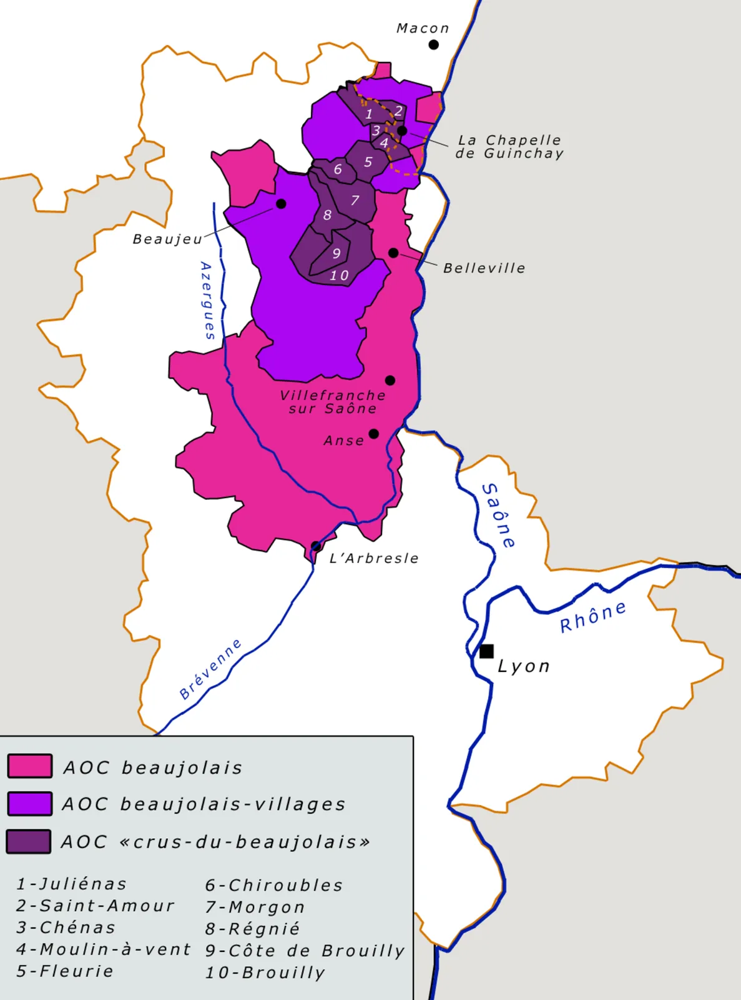

# 博若莱

博若莱（Beaujolais）是法国东部索恩河以西、里昂以北的葡萄酒产区，位于[勃艮第](ref:burgundy)以南。它主要以[佳美](ref:gamay)酿造[红葡萄酒](ref:red-wine)，也少量生产以[霞多丽](ref:chardonnay)酿造的[白葡萄酒](ref:white-wine)。产区从大区级、博若莱村庄到十个村庄级 cru 逐级细分。

图：博若莱。图片：Cyril5555，CC BY-SA 3.0，via Wikimedia Commons（[原图页面](https://commons.wikimedia.org/wiki/File:Carte_vignoble_beaujolais.png)）。

## 地理与气候

博若莱位于[法国](ref:france)东部，葡萄园分布在索恩河以西的丘陵与坡地，北接马孔内，南邻里昂。产区整体呈南北狭长走向，北部地势起伏更大，南部逐渐过渡到较平缓的丘陵。

气候属半大陆性，夏季温暖、秋季较长，适合佳美充分成熟；北部海拔较高、昼夜温差更明显，南部更温暖。年份差异会改变成熟度与酸度，采收期降雨是主要风险之一。

## 「博若莱」的时间线
博若莱的葡萄种植可追溯至中世纪，但它的市场地位与 20 世纪的城市需求密切相关。里昂的餐馆与酒商推动了早期销售，20 世纪后半叶的博若莱新酒又把产区推向更广的消费市场。

博若莱新酒是“当年采收、当年上市”的早期酒款，历史上形成固定的上市节奏，强调新鲜果味而非陈年。它与村庄级 cru 是两种不同的产品逻辑，不能互相替代。

## 子产区与 cru

博若莱的法定产区大致分为三层：博若莱大区级、博若莱村庄级（Beaujolais-Villages）与十个村庄级 cru。十个 cru 是 Saint-Amour、Juliénas、Chénas、Moulin-à-Vent、Fleurie、Chiroubles、Morgon、Régnié、Brouilly 与 Côte de Brouilly。

北部 cru 多位于花岗岩坡地，结构与陈年潜力更强；南部 Brouilly 与 Côte de Brouilly 围绕一座小山，土壤与朝向变化明显。[莫尔贡](ref:morgon)位于北部，是其中面积较大、风格较厚的代表之一。

## 分级体系

大区级博若莱覆盖整个产区，产量最大，风格以果味为主；博若莱村庄级来自指定村庄，成熟度与结构通常更高；十个 cru 各自拥有独立的法定产区名称，只能在对应村庄内生产。

分级由法定产区规则界定，不是市场评价。cru 名称写在酒标上时，通常不再标注“博若莱”大区名；购买时应先确认层级，再看村庄与酒庄。级别越高，产量限制与成熟度要求通常越严。

## 「博若莱」的品种与风格坐标
红葡萄酒几乎全部使用[佳美](ref:gamay)，颜色偏紫红、单宁轻到中等、酸度清晰，典型香气是红樱桃、覆盆子、紫罗兰与牡丹。北部 cru 的酒体更厚、结构更紧，南部与村庄级更轻盈、果味更直接。

白葡萄酒产量很小，以[霞多丽](ref:chardonnay)酿造，风格以柑橘、白花与矿物感为主。博若莱也生产少量桃红与起泡酒，但规模远小于红葡萄酒。

## 土壤与地形

北部 cru 的土壤以花岗岩风化砂为主，排水好、肥力低，促使根系深扎、产量受控；部分地块混合片岩与砂岩。南部则更多黏土与石灰岩，土壤更肥沃，酒体相对柔和。

坡向与海拔同样重要：朝南或东南的坡面成熟更充分，高海拔地块酸度保留更好。土壤与地形的组合解释了同一品种在博若莱内部的风格差异。

## 酒标与年份

酒标通常标注产区名、村庄或 cru 名、年份、酒精度、净含量与装瓶者。大区级会写 Beaujolais，村庄级会写 Beaujolais-Villages，cru 则直接写 cru 名称，例如 Morgon 或 Fleurie。

年份反映那一年的天气。霜冻、冰雹与采收期降雨会改变产量与成熟度；博若莱新酒强调当年果味，不适合长期存放，而 cru 可以陈年数年甚至更久。购买时应同时核对层级、村庄、年份与装瓶信息。

## 市场与饮用

博若莱长期以新酒与日常饮用形象为主，但 cru 的市场定位更高，价格也更高。产区内部差异很大，不能用一个价格区间概括全部酒款。

红葡萄酒适合略低于室温饮用，轻盈酒款可轻微冰镇；适合禽肉、熟食、菌菇与软质奶酪。开瓶后应冷藏并尽快饮用；本页关于博若莱的内容涉及酒精饮料；过量饮酒有害健康，未成年人不应饮酒。

## 「博若莱」容易被读错的地方
第一，把博若莱等同于博若莱新酒。新酒只是产区的一小部分，cru 才是结构与陈年的代表。
第二，认为博若莱属于勃艮第的子产区。它是独立的葡萄酒产区，法规与分级另行界定。
第三，认为佳美只能做轻酒体红酒。北部 cru 的佳美可以有结构感与陈年潜力。
第四，把十个 cru 的风格混为一谈。土壤、坡向与村庄传统造成明显差异。
第五，只用价格判断质量。层级、村庄、年份与装瓶者信息更具体。

博若莱不止“新酒”：佳美在花岗岩土壤与整串发酵下，能做出从轻盈果味到可陈年的村庄级 cru。大区级、博若莱村庄与十个村庄级 cru 是不同层级；新酒只是其中一个市场产品，不能代表整个产区的结构潜力。

对照阅读：[法国](ref:france)、[红葡萄酒](ref:red-wine)。

**关键事实。**

| 项目 | 内容 |
| --- | --- |
| 一句话定位 | 法国东部索恩河以西、里昂以北的葡萄酒产区，位于勃艮第以南、马孔内以南；以佳美酿造的红葡萄酒为主，从大区级、博若莱村庄到十个村庄级 cru 逐级细分，南北土壤与风格差异明显 |
| 层级 | 其他 |
| 所属 | 法国 |
| 国家代码 | FR |

**来源与边界。** 本页关于「博若莱」的关键事实，主要由以下来源交叉核对：Inter Beaujolais（博若莱的子产区、十个 cru 与分级框架；由原条目末尾参考资料迁移，未逐条复核访问日期）、INAO（法国原产地命名制度与博若莱各法定产区的范围；由原条目末尾参考资料迁移，未逐条复核访问日期）、European Union（欧盟葡萄酒类别、地理标志与标签规则）等 7 条来源。价格、批次与状态会变，涉及这些字段时以页面所列来源的最新版本为准。正文为项目自写，来源只作核验，不复制原文。

**并读。** 把「博若莱」与「法国」、「勃艮第」、「红葡萄酒」放在一起读时，先确认它们是同一层级还是上下游关系：先确认边界与法定分类，再比较气候、土壤、海拔与代表酒款。本页负责给出产区的基本坐标，对照条目补上具体案例与差异；读完再回到本页，才能分清哪些差别属于产区本身，哪些只是产地、批次或品牌选择。

## 参考资料
- [法国](ref:france)：法国葡萄酒法规与产区体系。
- [勃艮第](ref:burgundy)：博若莱以北的邻近产区。
- [红葡萄酒](ref:red-wine)与[白葡萄酒](ref:white-wine)：博若莱的两个基本类型。
- [佳美](ref:gamay)：博若莱红葡萄酒的核心品种。
- [霞多丽](ref:chardonnay)：博若莱白葡萄酒使用的品种。
- [莫尔贡](ref:morgon)：博若莱北部具有代表性的村庄级 cru。
