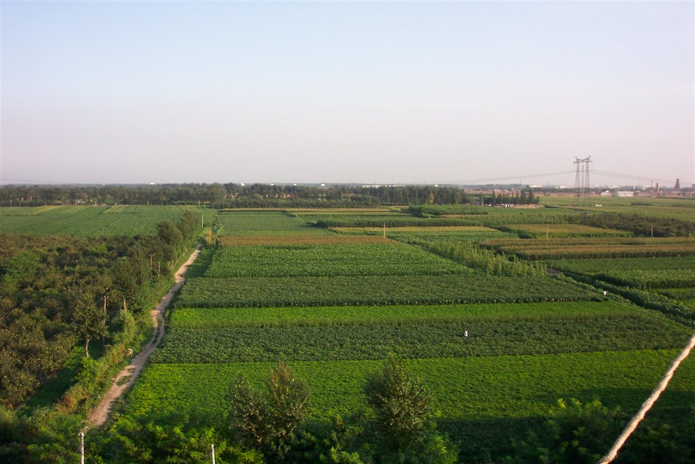

# 北京

中国首都的葡萄酒与白酒产区，房山、密云等地有葡萄园，顺义牛栏山与红星二锅头是清香型白酒的代表；城市边缘的葡萄酒庄与老字号酒厂，构成一种少见的“都市酒乡”。

北京是城市，不是单一葡萄酒产区；房山、密云、延庆的葡萄园与顺义、红星的二锅头，构成两条并行的酒文化脉络。

图：北京。摄影：Aerial View of Farmland。署名：earth_photos，CC BY 2.0，来自 Flickr / Openverse（[来源](https://www.flickr.com/photos/41078423@N00/79668034)）。

## 定义与边界

北京不是[中国](ref:china)法定的葡萄酒产区名，而是行政区划：房山、密云、延庆、昌平与大兴等地都有葡萄园与酒庄，风格随地形与海拔变化。把它当作一个“产区”读时，要先分清城市、酒庄与地块，而不是把“北京”当成单一风土。

北京的白酒产区更明确：顺义牛栏山与红星二锅头是清香型白酒的代表，二锅头以“掐头去尾取中段”的工艺得名。葡萄酒与白酒共享“北京”这个地名，但原料、工艺与法规完全不同，不能混为一谈。

北京没有类似法国 AOC 的葡萄酒法定产区体系，酒标上的“北京”更多是产地或品牌信息。读酒标时，看酒庄、葡萄品种与年份，比看“北京”两个字更有用。

## 历史与命名

北京的家酿与酒坊历史很长，但现代葡萄酒产业是 20 世纪后期才成规模：1980 年代以后，近郊开始种植酿酒葡萄；2000 年代，房山、密云与延庆出现精品酒庄，把北京从“消费城市”变成“城市边缘的酒乡”。

二锅头的历史与北京城紧密相关：红星始建于 1949 年，牛栏山酒厂在顺义，二者都用高粱、小麦或玉米为原料，以清香型工艺蒸馏。二锅头不是葡萄酒，也不是“北京葡萄酒”的替代品。

“北京”作为酒标地名，既可能指葡萄酒庄，也可能指白酒厂；读标签时先看产品类型与原料，再看产地。名称的模糊性，是这个城市酒产业的特点，不是缺点。

## 地理与风土

北京位于华北平原北缘，西、北为燕山与太行山余脉，东南为平原；温带季风气候，冬季寒冷干燥，夏季高温多雨。葡萄园多分布在房山、密云、延庆的山前洪积扇与河谷阶地，排水与霜冻是首要问题。

房山的土壤以砾石、砂壤与黄土为主，排水好、升温快，适合 Cabernet Sauvignon、Merlot 与 Chardonnay；密云与延庆海拔更高、冬季更冷，成熟期更短，酸度更高，适合早熟品种与清爽白葡萄酒。

北京的风土关键词是“大陆性”与“边缘”：冬季低温可能冻伤芽眼，春季霜冻与冰雹风险高，夏季降雨集中，需要疏叶、控产与防病。城市热岛与山地逆温也会改变成熟节奏。

房山的葡萄园多集中在张坊、大石窝与青龙湖一带，海拔不高、热量充足，砾石与砂壤让 Cabernet 成熟得较早；密云与延庆的园子更靠山，冬季更冷、无霜期更短，酒农常用埋土与防风林保护藤蔓。

## 原料与风格

北京葡萄酒以[赤霞珠](ref:cabernet)（Cabernet Sauvignon）、Merlot、Chardonnay 为主，也有品丽珠、小味儿多、雷司令与霞多丽等；红葡萄酒通常酒体中等、单宁紧、酸度高，白葡萄酒清爽、柑橘与青苹果明显。

二锅头是清香型[白酒](ref:baijiu)，酒体干净、香气以粮香与酯香为主，入口烈、回味短；低度版本更柔，高度版本更冲。它适合直接饮用或调酒，不适合用葡萄酒的品鉴语言描述。

北京红葡萄酒的常见问题是酸度与单宁在热年份容易失衡：糖分上升快、酸度下降，酒体显得厚而软。酒庄通过早采、控产与夜间采收保留酸度；白葡萄酒则更依赖海拔与凉爽地块。

## 代表生产者与酒款

房山的波龙堡、莱恩堡等酒庄以 Cabernet Sauvignon 与 Merlot 为主，部分酒款经橡木桶陈年；密云与延庆的酒庄更强调高山气候与清爽白葡萄酒。北京酒庄规模小，产量有限，酒标常标酒庄名而非“北京产区”。

白酒方面，牛栏山与红星是二锅头的代表，产品线从低度到高度、从光瓶到礼盒都有；它们不是精品葡萄酒的替代，而是北京另一条酒文化脉络。

北京酒庄的产量通常不大，酒款以酒庄同名系列为主，部分酒庄也做起泡酒与甜酒；由于没有法定产区等级，酒标上的“Reserve”或“老藤”更多是酒庄自己的表述，读背标比看正标更可靠。

## 上桌方式

北京红葡萄酒温度 16–18°C，白葡萄酒 10–12°C；二锅头常温或微冰，用小型白酒杯。红葡萄酒配烤鸭、烤肉与家常菜；白葡萄酒配鱼、蔬菜与轻奶酪；二锅头配卤味、花生与北方家常菜。

北京菜偏咸、偏油，红葡萄酒的酸度与单宁能切油；二锅头的烈度则适合小口慢饮，不适合与重甜菜同席。

北京的酒庄多兼做餐饮与品鉴，提前预约比临时到访更稳；葡萄酒庄的参观通常包含葡萄园、酒窖与品鉴，二锅头酒厂则以博物馆与生产线参观为主。两条路线不要安排在同一天，距离与交通会吃掉大部分时间。

## 选购与误区

买北京葡萄酒，先看酒庄与年份，再看品种与工艺；北京没有法定产区等级，价格高低更多取决于酒庄投入与产量。买二锅头，先看清香型、酒精度与配料，再看品牌与光瓶/礼盒。

常见误读：把“北京”当成一个统一葡萄酒产区；把二锅头当成葡萄酒的“北京代表”；以为所有北京酒庄都做高端酒。北京是城市，不是单一风土；酒的类型比地名更重要。

## 参见

- [中国](ref:china)：中国酒类产区与法规。
- [赤霞珠](ref:cabernet)：北京红葡萄酒的主要品种。
- [白酒](ref:baijiu)：二锅头的香型与工艺。
- [红葡萄酒](ref:red)：红葡萄的发酵与结构。
- [白葡萄酒](ref:white)：白葡萄的发酵与风格。

**关键事实。**

| 项目 | 内容 |
| --- | --- |
| 一句话定位 | 中国首都的葡萄酒与白酒产区，房山、密云等地有葡萄园，顺义牛栏山与红星二锅头是清香型白酒的代表；城市边缘的葡萄酒庄与老字号酒厂，构成一种少见的“都市酒乡” |
| 层级 | 省/大区 |
| 所属 | 中国 |
| 国家代码 | CN |

**来源与边界。** 本页关于「北京」的关键事实，主要由以下来源交叉核对：中国政府网（中国地理标志与酒类管理政策框架）、OIV（葡萄酒定义与全球生产框架）、FAO（农业地理与气候背景）等 4 条来源。价格、批次与状态会变，涉及这些字段时以页面所列来源的最新版本为准。正文为项目自写，来源只作核验，不复制原文。
