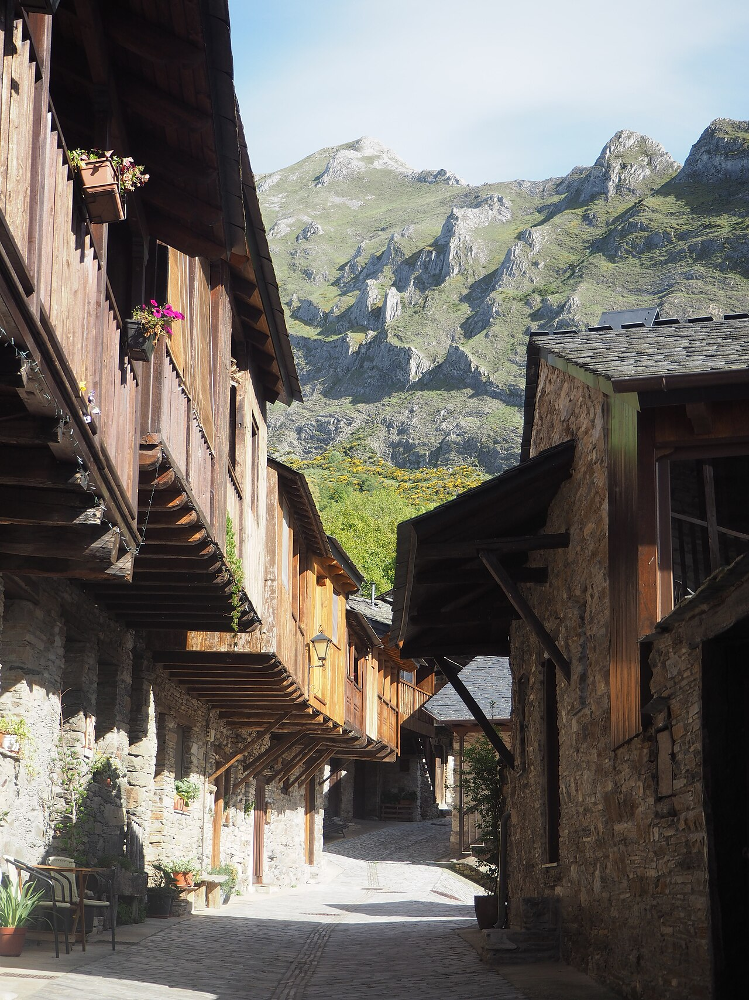

# 比埃尔索

比埃尔索（Bierzo）是西班牙莱昂省西部的葡萄酒法定产区，一个被山地包围的盆地，以 Mencía 红酒、板岩坡地与老藤著称。它在 1989 年正式成为 DO，却是西班牙西北部最晚获得制度承认的老产区之一。

图：比埃尔索。图片：Fogar Mozárabe，CC BY-SA 4.0，via Wikimedia Commons（[原图页面](https://commons.wikimedia.org/wiki/File:Arquitectura_tradicional_de_El_Bierzo.jpg)）。

## 山间盆地里的红酒产区

比埃尔索位于卡斯蒂利亚-莱昂最西端，紧邻加利西亚边界，地理上更接近大西洋流域而不是卡斯蒂利亚高原。产区由 Sil 河及其支流切出的盆地构成，四周山地阻挡了大部分极端天气，使其气候带有过渡性质：比高原温和，又不像加利西亚海岸那样湿润。

这种位置决定了品种结构。Mencía 在这里成熟得足够充分，同时保留酸度；白品种与少量其他红品种作为补充。产区以红葡萄酒为主，却也有历史悠久的白葡萄酒传统。

## 从 1988 到 1989：一个 DO 的确立

比埃尔索的法定地位分两步完成。1988 年 6 月 3 日，产区获得临时承认，同年 10 月 3 日任命了临时监管委员会；1989 年 11 月 11 日，西班牙正式承认 Denominación de Origen Bierzo 并批准其章程。

制度建立得晚，并不意味着葡萄种植历史短。相反，当地葡萄园与混合农业长期共存，许多地块在获得 DO 之前只以散装酒或地方酒形式出售。DO 的确立把这些零散资源整合成一个可识别的产区品牌。

与西班牙其他老产区相比，比埃尔索的酒庄规模普遍偏小，许多酒庄由家族经营，年产数千至数万瓶。合作社与小农结构保留了地块多样性，也限制了单一酒庄的市场影响力。这种"小而多"的格局，是理解比埃尔索酒款风格分散的关键。

## 板岩坡与 Bierzo Alto/Bajo

比埃尔索的地形可以粗略分为两类。北侧与西侧是较高的山地与陡坡，常被称为 Bierzo Alto；南侧与河谷低地较温暖平坦，常被称为 Bierzo Bajo。这两个名称是地理与气候上的常用说法，不是法定子区，酒标上也不会作为官方产区层级出现。

坡地土壤以板岩、石英岩、砂岩与黏土为主，酸性、缺乏碳酸盐，排水性强，肥力低。板岩在阳光下升温快，帮助高海拔地块成熟；同时低肥力限制了产量，使果实更小、皮更厚。河谷低地则有更多冲积土，成熟更容易，风格更宽厚。这些差异构成产区的[风土](ref:terroir)基础。

## Mencía 的性格

Mencía 是比埃尔索的核心品种，占葡萄产量的 70.5%。它发芽早、成熟早，果穗小、果皮颜色深，产量不高。酒款通常呈中等至深宝石红，香气以红樱桃、覆盆子、紫罗兰与黑胡椒为主，常带草本与矿物气息，单宁中等、酸度清晰。

Mencía 的风格弹性很大：整串发酵与少萃取可以做出轻盈芳香的酒，较长时间浸渍与桶陈则能得到更厚实的结构。它容易与 Garnacha、Merlot、Cabernet Sauvignon 或 Syrah 混酿，混酿比例会影响酒标允许标注的品种名称。

## 老藤、混合园与栽培

比埃尔索的葡萄园平均树龄约 75 年，这在欧洲属于罕见的老藤资源。许多老园是混合种植：Mencía 与 Garnacha Tintorera、白品种甚至果树交错，采收后需要分选。这种混合园在法规上不利于单一品种标注，却保留了遗传多样性与风土层次。

栽培多采用灌木式或短架式，坡地依赖人工，机械化程度有限。干旱不是主要限制，成熟期的降雨与湿度才是霉病风险所在。老藤产量低，但根系深，年份波动下的稳定性更好。

采收通常从清晨开始，以保持果实凉爽并保留香气。混合园需要在采收后或发酵前分选，把 Mencía 与白品种、其他红品种分开；这项人工成本很高，却是老园酒款能够保持纯净度的前提。部分酒庄也会对老藤单独发酵，以保留地块差异。

## 酿造与法规

红葡萄经除梗或整串[发酵](ref:fermentation)，浸渍时间依风格而定。传统做法使用大型旧木桶或水泥罐，现代酒庄更多使用法国橡木桶，新桶比例较克制，以避免掩盖 Mencía 的香气。[橡木桶陈年](ref:oak-ageing)对结构型酒款重要，但并非所有酒都需要。

DO 规则规定了允许品种、产量上限与酒标标注方式。酒标须核对产区、品种、[年份](ref:vintage)与[酒精度](ref:abv)；标注单一品种时须满足法定比例，具体数值以监管委员会章程为准。多数红葡萄酒为[干型](ref:dry)，酸度是判断成熟度与配餐的重要线索。

## 饮用与误区

比埃尔索红酒建议在 16 至 18 摄氏度饮用，适合烤肉、炖菜、蘑菇与中等硬度的奶酪。年轻酒款果香外放，老藤酒款则在数年陈放后展现香料与矿物层次。白葡萄酒应更低温饮用，适合海鲜与清淡菜肴。

常见误区有四。第一，把 Bierzo Alto 与 Bajo 当成法定子区：它们是地理称呼。第二，认为 Mencía 只是"西班牙的某种轻红酒"：它的风格跨度很大，从芳香轻盈到结构厚实都有。第三，把老藤当成质量保证：老藤需要正确的栽培与酿造才能体现。第四，以为比埃尔索只产红酒：白葡萄酒同样有历史与法定位置。

对照阅读：[葡萄酒](ref:wine)、[西班牙](ref:spain)。

**关键事实。**

| 项目 | 内容 |
| --- | --- |
| 一句话定位 | 西班牙莱昂省西部的 DO 红酒产区，1988 年 6 月 3 日获临时承认、1989 年 11 月 11 日正式确立；登记葡萄园 2,300 公顷，981 名种植者、69 家酒庄 |
| 层级 | 其他 |
| 所属 | 西班牙 |
| 国家代码 | ES |

**来源与边界。** 本页关于「比埃尔索」的关键事实，主要由以下来源交叉核对：Consejo Regulador de la D.O. Bierzo（登记葡萄园 2,300 公顷、981 名种植者与 69 家酒庄；Mencía 占葡萄产量 70.5% 及其品种特征）、Official Journal of the European Union（产区葡萄园平均树龄约 75 年与 Mencía 为主的品种结构）。价格、批次与状态会变，涉及这些字段时以页面所列来源的最新版本为准。正文为项目自写，来源只作核验，不复制原文。

## 参考资料

- [葡萄酒](ref:wine)：理解比埃尔索的大类归属与产地规则。
- [红葡萄酒](ref:red-wine)：红葡萄酒的酿造与风格框架。
- [西班牙](ref:spain)：西班牙葡萄酒产区的整体格局。
- [发酵](ref:fermentation)：整串发酵与浸渍选择。
- [酸度](ref:acidity)：Mencía 的酸度与配餐。
- [橡木桶陈年](ref:oak-ageing)：桶型与新桶比例对风格的影响。
- [风土](ref:terroir)：板岩坡地与盆地气候。
- [葡萄](ref:grape)：酿酒葡萄的成熟指标。
- [年份](ref:vintage)：年份差异与老藤的稳定性。
- [酒精度](ref:abv)：酒标上 % vol 的含义。
- [干型](ref:dry)：干型与残糖风格的区分。

## 相关图像

图：Uga - Lanzarote - Spain. Vineyards -U16。摄影：Luis Miguel Bugallo Sánchez，CC BY-SA 3.0，来自 Wikimedia Commons。。图片：Luis Miguel Bugallo Sánchez，CC BY-SA 3.0，via Wikimedia Commons（[原图页面](https://commons.wikimedia.org/w/index.php?curid=17458062)）。关联图像：比埃尔索。

图：年份（vintage）。图片：Chiusi Painter，Public domain，via Wikimedia Commons（[原图页面](https://commons.wikimedia.org/wiki/File:Cup_vintage_Cdm_Paris_320_n1.jpg)）。关联图像：比埃尔索。
