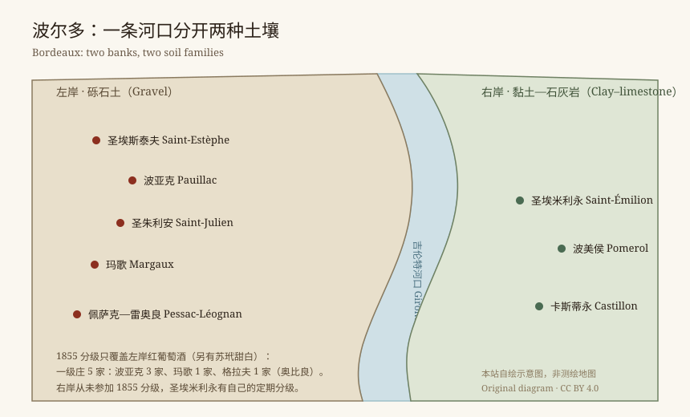

# 波尔多

波尔多是法国西南部吉伦特省（Gironde）的港口城市，也是世界上最具影响力的葡萄酒产区名称之一。吉伦特河口把产区分为左岸与右岸，加龙河与多尔多涅河在此汇合。海洋性气候、砾石与黏土石灰岩土壤、以赤霞珠和梅洛为核心的品种组合，共同构成了波尔多的基本面貌。

图：波尔多左右岸的土壤差异与主要村庄位置。本站自绘示意图，非测绘地图，CC BY 4.0。

## 地理与气候

波尔多靠近大西洋，气候温和湿润，生长季较长。春季霜冻、夏季冰雹和秋季降雨是主要风险；不同年份的天气差异会直接影响采收时间与成熟度。左岸（梅多克、格拉夫）以砾石土壤为主，排水性好，适合晚熟的赤霞珠；右岸（圣埃美隆、波美侯）以黏土与石灰岩为主，更适合梅洛和品丽珠。两片区域的风格差异，往往比“波尔多”这个总名称更值得注意。

采收时间通常从秋季开始，具体取决于品种、地块与成熟度。同一产区内的不同酒庄可能在不同日期采收，甚至同一酒庄的不同地块也会分批采收。晚收可以追求更成熟的果味，但也要承担降雨与病害风险；早收保留酸度，却可能牺牲单宁成熟。年份差异正是这些决策与天气条件共同作用的结果。

## 子产区

- 梅多克（Médoc）：左岸核心，包含圣埃斯泰夫、波亚克、圣朱利安等村庄。
- 格拉夫（Graves）与佩萨克-雷奥良（Pessac-Léognan）：左岸南部，红白皆有。
- 圣埃美隆（Saint-Émilion）与波美侯（Pomerol）：右岸，以梅洛为主。
- 两海之间（Entre-deux-Mers）：两条河之间的区域，干白常见。
- 苏玳（Sauternes）与巴萨克（Barsac）：贵腐甜白产区。

## 品种与风格

[红葡萄酒](ref:red-wine)以赤霞珠、梅洛、品丽珠、小维多和马尔贝克为主。左岸常以赤霞珠为骨架，单宁较强，陈年后发展出雪松与雪茄盒气息；右岸以梅洛为主，口感更圆润，早熟而柔顺。[白葡萄酒](ref:white-wine)以赛美蓉、长相思和密斯卡岱为主，干白清爽，甜白则依赖贵腐菌带来的浓缩与蜂蜜、杏子香气。

## 分级与法规

波尔多属于法国 AOC/AOP 体系，具体规则由 INAO 与欧盟法规框架管理。1855 年梅多克与格拉夫的分级是最广为人知的历史分级，但它只覆盖部分酒庄，并不是整个波尔多的质量排名。圣埃美隆有自己的分级，且会定期修订；中级庄（Crus Bourgeois）则是另一套市场与评审体系。阅读“列级庄”标签时，需要确认它指的是哪一套分级、哪个年份的版本。

## 代表酒款与生产者

波尔多有大量酒庄与酒商。[拉菲古堡](ref:lafite)是波亚克一级庄的代表之一，以赤霞珠为主的混酿和长陈年潜力著称。除此之外，梅多克、格拉夫、圣埃美隆与波美侯都有各自代表性的酒庄。评价具体酒款时，年份、酒庄、地块和装瓶批次都比“波尔多”三个字更重要。

## 市场与饮用

波尔多形成了期酒（en primeur）交易、酒商体系和拍卖市场。期酒让买家在装瓶前购买，也把年份差异放大为价格信号。日常饮用时，波尔多红酒通常在适饮温度下搭配红肉、硬质奶酪；白葡萄酒适合海鲜与禽类；甜白则常与蓝纹奶酪或甜点搭配。开瓶后的陈年潜力取决于具体酒款，而不是产区名称。

## 常见误区

第一，波尔多只产红葡萄酒。它同样生产干白和贵腐甜白，苏玳就是代表。

第二，1855 分级等于波尔多全部酒庄的排名。它只覆盖梅多克与格拉夫的部分酒庄，右岸并不在列。

第三，波尔多酒越老越好。陈年潜力取决于酒款结构、年份与保存条件，普通酒款并不适合长期存放。

## 左岸与右岸的对比

左岸与右岸是理解波尔多的第一把钥匙。左岸以砾石土壤为主，排水性好、升温快，适合晚熟的赤霞珠；酒体通常更紧致，单宁更强，陈年后发展出雪松、烟草与铅笔芯气息。右岸以黏土与石灰岩为主，保水性更好，适合早熟的梅洛；酒体更圆润，果味更饱满，陈年后常呈现李子、松露与巧克力气息。两片区域并不是质量高低的关系，而是品种与土壤匹配的不同答案。

## 土壤与排水

波尔多的土壤差异是左岸与右岸风格差异的物质基础。砾石土壤颗粒大、排水快、白天升温快，能让赤霞珠在较凉爽的气候下达到成熟；黏土与石灰岩土壤保水性强、升温慢，更适合梅洛和品丽珠。土壤并不是孤立的变量，它与地下水位、坡度、朝向和气候共同作用。理解土壤，可以帮助读者明白为什么同一产区内的不同地块会有不同表现。

## 甜白与贵腐

苏玳与巴萨克的甜白依赖贵腐菌（Botrytis cinerea）。秋季潮湿的早晨与干燥的午后，让贵腐菌在葡萄表面生长，蒸发水分、浓缩糖分与香气，形成蜂蜜、杏子、柑橘酱与藏红花般的风味。贵腐菌的出现需要特定的天气条件，因此并非每年都能产出同等质量的甜白。甜白的甜度与酸度平衡，是判断质量的重要维度，而不是只看甜不甜。

## 酒标与年份

波尔多酒标通常标注酒庄名、产区名、年份、酒精度与容量。酒庄名与产区名不是同一件事：同一产区内有大量酒庄，同一酒庄也可能生产不同等级的酒款。年份反映那一年的天气条件，不同年份的成熟度、酸度与病害压力不同，因此同一酒庄的不同年份可以有明显差异。购买时应同时看酒庄、年份、产区和装瓶信息，而不是只看“波尔多”三个字。

## 陈年与侍酒

波尔多红酒的陈年潜力差异很大。结构强、果味集中、酸度与单宁平衡的酒款适合长期存放；普通酒款则更适合在年轻时饮用。侍酒温度通常在室温略低，过高的温度会让酒精感突出；年轻酒款可以醒酒，老酒则应缩短醒酒时间，避免香气散失。搭配上，红酒适合红肉、野味与硬质奶酪，干白适合海鲜与禽类，甜白适合蓝纹奶酪与甜点。这些原则适用于大多数波尔多酒款，但具体酒款仍应参考生产者建议，具体年份的适饮时间也需结合酒款状态判断。

## 期酒与市场

波尔多的期酒制度让买家在酒款装瓶前购买，价格与年份预期密切相关。酒商体系、酒庄与经纪人构成了复杂的交易网络。期酒不是低风险投资，酒款的实际表现、装瓶后的保存条件与市场供需都会影响价值。对普通消费者，理解期酒的存在即可，不必把它当成购买波尔多的唯一渠道。此外，波尔多的酒商与合作社也在日常消费市场中扮演重要角色，它们的产品线不一定出现在期酒名单中。

## 参考边界

本页描述波尔多的地理、品种与制度框架，不评价具体酒庄或年份。产区上级节点请参见[法国](ref:france)。

补充阅读：[阿空加瓜谷](ref:c-extra-1)。

相关条目：[法国](ref:france)、[红葡萄酒](ref:red-wine)、[白葡萄酒](ref:white-wine)。
