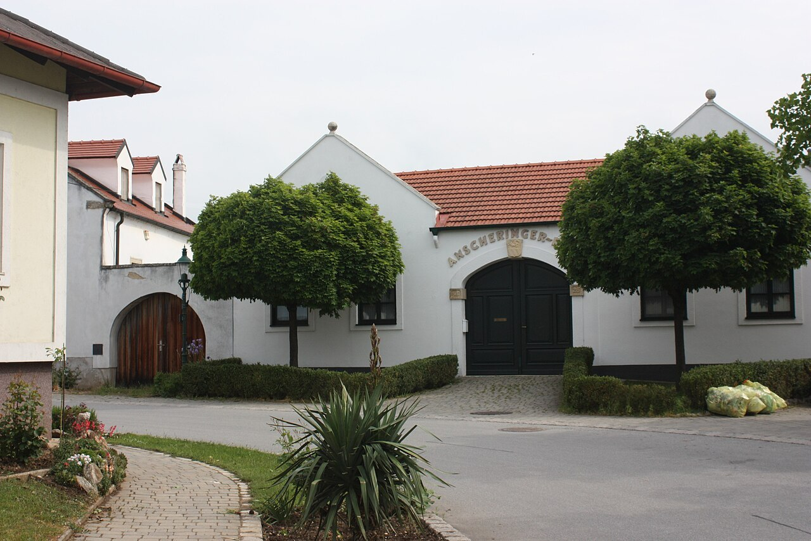

# 布尔根兰

布尔根兰（Burgenland）是奥地利最东部的联邦州级葡萄酒产区，受潘诺尼亚大陆性气候影响，以 Blaufränkisch 红葡萄酒与贵腐甜酒著称。

图：布尔根兰。摄影：Breitenbrunn (Burgenland), vineyard estate house 25 Josef Haydngasse。署名：Dguendel，CC BY 3.0，来自 Wikimedia Commons（[来源](https://commons.wikimedia.org/w/index.php?curid=31331941)）。

## 定义与范围

布尔根兰是奥地利的三个州级葡萄酒产区之一，与下奥地利州和施泰尔马克并列。产区从匈牙利边境向西延伸，北部靠近新锡德尔湖（Neusiedler See），南部到 Eisenberg 一带。

州内再划分为若干具有 DAC 地位的子区。红葡萄酒在总量中约占一半以上，白葡萄酒次之，甜酒集中在湖边与 Seewinkel。

## 「布尔根兰」的时间线
布尔根兰的葡萄种植历史与奥匈帝国时期的边境贸易、庄园经济相连。20 世纪后期，产区逐步从散装酒转向以品种与产地为核心的精品路线。

2005 年，Mittelburgenland 成为布尔根兰第一个 DAC，以 Blaufränkisch 为核心品种。此后 Leithaberg、Eisenberg 与 Neusiedlersee 相继获得 DAC 地位；2018 年 Rosalia 独立为 DAC；2020 年 Ruster Ausbruch 成为甜酒的 DAC，布尔根兰的 DAC 体系至此完整。

## 地理与气候

产区属潘诺尼亚大陆性气候，夏季炎热干燥、日照充足，秋季稳定，成熟条件优于奥地利其他地区。新锡德尔湖是欧亚大陆西缘少见的草原浅湖，水深很浅，白天吸热、夜间释放，延长了湖边葡萄的成熟期。

地质上，布尔根兰横跨施泰尔马克盆地与潘诺尼亚盆地，兼具阿尔卑斯推覆体与彭尼带岩石。北部大面积是第四纪砂砾沉积，Seewinkel 砾石覆盖约三分之一的葡萄园；Neogene 沉积物从黏土到坚硬的 Leitha 石灰岩都有；少量葡萄园位于白云岩、石灰岩、片岩、片麻岩与蛇纹岩上。

土壤与湖面微气候共同构成[风土](ref:terroir)差异：黏土与黄土带来果味与长度，石灰岩与片岩带来矿物感与单宁。

布尔根兰的潘诺尼亚平原与诺伊齐德勒湖周边气候不同，前者更暖，后者受湖面调节；这种差异也让同一产区的白葡萄酒与甜酒呈现不同成熟曲线。

## 子区与 DAC

布尔根兰有六个 DAC，各自规定允许品种与风格：

- Mittelburgenland DAC：2005 年设立，以 Blaufränkisch 为核心，土壤以重黏土与黄土为主，酒体深、果味浓。
- Leithaberg DAC：Leitha 山东西坡，石灰岩与片岩，红葡萄为 Blaufränkisch，白葡萄为 Pinot Blanc、Chardonnay 与 Grüner Veltliner。
- Eisenberg DAC：南部，受施泰尔马克气候影响，含铁片岩土壤，Blaufränkisch 以细致矿物感与优雅结构著称。
- Neusiedlersee DAC：湖东岸，以 Blauer Zweigelt 为主，同时涵盖该区的 Prädikatswein 甜酒。
- Rosalia DAC：2018 年由原 Großlage 升格，Blaufränkisch 与 Zweigelt 的红酒及桃红，黄土带来深度与长度。
- Ruster Ausbruch DAC：2020 年设立，位于 Rust 自由市，以贵腐葡萄酿造的 Ausbruch 甜酒为唯一对象。

DAC 名称后面的产区、村庄与地块信息描述来源范围，不是质量排序。

## 品种与原料

红葡萄以 Blaufränkisch、Blauer Zweigelt 与 Sankt Laurent 为主，另有 Pinot Noir 与少量国际品种。白葡萄包括 Pinot Blanc、Chardonnay、Grüner Veltliner、Welschriesling、Scheurebe 与 Traminer。原料是[葡萄](ref:grape)。

Blaufränkisch 带来深色、黑果、胡椒与较高酸度，是产区最具辨识度的品种；Zweigelt 更柔顺多汁，常用于单一品种或[混酿](ref:blend)；Welschriesling 在甜酒中表现突出。国际品种与红葡萄混酿在近二十年也获得较高评价。

## 「布尔根兰」怎么做出来
红葡萄经除梗、浸渍与[发酵](ref:fermentation)，视风格采用淋皮、压帽或开放式发酵槽。Blaufränkisch 需要足够浸渍提取颜色与单宁，同时避免过度萃取带来的粗糙感。

部分酒款在大型旧桶或小橡木桶中[陈年](ref:oak-ageing)，新桶比例因酒庄而异；强调果味的生产者倾向旧桶或不锈钢。白葡萄多为低温发酵、避免苹果酸乳酸发酵，以保持酸度。

## 贵腐与甜酒

新锡德尔湖东岸的 Seewinkel 分布着众多小盐湖（Zicklacken），空气湿度高，秋季常起雾，为 Botrytis cinerea（贵腐菌）提供条件。贵腐菌使葡萄失水、糖分与酸度浓缩，并带来蜂蜜、杏干与藏红花气息。

按奥地利 Prädikatswein 体系，甜酒主要包括 Beerenauslese（BA）、Trockenbeerenauslese（TBA）、Eiswein、Ausbruch、Strohwein 与 Schilfwein。BA 与 TBA 要求贵腐感染的最低糖度逐级提高；Eiswein 要求在低温下自然结冰后采收；Ausbruch 以贵腐葡萄酿制，Ruster Ausbruch 是其中受 DAC 保护的代表；Strohwein 与 Schilfwein 将葡萄在草席或芦苇席上风干浓缩。

这些类别的共同点是高[残糖](ref:residual-sugar)与高酸度的平衡，而不是单纯的[甜](ref:sweet)。奥地利的国家分级没有 Kabinett，也没有德国的 Spätlese 与 Auslese 名称。

## 「布尔根兰」的酒标与喝法
酒标应核对 DAC 名称、村庄或地块、品种、[年份](ref:vintage)、酒精度、容量与装瓶者。标示单一品种的酒款须为[单一品种](ref:single-varietal)酿造；混酿按法规列出品种。

Blaufränkisch 建议 15–17 摄氏度，Zweigelt 与桃红可稍低；Pinot Blanc 与 Chardonnay 建议 10–12 摄氏度。BA、TBA 与 Ausbruch 建议 8–10 摄氏度，小杯慢饮。开瓶后冷藏并尽快喝完。本页关于布尔根兰的内容涉及酒精饮料；过量饮酒有害健康，未成年人不应饮酒。

## 「布尔根兰」容易被读错的地方
第一，把布尔根兰等同于甜酒产区。甜酒集中在湖边与 Seewinkel，占总量很小，红葡萄酒才是主体。
第二，认为 Blaufränkisch 只是本地品种。它在 Eisenberg 与 Leithaberg 表现出清晰的产地差异。
第三，把 DAC 名称当成等级。DAC 规定品种与风格，产区、村庄与地块才描述来源范围。
第四，认为甜酒越甜越好。BA、TBA 与 Ausbruch 的价值在于酸度与风味的平衡。
第五，用德国分级读奥地利酒标。奥地利没有 Kabinett、Spätlese 与 Auslese 这些国家等级。

对照阅读：[葡萄酒](ref:wine)、[白葡萄酒](ref:white-wine)。

布尔根兰有六个 DAC，各有自己的品种与规则；把整个州当成一个统一产区，会读错酒标。

**关键事实。**

| 项目 | 内容 |
| --- | --- |
| 一句话定位 | 奥地利最东部的联邦州级葡萄酒产区，受潘诺尼亚大陆性气候影响，葡萄园约 11,538 公顷；以 Blaufränkisch 红葡萄酒、Leithaberg 的 Pinot Blanc 与 Chardonnay 白葡萄酒，以及新锡德尔湖东岸 Seewinkel 的贵腐甜酒著称 |
| 层级 | 其他 |
| 国家代码 | AT |

**来源与边界。** 本页关于「布尔根兰」的关键事实，主要由以下来源交叉核对：Austrian Wine Marketing Board（面积 11,538 公顷、六个 DAC 的设立年份、Seewinkel 贵腐条件与主要品种）、European Union（欧盟葡萄酒类别、地理标志与传统术语框架）、Bundesministerium für Land- und Forstwirtschaft, Klima- und Umweltschutz（Leithaberg DAC 的产区范围、Blaufränkisch 主导的法定要求与检验安排）等 4 条来源。价格、批次与状态会变，涉及这些字段时以页面所列来源的最新版本为准。正文为项目自写，来源只作核验，不复制原文。

## 参考资料
- [葡萄酒](ref:wine)：理解布尔根兰的类别、年份与产地规则的入口。
- [红葡萄酒](ref:red-wine)与[白葡萄酒](ref:white-wine)：布尔根兰两大酒类的基本框架。
- [葡萄](ref:grape)：酿酒葡萄的结构与成熟指标。
- [发酵](ref:fermentation)：红葡萄浸渍发酵与白葡萄低温发酵的差异。
- [橡木桶陈年](ref:oak-ageing)：Blaufränkisch 陈年的容器选择。
- [残糖](ref:residual-sugar)与[甜](ref:sweet)：甜酒分类的化学基础。
- [风土](ref:terroir)：湖面微气候与土壤如何形成产地差异。
- [年份](ref:vintage)：甜酒与红酒的年份差异。
- [单一品种](ref:single-varietal)与[混酿](ref:blend)：酒标品种标注与调配的两种路径。
