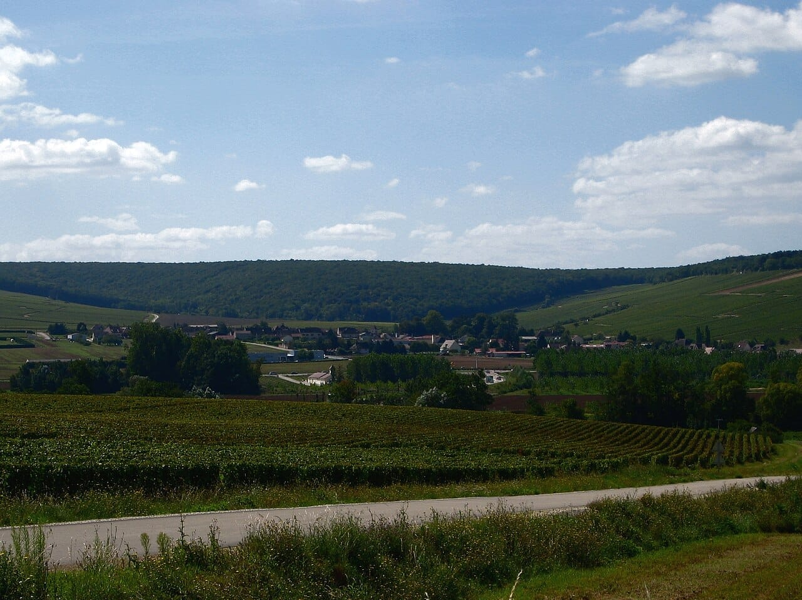

# 勃艮第

勃艮第是法国东部索恩河以西的葡萄酒产区，以黑皮诺与霞多丽为核心品种。产区从北到南呈狭长带状，分为夏布利、金丘、夏隆内丘与马孔内四段；分级按大区、村庄、一级园与特级园四层划分，地块边界比酒庄名更能决定身份。

图：勃艮第。摄影：Burgundy vineyards near Beaune, France。署名：Mark Gorzynski，CC BY-SA 4.0，来自 Wikimedia Commons（[来源](https://commons.wikimedia.org/w/index.php?curid=65061583)）。

## 地理与气候

勃艮第位于[法国](ref:france)东部，葡萄园多分布在索恩河平原西侧的丘陵与坡地，呈南北狭长走向。北部夏布利气候偏凉，南部马孔内更温暖；金丘的坡地朝向东南，兼顾日照与排水。

大陆性气候影响明显，冬季寒冷、夏季温暖，春季霜冻与夏季冰雹是主要风险。年份差异会直接改变成熟度与产量，同一地块在不同年份的表现可能差别很大。坡向、海拔与土壤排水共同决定成熟节奏，气候不是统一背景。

## 「勃艮第」的时间线
勃艮第的葡萄种植与中世纪修道院关系密切，西多会与克吕尼的修院留下了许多地块记录与耕作传统。法国大革命后土地分散，形成了今天大量小农酒庄与地块细分的格局。

分级制度在 20 世纪逐步制度化，1935 年成立的国家产地命名管理机构推动了 AOC 体系的建立，此后由 INAO 承接管理。历史积淀与制度框架共同塑造了“地块优先于酒庄”的表达习惯。

## 子产区

- 夏布利（Chablis）：最北端的白葡萄酒产区，位于约讷省，只产以霞多丽酿造的白葡萄酒。
- 金丘（Côte d'Or）：核心产区，分为北面的夜丘（Côte de Nuits）与南面的伯恩丘（Côte de Beaune）。
- 夏隆内丘（Côte Chalonnaise）：金丘以南，红白皆有，常见梅尔居雷、日夫里、吕利与蒙塔尼。
- 马孔内（Mâconnais）：最南段，以白葡萄酒为主，普伊-富赛与圣韦朗较知名，也种植佳美。

四段的气候、土壤与市场定位不同。夏布利与金丘常被并称，但它们的品种结构与分级历史并不相同。

## 分级体系

勃艮第的分级从下到上分为四层：大区级（如 Bourgogne）、村庄级（如 Gevrey-Chambertin）、一级园（Premier Cru）与特级园（Grand Cru）。特级园数量有限，酒标通常只写园地名，例如香贝丹、蒙哈榭、罗曼尼-康帝。

分级由法定产区规则界定，不是市场评价或酒庄自封。一级园与特级园的地块边界经过长期划定，同一村庄内的不同地块可以属于不同层级。阅读酒标时，先确认层级，再看村庄与园地，最后看酒庄。

## 「勃艮第」的品种与风格坐标
[红葡萄酒](ref:red-wine)几乎都以[黑皮诺](ref:pinot-noir)酿造，颜色偏浅、酸度清晰、单宁细腻，陈年后发展出红樱桃、蘑菇与林地气息。[白葡萄酒](ref:white-wine)以[霞多丽](ref:chardonnay)为主，从夏布利的清瘦矿物风格到蒙哈榭的饱满风格都有。

此外还有阿里高特（Aligoté）白葡萄酒、佳美（Gamay）红葡萄酒与勃艮第起泡酒（Crémant de Bourgogne）。品种结构相对简单，但同一品种在不同地块的表现差异很大，这正是勃艮第强调地块的原因。

## 金丘：夜丘与伯恩丘

夜丘以红葡萄酒为主，村庄包括热夫雷-香贝丹、香波-慕西尼、伏旧、沃恩-罗曼尼与夜圣乔治，坡度较陡、土壤排水好，黑皮诺结构更紧致。

伯恩丘红白并重，阿洛斯-科通、博讷、波玛、沃尔奈以红葡萄酒为主，默尔索、普里尼-蒙哈榭与夏山-蒙哈榭以白葡萄酒知名。南北两段的风格差异来自坡向、土壤与村庄传统，而不是单一品种。

## 夏布利

[夏布利](ref:chablis)位于产区最北端，是独立的法定产区，只产以霞多丽酿造的白葡萄酒。启莫里阶石灰岩与泥灰岩土壤、偏凉气候与较长的成熟期，带来清瘦、酸度清晰、矿物感强的风格。

夏布利内部同样分级：小夏布利、夏布利、一级园与特级园。它的分级逻辑与金丘一致，但品种只有霞多丽，因此风格差异更多来自地块与酿造方式，而不是品种组合。

## 酒标与年份

酒标通常标注产区名、村庄名、园地名、年份、酒精度、净含量与装瓶者。大区级与村庄级会写村庄名，一级园与特级园会写具体园地名；同一村庄可能同时拥有多个层级的地块。

年份反映那一年的天气条件。霜冻、冰雹与采收期降雨会改变产量与成熟度；同一酒庄的不同年份可以有明显差异。购买时应同时核对层级、村庄、园地、年份与装瓶信息，不能只看“勃艮第”三个字。

## 市场与饮用

勃艮第的产量有限、地块细分，市场价格长期偏高，名庄与名园酒款尤其明显。分级与地块是价格的重要依据，但价格不等于个人喜好，适饮窗口也因年份与酒款结构而异。

饮用时，红葡萄酒通常在略低于室温的温度下服务，白葡萄酒充分冰镇；年轻酒款可适当醒酒，老酒则应缩短醒酒时间。红葡萄酒适合禽类、蘑菇与软质奶酪，白葡萄酒适合海鲜、禽类与奶油类菜肴。开瓶后的保存条件会影响风味，应冷藏并尽快饮用。

## 「勃艮第」容易被读错的地方
第一，把勃艮第当成一个品牌。它是产区，内部有大量法定产区与酒庄。
第二，把特级园当成质量保证。分级界定地块与规则，不替代具体酒款的表现。
第三，认为勃艮第红酒都很淡。黑皮诺颜色偏浅，但结构可以很紧致。
第四，把夏布利与金丘混为一谈。夏布利只产白葡萄酒，分级与村庄体系也不同。
第五，用酒庄名气代替酒标信息。层级、村庄、园地与年份更具体。

对照阅读：[法国](ref:france)、[红葡萄酒](ref:red-wine)。

**关键事实。**

| 项目 | 内容 |
| --- | --- |
| 一句话定位 | 法国东部索恩河以西的葡萄酒产区，以黑皮诺与霞多丽为核心品种；从北到南分为夏布利、金丘、夏隆内丘与马孔内，分级按大区、村庄、一级园与特级园四层划分 |
| 层级 | 其他 |
| 所属 | 法国 |
| 国家代码 | FR |

**来源与边界。** 本页关于「勃艮第」的关键事实，主要由以下来源交叉核对：Bureau Interprofessionnel des Vins de Bourgogne（勃艮第的子产区、分级与品种框架）、INAO（法国原产地命名制度与勃艮第各法定产区的范围；由原条目末尾参考资料迁移，未逐条复核访问日期）、European Union（欧盟葡萄酒类别、地理标志与标签规则）等 7 条来源。价格、批次与状态会变，涉及这些字段时以页面所列来源的最新版本为准。正文为项目自写，来源只作核验，不复制原文。

## 参考资料
- [法国](ref:france)：法国葡萄酒版图与 AOC/AOP 制度。
- [夏布利](ref:chablis)：勃艮第最北端的白葡萄酒产区。
- [霞多丽](ref:chardonnay)与[黑皮诺](ref:pinot-noir)：勃艮第的两大核心品种。
- [白葡萄酒](ref:white-wine)与[红葡萄酒](ref:red-wine)：两类基本风格与工艺。
- [橡木桶陈年](ref:oak-ageing)：桶型与新旧程度对风格的影响。

## 相关图像

图：夏布利。图片：CocktailSteward，CC BY 3.0，via Wikimedia Commons（[原图页面](https://commons.wikimedia.org/wiki/File:Chablis_and_Premier_Cru_Vaulorent.jpg)）。关联图像：勃艮第。

图：黑皮诺。图片：Cjp24，Public domain，via Wikimedia Commons（[原图页面](https://commons.wikimedia.org/wiki/File:Grape_near_Sancerre.jpg)）。关联图像：勃艮第。
