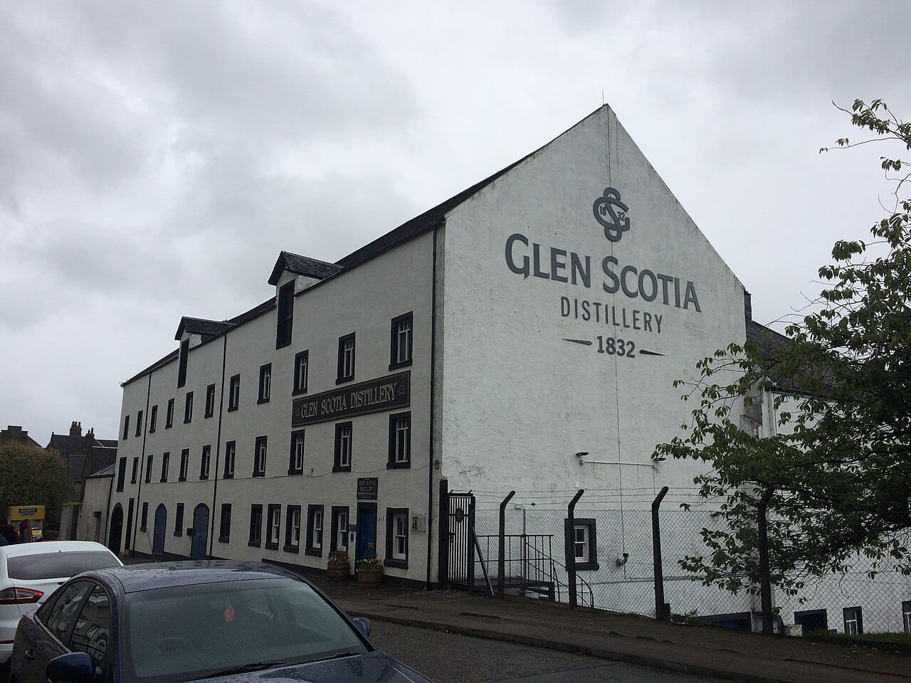

# 坎贝尔镇

坎贝尔镇（Campbeltown）是[苏格兰](ref:scotland)威士忌五个受保护名称中面积最小的一个，位于金泰尔半岛南端。它在 19 世纪曾被称为“世界威士忌之都”，今天只剩三家酒厂。这个落差本身就是理解它的入口：产区名称保护的是地理与传统，不是产量，也不保证某种固定风味。

图：坎贝尔镇。摄影：Glen Scotia Distillery, Campbeltown。署名：Lirazelf，CC BY-SA 4.0，来自 Wikimedia Commons（[来源](https://commons.wikimedia.org/w/index.php?curid=62323489)）。

## 法定范围只有半岛一角

《2009 年苏格兰威士忌条例》把“Campbeltown”定义为阿盖尔-比特郡南金泰尔选区，而不是整个金泰尔半岛，更不是泛指苏格兰西南部。法规文本把坎贝尔镇与艾雷岛并列为“受保护地方名称”（protected locality），把高地、低地与斯佩塞列为“受保护区域”（protected region）；两者都受标签保护，但法律层级不同。

[条例](ref:swr)要求，标注坎贝尔镇的威士忌必须在该范围内蒸馏，并同时满足苏格兰威士忌的全部条件：在苏格兰陈年、使用橡木桶至少三年、装瓶不低于 40% vol、蒸馏酒精度低于 94.8% vol。范围之外的酒厂即使风格相近，也不能使用这个地名。

## 维多利亚时代的“世界威士忌之都”

坎贝尔镇的地理位置适合海运：酒液可以从港口直接运往格拉斯哥、利物浦与海外市场，煤炭与本地大麦也容易获得。官方酒厂史料记载，1814 年当地已有 22 家持证酒厂；到维多利亚时代，这个数字超过三十家，蒸馏厂沿着街道与港口密集分布。

当时的坎贝尔镇威士忌大量进入正在扩张的调和体系，也有相当部分以原酒形式出口。酒厂、码头、仓库与商人构成一条完整产业链，城镇的财富与威士忌直接绑定。今天回看，这段繁荣建立在海运、煤炭与宽松的原料供应之上，而不是某种不可复制的风土。

## 从三十多家到三家

繁荣没有持续。20 世纪 20 年代，部分酒厂为满足需求而压缩工艺、降低质量，调和商逐渐转向其他产区，订单流失引发连锁关闭。格兰吉尔（Glengyle）在 1925 年停止运营；到 1934 年，里克拉汉（Rieclachan）关闭后，当地只剩云顶（Springbank）与格兰帝（Glen Scotia）两家。

云顶在 1828 年建立，是坎贝尔镇现存最老的酒厂之一；格兰帝始于 1832 年。格兰吉尔则由米切尔家族在 1872 年创立，1925 年停产后，其建筑在 2000 年被云顶的米切尔家族买回，2004 年重建并恢复蒸馏。云顶官方把 2004 年视为坎贝尔镇“再次被承认为独立威士忌产区”的节点；在现行法规中，它仍是受保护地方名称，而非产量意义上的大产区。

## 海风、油脂与轻泥煤

苏格兰威士忌协会把坎贝尔镇概括为“盐、烟、水果、香草与太妃糖交织，酒体强劲而丰厚”。这种描述对应的是常见印象：海风带来的咸感、较厚的油脂质地、轻到中度的泥煤烟熏，以及果干与香料的后段。海边仓库的湿度与温差，常被用来说明酒体为何偏重。

但“海风”不是配方。酒厂的麦芽酚值、蒸馏器形状、切酒点与桶型，才是风味的直接来源。坎贝尔镇也有几乎无泥煤的产品，或把泥煤控制在很低水平的版本；把整个产区等同于“重泥煤”，会错过它更常见的油脂感与果香。

## 云顶：从发芽到装瓶

云顶是坎贝尔镇传统工艺的象征。酒厂保留地板发芽，使用本地或指定农场的大麦，蒸馏、陈年与装瓶都在同一地点完成。它的产品线用同一套设备做出不同风格：云顶本体偏轻泥煤与油脂，朗格罗（Longrow）走重泥煤路线，哈索本（Hazelburn）则采用三次蒸馏，风格更干净。

[单一麦芽](ref:single-malt)的法定条件在这里被完整执行：同一家酒厂、100% 发芽大麦、壶式[蒸馏](ref:distillation)、橡木桶陈年至少三年。云顶的价值不只在于“传统”，而在于它把发芽、糖化、蒸馏与[橡木桶陈年](ref:oak-ageing)放在同一条可见的生产链上，让风格差异可以被追溯到具体工序。

## 格兰帝与格兰吉尔

格兰帝是坎贝尔镇最小的酒厂之一，官方资料称其保留 1830 年代的发酵槽、蒸馏车间与铺地仓库（dunnage warehouse）。它同时生产泥煤与非泥煤版本，核心产品常带海水、果干与香草，酒体比云顶更直接。格兰吉尔在 2004 年重建后以 Kilkerran 品牌装瓶，产量小，风格偏油脂、矿物与轻烟熏，是产区复兴的另一个样本。

三家酒厂的设备与配方并不相同，却共享同一套地理与法规条件。把“坎贝尔镇风格”理解为三家酒厂的交集，比理解为一种统一配方更准确。

## 今天的产区身份

坎贝尔镇仍是苏格兰最小的威士忌产区，但旅游与小型项目正在增加。每年 5 月的坎贝尔镇麦芽威士忌节把三家酒厂、港口与镇中心连成一条步行路线；云顶与格兰帝的参观需要提前预约，格兰吉尔的开放时间随生产季调整。几家新项目已公开表示计划在当地建厂，但产能与投产时间应以官方渠道为准。

产区身份在这里有双重含义：法律上，它是受保护地方名称，只有当地蒸馏的酒才能使用；市场上，它是一种风格标签，常被用来暗示海风、油脂与轻度烟熏。两者相关，但不能互相替代。[威士忌](ref:whisky)的产区体系，正是由这种“地名 + 工艺传统”的组合构成。

## 坎贝尔镇的六个误读

第一，认为坎贝尔镇在法规中与高地、低地同级为“区域”。它实际上是受保护地方名称。第二，认为坎贝尔镇威士忌都很重泥煤。实际风格从无泥煤到中泥煤都有。第三，认为产区只剩云顶一家。格兰帝与格兰吉尔仍在生产。第四，认为坎贝尔镇已经衰落。产量小不等于产业消失，三家酒厂仍在运营并有扩建计划。第五，把产区名称当成质量等级。第六，认为海边陈年一定会带来咸味，海风的影响常被叙事放大。

品鉴时可以先找油脂感与矿物感，再判断泥煤强度，最后看桶型带来的果干与香草。加少量水有助于打开香气；加冰会压低油脂感。适量饮用，未成年人不应饮酒。

相关条目：[苏格兰](ref:scotland)、[威士忌](ref:whisky)。

**关键事实。**

| 项目 | 内容 |
| --- | --- |
| 一句话定位 | 苏格兰威士忌五个受保护名称中面积最小的一个，法定范围为阿盖尔-比特郡南金泰尔选区；19 世纪曾有三十多家酒厂，如今只剩云顶、格兰帝与格兰吉尔三家，风格以海风、油脂与轻度泥煤为常见线索 |
| 层级 | 其他 |
| 所属 | 苏格兰 |
| 国家代码 | GB |

## 相关图像

图：单一麦芽苏格兰威士忌。图片：Sansvase，CC BY-SA 3.0，via Wikimedia Commons（[原图页面](https://commons.wikimedia.org/wiki/File:Bowmore_whisky_12_years.JPG)）。关联图像：坎贝尔镇。

图：苏格兰类别配图。图片：Alan Jamieson，CC BY-SA 3.0，via Wikimedia Commons（[原图页面](https://commons.wikimedia.org/wiki/File:Glenmorangie_Distillery_-_panoramio.jpg)）。关联图像：坎贝尔镇。
