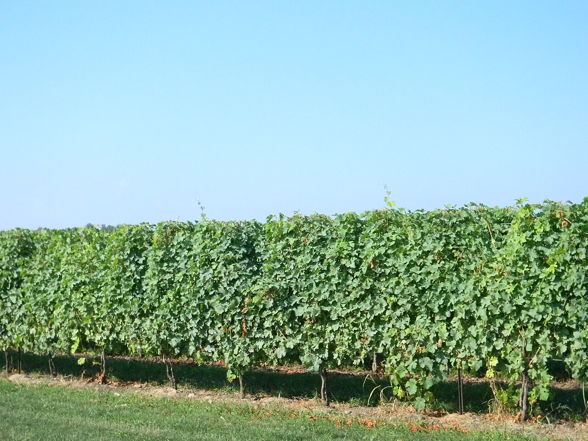

# 加拿大

加拿大威士忌的国家级类别，以玉米、黑麦与大麦为原料，经糖化、蒸馏并在木桶中陈年至少三年；法规允许加入焦糖与调味酒液（其他烈酒或葡萄酒），其中 9.09% 是年龄声明与出口证书门槛，不是普通成分上限，风格通常柔和、顺口。

图：安大略 Forty Creek 酒厂的威士忌橡木桶陈酿库。图片：Gogerr，CC BY-SA 4.0，via Wikimedia Commons（[原图页面](https://commons.wikimedia.org/wiki/File:Whisky_maturation_in_barrels_at_the_Forty_Creek_Distillery.jpg)）。

## 先划清「加拿大」的边界
加拿大威士忌是一个以法规定义的国家级烈酒类别：以谷物糖化、蒸馏，并在橡木桶中陈年至少三年；常见原料是玉米、黑麦与大麦，黑麦负责香料与骨架。

这里的“产区”不是葡萄酒式的法定地块，而是国家层级的类别与产业带。看到“Canadian whisky”先确认它符合谷物、蒸馏与三年木桶陈年三条底线；具体风格还要看原料比例、蒸馏方式与调配。

## 历史与命名

加拿大威士忌的产业史与谷物农业、铁路与移民市场相连；20 世纪以来，柱式蒸馏与大规模调和让它成为日常烈酒。

“9.09% 规则”常被误读为“只能加入 9.09% 的其他酒”。实际上，加拿大威士忌标准允许加入焦糖与“flavouring”（其他烈酒或葡萄酒），并未把 9.09% 写成普通成分上限；9.090% 是年龄与出口证书的门槛：当调味酒液的绝对酒精不超过成品总绝对酒精的 9.090% 时，成品可按基础威士忌的酒桶年龄声明，非葡萄酒调味酒液仍需陈年两年以上；出口 blend 若进口酒液超过 9.090%，证书须注明比例且不得称 Canadian Whisky。它约束的是年龄声明与出口标签，不是把主体换成其他酒的许可。

## 「加拿大」的地理与风土
加拿大主要威士忌产区包括安大略、魁北克、阿尔伯塔与不列颠哥伦比亚；冬季寒冷使仓库温度低、熟成速度慢，酒厂需要用仓库位置与温度控制来调节陈年。

这里的风土不是葡萄园坡向，而是谷物带、水源与气候。寒冷气候让新酒更慢地变圆，热带或温暖仓库则更快；同一配方在不同仓库里会得到不同的香草、焦糖与木质层次。

## 原料与风格

原料以玉米、黑麦与大麦为主：玉米给甜感与酒体，黑麦给胡椒、香料与骨架，大麦补充麦芽香。柱式蒸馏通常得到更干净、连续的酒液，壶式或特殊蒸馏则增加个性。

风格从柔和、带香草与焦糖的日常调和，到高黑麦、辛辣、结构更强的版本。判断风格时，先看黑麦比例与陈年，再看是否标注单一蒸馏厂或调和；不要只看品牌名。

## 代表生产者与酒款

代表品牌包括 Crown Royal、Canadian Club、Lot No. 40、Pike Creek 与 Alberta Premium；Crown Royal 是全球最知名的加拿大威士忌之一，Lot No. 40 则以高黑麦风格著称。

看生产者时，区分“蒸馏厂”与“品牌”：大品牌可能调配多家酒厂的酒液，小蒸馏厂则更强调自有谷物与仓库。先找一款高黑麦与一款玉米型对比，能最快理解加拿大风格的两端。

## 「加拿大」的上桌方式
饮用温度从室温到加冰都可；净饮用小杯，闻香时不要倒满。加少量水能打开香草与黑麦香料，但过多冰会压住香气。不要像葡萄酒那样醒酒，加拿大威士忌更适合即开即饮。

配餐适合咸甜与烟熏：烟熏肉、烤鸡、陈年切达、枫糖甜点与黑巧克力都能接住香草与香料。高黑麦版本配脂肪与盐分更稳；重甜点心会让酒显得更干、更辛辣。

## 选购、标签与误区

标签重点看：类别（Canadian whisky）、陈年（至少三年，若标年份则要符合规则）、原料或黑麦比例、蒸馏厂与调配信息。

常见误区是把“rye”当成 100% 黑麦，或把“加拿大威士忌”当成单一风格。实际上它允许调和，9.09% 规则是年龄声明与出口证书的门槛，不是普通成分上限，也不是主体替换的许可；开瓶后避光、直立、常温保存，风味通常比葡萄酒更耐放。

## 「加拿大」周边怎么走
加拿大酒厂参观集中在安大略、不列颠哥伦比亚与阿尔伯塔的部分城市周边；多数需要预约，生产区不适合随意进入。

路线安排上，把城市中心与酒厂分开：多伦多或温哥华出发通常要半天到一天。冬季路况与营业时间变化大，出发前查官网；一次选一到两家酒厂，比赶路更能理解风格。

## 进一步阅读

进一步阅读：把加拿大威士忌分成“玉米型、黑麦型与调和型”三条线来喝，比记品牌更有用。玉米型提供香草、焦糖与柔和酒体，黑麦型带胡椒、香料与更干的骨架，调和型则把两者按比例拼接。对比时保持酒精度与陈年接近，否则很容易把高酒精度误判成更浓郁。加拿大威士忌的“柔”不是没有味道，而是把谷物甜、木质与香料压在一个较低的音量上；高黑麦版本会把音量调高。若参观酒厂，先问原料比例与仓库位置，再问年份；这两个答案比“加拿大风格”四个字具体得多。

另一个实用做法是把“柔”与“甜”分开：柔来自酒体与调和，甜来自玉米与桶；不喜欢太甜的人应找高黑麦、陈年更久或酒精度更高的版本，而不是只看品牌。加拿大威士忌的年份标注不像苏格兰那样普遍，买时看桶陈与酒精度更实际。

- 相关条目：[niagara](ref:niagara)、[whisky](ref:whisky)、[barley](ref:barley)、[distillation](ref:distillation)、[oak-ageing](ref:oak)。
关于加拿大，本页只保留产区与风格信息；地图、实时价格与营业时间请查当地官方渠道。

对照阅读：[尼亚加拉](ref:niagara)、[大麦](ref:barley)。

相关条目：[威士忌](ref:whisky)。

**关键事实。**

| 项目 | 内容 |
| --- | --- |
| 一句话定位 | 加拿大威士忌的国家级类别，以玉米、黑麦与大麦为原料，经糖化、蒸馏并在木桶中陈年至少三年；法规允许加入焦糖与调味酒液（其他烈酒或葡萄酒），其中 9.09% 是年龄声明与出口证书门槛，不是普通成分上限，风格通常柔和、顺口 |
| 层级 | 国家 |
| 国家代码 | CA |

**来源与边界。** 本页关于「加拿大」的关键事实，主要由以下来源交叉核对：Canadian Food Inspection Agency（威士忌类别、在加拿大销售标签与至少三年小木桶陈年要求；Canadian whisky 的成分标准与 40% 酒精度等类别要求）、Department of Justice Canada（出口年龄与原产地证书中的 9.090% 进口酒液规则，以及调味酒液的陈年计算口径；加拿大威士忌的 flavouring 定义与陈年要求）、Spirits Canada（加拿大威士忌的法定保护、产业协会与贸易背景）。价格、批次与状态会变，涉及这些字段时以页面所列来源的最新版本为准。正文为项目自写，来源只作核验，不复制原文。

## 相关图像

图：Niagara Peninsula：Wine Grapes in the Niagara Peninsula（Wikimedia Commons）。图片：M Readey，CC BY-SA 3.0，via Wikimedia Commons（[原图页面](https://commons.wikimedia.org/wiki/File:Wine_Grapes_in_the_Niagara_Peninsula.jpg)）。关联图像：加拿大。

图：威士忌。图片：Guinnog，CC BY-SA 3.0，via Wikimedia Commons（[原图页面](https://commons.wikimedia.org/wiki/File:Whiskyhogmanay2010.jpg)）。关联图像：加拿大。
