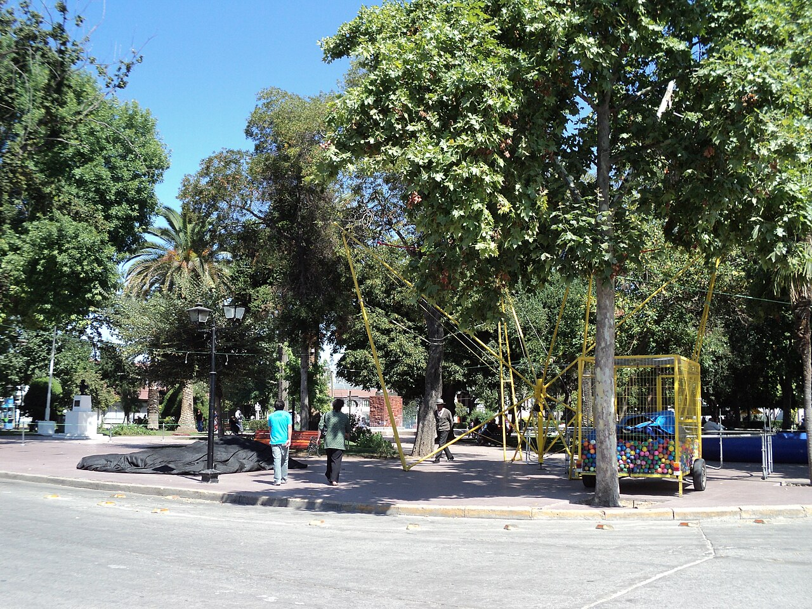

# 卡萨布兰卡谷

卡萨布兰卡谷（Casablanca Valley）是智利圣地亚哥西北、通往瓦尔帕莱索方向的冷凉气候产区，也是智利白葡萄酒现代化的关键地点。它在 1980 年代被重新发现，1994 年获得法定地位，以 Sauvignon Blanc、Chardonnay 与 Pinot Noir 著称。

图：卡萨布兰卡谷。图片：Diego Grez，CC BY-SA 3.0，via Wikimedia Commons（[原图页面](https://commons.wikimedia.org/wiki/File:Plaza_Casablanca.jpg)）。

## 太平洋雾带里的年轻产区

卡萨布兰卡位于智利 Aconcagua 葡萄酒大区内，距太平洋不远，地形是沿海丘陵与谷地之间的过渡带。与智利传统的中央山谷红酒产区相比，这里纬度更靠南、更靠近冷海流，成熟期温度明显更低。

产区的现代历史很短。在 1980 年代之前，这里主要种小麦、养奶牛，葡萄并非常规作物。今天它是智利冷凉气候白葡萄酒的代表，也是该国葡萄酒版图南移与西移的重要节点。

卡萨布兰卡距瓦尔帕莱索港不远，出口物流便利，这对以白葡萄酒为主的产区尤其重要。智利白葡萄酒的国际市场扩张，与这类靠近港口、能快速装运的冷凉产区密切相关。港口、公路与冷库设施，构成了产区竞争力的隐形部分。

## 1980 年代的试验与第一片葡萄园

1982 年，Concha y Toro 的酿酒师 Pablo Morandé 在卡萨布兰卡种下第一批葡萄，最初以 Chardonnay 与 Sauvignon Blanc 为主。早期的种植并不顺利，霜冻与陌生风土让产量与成熟度难以预测，但试种证明了冷凉气候可以做出与中央山谷截然不同的白葡萄酒。

到 1980 年代中后期，第一批商业化酒款进入市场，香气强度与酸度引起国际关注。此后酒庄相继进入，卡萨布兰卡从一个农业谷地变成智利最受关注的冷凉产区之一。

## 1994 年与第 464 号法令

1994 年，智利农业部通过第 464 号法令，正式建立葡萄酒产区划分与产地命名规则。Valle de Casablanca 被列为 Aconcagua 大区下的子区，边界延伸至同名 commune（市镇）。

这一法令为卡萨布兰卡提供了法律身份：酒标使用 Valle de Casablanca 时，葡萄必须来自该子区。它也把产区的名称与行政边界绑定，避免酒庄把更广泛区域的酒标注为卡萨布兰卡。

## 冷凉气候如何形成

卡萨布兰卡的冷凉来自三个因素。第一是太平洋的秘鲁寒流（Humboldt Current），海水温度低，沿海空气因此凉爽。第二是晨雾：夜间与清晨的雾带压低温度、增加湿度，延缓成熟。第三是谷地开口与海风，把冷空气带入内陆。

结果是成熟期更长、酸度更高、酒精潜力更低。白葡萄酒因此保留柑橘、青苹果与草本香气，红酒则更偏向轻盈、香料与红果风格。这种气候也带来霜冻风险，尤其在低洼地块。

采收时机因此格外关键：过早则香气不足，过晚则酸度下滑。酒庄通常分地块、分品种多次采收，并在清晨低温时入厂，以保留香气前体。年份之间的雾量、霜冻与热量积累差异，会让同一款酒在酸度与成熟度上出现明显变化。

## 品种：Sauvignon Blanc、Chardonnay 与 Pinot Noir

Sauvignon Blanc 是卡萨布兰卡最具代表性的白品种，酒款常带青柠、百香果、青草与矿物气息，酸度鲜明。Chardonnay 则是产区最早的试验品种之一，风格从清爽不锈钢到酒泥搅拌与橡木桶发酵都有。

Pinot Noir 在冷凉气候下表现良好，常带红樱桃、草莓与香料气息，酒体轻至中等。部分酒庄也种植 Riesling 与其他白品种。原料是葡萄，品种与产地标注须符合智利酒法的最低比例要求。

白葡萄多在不锈钢罐中低温[发酵](ref:fermentation)，以保留香气；追求质地的酒款会进行酒泥搅拌或部分橡木桶发酵。红葡萄则采用较轻的浸渍与较温和的萃取，避免在冷凉年份出现生青单宁。

## 土壤、霜冻与栽培

土壤以花岗岩风化的黏土与砂质土为主，排水性因地形而异。谷底土壤更厚、保水更强，但霜冻风险更高；较高、较暖且避霜的地块更适合晚熟品种与高品质白葡萄。酒庄因此常把最好的地块放在坡地中上部。

这种土壤结构也影响根系深度与水分供给。花岗岩黏土在湿润年份可能过湿，在干旱年份又容易板结，酒庄需要通过覆盖作物、深耕与排水沟来调节。土壤管理因此不是背景条件，而是冷凉产区能否稳定成熟的关键变量。

栽培上，卡萨布兰卡需要应对晨雾带来的湿度与霉菌压力，以及低洼地的春季霜冻。整形、叶幕管理与采收时机都比传统暖区更精细。土壤、雾带与坡位的组合构成产区的[风土](ref:terroir)基础。

## 酒标、饮用与误区

卡萨布兰卡白葡萄酒建议在 10 至 12 摄氏度饮用，适合海鲜、贝类、沙拉与清淡禽肉。Sauvignon Blanc 适合配山羊奶酪与香草；Chardonnay 经[酒泥陈酿](ref:lees-ageing)或橡木桶处理后，可搭配烤鱼与奶油酱汁。Pinot Noir 建议 14 至 16 摄氏度，适合禽肉与蘑菇。

常见误区有四。第一，认为卡萨布兰卡是传统老产区：它的现代葡萄种植始于 1980 年代。第二，把冷凉气候等同于寒冷：这里仍是地中海气候，夏季干燥，只是受海洋调节。第三，以为产区只产白葡萄酒：Pinot Noir 与少量红酒也有稳定表现。第四，把"Valle de Casablanca"当成营销名：它是第 464 号法令下的法定子区名。

对照阅读：[葡萄酒](ref:wine)、[智利](ref:chile)。

**关键事实。**

| 项目 | 内容 |
| --- | --- |
| 一句话定位 | 智利 Aconcagua 葡萄酒大区内的法定子区 Valle de Casablanca，位于圣地亚哥西北、瓦尔帕莱索方向；1982 年由 Concha y Toro 的酿酒师 Pablo Morandé 率先种下第一批葡萄，1994 年第 464 号法令正式划定 |
| 层级 | 其他 |
| 所属 | 智利 |
| 国家代码 | CL |

**来源与边界。** 本页关于「卡萨布兰卡谷」的关键事实，主要由以下来源交叉核对：Vinos de Chile（卡萨布兰卡的太平洋海洋影响、晨雾、花岗岩黏土与高处避霜地块的描述）、Ministerio de Agricultura de Chile / FAOLEX（Valle de Casablanca 属 Aconcagua 大区、边界为同名 commune 的法定表述）、Servicio Agrícola y Ganadero (SAG)（Aconcagua 大区葡萄园面积与智利法定产区统计口径；第 464 号法令中 Valle de Casablanca 的法定边界条款）等 5 条来源。价格、批次与状态会变，涉及这些字段时以页面所列来源的最新版本为准。正文为项目自写，来源只作核验，不复制原文。

## 参考资料

- [葡萄酒](ref:wine)：理解卡萨布兰卡谷的大类归属与产地规则。
- [白葡萄酒](ref:white-wine)：白葡萄酒的酿造与风格框架。
- [智利](ref:chile)：智利葡萄酒产区的整体格局。
- [Sauvignon Blanc](ref:sauvignon-blanc)：卡萨布兰卡的代表性白品种。
- [Chardonnay](ref:chardonnay)：产区最早的试验品种之一。
- [Pinot Noir](ref:pinot-noir)：冷凉气候下的重要红品种。
- [酸度](ref:acidity)：冷凉气候与高酸的关系。
- [发酵](ref:fermentation)：低温发酵与香气保留。
- [酒泥陈酿](ref:lees-ageing)：酒泥接触对质地的影响。
- [风土](ref:terroir)：花岗岩黏土、雾带与坡位。
- [酒精度](ref:abv)：酒标上 % vol 的含义。
