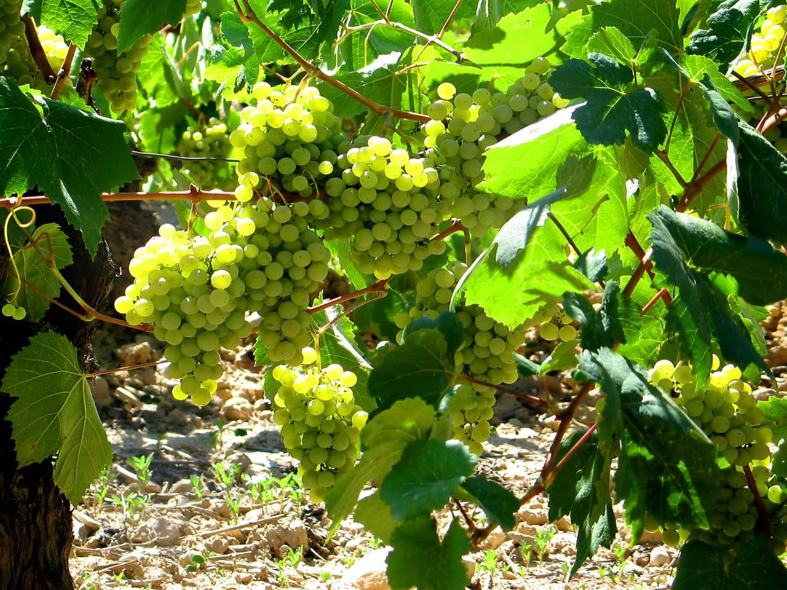

# 卡瓦

卡瓦（Cava）是[西班牙](ref:spain)以传统法酿造的[起泡酒](ref:sparkling-wine)法定产区。名称覆盖加泰罗尼亚佩内德斯及多处授权区域，主要品种为马卡贝奥、沙雷洛与帕雷亚达，常加入[霞多丽](ref:chardonnay)与[黑皮诺](ref:pinot-noir)。

图：卡瓦。摄影：St. Sadurni d'Anoia - Bunches - Shoes on Wires。署名：Shoes on Wires，CC BY 2.0，来自 Flickr / Openverse（[来源](https://www.flickr.com/photos/9290458@N07/3087659344)）。

## 定义与范围

先分层：[起泡酒](ref:sparkling-wine)是大类，马卡贝奥等是品种，卡瓦是法定产区名称，具体酒庄与酒款是生产者层面。卡瓦不是单一村庄，而是覆盖多个授权区域的产区名称。

卡瓦与香槟的关系是“同一方法、不同产区”：两者都采用瓶中二次发酵的传统法，但品种、法规、陈年要求与价格带不同。把卡瓦称为“西班牙香槟”会掩盖这些差别。

## 「卡瓦」的时间线
卡瓦的现代起泡酒生产可追溯到 19 世纪后期，佩内德斯地区的酒庄开始采用瓶中二次发酵。20 世纪 70 年代起，生产者在名称上统一使用 Cava，以避免与法国香槟混淆，此后逐步建立法定产区规则。

历史路径决定了卡瓦的双重面貌：既有大规模、价格亲民的日常起泡酒，也有强调长时间带酒泥陈年与有机种植的高端酒款。理解分级体系，比记住品牌更重要。

## 子产区

卡瓦的主要产区在加泰罗尼亚的佩内德斯，此外还有阿拉贡、卡斯蒂利亚-莱昂、卡斯蒂利亚-拉曼恰、巴伦西亚、埃斯特雷马杜拉、纳瓦拉、巴斯克与里奥哈等授权区域。

不同区域的海拔与气候影响成熟度与酸度。佩内德斯沿海与内陆地块差异明显，高海拔地块通常酸度更好；其他授权区域多以补充产量与风格多样性为主。

## 「卡瓦」的品种与风格坐标
白卡瓦以马卡贝奥、沙雷洛与帕雷亚达为主，三者提供酸度、果味与香气的不同组合；霞多丽增加柑橘与奶油气息，部分酒款使用。红卡瓦（桃红）使用[歌海娜](ref:grenache)、黑皮诺与特雷帕等品种。

基酒通常较早采收，以保留酸度与较低酒精度。风格从清爽的青苹果、柑橘与白花，到带酒泥陈年较久的面包、坚果与奶油气息，跨度很大。

## 酿造与陈年分级

卡瓦采用传统法：基酒完成第一次[发酵](ref:fermentation)后装瓶，加入糖与酵母进行第二次发酵，气泡在瓶中产生。酒液与酒泥接触的时间决定分级与风格。

按瓶中带酒泥陈年时间，卡瓦分为 Cava de Guarda（最低 9 个月）与 Cava de Guarda Superior（最低 18 个月）。Guarda Superior 之下再分 Reserva（18 个月起）、Gran Reserva（30 个月起）与 Paraje Calificado（36 个月起），并要求葡萄来自特定地块且为有机种植。

## 土壤与地形

佩内德斯以石灰岩、黏土与冲积土为主，沿海与内陆地块差异明显。排水性与保水性影响根系深度与成熟节奏，高海拔地块昼夜温差更大。

地形以丘陵与河谷为主，坡向与海拔调节温度。靠近地中海的地块湿度更高、成熟更早，内陆高海拔地块酸度保留更好，这构成卡瓦基酒的风格基础。

## 酒标与年份

酒标通常标注 D.O. Cava、陈年分级、甜度标示、容量与装瓶者。常见甜度用语包括 Brut Nature、Brut、Extra Dry 等，数字越低通常越干。

多数卡瓦不标注年份，以无年份混酿为主；部分高端酒款会标注年份与地块。购买时应把分级、甜度与酒庄一起看，而不是只看“Cava”一词。

## 市场与饮用

卡瓦是西班牙产量最大的起泡酒，价格从日常餐酒到高端酒款都有。市场长期以性价比为核心，近年高端与有机酒款的比重上升。

卡瓦常见[酒精度](ref:abv)约 11.5%–12.5% vol，适合作为开胃酒，也可搭配海鲜、沙拉、禽肉与软质奶酪。建议饮用温度约 6–8 摄氏度；未开瓶存放理想温度为 12–15 摄氏度。本页关于卡瓦的内容涉及酒精饮料；过量饮酒有害健康，未成年人不应饮酒。

## 「卡瓦」容易被读错的地方
第一，把卡瓦称为“西班牙香槟”。两者采用同一方法，但产区、品种与法规不同。
第二，认为卡瓦都是低价酒。高端与长时间陈年酒款价格不低。
第三，认为 Cava 是一个品种。它是起泡酒法定产区名称。
第四，认为陈年越久越好。陈年影响风格，不保证每一瓶都更合口味。
第五，认为卡瓦只有白起泡酒。桃红卡瓦也是法定类型。

卡瓦是西班牙传统法起泡酒，不是“西班牙香槟”：马卡贝奥、沙雷洛与帕雷亚达是核心品种，瓶中带酒泥陈年时间决定 Guarda 与 Guarda Superior 的分级。它可以覆盖加泰罗尼亚以外的授权区域，酒标上的 Cava 说明工艺与规则，不说明甜度或质量高低。

对照阅读：[西班牙](ref:spain)、[霞多丽](ref:chardonnay)。

**关键事实。**

| 项目 | 内容 |
| --- | --- |
| 一句话定位 | 西班牙以传统法酿造的起泡酒法定产区，名称覆盖加泰罗尼亚佩内德斯及多处授权区域；主要品种为马卡贝奥、沙雷洛与帕雷亚达，常加入霞多丽与黑皮诺，按瓶中带酒泥陈年时间分为 Cava de Guarda 与 Cava de Guarda Superior，最低分别为 9 个月与 18 个月 |
| 层级 | 其他 |
| 所属 | 西班牙 |
| 国家代码 | ES |

**来源与边界。** 本页关于「卡瓦」的关键事实，主要由以下来源交叉核对：Consejo Regulador de la D.O. Cava（卡瓦的授权区域、品种、传统法工艺与陈年分级）、European Union（欧盟葡萄酒类别、地理标志与传统术语规则）、Oxford University Press（提供关于卡瓦、马卡贝奥、沙雷洛与帕雷亚达的条目；由原条目末尾参考资料迁移，未逐条复核访问日期）等 5 条来源。价格、批次与状态会变，涉及这些字段时以页面所列来源的最新版本为准。正文为项目自写，来源只作核验，不复制原文。

**并读。** 把「卡瓦」与「西班牙」、「起泡酒」、「霞多丽」放在一起读时，先确认它们是同一层级还是上下游关系：先确认边界与法定分类，再比较气候、土壤、海拔与代表酒款。本页负责给出产区的基本坐标，对照条目补上具体案例与差异；读完再回到本页，才能分清哪些差别属于产区本身，哪些只是产地、批次或品牌选择。

**适用边界。** 对「卡瓦」而言，产区边界、面积与法定分类会随法规更新；气候描述是长期趋势，不是某一年的天气预报。

## 参考资料
- [西班牙](ref:spain)：卡瓦所属的国家产区框架。
- [起泡酒](ref:sparkling-wine)：传统法起泡酒的工艺与风格框架。
- [霞多丽](ref:chardonnay)与[黑皮诺](ref:pinot-noir)：卡瓦基酒可使用的品种。
- [歌海娜](ref:grenache)：桃红卡瓦使用的品种之一。
- [发酵](ref:fermentation)：第一次发酵与瓶中二次发酵的基本逻辑。
- [葡萄酒](ref:wine)：理解卡瓦的类别、年份与产地规则的入口。
- [酒精度](ref:abv)：11.5%–12.5% vol 在标签上的含义。

## 相关图像

图：Uga - Lanzarote - Spain. Vineyards -U16。图片：Luis Miguel Bugallo Sánchez，CC BY-SA 3.0，via Wikimedia Commons（[原图页面](https://commons.wikimedia.org/w/index.php?curid=17458062)）。关联图像：卡瓦。

图：歌海娜。图片：Jules Troncy，Public domain，via Wikimedia Commons（[原图页面](https://commons.wikimedia.org/wiki/File:Grenache_N.jpg)）。关联图像：卡瓦。
