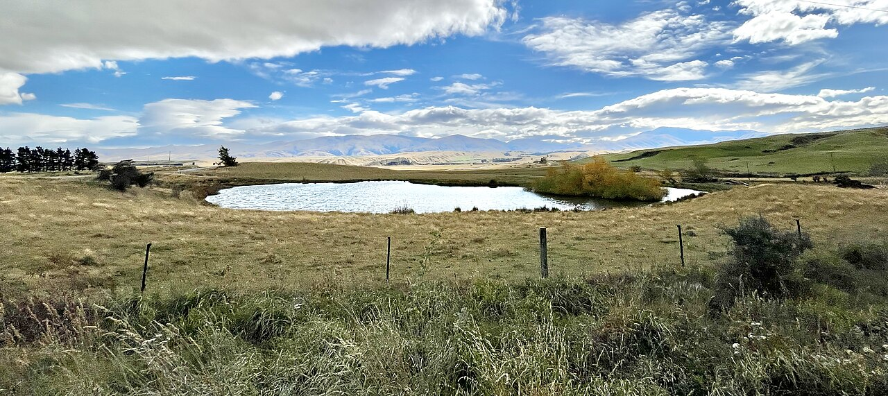

# 中奥塔哥

中奥塔哥（Central Otago）是新西兰最南端的葡萄酒产区，也是世界上最靠南的商业葡萄酒产区之一。它位于南岛内陆，以 Pinot Noir 著称，山地、湖泊与半大陆性气候共同塑造了浓郁而结构清晰的风格。

图：中奥塔哥。图片：AnnWoolliams，CC BY-SA 4.0，via Wikimedia Commons（[原图页面](https://commons.wikimedia.org/wiki/File:Hills_Creek,_Central_Otago.jpg)）。

## 定义与范围

中奥塔哥位于新西兰南岛内陆的 Otago 地区，葡萄酒产区围绕 Queenstown、Cromwell 与 Alexandra 展开，葡萄园多分布在河谷、阶地与山坡。按新西兰葡萄酒种植者 2026 年葡萄种植报告，产区种植 2,116 公顷，产果 2,045 公顷，约占全国种植面积 5%。

Central Otago GI 于 2018 年 10 月 29 日注册，注册号 1007。产区内部有六个常用次级产区：Gibbston、Bannockburn、Cromwell/Lowburn/Pisa、Bendigo、Wanaka 与 Alexandra。

## 「中奥塔哥」的时间线
中奥塔哥的葡萄酒历史可追溯到 19 世纪：1881 年，当地酒款在悉尼获得金牌；1895 年，Bragato 评价该地“特别适合”酿酒。此后很长一段时间，水果种植取代了葡萄酒，直到 20 世纪 50 年代出现复兴，1970 年代一批先驱酒庄重新建立葡萄园。

这些先驱酒庄包括 Chard Farm、Rippon、Black Ridge 与 Gibbston Valley 等。1990 年代以后，Pinot Noir 的国际声誉上升，产区逐渐成为新西兰精品红葡萄酒的代表。

## 地理与气候

中奥塔哥是半大陆性气候，干燥，夏冬温差与昼夜温差都大。夏季白天热量充足，夜间明显降温；冬季寒冷，霜冻风险高。山地与湖泊改变热量分布：湖泊反射热量、缓和霜冻，坡向与海拔决定成熟节奏。

这种极端气候使地块选择格外重要。朝北的坡地获得更多热量，靠近湖泊的地块温度更平稳，谷底低洼处则更容易积聚冷空气。年份差异也很明显：冷凉年份成熟更慢，需要严格选果；温暖年份糖分上升更快，酸度管理更关键。

土壤以片岩风化土、冲积砾石与黄土为主。砾石排水快、升温早，片岩与黄土保水与养分状况不同，影响长势与成熟。这些差异构成[风土](ref:terroir)基础。

## 次级产区

中奥塔哥的六个次级产区差异明显：

- Gibbston：位于 Kawarau 峡谷，海拔最高、气候较凉，朝北坡地成熟较晚，酒体较轻但集中。
- Bannockburn：位于 Kawarau 河南岸，是产区最温暖、最干燥的地块之一，采收可比其他次级产区早约一个月，酒款复杂而有个性。
- Cromwell、Lowburn 与 Pisa：沿 Lake Dunstan 西侧向北延伸约 25 公里，多数葡萄园位于低阶地与谷底。
- Bendigo：Cromwell 东北，朝北缓坡与石质土壤，夏季热量与冷凉夜晚对比明显。
- Wanaka：Queenstown 以北约 80 公里，比产区其他部分更凉、略湿润，湖泊缓和霜冻。
- Alexandra：最靠南的次级产区，干燥、夏冬温差极端，成熟期日变化大，酒款芳香而结构细致。

次级产区是地理与气候概念，不是质量等级。酒标上的具体地名需要结合注册 GI 规则理解。

## 品种与原料

Pinot Noir 是中奥塔哥的旗舰品种，约占葡萄园 80%。酒款常带深色樱桃、李子、香料与泥土气息，酒体中等、单宁细致、酸度清晰。Riesling、Pinot Gris 与 Gewürztraminer 等芳香型品种覆盖干型到甜型；Chardonnay 带柑橘与矿物气息；Sauvignon Blanc 与起泡酒也有生产。

原料是[葡萄](ref:grape)。品种结构高度集中于 Pinot Noir，这与气候、市场与产区的历史选择有关，但芳香型白葡萄酒同样具有声誉。

## 「中奥塔哥」怎么做出来
Pinot Noir 常部分整串发酵，浸渍时间较短，发酵温度较低，部分酒庄使用天然酵母。陈年多使用法国[橡木桶](ref:oak-ageing)，新桶比例较低，以保留果味与香气。不同次级产区的成熟度差异，会影响整串比例、浸渍强度与陈年策略。

白葡萄低温[发酵](ref:fermentation)。Riesling 与 Pinot Gris 依风格保留残糖或完全干型；Chardonnay 部分经橡木桶与酒泥搅拌；起泡酒采用传统法，产量小但受到关注。

## 法规与酒标

新西兰葡萄酒地理标志受《地理标志（葡萄酒与烈酒）注册法》管理，Central Otago GI 于 2018 年注册。酒标标注单一品种、年份或产区时，至少 85% 的酒液须来自所标注的品种、年份或产区；混酿须按比例从高到低标注。

GI 是地理边界，不是质量分级。新西兰没有全国统一的酒庄分级，酒庄声誉来自历史、酒款表现与市场评价。次级产区名称的使用须符合 GI 规则。

## 「中奥塔哥」的酒标与喝法
酒标应核对 GI 名称、品种、[年份](ref:vintage)、[酒精度](ref:abv)、容量与装瓶者。标注[单一品种](ref:single-varietal)的酒款须达到 85% 品种比例；混酿按法规列出品种。Pinot Noir 建议 14–16 摄氏度，Chardonnay 建议 10–12 摄氏度，Riesling 依风格可在 8–12 摄氏度。

Pinot Noir 适合禽肉、蘑菇、三文鱼与清淡红肉；Riesling 适合海鲜、亚洲料理与辛辣食物；Chardonnay 适合奶油类菜肴。开瓶后冷藏并尽快喝完。本页关于中奥塔哥的内容涉及酒精饮料；过量饮酒有害健康，未成年人不应饮酒。

## 「中奥塔哥」容易被读错的地方
第一，认为中奥塔哥只产 Pinot Noir。Pinot Noir 占主导，但 Riesling、Pinot Gris、Chardonnay 与起泡酒也有稳定产量。
第二，把“最南端”当成质量保证。纬度高意味着热量与成熟条件更紧张，品质仍取决于地块与年份。
第三，把次级产区当成质量等级。它们是地理与气候划分，不评价酒质。
第四，以为半大陆性气候容易栽培。霜冻、极端温差与水资源管理都是现实约束。
第五，把 GI 名称当成品牌。GI 是地理边界，酒庄名与品牌名是另一回事。

**关键事实。**

| 项目 | 内容 |
| --- | --- |
| 一句话定位 | 新西兰最南端的葡萄酒产区，位于南岛内陆的 Otago 地区，围绕 Queenstown、Cromwell 与 Alexandra；2026 年葡萄种植报告口径为种植 2,116 公顷、产果 2,045 公顷，约占全国 5% |
| 层级 | 其他 |
| 所属 | 新西兰 |
| 国家代码 | NZ |

**来源与边界。** 本页关于「中奥塔哥」的关键事实，主要由以下来源交叉核对：New Zealand Winegrowers（产区概况、六个次级产区、气候与酒款风格、历史信息；中奥塔哥种植面积、产果面积与占全国比例）、Intellectual Property Office of New Zealand (IPONZ)（Central Otago GI 的注册日期与注册号）、New Zealand Legislation（单一品种、年份与产区标注的 85% 规则及混酿标注顺序）。价格、批次与状态会变，涉及这些字段时以页面所列来源的最新版本为准。正文为项目自写，来源只作核验，不复制原文。

## 参考资料
- [葡萄酒](ref:wine)：理解中奥塔哥的类别、年份与产地规则的入口。
- [红葡萄酒](ref:red-wine)与[白葡萄酒](ref:white-wine)：中奥塔哥两大酒类的基本框架。
- [黑皮诺](ref:pinot-noir)：产区的旗舰品种。
- [雷司令](ref:riesling)与[霞多丽](ref:chardonnay)：产区的白葡萄酒主线。
- [葡萄](ref:grape)：酿酒葡萄的结构与成熟指标。
- [发酵](ref:fermentation)：Pinot Noir 与白葡萄的发酵差异。
- [酸度](ref:acidity)：昼夜温差与冷凉夜晚对酸度的影响。
- [风土](ref:terroir)：片岩、砾石与湖泊如何影响成熟。
- [橡木桶陈年](ref:oak-ageing)：Pinot Noir 的旧桶与低新桶比例。
- [干型](ref:dry)：Riesling 从干型到甜型的风格。
- [年份](ref:vintage)：中奥塔哥的年份差异与霜冻风险。
- [单一品种](ref:single-varietal)：85% 品种标注规则。
- [酒精度](ref:abv)：酒标上 % vol 的含义。
