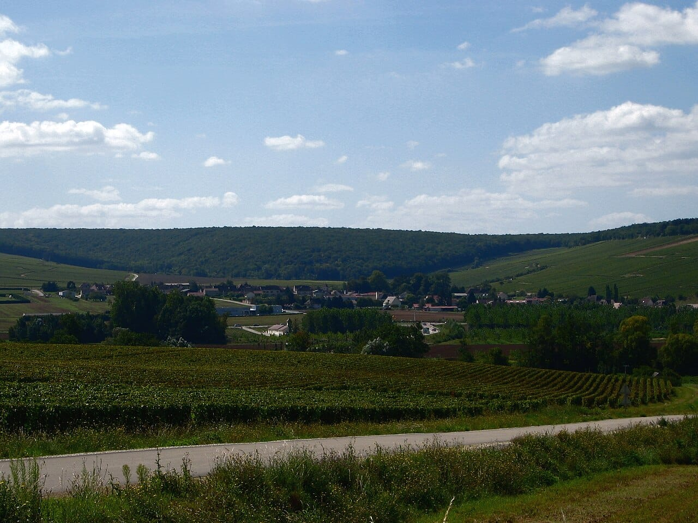

# 夏布利

夏布利（Chablis）是[勃艮第](ref:burgundy)最北端的白葡萄酒产区，位于约讷省的塞兰河（Serein）河谷，葡萄园约 5800 公顷。它只以[霞多丽](ref:chardonnay)酿造[白葡萄酒](ref:white-wine)，以偏凉气候下的高酸度与矿物感著称。与金丘不同，这里没有复杂的村庄与园地拼图，而是清晰的四级结构：小夏布利、夏布利、一级园与特级园。

图：夏布利。图片：CocktailSteward，CC BY 3.0，via Wikimedia Commons（[原图页面](https://commons.wikimedia.org/wiki/File:Chablis_and_Premier_Cru_Vaulorent.jpg)）。

## 位置与整体轮廓

夏布利在勃艮第北部，距离第戎约 140 公里，比夏布利南方的金丘更接近巴黎盆地。葡萄园沿塞兰河及其支谷展开，主体集中在夏布利镇周边约 20 个村庄。产区面积虽大，但真正位于向阳坡面的地块有限，因此级别与地块的差异非常明显。这里的气候属半大陆性，冬季寒冷、夏季温和，生长季比金丘短，成熟度不足是常态风险之一。

## 塞兰河谷与霜冻

塞兰河从南向北穿过产区，在谷底形成一条冷空气通道。春季霜冻夜，冷空气下沉到谷底，坡面中段往往比谷底安全；这也是历史上葡萄园优先开在坡腰而非谷底的原因。现代酒农用喷水、加热器、风扇与覆盖等方式防霜，2021 年的严重霜冻仍造成大面积减产。冰雹是另一个风险，2021 年之前，2016 年也曾在部分村庄造成损失。采收通常在 9 月，凉年可能拖到 10 月。

## Kimmeridgian 土壤

夏布利的标志是启莫里阶（Kimmeridgian）石灰岩与泥灰岩，形成于约 1.5 亿年前的侏罗纪晚期，富含海洋生物化石，尤其是小型牡蛎类 Exogyra virgula。这类土壤排水好、肥力低、保水差，葡萄藤必须深扎根系，产量自然受限；它常被用来解释酒中的“牡蛎壳”矿物感，但矿物感是感官描述，并不意味着酒里含有岩石成分。高原边缘的波特兰阶（Portlandian）石灰岩多见于小夏布利的地块，土层更厚，酒体也更直接。

## 1938 年与四级体系

夏布利在 1938 年正式获得法定产区地位，一级园与特级园的地块名单在此后数十年中逐步细化。四级结构如下：小夏布利（Petit Chablis）多来自高原边缘或海拔较高处；夏布利（Chablis）是主体，覆盖河谷与两侧村庄；一级园（Premier Cru）标注具体园名；特级园（Grand Cru）只有 7 个地块。级别由法定规则界定，并不等于每一瓶酒的绝对质量，年份与生产者往往比级别更能决定表现。

## 小夏布利与村庄级

小夏布利约 1200 公顷，酒体较轻、酸度直接，常有青苹果与柑橘气息，适合年轻时饮用。村庄级夏布利约 3600 公顷，是产区的中坚，风格因地块而异：谷底地块更瘦、更酸，坡面地块更饱满。两者都不要求标注具体园地，因此酒标上的信息量有限，选择时应看酒庄、年份与装瓶者。

## 一级园

一级园约 750 公顷，分布在多个村庄的向阳坡地，常见园名包括 Montée de Tonnerre、Mont de Milieu、Fourchaume、Vaillons、Montmains 与 Les Beauregards。一级园的酒体通常比村庄级更饱满，成熟度更高，酸度仍清晰；不同园名的土壤与坡向差异明显，Montée de Tonnerre 常被认为更接近特级园的质地，Fourchaume 则更偏果味与圆润。

## 特级园

特级园只有 7 个地块，集中在塞兰河右岸一段向阳坡面，总面积约 100 公顷：Les Clos、Vaudésir、Valmur、Grenouilles、Blanchots、Les Preuses 与 Bougros。Les Clos 面积最大、风格最完整，常有蜂蜡、坚果与咸鲜感；Vaudésir 更纤细；Valmur 结构更强；Grenouilles 位于谷底，风格更柔；Blanchots 与 Les Preuses 以矿物与花香著称；Bougros 位于坡顶，成熟度稍慢。特级园产量有限，是产区价格与陈年潜力的高点。

## 酿造与风格

夏布利只允许霞多丽。多数酒款在不锈钢罐或旧桶中发酵，[橡木桶陈年](ref:oak-ageing)使用很少，新桶更少见，因此香气以柑橘、青苹果、白花与湿石头为主。特级园与部分一级园可能使用旧桶，增加质地而不掩盖酸度。酒泥陈酿（sur lie）可以增加圆润感，苹果酸-乳酸发酵则降低酸度、带来奶油气息；是否做苹乳，是酒庄风格的重要分水岭。随着陈年，夏布利会发展出蜂蜜、蜂蜡与坚果气息，但酸度骨架依然清晰。

## 代表生产者

夏布利有家族酒庄、合作社与酒商。拉沃诺（Raveneau）与达维萨（Dauvissat）常被视为传统风格的代表，前者以密度与陈年潜力著称，后者更强调矿物与张力；拉夏布利森（La Chablisienne）是 1923 年成立的合作社，产量占比很高；威廉·费夫尔（William Fèvre）、克里斯蒂安·莫罗（Christian Moreau）与路易·米歇尔（Louis Michel）也生产多个级别，其中路易·米歇尔以不用新桶著称。合作社与酒商在总产量中占不小比例，具体酒款仍应看年份、地块与装瓶者。

## 年份与市场

夏布利的年份差异主要来自霜冻、冰雹与成熟期的降雨。2016 年与 2021 年的霜冻造成明显减产，2018 与 2020 则是偏热年份，酒体更饱满、酸度略低。市场方面，夏布利长期是勃艮第白葡萄酒的入口产区，价格相对金丘更亲民，但特级园与顶级一级园的价格已明显上升。出口市场以英国、美国与亚洲为主，合作社与酒商保证了供应稳定，也带来风格同质化的风险。

## 常见误区

第一，把夏布利当成独立于勃艮第的产区。它在地理与行政上属于勃艮第北部。第二，认为夏布利都是重橡木的霞多丽。多数酒款不使用新桶，风格以清瘦酸度为主。第三，把“矿物感”理解为添加了矿物质。它是风味描述，不是成分表。第四，只认特级园。一级园与村庄级同样可以表现出色，年份与生产者影响很大。第五，把夏布利与默尔索等金丘白酒混同。气候、土壤与酿造传统并不相同。第六，认为夏布利不能陈年。优质一级园与特级园可以陈放十年以上。

对照阅读：[勃艮第](ref:burgundy)、[白葡萄酒](ref:white-wine)。

## 延伸阅读

- [勃艮第](ref:burgundy)：夏布利所属的上级产区。
- [霞多丽](ref:chardonnay)：夏布利唯一的法定品种。
- [白葡萄酒](ref:white-wine)：夏布利的酒类类型。
- [橡木桶陈年](ref:oak-ageing)：桶型与新旧程度对风格的影响。
- [风土](ref:terroir)：土壤、坡向与气候如何塑造风味。

**关键事实。**

| 项目 | 内容 |
| --- | --- |
| 一句话定位 | 勃艮第最北端的白葡萄酒产区，位于约讷省塞兰河谷，葡萄园约 5800 公顷；启莫里阶石灰岩与泥灰岩富含海洋化石，气候偏凉，只种霞多丽，分为小夏布利、夏布利、一级园与特级园四级，特级园只有 7 个地块 |
| 层级 | 其他 |
| 所属 | 勃艮第 |
| 国家代码 | FR |

## 相关图像

图：Burgundy vineyards near Beaune, France。图片：Mark Gorzynski，CC BY-SA 4.0，via Wikimedia Commons（[原图页面](https://commons.wikimedia.org/w/index.php?curid=65061583)）。关联图像：夏布利。

图：霞多丽。图片：Jenavive at English Wikipedia，Public domain，via Wikimedia Commons（[原图页面](https://commons.wikimedia.org/wiki/File:Chardonnay.jpg)）。关联图像：夏布利。
