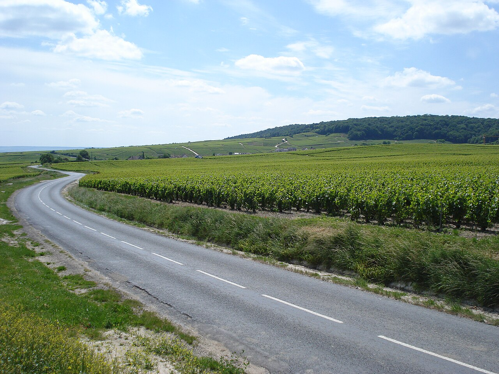
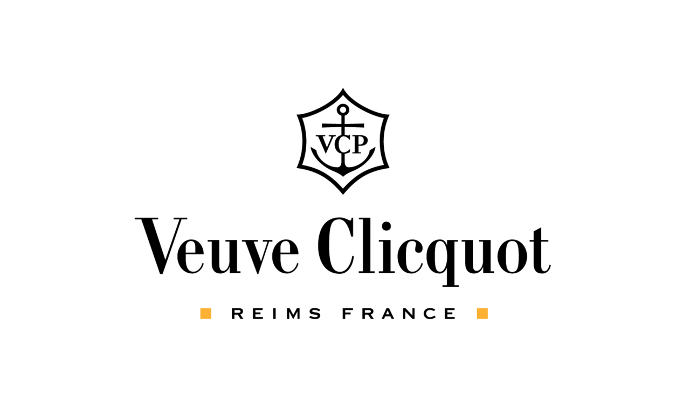

# 香槟

香槟是法国北部香槟地区的[起泡酒](ref:sparkling-wine)法定产区，也是“香槟”这一受保护名称的唯一合法产地。葡萄园围绕兰斯（Reims）与埃佩尔奈（Épernay）展开，并向南延伸到奥布河岸（Côte des Bar）。主要品种为[霞多丽](ref:chardonnay)、[黑皮诺](ref:pinot-noir)与莫尼耶皮诺（Pinot Meunier）。

图：香槟。图片：bgvjpe，CC BY 2.0，via Wikimedia Commons（[原图页面](https://commons.wikimedia.org/wiki/File:Glass_of_champagne.jpg)）。

## 地理与气候

香槟位于[法国](ref:france)北部，葡萄园分布在马恩省、埃纳省、奥布省与上马恩省的部分市镇。气候偏冷，受海洋性影响，生长季较短；春季霜冻、夏季冰雹与秋季降雨是主要风险。低温让葡萄保留较高酸度，这是香槟风格的骨架。

土壤以白垩土（chalk）最具代表性，尤其在兰斯山与白丘：白垩排水性好、能反射阳光并储存热量，有利于根系深扎与成熟。马恩河谷的土壤更多样，黏土与砂质比例较高，适合莫尼耶皮诺。

## 子产区

香槟的葡萄园通常分为四个主要区域：

- 兰斯山（Montagne de Reims）：以黑皮诺为主，果味与结构较完整。
- 马恩河谷（Vallée de la Marne）：莫尼耶皮诺比例较高，果味突出、成熟较早。
- 白丘（Côte des Blancs）：以霞多丽为主，白垩坡地赋予高酸度与矿物感。
- 奥布河岸（Côte des Bar）：位于产区南部，以黑皮诺为主，历史上属于奥布产区。

产区内的村庄分为特级村（grand cru）与一级村（premier cru），目前有 17 个特级村与 42 个一级村。村庄分级反映历史价格与地块评价，不是酒款质量等级；同一村庄内不同酒庄的风格差异仍然明显。

## 品种与风格

[霞多丽](ref:chardonnay)提供酸度、柑橘与白花香气，并带来陈年后的奶油与坚果气息；[黑皮诺](ref:pinot-noir)提供酒体、红果与结构；莫尼耶皮诺提供果味与柔顺感，成熟较早，在霜冻风险较高的马恩河谷尤为重要。

多数香槟是[混酿](ref:blend)：不同品种、不同村庄与不同年份的基酒按比例调配，以平衡酸度、果味与结构。单一品种、单一村庄或单一年份的酒款也存在，但属于少数，具体比例属于酒庄信息。

## 酿造工艺

香槟采用传统法。葡萄按法规要求人工整串采收，压榨后先进行第一次[发酵](ref:fermentation)得到基酒；部分酒庄会进行苹果酸-乳酸发酵以降低酸度。随后将基酒调配，加入糖与酵母后装瓶，在瓶内进行二次发酵产生气泡。

二次发酵完成后，酒液带酒泥陈年。无年份香槟在酒窖中至少陈年 15 个月，其中至少 12 个月带酒泥；年份香槟至少陈年 36 个月（3 年），其中同样至少 12 个月带酒泥。陈年时间越长，气泡越细腻，烤面包与坚果气息越明显。

陈年结束后进行转瓶（riddling），使酒泥聚集到瓶口，再除渣（disgorgement）；最后按目标甜度添加调整液（dosage）。这一整套流程是香槟区别于罐式发酵起泡酒的核心。

## 分级与法规

香槟属于法国 AOC/AOP 体系，规则由 INAO 与欧盟法规框架管理，涵盖产区范围、允许品种、产量上限、修剪方式、采收方式、压榨比例、二次发酵、最短陈年与标签标注。只有符合规则的起泡酒才能使用“Champagne”名称。

香槟区内还有静态酒 Coteaux Champenois 与桃红静态酒 Rosé des Riceys 等独立法定产区，它们与香槟共享地理范围但不使用香槟名称。阅读酒标时，应区分产区名、村庄分级、酒庄名与甜度标注。

## 甜度标注

香槟的甜度由除渣后的调整液决定，标签上的常见等级以[残糖](ref:residual-sugar)含量划分：

- Brut Nature（自然型）：低于 3 g/L。
- Extra Brut：0–6 g/L。
- Brut：低于 12 g/L。
- Extra Dry（Extra Sec）：12–17 g/L。
- Sec：17–32 g/L。
- Demi-Sec：32–50 g/L。
- Doux：高于 50 g/L。

甜度标注描述含糖量，不等于质量等级。多数酒款以 Brut 为主，Demi-Sec 与 Doux 更适合搭配甜点；标注数值是上限框架，具体含量以酒庄资料为准。

## 年份与无年份

无年份香槟（non-vintage，法语 sans année）由多个年份的基酒调配而成，目标是保持酒庄风格稳定，是市场上的大多数。调配比例属于酒庄信息，标签通常只标注酒庄与甜度。

[年份](ref:vintage)香槟（vintage，法语 millésimé）只用所标年份采收的葡萄酿造，并要求更长的酒泥陈年。年份香槟只在评价较好的年份生产，数量较少；年份差异会直接影响酸度、成熟度与陈年潜力。

## 代表酒款与生产者

香槟产区内有大型酒商、合作社与独立酒庄三类生产者。[酩悦](ref:moet)、[凯歌](ref:veuve)与[库克](ref:krug)属于大型酒商层面，[唐·培里侬](ref:domperignon)是酒商旗下的代表性年份酒款。合作社由多个种植者共同酿造，独立酒庄多自有地块并自行装瓶。

酒标上的装瓶者缩写可区分生产者类型：NM 表示酒商，RM 表示种植者自酿，CM 表示合作社。缩写与产区名、年份、甜度标注一起，构成判断酒款来源的基本信息。

## 市场与饮用

香槟常见容量为 750 mL，[酒精度](ref:abv)通常约 12%–12.5% vol。适合作为开胃酒，也适合搭配海鲜、白肉与咸味小食；甜度较高的酒款可搭配水果甜点。

饮用温度建议约 8–10 摄氏度，使用郁金香形或笛形杯。无年份酒款多数适合在 2–5 年内饮用，年份酒款可以更久；开瓶后气泡会逐渐流失，应冷藏并尽快饮用。本页关于香槟的内容涉及酒精饮料；过量饮酒有害健康，未成年人不应饮酒。

## 常见误区

第一，把所有起泡酒都称为香槟。香槟是受保护的法国法定产区名称。
第二，认为香槟越甜越好。甜度标注描述含糖量，风格适配更重要。
第三，把气泡大小当成唯一质量指标。香气、酸度与平衡同样重要。
第四，认为只有霞多丽可以酿造香槟。黑皮诺与莫尼耶皮诺同样是主要品种。
第五，把无年份香槟当成低质量。无年份是追求风格稳定的调配方式，与质量高低不直接相关。
第六，把村庄分级当成酒款评级。特级村与一级村描述地块历史评价，不保证每一瓶的水平。

## 进阶判断

图：兰斯山特雷派伊的葡萄园，香槟区白垩土与坡向的典型景观。图片：Havang(nl)，CC0，via Wikimedia Commons（[原图页面](https://commons.wikimedia.org/wiki/File:Tr%C3%A9pail,_vignes_au_pied_de_la_Montagne_de_Reims.JPG)）。

| 子产区 | 主要葡萄 | 风格线索 |
| --- | --- | --- |
| 兰斯山 | 黑皮诺为主 | 结构、红果、陈年潜力 |
| 白丘 | 霞多丽 | 酸度、花香、矿物感 |
| 马恩河谷 | 莫尼耶为主 | 果香、柔顺、早饮 |
| 南部产区 | 霞多丽为主 | 轻盈、新鲜、性价比 |

**Blanc de Blancs 一定是白丘吗？** 不一定。Blanc de Blancs 指只用白葡萄品种，香槟区通常就是霞多丽，但葡萄可以来自多个子产区。白丘是常见来源，不是唯一来源。

**无年份香槟一定不如年份香槟吗？** 不是。无年份靠多年基酒调配，追求稳定风格；年份香槟表达单一年份。两者是不同目标，不是等级高低。

**香槟甜度标签怎么选？** 先按场合与菜选：Brut 适合大多数咸鲜菜，Demi-Sec 适合甜点与微辣菜。不要只记“Brut 就是干”，不同酒庄的残糖并不完全相同。

延伸阅读：[起泡酒](ref:sparkling-wine)、[法国](ref:france)。

## 参考边界

本页描述香槟产区的范围、子产区、品种、工艺与标签规则，不评价具体酒庄或年份。上级产区节点请参见[法国](ref:france)；香槟酒款页记录具体生产者与产品，与本页的产区层面相互区分。

**关键事实。**

| 项目 | 内容 |
| --- | --- |
| 一句话定位 | 法国北部的起泡酒法定产区，以兰斯与埃佩尔奈为中心；葡萄园分布在兰斯山、马恩河谷、白丘与南部的奥布河岸，以霞多丽、黑皮诺与莫尼耶皮诺酿造，采用瓶内二次发酵的传统法，经酒泥陈年并标注甜度等级 |
| 层级 | 其他 |
| 所属 | 法国 |
| 国家代码 | FR |

## 相关图像

图：凯歌香槟。图片：Julia Jeanselme，CC BY 3.0，via Wikimedia Commons（[原图页面](https://commons.wikimedia.org/wiki/File:Logo_Veuve_Clicquot.png)）。关联图像：香槟。
