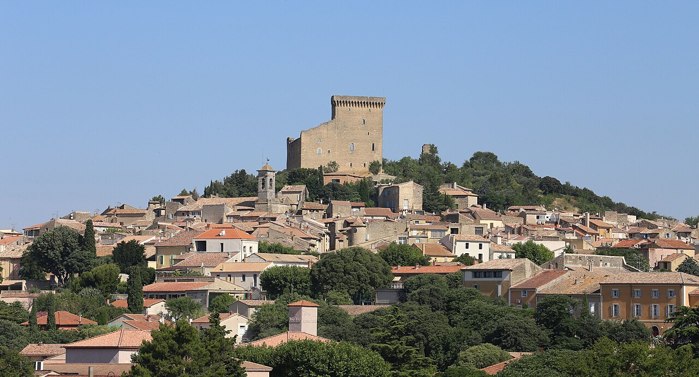

# 教皇新堡

教皇新堡（Châteauneuf-du-Pape）是[罗讷河谷](ref:rhone)南部、阿维尼翁以北的法定产区，葡萄园散布在罗讷河左岸的台地与丘陵之间。它给人的第一印象往往是“饱满、香料感强、酒精高”，但真正决定风格的，是鹅卵石台地的热量、密史脱拉风的干燥，以及以[歌海娜](ref:grenache)为骨架的混酿传统。

图：教皇新堡。图片：Aa77zz，CC0，via Wikimedia Commons（[原图页面](https://commons.wikimedia.org/wiki/File:Village_of_Chateauneuf-du-Pape.JPG)）。

## 位置与整体轮廓

产区北起奥朗日（Orange），南到阿维尼翁以北数公里，主体位于沃克吕兹省。葡萄园面积约 3200 公顷，是南罗讷最大的单一法定产区之一。它与吉恭达斯、瓦凯拉斯等南罗讷产区共享地中海气候，却因面积大、地块杂，内部风格跨度远大于很多小产区。产区只有一级 AOC 名称，没有勃艮第式的一级园或特级园，酒标通常只写产区与年份。

## 地形与密史脱拉风

葡萄园海拔多在 100 至 150 米之间，坡向以东南、南和西南为主。罗讷河谷在此变宽，形成多条东西向的支谷，冷空气可以沿谷地下沉。密史脱拉风自北向南穿过河谷，一年中频繁出现，降低湿度、减少霉病，也会造成风害与花期落果；酒农多用矮灌木式（gobelet）或低架式整枝，让藤架贴近地面避风。风带来的干燥使产区可以采用较少的化学防治，但也让幼藤在定植初期更难成活。

## 鹅卵石与三种土壤

最著名的是 galets roulés：磨圆的石英质鹅卵石，来自古代罗讷河床，密集覆盖在拉 Crau 等台地上。它们白天吸收热量、夜间缓慢释放，同时抑制土壤蒸发、减轻风蚀；石下通常是沙、黏土与石灰岩的混合层，排水极快，老藤必须把根扎得很深。第二种是 safres，即细砂土，拉雅（Rayas）等酒庄的地块以此为特征，保水差、升温快，酒风常更细腻。第三种是北侧与东侧的黏土-石灰岩台地，保水更好，成熟节奏更慢。

## 1936 年与单一产区层级

教皇新堡在 1936 年成为法国最早的法定产区之一，这一时间点常被用来强调它在 AOC 制度史上的位置。名称来自 14 世纪教廷迁至阿维尼翁后修建的城堡，但今天的法定边界与教皇产业并无直接继承关系。产区没有官方子产区，酒农通常按地块描述风格，例如拉 Crau 的鹅卵石台地、沙土坡地与黏土-石灰岩地块。法定规则对产量、成熟度与品种比例作出限制，近年产量上限大致在每公顷 35 百升左右，红葡萄酒的最低自然酒精度为 12.5%。

## 十三个许可品种

法定名单常被概括为 13 种，红白合计。按常见归纳，包括歌海娜（黑、白、灰三种颜色变型算作一项）、西拉、慕合怀特、神索、克莱雷特、胡珊、布尔朗克、匹格普勒、黑特雷、顾尔努瓦兹、慕斯卡丹、瓦卡雷斯与皮卡丹。名单是允许范围，不是配方：一瓶酒可以使用其中一种，也可以使用多种，比例没有统一模板。红葡萄酒以歌海娜为主体，常配西拉与慕合怀特补充颜色、单宁与酸度；白葡萄酒以白歌海娜、克莱雷特、胡珊与布尔朗克为主，产量只占总量的约 5%。

## 红白风格与酿造

红葡萄酒的典型描述是成熟黑莓、李子、普罗旺斯香草、皮革、松露与甘草，酒体饱满，酒精度常在 14% 至 15% 之间。整串发酵可以增加香料感与茎梗带来的清新感，但也会带来生青风险；多数酒庄在混凝土罐或大橡木槽（foudres）中发酵，随后在旧桶或槽中陈年，新桶使用相对克制，以免掩盖品种与地块。白葡萄酒则更清瘦，酸度靠早采与地块维持，常带白花、茴香与轻微咸鲜感。

## 老藤、产量与熟成

产区内保留了大量老藤歌海娜，有些藤龄超过 80 年，产量低、果实小、风味集中，但抗旱与抗病能力并不自动更强，需要更细致的修剪与水肥管理。老藤多分布在鹅卵石与沙土地块，根系深，能在干旱年份维持较好的成熟度。熟成时间从一年到数年不等，取决于酒体与市场定位；过度桶陈会让酒失去果味与香料细节。

## 代表酒庄

拉雅（Château Rayas）以沙土地块的歌海娜著称，酒风细腻、香气偏红果与香料；博卡斯特尔（Château de Beaucastel）由 Perrin 家族经营，使用全部许可品种，慕合怀特比例较高，并长期采用有机种植；老电报（Vieux Télégraphe）的拉 Crau 地块是鹅卵石台地的典型；克洛德帕普（Clos des Papes）、雅纳斯（Domaine de la Janasse）与佩高（Domaine du Pégaü）也常被讨论。大型酒商与合作社在总产量中占一定比例，家族酒庄则更强调地块与老藤。

## 年份与市场

南罗讷的年份差异主要来自热量与水分：2003 年的热浪带来极高酒精与低酸，2021 年的春霜造成严重减产，2019 与 2020 则是干旱与高温的连续考验。市场方面，教皇新堡长期是南罗讷价格与知名度的标杆，美国、英国与亚洲餐厅是主要出口渠道；但产区名也容易被过度使用，同一名称下的酒款质量差距很大。评价一瓶酒，应看酒庄、地块、年份与装瓶信息，而不是只看产区名。

## 常见误区

第一，认为 13 种品种都必须出现在同一瓶酒里。名单是允许范围，不是配方。第二，把鹅卵石当成唯一的风味来源。土壤、老藤、气候与酿造共同作用。第三，认为酒精度高就一定失衡。成熟度与酸度、单宁的配合更重要。第四，以为教皇新堡只产红酒。这里也生产少量白葡萄酒与桃红。第五，把产区名当成酒庄名。教皇新堡是一个法定产区，不是单一城堡。第六，认为老藤一定比年轻藤好。藤龄只是变量之一，栽培与年份同样关键。

对照阅读：[罗讷河谷](ref:rhone)、[红葡萄酒](ref:red-wine)。

## 延伸阅读

- [罗讷河谷](ref:rhone)：教皇新堡所属的上级产区。
- [歌海娜](ref:grenache)：南罗讷与教皇新堡的核心品种。
- [红葡萄酒](ref:red-wine)：产区的主要酒类。
- [发酵](ref:fermentation)：浸渍与整串发酵对风格的塑造。
- [风土](ref:terroir)：鹅卵石、土壤与风如何影响成熟。

**关键事实。**

| 项目 | 内容 |
| --- | --- |
| 一句话定位 | 罗讷河谷南部、阿维尼翁以北的法定产区，1936 年获得 AOC 地位；拉 Crau 台地的 galets roulés 鹅卵石、密史脱拉风与以歌海娜为主体的混酿构成其骨架，法定许可品种常被概括为 13 种，但名单是允许范围而非固定配方 |
| 层级 | 其他 |
| 所属 | 罗讷河谷 |
| 国家代码 | FR |

## 相关图像

图：罗讷河谷。图片：Béa at French Wikipedia，Public domain，via Wikimedia Commons（[原图页面](https://commons.wikimedia.org/wiki/File:Thain1.jpg)）。关联图像：教皇新堡。

图：歌海娜。图片：Jules Troncy，Public domain，via Wikimedia Commons（[原图页面](https://commons.wikimedia.org/wiki/File:Grenache_N.jpg)）。关联图像：教皇新堡。
