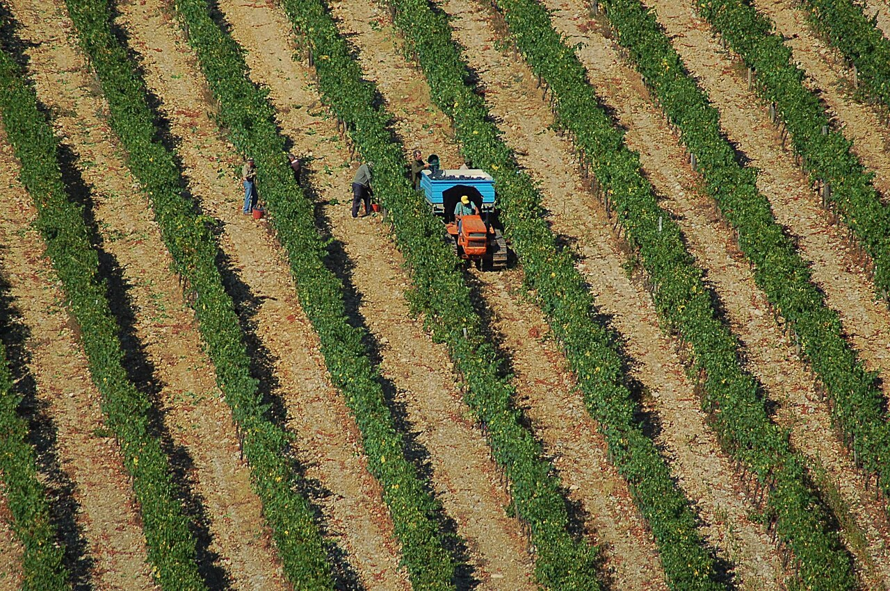

# 基安蒂经典

基安蒂经典（Chianti Classico）是意大利托斯卡纳佛罗伦萨与锡耶纳之间的红葡萄酒保证法定产区（DOCG），生产区约 71,800 公顷，以桑娇维塞为主体。它与更大的基安蒂（Chianti）产区自 1996 年起分属两套独立规范，酒标上的黑公鸡标志是它最直观的身份标记。

图：基安蒂经典。摄影：Vineyards in the Chianti Classico valleys (6222951465)。署名：Tom Chance from Peckham，CC BY-SA 2.0，来自 Wikimedia Commons（[来源](https://commons.wikimedia.org/w/index.php?curid=133577648)）。

## 定义与范围

基安蒂经典只能用于在划定生产区内完成全部酿造、并在酒标上使用黑公鸡标志的红[葡萄酒](ref:red-wine)。产区位于[意大利](ref:italy)中部的[托斯卡纳](ref:tuscany)，范围包括 Castellina in Chianti、Gaiole in Chianti、Greve in Chianti 与 Radda in Chianti 四个完整市镇，以及 Barberino Tavarnelle、Castelnuovo Berardenga、Poggibonsi 与 San Casciano Val di Pesa 四个市镇的部分地块。

法定品种以[桑娇维塞](ref:sangiovese)为主，最低比例为 80%，其余 20% 可使用经托斯卡纳大区授权的红品种；自 2006 年起，基安蒂经典只能使用红品种，白葡萄不再允许。产品分为 Annata、Riserva 与 Gran Selezione 三类，三者是同一产区内的不同酒型，而不是三个子产区。

生产区面积约 71,800 公顷，但其中包含森林、橄榄园与村庄，并不等于葡萄园面积；酒标上的 Classico 说明历史核心地带，而不是某一块固定葡萄园。

## 历史脉络

黑公鸡与这片土地的联系可追溯到 1384 年，当时它成为基安蒂联盟（Lega del Chianti）的标志。1398 年，一份公证文献首次以 Chianti 指称这里的葡萄酒，说明名称与产地的绑定早于现代产区制度。

1716 年 9 月 24 日，托斯卡纳大公科西莫三世颁布法令，正式划定基安蒂葡萄酒的生产边界，范围从 Spedaluzzo 到 Greve、Panzano，并包括 Radda 的辖区以及 Gajole 与 Castellina。这被视为现代原产地保护制度的早期实践之一；同年还设立了监督生产与贸易的机构。

1872 年，Bettino Ricasoli 写下以桑娇维塞为主、辅以 Canaiolo 等的混酿配方，奠定了现代基安蒂的品种框架。1924 年 5 月 14 日，33 家生产者在 Radda 成立保护协会，并选用黑公鸡作为标志。1932 年，部令把基安蒂划分为七个生产区，只有位于 1716 年边界内的酒才获准加上 Classico 后缀；这里的“七”指七个基安蒂产区，不是七个村庄。

1967 年基安蒂经典获得 DOC 地位，1984 年升为 DOCG；1996 年 8 月 5 日的部令使其成为拥有独立规范的 DOCG，从此与基安蒂分开。2005 年，黑公鸡从协会的集体商标转变为整个产区的象征，并纳入国家批准的瓶口封带；2014 年，Gran Selezione 作为新的最高酒型被引入。

## 地理与气候

产区位于佛罗伦萨与锡耶纳两城之间的丘陵，葡萄园分布在坡地与山脊，海拔与坡向造成明显差异。丘陵地形带来较好的空气流动，夏季炎热时可缓解高温与湿度，秋季则利于果实保持酸度。

土壤以 galestro 泥灰岩与 alberese 石灰岩为代表，前者风化后呈片状、排水快，后者更坚硬、含钙高；两者常与黏土、砂质沉积交错分布。土壤贫瘠、排水良好，通常促使根系深扎并限制产量，但不同地块的水分保持能力差别很大。

气候受地中海与大陆性双重影响，夏季温暖干燥，秋季昼夜温差大，降雨集中在冬春。海拔较高或朝北的坡面成熟更慢、酸度更高；朝南的坡面更暖、果味更饱满。年份之间的差异主要来自开花期降雨、夏季高温与采收前降雨，而不是单一土壤类型。

## 品种与栽培

桑娇维塞果皮较薄，酸度高、单宁中等偏强，典型香气包括酸樱桃、紫罗兰、干草与泥土。它成熟较晚，通常在 9 月下旬至 10 月上旬采收；成熟不足时酸度尖锐，成熟过度则失去清新感。

法定混酿中，桑娇维塞最低 80%，其余部分可使用 Canaiolo Nero、Ciliegiolo、Colorino、Fogliatonda、Malvasia Nera、Mammolo 与 Pugnitello 等本地品种，也可使用 Cabernet Franc、Cabernet Sauvignon、Merlot 与 Syrah 等国际品种。1996 年起允许 100% 桑娇维塞，2006 年起混酿中不得再出现白品种。

产区把产量控制在意大利 DOCG 中较低的水平，以换取更集中的风味；具体上限随规范修订而变化。栽培上强调坡地、通风与适当叶幕，以减少病害并让果实缓慢成熟。

## 酿造与陈年

Annata 是最年轻的酒型，最低酒精度 12%，最短陈年 12 个月；Riserva 最低 12.5%，最短陈年 24 个月，其中至少 3 个月在瓶中；Gran Selezione 最低 13%，最短陈年 30 个月，其中至少 3 个月瓶陈。三者的干浸出物下限分别为 24、25 与 26 克/升，总酸均不低于 4.5 克/升。

Gran Selezione 必须只用酒庄自有葡萄，来自单一葡萄园或经过筛选的最佳果实，并允许在酒标上标注附加地理单元。它于 2014 年才被引入，是意大利首个在既有 DOCG 之上增设“顶级酒型”的案例，因此它不是历史分级，而是近年的规范创新。

桑娇维塞的高酸与中等单宁需要[橡木桶陈年](ref:oak-ageing)来整合，但桶型没有统一规定。传统大桶强调果味与酸度，小型法式桶增加香料与酒体；Riserva 与 Gran Selezione 的差异，往往来自桶陈时长、桶龄与瓶陈的组合，而不是单纯的年份高低。

## 分级与法规

基安蒂经典没有村庄级法定分级。Annata、Riserva 与 Gran Selezione 构成酒型金字塔，附加地理单元（MGA）则是可选的更具体地名，主要出现在 Gran Selezione 酒标上。把 Riserva 当成“更好的地块”或把 Gran Selezione 当成“官方第一名”，都是对规范的误读。

1996 年以前，基安蒂经典与基安蒂共享一套规范；1996 年 8 月 5 日之后，两者成为独立 DOCG，生产区、品种与陈年要求都不同。1932 年部令确定的七个基安蒂产区，是理解“Classico”后缀的历史背景，但不等于今天基安蒂经典的内部划分。

酒标必须出现 Chianti Classico 与 DOCG；黑公鸡通常位于瓶口或背标，并纳入国家封带。只有在 1716 年边界内生产的酒才能使用 Classico，其他区域即使种植桑娇维塞也不能借用这一名称。

## 风格与饮用

Annata 以新鲜酸樱桃、紫罗兰与草本香气为主，酸度明亮、单宁适中，适合搭配番茄基菜肴、烤蔬菜与中等硬度的奶酪。Riserva 经过更长陈年，果味更熟、香料与皮革感更明显，适合炖肉、烤肉与陈年 pecorino。Gran Selezione 结构最深，香气更复杂，适合单独品饮或搭配味道浓郁的野味。

饮用温度通常建议在 16 至 18 摄氏度；高酸度让它在配餐中很灵活，但也会放大油腻感。年轻酒款可短时间醒酒，老酒则应减少暴露，以保留酸樱桃与花香。

选购时先确认酒型，再看年份与酿造风格；同一产区内，海拔、坡向与土壤差异会让 Annata 与 Riserva 表现不同。黑公鸡只证明产区归属，不证明酒型等级。

对照阅读：[意大利](ref:italy)、[桑娇维塞](ref:sangiovese)。

## 参考资料

- [意大利](ref:italy)：国家级产区与 DOCG 体系。
- [托斯卡纳](ref:tuscany)：基安蒂经典所在的大区框架。
- [桑娇维塞](ref:sangiovese)：本产区的主导品种。
- [红葡萄酒](ref:red-wine)：基安蒂经典的类别、单宁与酿造概览。
- [橡木桶陈年](ref:oak-ageing)：桶型、桶龄与微氧化的作用。
- [风土](ref:terroir)：海拔、坡向与土壤差异的讨论框架。
