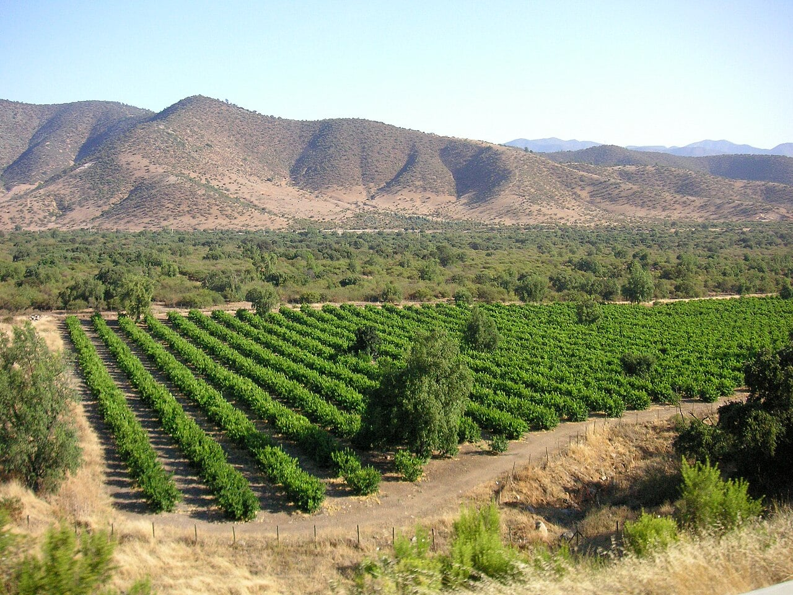

# 智利

智利是南美洲西海岸的狭长葡萄酒生产国，葡萄园夹在安第斯山脉与太平洋之间，从北部的沙漠边缘延伸到南部的凉爽地区。

图：智利安第斯山麓的葡萄园，成排的葡萄藤沿山坡展开。图片：Beatrice Murch，CC BY-SA 2.0，via [原图页面](https://commons.wikimedia.org/wiki/File:Chilean_vineyard_in_Andes_foothills.jpg)。

## 定义与范围

智利是国家级葡萄酒产区。按 2024 年 SAG 葡萄园普查，全国葡萄园约 126,249 公顷，其中酿酒品种 116,961 公顷、Pisco 用葡萄 9,287 公顷；酿酒品种中红葡萄 84,768 公顷（72.5%）、白葡萄 32,194 公顷（27.5%）。

葡萄园集中在 centro-sur：O'Higgins 约 36,026 公顷与 Maule 约 48,565 公顷，两者合计约占全国的三分之二；首都大区约 8,898 公顷酿酒品种，Valparaíso 大区约 7,757 公顷。2023 至 2024 年，全国葡萄园减少约 7,400 公顷，降幅约 6%，反映国内消费下降与葡萄园拔除。

## 「智利」的时间线
智利的葡萄种植始于 16 世纪西班牙殖民时期，早期以传教士引入的品种与本地克里奥拉品种为主。19 世纪中叶，法国波尔多品种被引入，灌溉渠道与铁路推动葡萄酒业扩张；19 世纪末的欧洲病害冲击智利较轻，部分老藤因此保留下来。

20 世纪后期，智利转向出口，酒厂引入不锈钢罐、温控发酵与国际品种。1990 年代在原有 Merlot 葡萄园中确认了 Carménère，使其成为智利的标志性品种之一。同期，沿海冷凉地区被重新评估，Casablanca 从 1982 年的试验种植发展为独立产区。

## 地理与气候

智利南北长约 4,300 公里，产区跨越多个气候带。中部是地中海气候：夏季炎热干燥、冬季凉爽多雨，降水集中在冬季；沿海受太平洋冷流与晨雾影响，气温较低且昼夜温差小；内陆谷地则更热、更干，依赖安第斯融雪灌溉。

安第斯山脉与海岸山脉构成两道屏障，使中部谷地相对封闭。这减少了病害传入，也让不同谷地形成清楚的气候梯度：同一品种在靠海的 Casablanca 与内陆的 Maipo 会呈现不同成熟度与风格。

土壤以河流冲积物、砾石、砂与黏土为主；安第斯山麓的冲积扇排水良好，海岸山脉一带多为花岗岩风化土与黏土。排水、保水与根系深度的差异，构成谷地内部的[风土](ref:terroir)分化。

## 产地制度

智利的产地命名由 1994 年 12 月制定、1995 年 5 月公布的第 464 号法令（Decreto 464）建立，隶属《葡萄酒法》（Ley 18.455）。法令把产区分为四级：Región Vitícola（产区）、Subregión（子产区）、Zona（地带）与 Área（小区），并规定各级的法定边界与允许使用的品种。

符合规定的酒款可在酒标上标注 D.O.（Denominación de Origen）与相应地名。Reserva、Reserva Especial 与 Gran Reserva 等字样属于受规范的补充标注，与最低酒精度和木桶处理等条件挂钩，不是统一的质量等级。智利不是欧盟成员，其 D.O. 与欧盟 PDO/PGI 并行但不等同。

## Maipo

Maipo 是 Valle Central 产区的 Subregión，范围覆盖首都大区，包含 Santiago、Pirque、Puente Alto、Buin、Isla de Maipo、Talagante、Melipilla、Alhué、María Pinto、Colina 与 Calera de Tango 等 Área。这里是智利红葡萄酒的历史核心，Concha y Toro（1883）与 Santa Rita（1880）等酒厂均发源于此。

气候为地中海型：夏季炎热干燥，冬季寒冷多雨。东侧葡萄园位于安第斯山麓的冲积扇，砾石与碎石排水良好；西侧葡萄园延伸到海岸山脉的砂质土壤。海拔与离山距离造成明显差异，山麓地块昼夜温差更大，成熟更慢。

主要品种为 Cabernet Sauvignon（约 5,517 公顷），其后为 Merlot（约 890 公顷）、Syrah（约 869 公顷）、Carménère（约 709 公顷）、Sauvignon Blanc（约 604 公顷）与 Chardonnay（约 602 公顷），另有 Tintorera 约 454 公顷；全谷地葡萄园约 10,000 公顷。Cabernet Sauvignon 在这里常表现为黑加仑、铅笔芯与结构清晰的单宁，适合[橡木桶](ref:oak-ageing)陈年。

## Casablanca

Casablanca 是 Aconcagua 产区的 Subregión，法定范围仅限 Casablanca 市镇，位于圣地亚哥西北约 75 公里、太平洋以东约 20 公里。1982 年，Pablo Morandé 在此种下首批约 20 公顷 Chardonnay、Sauvignon Blanc 与 Riesling，被视为智利冷凉气候种植的起点。

产区受太平洋冷流、晨雾与午后海风影响，生长季气温明显低于内陆谷地，成熟缓慢。土壤多为花岗岩风化土与黏土，保水性强，与 Maipo 的砾石冲积土形成对照。海拔较高的温暖、无霜地块适合 Merlot 与 Syrah 等红葡萄，低处冷凉地块则以白葡萄为主。

主要品种为 Sauvignon Blanc（约 2,235 公顷）、Chardonnay（约 1,420 公顷）与 Pinot Noir（约 853 公顷），其后为 Merlot（约 238 公顷）与 Syrah（约 107 公顷）；全谷地葡萄园约 5,000 公顷。Sauvignon Blanc 常带柑橘、青草与矿物感，Chardonnay 酸度清晰，部分酒款经橡木桶与酒泥处理。

Maipo 与 Casablanca 的差异可以归纳为：Maipo 在内陆、偏热、以 Cabernet Sauvignon 等红葡萄为主；Casablanca 靠海、偏冷、以 Sauvignon Blanc 与 Chardonnay 等白葡萄为主。两者都不以海拔为唯一卖点，气候与土壤才是风格分化的主因。

## 品种与原料

Cabernet Sauvignon、Sauvignon Blanc、País 与 Carménère 是面积最大的四个品种，合计约占全国酿酒品种的 56%。Cabernet Sauvignon 是红葡萄的核心；Sauvignon Blanc 在沿海与中部广泛种植；País 是早期引入的本地老藤品种，多见于南部与小型生产者；Carménère 原产波尔多，在智利成为标志性品种，常带青椒、香料与柔顺单宁。

白葡萄中，Chardonnay 与 Sauvignon Blanc 占据主要面积，另有 Moscatel、Torrontés 与 Pedro Jiménez 等。原料是[葡萄](ref:grape)。智利葡萄园多为自根苗，部分老藤未受根瘤蚜影响，这与其地理隔离、砂质土壤和灌溉方式有关。

## 「智利」怎么做出来
红葡萄按品种与风格调整浸渍时间。Cabernet Sauvignon 与 Carménère 常经较长时间浸渍与橡木桶陈年；Syrah 与 Pinot Noir 更强调果味与中等酒体。部分酒款使用整串发酵或大比例旧桶，以减少新桶带来的甜香料感。

白葡萄低温[发酵](ref:fermentation)，多数保持清爽酸度，避免苹果酸乳酸发酵；Casablanca 的 Sauvignon Blanc 常在不锈钢罐中发酵并短暂酒泥接触。Chardonnay 部分酒款使用橡木桶、酒泥搅拌与苹果酸乳酸发酵，风格更饱满。

## 「智利」的酒标与喝法
酒标应核对 D.O. 与具体地名、品种、[年份](ref:vintage)、[酒精度](ref:abv)、容量与装瓶者。标示[单一品种](ref:single-varietal)的酒款须达到法定品种比例；混酿按法规列出品种。Reserva 等字样须结合酒精度与工艺理解，不应直接当作质量等级。

Maipo 的 Cabernet Sauvignon 建议 16–18 摄氏度，Casablanca 的 Sauvignon Blanc 建议 8–10 摄氏度，Chardonnay 建议 10–12 摄氏度，Pinot Noir 建议 14–16 摄氏度。Cabernet 适合红肉与硬质奶酪；Sauvignon Blanc 适合海鲜、沙拉与亚洲料理。开瓶后冷藏并尽快喝完。本页关于智利的内容涉及酒精饮料；过量饮酒有害健康，未成年人不应饮酒。

## 「智利」容易被读错的地方
第一，认为智利只产 Cabernet Sauvignon。白葡萄占酿酒品种的 27.5%，Sauvignon Blanc 与 Chardonnay 面积可观。
第二，把 Casablanca 当成 Maipo 的一部分。Casablanca 属 Aconcagua 产区，Maipo 属 Valle Central 产区。
第三，把 Reserva 当成统一质量等级。它是与酒精度和工艺挂钩的补充标注。
第四，用欧盟 PDO 体系读智利酒标。智利 D.O. 是本国的四级产地制度，与欧盟框架并行但不等同。
第五，以为智利葡萄园靠天然降雨。中部产区夏季干旱，葡萄园主要依赖安第斯融雪灌溉。

## 参考资料
- [葡萄酒](ref:wine)：理解智利的类别、年份与产地规则的入口。
- [红葡萄酒](ref:red-wine)与[白葡萄酒](ref:white-wine)：智利两大酒类的基本框架。
- [葡萄](ref:grape)：酿酒葡萄的结构与成熟指标。
- [发酵](ref:fermentation)：红葡萄浸渍与白葡萄低温发酵的差异。
- [酸度](ref:acidity)：沿海冷凉气候与昼夜温差对酸度的影响。
- [风土](ref:terroir)：海岸山脉、安第斯山麓与冲积土如何形成谷地差异。
- [橡木桶陈年](ref:oak-ageing)：Cabernet Sauvignon 与 Chardonnay 的容器选择。
- [干型](ref:dry)：智利白葡萄酒的干型定位。
- [年份](ref:vintage)：智利的年份差异与厄尔尼诺影响。
- [单一品种](ref:single-varietal)：智利的品种比例与酒标标注规则。
- [酒精度](ref:abv)：酒标上 % vol 的含义。
