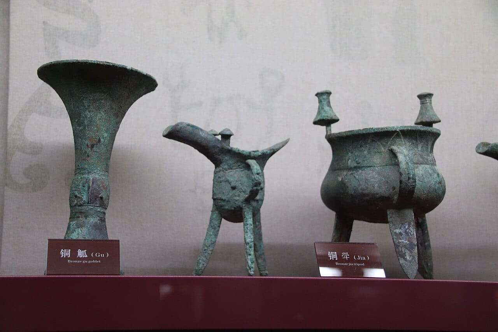
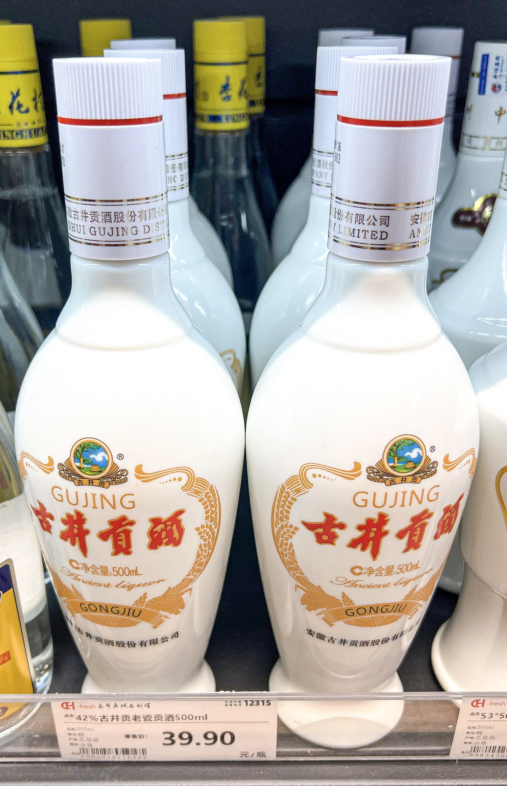
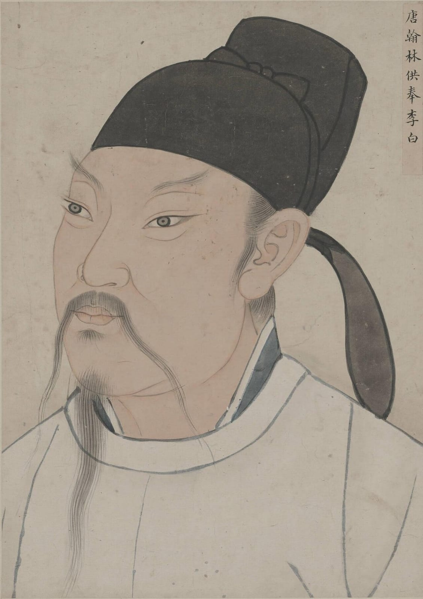

# 中国

本页是地区层级的国家节点，用于组织产区、生产者与地点。中国酒类既有以粮食发酵、蒸馏为基础的[白酒](ref:baijiu)与[黄酒](ref:yellow-wine)，也有规模化生产的[葡萄酒](ref:wine)、[啤酒](ref:beer)以及进口烈酒。

图：中国地区文化实景。图片：Gary Todd，CC0，via Wikimedia Commons（[原图页面](https://commons.wikimedia.org/wiki/File:Shang_Bronze_Gu,_Jue,_%26_Jia_Wine_Vessels.jpg)）。这张照片用于说明中国的实际风貌，不是中国的全区域地图。

## 地理与气候

中国幅员辽阔，从寒温带到热带、从湿润沿海到干旱内陆都有分布。酿酒原料与工艺因此呈现明显的地域差异：北方以高粱、小麦为主，南方稻米、糯米比重更高；东部沿海湿润，西北干燥，发酵与贮存的微生物环境各不相同。

气候不仅影响原料品质，也影响发酵管理。夏季高温需要降温与卫生控制，冬季低温则可用于控制发酵速度。高原与山地的昼夜温差、盆地与平原的湿度差异，都会落到具体的曲、窖与贮存条件上。

## 酒类版图

白酒是产量与消费规模最大的本土蒸馏酒，香型包括浓香、酱香、清香、米香、兼香、凤香等。黄酒以稻米为主料，主要分布在浙江、江苏、上海、福建、山东等地。葡萄酒产区集中在山东、河北、宁夏、新疆、云南等地；啤酒则几乎遍布全国。

进口酒在中国市场也占有位置：苏格兰威士忌、法国干邑、古巴朗姆、墨西哥龙舌兰、日本清酒等都有稳定消费群。把中国酒类理解为“本土酒 + 进口酒”的双轨结构，比只看白酒更完整。

## 白酒与黄酒

白酒以粮谷为原料，经制曲、发酵、蒸馏、贮存与勾调而成，酒精度通常较高。不同香型的差别来自曲种、发酵容器、发酵温度与蒸馏方式，而不是简单的“香味浓淡”。浓香强调窖池与续糟，酱香强调高温制曲与多轮次取酒，清香强调清蒸清烧。

黄酒属于发酵酒，以糯米、粳米等为原料，经麦曲或酒药糖化发酵、压榨、煎酒与陈酿而成。绍兴酒是黄酒中最知名的地理标志产品。黄酒酒精度通常低于白酒，风味更依赖米、曲与水。

## 葡萄酒与啤酒

中国葡萄酒的历史可追溯到近代工业化时期，烟台张裕是代表之一。现代产区在宁夏、新疆、河北、山东等地形成规模，品种以赤霞珠、霞多丽、蛇龙珠等为主。国产葡萄酒既有日常餐酒，也有酒庄酒。

啤酒在中国是产量最大的饮料酒类别，工业拉格为主，精酿啤酒在大城市形成细分市场。啤酒的风格由麦芽、酒花、酵母与水质决定，与白酒、黄酒的评价体系完全不同，不能用同一套“度数—香气”标准比较。

## 原料与工艺

白酒的主要原料是高粱，制曲多用小麦；黄酒以稻米为主；葡萄酒以葡萄为原料；啤酒以大麦芽、酒花与酵母为核心。原料之外，水、曲、容器与环境微生物共同决定风格。

工艺上，蒸馏酒与发酵酒是两条主线。蒸馏决定了酒精浓度与香气浓缩，发酵与贮存决定了酸、糖、氨基酸与香气前体。理解一条产品线，先确认它属于哪条主线，再谈具体风格，才能避免把不同品类的指标混在一起。

## 消费与饮用

中国酒类的消费场景差异很大：白酒常见于宴席与礼赠，黄酒多见于江浙沪的家常与蟹季，葡萄酒与啤酒更偏向餐饮与日常饮用，洋酒则集中在酒吧、夜店与收藏市场。场景影响产品设计，也影响人们对“好酒”的判断。

饮用应遵循适量原则。高度酒不宜快饮，低度酒也不等于可以无限量饮用。开瓶后的保存、温度与器皿都会影响体验；对具体产品，标签上的原料、酒精度、执行标准与产地，是最直接的信息来源。

## 与世界的关系

中国既是酒类生产国，也是重要的进口市场。白酒在国际烈酒版图中的认知度仍在提升，黄酒常被拿来与日本清酒比较，国产葡萄酒则在国际赛事与批评体系中逐渐获得关注。

跨文化比较要注意口径差异：香型不是葡萄品种，黄酒的“陈”与葡萄酒的“陈年”也不是同一概念。用对方的评价框架套本土酒，容易得出似是而非的结论；更可靠的方式是先理解各自的工艺，再做对照。

## 从国家节点到具体条目

国家页只提供框架，真正的信息在生产者、酒款与人物页。生产企业可以从[五粮液集团](ref:wuliangye-group)、[泸州老窖集团](ref:luzhou-laojiao-group)、[汾酒集团](ref:fenjiu-group)、[洋河集团](ref:yanghe-group)与[古井贡酒](ref:gujing-distillery)进入；具体酒款包括[五粮液普五](ref:puwu)、[国窖1573](ref:guojiao)、[青花汾30](ref:qinghua)、[梦之蓝M9](ref:mengzhilan)、[古井贡古20](ref:gu20)、[水晶剑南春](ref:crystal)与[红西凤](ref:hongxifeng)。

人物与饮用入口方面，[李白](ref:li-bai)把酒写入唐诗的社交与孤独场景，[第一次喝白酒怎么选](ref:first-baijiu)则把选酒拆成可执行的步骤。产区、企业、产品与人物各自回答不同问题，顺着链接阅读比用一条概括替代全部更可靠。

## 常见误区

第一，把中国酒等同于白酒。黄酒、葡萄酒、啤酒同样是本土酒类的重要部分。
第二，认为香型越多越好。香型是工艺分类，不是品质等级。
第三，把“陈年”当作通用标准。不同酒类的适饮期与变化方向不同。
第四，认为进口酒一定更高级。价格与关税不直接等于品质。
第五，用单一品牌代表整个国家。产地、企业与产品之间差异很大。

对照阅读：[白酒](ref:baijiu)、[葡萄酒](ref:wine)。

## 延伸阅读

- [白酒](ref:baijiu)：中国最具代表性的蒸馏酒与其香型体系。
- [黄酒](ref:yellow-wine)：稻米发酵酒的传统与分类。
- [葡萄酒](ref:wine)：国产与进口葡萄酒的基本框架。
- [啤酒](ref:beer)：产量最大的饮料酒类别与风格基础。

**关键事实。**

| 项目 | 内容 |
| --- | --- |
| 一句话定位 | 地区层级中的国家节点；中国酒类以白酒与黄酒最具本土特色，葡萄酒、啤酒与洋酒也已形成规模化市场 |
| 层级 | 国家 |
| 国家代码 | CN |

**来源与边界。** 本页关于「中国」的关键事实，主要由以下来源交叉核对：国务院办公厅（行政区划与国家层面的公开信息）、中华人民共和国国家质量监督检验检疫总局、中国国家标准化管理委员会（行政区划层级与代码）、国家市场监督管理总局、国家标准化管理委员会（饮料酒分类与术语）等 7 条来源。价格、批次与状态会变，涉及这些字段时以页面所列来源的最新版本为准。正文为项目自写，来源只作核验，不复制原文。

## 相关图像

图：安徽古井贡酒股份有限公司相关实景照片。图片：N509FZ，CC BY-SA 4.0，via Wikimedia Commons（[原图页面](https://commons.wikimedia.org/wiki/File:Gujing_Gongjiu_at_a_supermarket_in_Beijing_(20241109164639).jpg)）。关联图像：中国。

图：佚名《唐名臣像》中的李白像。。图片：Unknown author，Public domain，via Wikimedia Commons（[原图页面](https://commons.wikimedia.org/wiki/File:%E5%94%90%E5%90%8D%E8%87%A3%E5%83%8F-14-%E5%94%90%E7%BF%B0%E6%9E%97%E4%BE%9B%E5%A5%89%E6%9D%8E%E7%99%BD.jpg)）。关联图像：中国。
