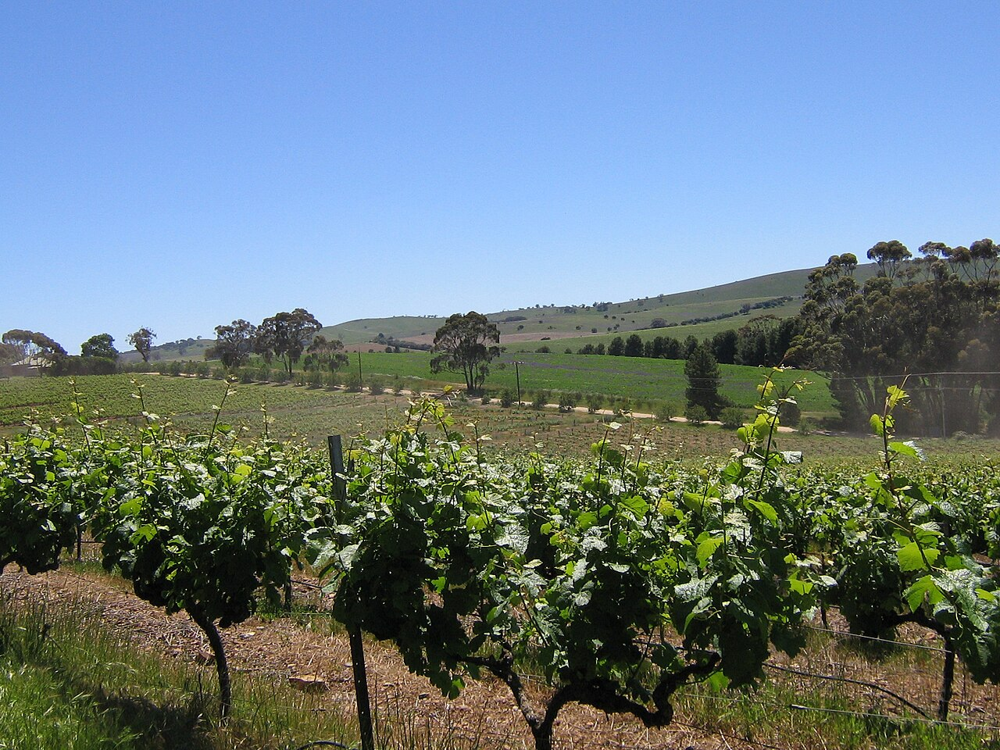

# 克莱尔谷

南澳大利亚中北部的狭长谷地，以雷司令与西拉著称；板岩、石灰岩与红土、昼夜温差与老藤，使它成为澳洲雷司令的核心，1990 年代获 GI。

克莱尔谷是南澳阿德莱德以北的凉爽产区，雷司令与设拉子是核心；Polish Hill 与 Watervale 的地块差异，比“Clare Valley”更能说明风格。

图：Clare Valley：Vines in Clare Valley（Wikimedia Commons）。图片：Scott Davis，CC BY-SA 3.0，via Wikimedia Commons（[原图页面](https://commons.wikimedia.org/wiki/File:Vines_in_Clare_Valley.jpg)）。

## 定义与边界

克莱尔谷是[澳大利亚](ref:australia)阿德莱德以北的葡萄酒产区，以雷司令与设拉子著称；它由 Auburn、Watervale、Polish Hill、Sevenhill 等子产区组成，北接 Burra，南邻 Barossa。读酒标时，子产区名比“Clare Valley”更能说明风格。

克莱尔谷不是巴罗萨的附属：它海拔更高、夜晚更冷、降雨更少，雷司令的酸度与矿物感更强，设拉子更胡椒、更紧。把它与巴罗萨混为一谈，会错过它最典型的凉爽面。

产区的边界由山脉、河谷与海拔决定，而不是一条行政线；同一酒庄在不同子产区的葡萄，可以酿出完全不同的雷司令与设拉子。

## 历史与命名

克莱尔谷的葡萄酒史始于 1851 年，耶稣会士在 Sevenhill 建立葡萄园与教堂，为弥撒酿酒；19 世纪后期， German 移民与英国移民在山谷里种下雷司令、设拉子与赤霞珠。

20 世纪中期，克莱尔谷的雷司令一度被甜型风格掩盖；1970–80 年代，酒庄重新强调干型、高酸与矿物感，Polish Hill 与 Watervale 成为两个标志性风土。

“Clare Valley”以 Clare 镇命名，镇名来自爱尔兰地名；产区历史与天主教、移民、铁路和农业社区交织，不是单一的“名庄叙事”。

Sevenhill 的耶稣会士不仅酿酒，也记录了当地的气候与收成；19 世纪的教会酒窖、石砌建筑与老藤，今天仍是产区历史的一部分。20 世纪后期，家族酒庄与新一代酿酒师把克莱尔谷从“教会酒”转向精品市场。

## 地理与风土

克莱尔谷位于 Mount Lofty Ranges 北段，海拔约 300–500 米，东西两侧是丘陵，谷底有溪流；地中海气候，白天温暖、夜晚凉爽，生长季降雨少，需要灌溉。

Polish Hill 的土壤以石板与页岩为主，排水差、根系深，雷司令更紧、更矿物；Watervale 的土壤更肥沃、海拔更低，雷司令更花香、更柑橘；Auburn 更北、更暖，设拉子更饱满。

凉爽夜晚是克莱尔谷的关键：它让雷司令保留高酸，也让设拉子保留胡椒与花香，而不是变成果酱。干旱与霜冻是主要风险，灌溉与冠层管理决定产量与成熟度。

克莱尔谷的北端更靠近内陆，夏季更热、成熟更早；南端靠近 Adelaide Hills，海拔更高、夜晚更冷。酒农常说“北边做设拉子、南边做雷司令”，但真正决定风格的是地块的海拔、朝向与土壤，而不是一条南北线。

## 原料与风格

[雷司令](ref:riesling)是克莱尔谷的旗帜：干型、浅黄、青柠、柠檬、白花、石板与烟熏，酸度高、酒体轻，陈年后出现蜂蜜与汽油味。[设拉子](ref:syrah)带黑胡椒、黑莓、紫罗兰与香料，酒体中等到饱满，单宁细。

赤霞珠与梅洛也有种植，风格更紧、更薄荷；老藤歌海娜与马尔贝克用于混酿。部分酒庄做起泡酒与甜酒，但雷司令与设拉子仍是核心。

克莱尔谷雷司令的陈年潜力常被低估：高酸与低酒精度让它能放 10–20 年，老酒出现蜂蜜、柠檬酱、汽油与烟熏。年轻时的青柠与石板感，是判断产区典型性的重要线索。

设拉子在克莱尔谷可以有两种方向：整串发酵、少橡木的版本更胡椒、更轻；熟成橡木桶的版本更黑莓、更饱满。酒标上的“Whole Bunch”或“Old Vine”能提示风格。

## 代表生产者与酒款

Sevenhill 是历史最久的酒庄，由耶稣会创办；Skillogalee、Pikes、Tim Knappstein、Jim Barry 等是克莱尔谷的代表，Polish Hill 与 Watervale 的单一园雷司令风格差异明显。

这些酒庄的雷司令通常在不锈钢罐发酵，保留酸度与香气；设拉子部分用橡木桶，部分用整串发酵。读酒标时，子产区与单一园信息比酒庄名更能说明风格。

Jim Barry 的“The Florita”与 Pikes“Traditionale”是 Watervale 雷司令的代表；Skillogalee 与 Sevenhill 的设拉子更偏传统；Tim Knappstein 的“Lenswood”系列则展示更轻、更精致的风格。

## 上桌方式

雷司令温度 8–10°C，用中等口径白酒杯；设拉子 16–18°C，用大肚红酒杯。雷司令配海鲜、沙拉、亚洲香料与轻奶酪；设拉子配烤肉、胡椒菜肴与硬质奶酪。

克莱尔谷雷司令不适合过度冰镇，低温会压住青柠与白花；设拉子不需要长时间醒酒，年轻酒开瓶 30 分钟即可。

克莱尔谷雷司令配生蚝、寿司、越南菜与印度香料都很合适，高酸能切油、也能压住辣；设拉子配烤肉、胡椒牛排与硬质奶酪。雷司令不要用太小的高脚杯，否则青柠香气会过于集中。

## 选购与误区

买雷司令先看子产区：Polish Hill 更矿物、更紧，Watervale 更花香、更柑橘；再看年份，克莱尔谷雷司令适合 5–15 年陈年。买设拉子看是否整串发酵与橡木桶比例。

常见误读：把克莱尔谷当成巴罗萨的一部分；以为雷司令都是甜酒；以为设拉子都厚重。克莱尔谷的雷司令是干的，设拉子可以很胡椒、很轻。

克莱尔谷雷司令的年份差异明显：冷凉年份酸度更高、青柠更锐，温暖年份更花香、更早饮。买之前看年份与子产区，比只看酒庄名更有用；雷司令不适合长期放在室温，会加速老化。

克莱尔谷雷司令常用螺旋盖封瓶，适合新鲜饮用；如果要陈年 10 年以上，检查储存条件比检查封口更重要。部分老酒会出现汽油味，这是雷司令的陈年特征，不是坏酒。

## 参见

- [澳大利亚](ref:australia)：南澳产区与法规。
- [雷司令](ref:riesling)：克莱尔谷的旗舰白葡萄。
- [设拉子](ref:syrah)：克莱尔谷的红葡萄。
- [白葡萄酒](ref:white)：白葡萄的发酵与风格。
- [红葡萄酒](ref:red)：红葡萄的发酵与结构。

**关键事实。**

| 项目 | 内容 |
| --- | --- |
| 一句话定位 | 南澳大利亚中北部的狭长谷地，以雷司令与西拉著称；板岩、石灰岩与红土、昼夜温差与老藤，使它成为澳洲雷司令的核心，1990 年代获 GI |
| 层级 | 省/大区 |
| 所属 | 澳大利亚 |
| 国家代码 | AU |

**来源与边界。** 本页关于「克莱尔谷」的关键事实，主要由以下来源交叉核对：Wine Australia（澳大利亚葡萄酒产区、GI 与产业框架）、Tourism Australia（澳大利亚葡萄酒产区的旅行与地理背景）、OIV（葡萄酒定义与全球生产框架）等 4 条来源。价格、批次与状态会变，涉及这些字段时以页面所列来源的最新版本为准。正文为项目自写，来源只作核验，不复制原文。

## 相关图像

图：Renmark South Australia Vineyard。图片：Feral Arts，CC BY 2.0，via Wikimedia Commons（[原图页面](https://commons.wikimedia.org/w/index.php?curid=9069567)）。关联图像：克莱尔谷。

图：雷司令。图片：No machine-readable author provided. T.o.m.~commonswiki assumed (based on copyright claims).，CC BY-SA 3.0，via Wikimedia Commons（[原图页面](https://commons.wikimedia.org/wiki/File:Riesling_grapes_leaves.jpg)）。关联图像：克莱尔谷。
