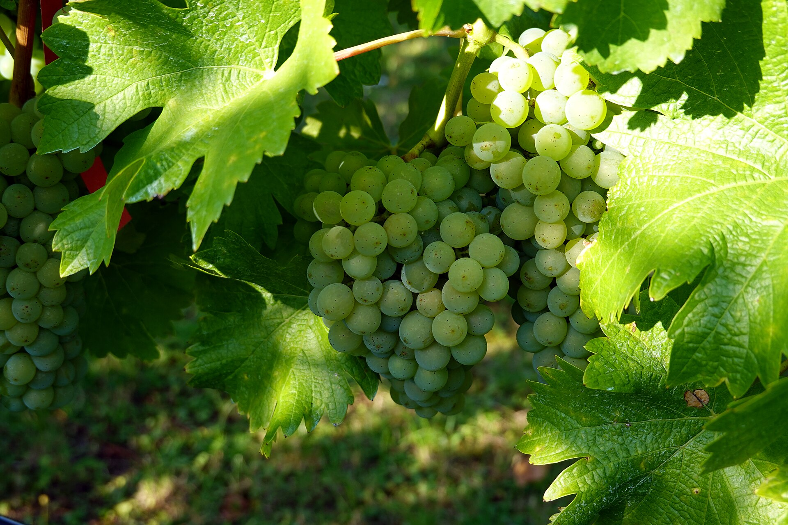

# 科尔查瓜

科尔查瓜（Colchagua）是智利中央山谷南部的重要葡萄酒产区，以 Cabernet Sauvignon、Carmenère 与 Merlot 的红葡萄酒为主，也生产 Syrah 与沿海白葡萄酒。它的法定层级是 Zona，而不是独立的 Región 或 Subregión。

图：科尔查瓜地区产业实景。图片：https://www.chile.gob.cl/india/noticias/lanzamiento-de-wines-of-chile-academy-en-dependencias-de-la-embajada，CC0，via Wikimedia Commons（[原图页面](https://commons.wikimedia.org/wiki/File:Vinos_chilenos.jpg)）。这张照片用于说明科尔查瓜的实际风貌，不是科尔查瓜的全区域地图。

## 定义与范围

按智利 1994 年第 464 号法令的葡萄酒产区划分，科尔查瓜是 Valle Central 产区下 Valle del Rapel 子产区内的一个 Zona，范围覆盖 Colchagua 省与 Cardenal Caro 省。该 Zona 内部又按市镇划分为多个 Áreas，包括 San Fernando、Chimbarongo、Nancagua、Santa Cruz、Palmilla、Peralillo、Lolol、Marchigüe、Litueche、La Estrella、Paredones 与 Pumanque。

按 Wines of Chile 的品种面积口径，科尔查瓜主要品种合计约 2.86 万公顷：Cabernet Sauvignon 11,928 公顷、Carmenère 3,657 公顷、Merlot 3,132 公顷、Tintorera 2,509 公顷、Syrah 2,153 公顷、Chardonnay 1,935 公顷、Sauvignon Blanc 1,688 公顷，另有 Malbec、Pinot Noir 与 Viognier 等。品种面积是行业统计，不同年份与来源会有差异。

## 「科尔查瓜」的时间线
科尔查瓜的葡萄种植可追溯到殖民时期，19 世纪已有酒庄与葡萄园。20 世纪后期，产区经历品种调整与出口导向的扩张，Cabernet Sauvignon 与 Merlot 的面积增加。

1990 年代以后，科尔查瓜的红葡萄酒在国际市场建立声誉，Santa Cruz 一带的山坡地块尤其受到关注。Carmenère 在智利被重新识别后，也成为产区的重要品种。产区的现代形象与精品红葡萄酒、家族酒庄和出口市场密切相关。

## 地理与气候

科尔查瓜属地中海气候，夏季温暖干燥、冬季温和多雨。内陆谷地热量充足，成熟期长；西部靠近太平洋的 Cardenal Caro 一带受海风与冷凉气流影响，温度更低、成熟更慢，适合白葡萄酒与凉爽风格的红葡萄酒。

安第斯山麓的坡地与谷底存在明显差异。海拔与坡向改变日照与排水，河谷夜间冷空气下沉，形成较大的昼夜温差。灌溉是产区稳定产量的关键，干旱年份的水资源管理直接影响成熟与产量。

土壤以河流冲积阶地、安第斯山麓的崩积与火山沉积物，以及沿海丘陵的花岗岩风化土为主。谷底土壤深厚、保水较好；山坡砾石与岩石比例高、排水快，适合根系深扎与糖分积累。这些差异构成[风土](ref:terroir)基础。

## 法定 Áreas

科尔查瓜 Zona 内的 Áreas 以市镇边界划定，各有气候与土壤差异：

- San Fernando：产区北部，靠近安第斯山麓，红葡萄成熟较稳。
- Chimbarongo：谷地冲积土为主，Cabernet Sauvignon 与 Carmenère 常见。
- Nancagua：位于谷地中部，昼夜温差明显。
- Santa Cruz：产区核心地带，山坡地块与谷底并存，红葡萄酒风格集中。
- Marchigüe、Litueche、La Estrella、Paredones：靠近太平洋，受海风影响更强，成熟更慢。
- Pumanque：西部丘陵地带，土壤贫瘠、排水快。

Áreas 是法定地理名称，不是质量等级。Apalta 等地名是 Santa Cruz 一带的地块俗称，酒标使用须结合 D.O. 规则。

## 品种与原料

Cabernet Sauvignon 是科尔查瓜面积最大的品种，常带黑加仑、香料与雪松气息；Carmenère 带成熟红果、青椒与香料，单宁柔和；Merlot 提供李子与柔顺口感。Syrah 在内陆温暖地块表现饱满，沿海地块则更偏胡椒与花香。

白葡萄以 Chardonnay 与 Sauvignon Blanc 为主，部分来自沿海较凉地块。原料是[葡萄](ref:grape)。品种结构与市场、灌溉条件和历史种植传统有关，不能简单等同于风格保证。

## 「科尔查瓜」怎么做出来
红葡萄经除梗与温控[发酵](ref:fermentation)，Cabernet Sauvignon 与 Carmenère 常采用较长浸渍与压帽，随后在法国或美国[橡木桶](ref:oak-ageing)中陈年。Carmenère 的成熟窗口较窄，采收时间会显著影响青椒气息与果味平衡。混酿中不同品种的比例与陈年策略，是风格差异的主要来源。

白葡萄低温发酵。Chardonnay 部分经橡木桶与酒泥搅拌，Sauvignon Blanc 多在不锈钢罐中发酵以保留酸度与香气。

## 法规与酒标

就「科尔查瓜」而言，智利葡萄酒的产地标识受第 464 号法令与相关法规管理。D.O. 酒款须来自划定产区；酒标标注品种时，传统品种在混酿中须至少占 85%。Reserva、Gran Reserva 等术语没有统一的陈年或质量强制标准，不能当作法定质量等级。

酒标上的 Región、Subregión、Zona 与 Área 是不同层级的法定地理名称，覆盖范围依次收窄。层级越具体，原料来源通常越集中，但不必然代表更高品质。

## 「科尔查瓜」的酒标与喝法
酒标应核对 D.O. 名称、品种、[年份](ref:vintage)、[酒精度](ref:abv)、容量与装瓶者。标注[单一品种](ref:single-varietal)的酒款须满足品种比例；混酿按法规列出品种。Cabernet Sauvignon 与 Carmenère 建议 16–18 摄氏度，Syrah 建议 16–18 摄氏度，Chardonnay 建议 10–12 摄氏度，Sauvignon Blanc 建议 8–10 摄氏度。

Cabernet Sauvignon 与 Carmenère 适合红肉、烤肉与炖菜；Syrah 适合香料风味菜肴；Chardonnay 适合海鲜与奶油类菜肴；Sauvignon Blanc 适合海鲜与沙拉。开瓶后冷藏并尽快喝完。本页关于科尔查瓜的内容涉及酒精饮料；过量饮酒有害健康，未成年人不应饮酒。

## 「科尔查瓜」容易被读错的地方
第一，把科尔查瓜当成独立 Región。它是 Valle del Rapel 子产区内的 Zona。
第二，认为科尔查瓜只有红葡萄酒。沿海 Áreas 也生产白葡萄酒与凉爽风格的红葡萄酒。
第三，把 Reserva 当成质量等级。智利没有统一的 Reserva 陈年标准。
第四，把 Apalta 当成法定 Área。它是常用地块名，酒标规则仍以 D.O. 为准。
第五，以为灌溉可以完全抵消干旱。水资源与土壤排水差异仍会显著影响成熟与产量。

对照阅读：[葡萄酒](ref:wine)、[红葡萄酒](ref:red-wine)。

**关键事实。**

| 项目 | 内容 |
| --- | --- |
| 一句话定位 | 智利中央山谷 Valle del Rapel 子产区内的一个 Zona，范围覆盖 Colchagua 省与 Cardenal Caro 省；按 Wines of Chile 的品种面积口径，主要品种合计约 2.86 万公顷，其中 Cabernet Sauvignon 11,928 公顷、Carmenère 3,657 公顷、Merlot 3,132 公顷 |
| 层级 | 其他 |
| 所属 | 智利 |
| 国家代码 | CL |

**来源与边界。** 本页关于「科尔查瓜」的关键事实，主要由以下来源交叉核对：Servicio Agrícola y Ganadero (SAG), Chile（Valle Central、Valle del Rapel 与 Valle de Colchagua 的层级、边界与 Áreas 划分）、Servicio Agrícola y Ganadería (SAG), Chile（中央山谷、Aconcagua 与 Sur 等产区的面积与全国占比）、Wines of Chile（科尔查瓜的品种面积、气候与土壤描述）等 4 条来源。价格、批次与状态会变，涉及这些字段时以页面所列来源的最新版本为准。正文为项目自写，来源只作核验，不复制原文。

## 参考资料
- [葡萄酒](ref:wine)：理解科尔查瓜的类别、年份与产地规则的入口。
- [红葡萄酒](ref:red-wine)与[白葡萄酒](ref:white-wine)：科尔查瓜两大酒类的基本框架。
- [赤霞珠](ref:cabernet)、佳美娜与[梅洛](ref:merlot)：产区的核心红品种。
- [西拉](ref:syrah)：内陆与沿海地块风格差异明显的品种。
- [霞多丽](ref:chardonnay)与[长相思](ref:sauvignon-blanc)：沿海白葡萄酒的主要品种。
- [葡萄](ref:grape)：酿酒葡萄的结构与成熟指标。
- [发酵](ref:fermentation)：红葡萄浸渍与白葡萄低温发酵。
- [酸度](ref:acidity)：昼夜温差与海风对酸度的影响。
- [风土](ref:terroir)：冲积阶地、山麓沉积与沿海丘陵的差异。
- [橡木桶陈年](ref:oak-ageing)：Cabernet Sauvignon 与 Carmenère 的桶陈。
- [干型](ref:dry)：智利白葡萄酒的干型定位。
- [年份](ref:vintage)：科尔查瓜的年份差异与干旱影响。
- [单一品种](ref:single-varietal)：品种标注的比例规则。
- [酒精度](ref:abv)：酒标上 % vol 的含义。

## 相关图像

图：Syrah Grapes on the Vine。摄影：U.S. Geological Survey，CC0，来自 Wikimedia Commons。。图片：U.S. Geological Survey，CC0，via Wikimedia Commons（[原图页面](https://commons.wikimedia.org/w/index.php?curid=114429512)）。关联图像：科尔查瓜。

图：长相思相关实景照片。图片：Geolina163 + 1971markus，CC BY-SA 4.0，via Wikimedia Commons（[原图页面](https://commons.wikimedia.org/wiki/File:HBLA_Klosterneuburg_Sauvignon_Blanc_2.jpg)）。关联图像：科尔查瓜。
