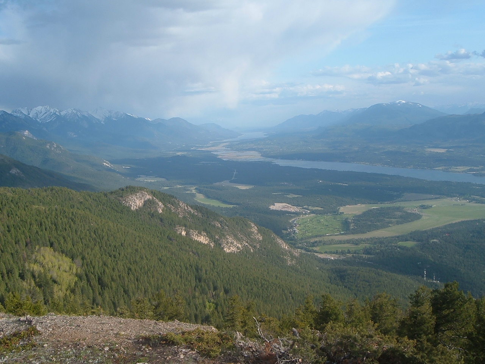

# 哥伦比亚谷

哥伦比亚谷（Columbia Valley）是美国华盛顿州最大的葡萄酒产区，也是美国西北部葡萄酒的地理核心。它覆盖华盛顿州中南部与东南部，并延伸进俄勒冈州北部，以灌溉农业、黄土台地与 Cabernet Sauvignon 闻名。

图：哥伦比亚谷。图片：Original uploader was Marcwenger at en.wikipedia，CC BY-SA 3.0，via Wikimedia Commons（[原图页面](https://commons.wikimedia.org/wiki/File:Columbiavalley_lake.jpg)）。

## 华盛顿州的巨型 AVA

哥伦比亚谷 AVA 总面积约 1,100 万英亩，约合 450 万公顷，横跨华盛顿州与俄勒冈州北部。它不是一个狭义的葡萄园地块，而是一个包含众多子产区的巨型地理框架，华盛顿州境内几乎所有其他 AVA 都位于它的边界之内。

华盛顿州是美国仅次于加州的第二大葡萄酒产州，而哥伦比亚谷集中了该州 99% 以上的酿酒葡萄面积。按官方统计，华盛顿州侧葡萄园为 60,079 英亩，折合 24,313 公顷。这个体量使它成为美国最重要的红酒供给区之一。

## 1984 年划定与层级关系

哥伦比亚谷 AVA 于 1984 年 11 月 13 日通过 T.D. ATF-190 正式划定，并在《联邦公报》公布。它的边界描述基于一个被 Yakima、Snake 与 Columbia 河环绕的大型无树盆地，而不是单一山谷。

AVA 与子 AVA 是层级关系，不是质量等级。Yakima Valley、Walla Walla Valley、Red Mountain、Horse Heaven Hills、Wahluke Slope 等子区都在哥伦比亚谷之内，各自有独立边界与标注规则。酒标写 Columbia Valley 还是写更小的子区，取决于酒庄的产地构成与市场策略。

子区之间的差异并不小：有的以高海拔与昼夜温差见长，适合结构型红酒；有的位于河谷低地，热量更足，适合晚熟品种；有的以陡坡与砾石土著称，排水极强。酒庄常跨子区调配，以获得更完整的结构，这也是"Columbia Valley"标签常见的实际含义。

## 雨影、干旱与灌溉

哥伦比亚谷位于 Cascade 山脉的雨影区，属于干旱与半干旱的大陆性沙漠气候。年降水只有 6 至 8 英寸，约合 150 至 200 毫米，没有灌溉几乎无法种植酿酒葡萄。Columbia 河及其支流与地下含水层提供了水源。

灌溉在这里不是应急手段，而是常规生产条件。它让种植者可以精确控制葡萄的水分供应与成熟节奏，也降低了年份波动。夏季白天炎热、夜晚凉爽，昼夜温差帮助保留酸度；生长季稳定，使酒款风格相对可预期。

水源的可持续性是产区的长期议题。河流流量、融雪时间与地下水开采都受到监管，酒庄也在推广滴灌、土壤覆盖与水分监测。部分生产者转向有机或再生农业，以减少投入并改善土壤结构，但这些做法在干旱区仍面临成本与水权的现实约束。

## 黄土、砾石与玄武岩

大部分葡萄园位于古代 Missoula 洪水淹没线以下。表层是风积黄土，由砂与粉砂组成，下面是砾石与静水沉积物，基岩为玄武岩。黄土保水与排水之间取得平衡，砾石层则提供深层排水与根系空间。

这种土壤组合排水良好、肥力有限，适合控制树势。不同子区的黄土厚度、砾石比例与坡向差异，造成了同一 AVA 内部的风格分化。土壤与雨影气候共同构成产区的[风土](ref:terroir)基础。

## 品种：Cabernet Sauvignon 与 Syrah

Cabernet Sauvignon 是哥伦比亚谷最重要的红品种，也是华盛顿州国际形象的核心。这里的酒通常带成熟黑加仑、樱桃、雪松与石墨气息，单宁结构清晰，酸度高于许多炎热产区，适合[橡木桶陈年](ref:oak-ageing)。

Syrah 在华盛顿州同样重要，常带黑胡椒、紫罗兰、烟熏与深色果香，风格介于北罗讷与澳洲之间。Merlot、Chardonnay 与 Riesling 也是主要品种；Riesling 在较凉爽的子区表现尤佳。原料是葡萄，[单一品种](ref:single-varietal)标注须满足法定比例。

红葡萄通常在夜间或清晨采收，以避开白天高温；白葡萄则更强调保留酸度与香气。灌溉节奏、叶幕管理与采收批次，是酒庄在干旱气候中控制成熟度与风格的主要手段。

## AVA 规则与酒标

美国 AVA 标注的核心规则是：酒标标注某个 AVA 时，酒款至少 85% 必须来自该 AVA。若同时标注州或县，比例要求更高；品种标注同样有最低比例要求。酒标还须标明[酒精度](ref:abv)、容量与装瓶信息。

AVA 只规定地理来源，不规定产量、品种或酿造方式。酒庄可以自由选择灌溉、产量与桶型，这也是哥伦比亚谷酒款风格跨度大的原因。购买时应区分 AVA 名、子 AVA 名与酒庄品牌，并注意同一酒款可能混合多个子区。

对于消费者，最实用的判断是看酒标上的产地层级与品种比例：只写 Columbia Valley 通常意味着跨子区调配，写到 Red Mountain 或 Wahluke Slope 则更强调单一子区的风土表达。

## 饮用与误区

哥伦比亚谷红酒建议在 16 至 18 摄氏度饮用，适合烤肉、牛排、蘑菇与硬质奶酪。Cabernet Sauvignon 常需醒酒；Syrah 可搭配香料与烟熏食物。Riesling 建议 8 至 10 摄氏度，适合亚洲料理与辛辣食物。

常见误区有四。第一，把哥伦比亚谷当成一个小产区：它是一个巨型 AVA，内部包含众多子区。第二，认为华盛顿州气候凉爽：生长季白天相当炎热，凉意来自夜晚与高纬度。第三，把 AVA 当成质量等级：它只规定地理边界。第四，以为灌溉会降低品质：在干旱区，受控灌溉是稳定成熟度的必要手段。

**关键事实。**

| 项目 | 内容 |
| --- | --- |
| 一句话定位 | 美国华盛顿州中南部与东南部、并延伸至俄勒冈州北部的 AVA，1984 年 11 月 13 日正式划定；总面积约 1,100 万英亩（约 450 万公顷），华盛顿州侧葡萄园 60,079 英亩（24,313 公顷），集中了该州 99% 以上的酿酒葡萄面积 |
| 层级 | 其他 |
| 所属 | 美国 |
| 国家代码 | US |

**来源与边界。** 本页关于「哥伦比亚谷」的关键事实，主要由以下来源交叉核对：Washington State Wine Commission（1984 年划定、总面积 1,100 万英亩、年降水 6–8 英寸、主要品种、土壤与雨影气候；华盛顿州侧葡萄园 60,079 英亩（24,313 公顷）与哥伦比亚谷占该州 99% 以上面积）、Alcohol and Tobacco Tax and Trade Bureau（Columbia Valley AVA 的设立日期与法定产区名录）、Federal Register（1984 年 11 月 13 日通过 T.D. ATF-190 划定）。价格、批次与状态会变，涉及这些字段时以页面所列来源的最新版本为准。正文为项目自写，来源只作核验，不复制原文。

## 参考资料

- [葡萄酒](ref:wine)：理解哥伦比亚谷的大类归属与产地规则。
- [红葡萄酒](ref:red-wine)：红葡萄酒的酿造与风格框架。
- [美国](ref:usa)：美国葡萄酒产区的整体格局。
- [Cabernet Sauvignon](ref:cabernet)：哥伦比亚谷的旗舰红品种。
- [Syrah](ref:syrah)：华盛顿州重要的红品种。
- [Chardonnay](ref:chardonnay)：主要白品种之一。
- [酸度](ref:acidity)：昼夜温差与灌溉对酸度的影响。
- [橡木桶陈年](ref:oak-ageing)：桶型与新桶比例对风格的影响。
- [风土](ref:terroir)：雨影、黄土与砾石。
- [单一品种](ref:single-varietal)：品种标注比例规则。
- [酒精度](ref:abv)：酒标上 % vol 的含义。
