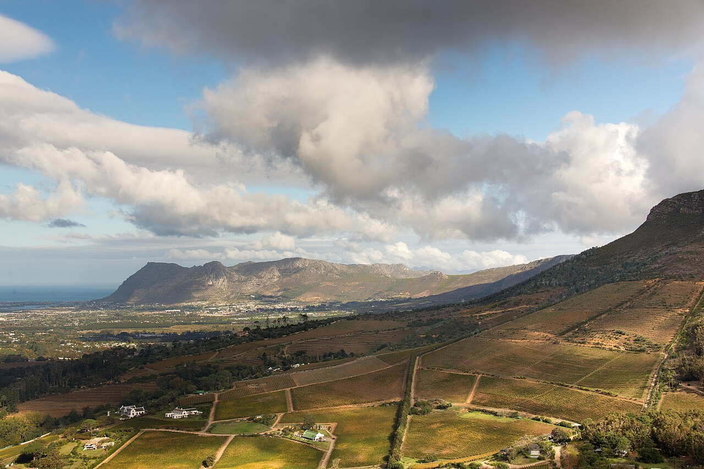

# 康斯坦提亚

康斯坦提亚（Constantia）是开普敦市区南侧的葡萄酒产区，也是南非葡萄酒历史的起点。它以海风、花岗岩坡地与 Muscat 甜酒闻名，但今天的酒款远不止历史上的那一种甜酒。

图：康斯坦提亚。摄影：Constantia vineyards。署名：Barry haynes，CC BY-SA 4.0，来自 Wikimedia Commons（[来源](https://commons.wikimedia.org/w/index.php?curid=37639295)）。

## 定义与范围

康斯坦提亚是西开普 Coastal Region 中 Cape Town District 内的 Ward，位于桌山山脉南坡、Constantiaberg 东向坡地，距 False Bay 不远。Cape Town District 还包含 Durbanville、Hout Bay 与 Philadelphia 三个 Ward。

SAWIS 2024 年统计把 Cape Town 统计区列为 2,511 公顷，占全国酿酒葡萄园的 2.90%，并注明该统计区包含 Constantia、Durbanville、Hout Bay 与 Philadelphia；官方统计未单列 Constantia Ward 的面积。产区范围不大，酒庄数量也少，是南非面积最小、历史最久的葡萄酒产区之一。

## 「康斯坦提亚」的时间线
1685 年，开普总督 Simon van der Stel 获得桌山南坡的土地，并命名为 Constantia。他在此建立葡萄酒农场，被认为是南非葡萄酒业的起点。1712 年 van der Stel 去世后，庄园于 1716 年被分为三部分出售：Bergvliet、Klein Constantia，以及保留原有农舍的 Constantia（后称 Groot Constantia）。

18 至 19 世纪，康斯坦提亚的甜酒在欧洲宫廷与文学作品中获得名声，Napoleon 与 Jane Austen 都曾提及。Groot Constantia 在 Cloete 家族经营时期扩建酒窖并扩大种植，其 Pontac 红葡萄酒与甜酒在 19 世纪的国际展览上获奖。1880 年，开普政府买下 Groot Constantia，庄园此后作为历史遗产与酒庄运营。

20 世纪中后期，康斯坦提亚的葡萄酒业规模缩小。1980 年，Duggie Jooste 收购 Klein Constantia 并推动复兴，1986 年发布首个现代年份；Vin de Constance 于 1990 年重新推出，使历史上的甜酒名称回到市场。今天，产区由少数历史庄园与较新的酒庄组成，Constantia Wine Route 把其中的主要酒庄串联起来。

## 地理与气候

康斯坦提亚位于桌山山脉的南侧，葡萄园沿 Constantiaberg 的东向坡地向上延伸。来自 False Bay 的冷凉海风在午后进入山谷，降低气温并增加湿度；年降雨约 1,000 毫米，2 月平均气温约 20.6 摄氏度，是南非最湿润、最冷凉的产区之一。由于降水充足，葡萄园通常不需要灌溉。

坡向与海拔造成明显差异：东向坡地接受上午阳光，下午受海风降温，成熟节奏较慢；高处地块更凉，酸度保留更好；低处与谷底更温暖，适合需要成熟度的红葡萄。土壤以分解花岗岩为主，排水良好、肥力较低，根系需要向下寻找水分与养分。这些条件构成[风土](ref:terroir)基础。

## 庄园与地块

康斯坦提亚的核心是几处历史庄园与坡地地块，而不是连片的葡萄园。Groot Constantia 位于山谷西侧，保留 18 世纪的农舍与酒窖；Klein Constantia 位于 Constantiaberg 上部，以 Vin de Constance 闻名；Buitenverwachting、Steenberg 等庄园分布在同一条山谷的不同坡段。

这些庄园之间的差异主要来自海拔、坡向与土壤深度，而不是某个官方等级。Constantia Wine Route 是旅游与品鉴路线，不是法定产区层级；酒标上的 Constantia 指 Ward，酒庄名与路线名属于另一层面。

## 品种与原料

Sauvignon Blanc 是康斯坦提亚最知名的白品种，受益于冷凉海风与较长成熟期，常带柑橘、青草、白花与矿物感。Chardonnay、Chenin Blanc 与 Semillon 也有种植，部分用于白葡萄酒与起泡酒。红葡萄以 Cabernet Sauvignon、Merlot 与 Cabernet Franc 为主，风格偏中等酒体、结构清晰。

Muscat de Frontignan（即 Muscat Blanc à Petits Grains 的当地名称）是康斯坦提亚甜酒的核心品种。Vin de Constance 以成熟度高、香气浓郁的 Muscat 酿造，带杏、橙花、蜂蜜与香料气息。历史上 Groot Constantia 还以 Pontac 酿造深色红葡萄酒，Pontac 今天已不是产区的主力品种。原料是[葡萄](ref:grape)。

## 「康斯坦提亚」怎么做出来
白葡萄经轻柔压榨后低温[发酵](ref:fermentation)。Sauvignon Blanc 多在不锈钢罐或大桶中发酵，避免明显的橡木味；Chardonnay 部分经橡木桶发酵与酒泥搅拌，增加质地与复杂度；Semillon 可与 Sauvignon Blanc 混酿，增加结构与蜂蜡气息。

Vin de Constance 的酿造与普通干白不同：Muscat 分次采收，选取成熟度高的果串，部分发酵后保留残糖，再在橡木桶中陈年，以获得甜度、酸度与香气之间的平衡。具体工艺因年份与酒庄而异，酒标上的 Vin de Constance 是 Klein Constantia 的酒名，不是法定的甜酒类别。

## 法规与酒标

康斯坦提亚的产地标识遵循南非的 Wine of Origin 制度。标示 Constantia 的酒款，须 100% 使用该 Ward 采收的葡萄；标示品种或年份时，相关成分须至少达到 85%。通过认证的酒款可使用 Wine of Origin 封签。

Constantia 是 Ward 名称，不是 District，也不是质量等级。Vin de Constance 是酒庄为自己的甜酒使用的名称，不属于 Wine of Origin 的地理层级；把两者混为一谈会误读酒标。WO 认证来源、品种与年份，不评价酒体、价格或风格高低。

## 「康斯坦提亚」的酒标与喝法
酒标应核对 Ward 名、品种、[年份](ref:vintage)、[酒精度](ref:abv)、容量与装瓶者。标示[单一品种](ref:single-varietal)的酒款须达到 85% 的品种比例；混酿按法规列出品种。Wine of Origin 封签表示通过认证，不等于质量评价。

Sauvignon Blanc 建议 8–10 摄氏度，Chardonnay 建议 10–12 摄氏度，Cabernet Sauvignon 与 Merlot 建议 16–18 摄氏度；Vin de Constance 等甜酒建议充分冷藏后饮用，约 8–10 摄氏度。Sauvignon Blanc 适合海鲜、沙拉与山羊奶酪；红葡萄酒适合红肉与硬质奶酪；甜酒适合蓝纹奶酪、水果甜点或单独饮用。开瓶后冷藏并尽快喝完。本页关于康斯坦提亚的内容涉及酒精饮料；过量饮酒有害健康，未成年人不应饮酒。

## 「康斯坦提亚」容易被读错的地方
第一，把 Constantia 当成 District。Constantia 是 Cape Town District 内的 Ward。
第二，认为康斯坦提亚只产甜酒。历史上的 Constantia 甜酒很有名，但今天的产区以 Sauvignon Blanc、Chardonnay 与红葡萄酒为主。
第三，把 Vin de Constance 当成法定产区或甜酒等级。它是 Klein Constantia 的酒名，不是 Wine of Origin 的地理名称。
第四，把 Muscat de Frontignan 当成产地。它是葡萄品种名称，与 Constantia 的产区名不是一回事。
第五，把 Wine of Origin 封签当作质量等级。它认证来源、品种与年份，不评价酒质。

对照阅读：[葡萄酒](ref:wine)、[红葡萄酒](ref:red-wine)。

**关键事实。**

| 项目 | 内容 |
| --- | --- |
| 一句话定位 | 南非西开普 Cape Town District 内的 Ward，位于桌山南坡与 Constantiaberg 东向坡地，靠近 False Bay；1685 年 Simon van der Stel 获授土地并命名 Constantia，1712 年他去世后，庄园于 1716 年分为 Groot Constantia、Klein Constantia 与 B… |
| 层级 | 其他 |
| 所属 | 南非 |
| 国家代码 | ZA |

## 参考资料
- [葡萄酒](ref:wine)：理解康斯坦提亚的类别、年份与产地规则的入口。
- [白葡萄酒](ref:white-wine)与[红葡萄酒](ref:red-wine)：康斯坦提亚两大酒类的基本框架。
- [长相思](ref:sauvignon)：产区最知名的白品种。
- [霞多丽](ref:chardonnay)：白葡萄酒与起泡酒的重要品种。
- [白诗南](ref:chenin)：开普传统白品种之一。
- [赤霞珠](ref:cabernet)：产区红葡萄酒的主力。
- [赛美蓉](ref:semillon)：白葡萄酒与混酿的组成部分。
- [葡萄](ref:grape)：酿酒葡萄的结构与成熟指标。
- [发酵](ref:fermentation)：干白发酵与甜酒的部分发酵。
- [酸度](ref:acidity)：冷凉海风与坡向对酸度的影响。
- [风土](ref:terroir)：花岗岩坡地与海风如何形成地块差异。
- [橡木桶陈年](ref:oak-ageing)：Chardonnay 与 Vin de Constance 的桶陈。
- [干型](ref:dry)：产区干白与甜酒的对比。
- [年份](ref:vintage)：康斯坦提亚的年份差异。
- [单一品种](ref:single-varietal)：85% 品种标注规则。
- [酒精度](ref:abv)：酒标上 % vol 的含义。

## 相关图像

图：Sémillon - Joseph Daurel。图片：Imprimerie A. Bellier & Cie - Bordeaux，CC0，via Wikimedia Commons（[原图页面](https://commons.wikimedia.org/w/index.php?curid=94839238)）。关联图像：康斯坦提亚。

图：白诗南。图片：Benjamin Smith，CC BY-SA 4.0，via Wikimedia Commons（[原图页面](https://commons.wikimedia.org/wiki/File:Rochecorbon_-_Vignoble_-_02.jpg)）。关联图像：康斯坦提亚。
