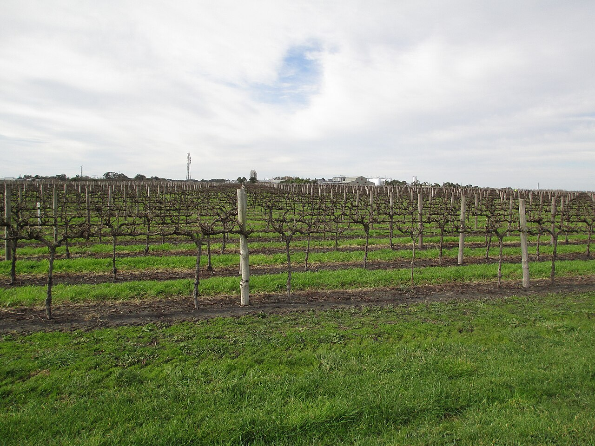

# 库纳瓦拉

库纳瓦拉位于南澳大利亚石灰岩海岸，是澳洲最具代表性的赤霞珠产区之一；一条雪茄形的 terra rossa 红土脊覆盖在古老石灰岩上，冷凉海洋性气候让葡萄缓慢成熟。产区 GI 面积 398 平方公里，葡萄园 5,784 公顷，法定边界于 2003 年正式划定。

图：Coonawarra：Winter vineyard in Coonawarra（Wikimedia Commons）。图片：ScottDavis，CC BY-SA 4.0，via Wikimedia Commons（[原图页面](https://commons.wikimedia.org/wiki/File:Winter_vineyard_in_Coonawarra.JPG)）。

> **先给结论**
> **一句话：** 这页判断库纳瓦拉的风味与旅行价值，以及怎么安排。
>
> - **适合谁：** 正在比较库纳瓦拉与其他产区、准备买酒或安排旅行的人。
> - **不适合谁：** 只想要“哪个产区最贵”的结论、不关心风格和年份的人。
> - **先看这两点：**
>   - 读酒标先确认 Coonawarra GI，再看生产者、年份与酒款级别。
>   - 产区中心是 Coonawarra 小镇，邻近 Penola；酒庄沿 Riddoch Highway 与 V&A Lane 两侧展开，彼此车程多在十几分钟内。

## 先划清「库纳瓦拉」的边界
库纳瓦拉在南澳东南角的石灰岩海岸，隶属 [澳大利亚](ref:australia) 葡萄酒产区框架，距阿德莱德东南约 380 公里、距南大洋约 60 公里。GI 区域面积 398 平方公里，葡萄园 5,784 公顷，海拔介于 51–127 米，地处南纬 37.47°。产区地势平坦，核心是一条纵贯南北的红土脊，周边则是砂质与灰黑壤土地块。

这条红土脊长约 27 公里、宽约 2 公里，是库纳瓦拉声誉的主要来源。2003 年 1 月，产区名称经过约七年联邦法院仲裁后登记入保护名称册，边界向南北与东侧略作扩展，只纳入既有红土葡萄园；石灰岩海岸其他地方也有小片红土，但只有划定 GI 内的葡萄园才能在酒标上使用 Coonawarra 一名。红土带内外的土壤与排水不同，酒风随之分化。

## 历史与命名

在欧洲殖民者到来之前，这里是 Pinechunga 与 Boandik 人的传统领地。1845 年 Cameron 兄弟成为区内早期牧人；1861 年苏格兰移民 John Riddoch 购入 Yallum 大片土地（含后来的 Katnook），1862 年建起 Katnook 羊毛棚。1890 年他发起 Penola Fruit Colony 定居计划，1891 年大面积种下 52 公顷葡萄；1895 年产出首个年份 Coonawarra Vineyards Claret，1896 年第二年份在 Katnook 羊毛棚中酿成，本地石材砌筑的三檐酒厂于 1897 年完工。同年产区正式得名 Coonawarra，名称或源自原住民语言中“天鹅”一词，旧说解作“金银花”。

1901 年 Riddoch 去世，定居地陷入财务困难。14 岁来到酒厂做工的 Bill Redman 后来撑起餐酒酿造传统，其余果实多被蒸馏成白兰地。1926 年州政府鼓励拔除葡萄改办奶牛场，原有 360 公顷葡萄仅剩 120 公顷；1933 年 Redman 的酒以 St Adele 标签在伦敦酒展获头奖。1945 至 1946 年，Woodley 购入 Riddoch 旧酒厂与 53 公顷葡萄园，改名 Chateau Comaum；1951 年 David Wynn 买下该地产并更名 Wynns Coonawarra Estate，立志让库纳瓦拉出名。1954 年首款 Black Label 赤霞珠问世，1955 年首款 Michael Shiraz 装瓶；1952 年全区仅 93 公顷葡萄园，其中西拉 66 公顷、Doradillo 20 公顷、赤霞珠 3 公顷。

现代扩张沿家族与公司两条线展开。1962 年 Wynns 开始酿造雷司令；1971 年 Brand’s Laira 酿出产区首款 100% 赤霞珠；1977 年 Wynns 以 1976 年份 Black Label 夺得产区首座 Jimmy Watson 奖杯；1979 年 Katnook 在旧羊毛棚中酿成现代首个年份；1980 年库纳瓦拉葡萄农协会成立，Orlando 推出 St Hugo 赤霞珠；1982 年 Wynns 首款 John Riddoch 赤霞珠问世，Hollick、Parker、Penley 分别于 1983、1985、1988 年建立。2014 年 John Riddoch 赤霞珠进入 Langton’s 澳洲葡萄酒分级的 Exceptional 级别。

## 「库纳瓦拉」的地理与风土
红土是一种古土壤：内陆风吹来的尘土落在中新世石灰岩床上，数千年来雨水淋滤掉碳酸盐，残留的氧化铁氧化成深红色。土层平均厚约 50 厘米，常不足一米，属透水的轻黏土，微碱性，下伏石灰岩与含水层；根系穿过红土扎入石灰岩裂隙，天然平衡叶幕与产量，果粒小而皮厚，色素、品种香气与细腻单宁在缓慢成熟中积累。

气候与土壤同等关键。产区虽处南纬 37°，却比预期冷凉，原因是邻近南大洋与夏季的 Bonney 上升流：强风把表层海水推离岸边，寒冷营养丰富的深层海水上涌，像一台天然空调，带来少雾的凉夏与冷夜，延长缓慢温和的挂果期。冬季日均 9.8°C，夏季日均 18.8°C，一月均温 20.1°C，生长季降雨约 260 毫米；长挂果让风味与酚类单宁成熟，糖分却不过高，酒精度适中、酸度鲜活，构成陈年骨架。

物候节奏上，霞多丽等白葡萄约 9 月上旬萌芽，赤霞珠在 9 月中下旬；花期始于 11 月底。采收分两段：起泡酒用白葡萄在 2 月上中旬下手，赤霞珠等红葡萄晚至 3 月底至 4 月初。春季霜冻需要重点防范；红土透水快，干旱年份可借助石灰岩含水层的地下水有限灌溉，控制果串大小与集中度。

## 原料与风格

2025 年压榨结构中，[赤霞珠](ref:cabernet)占 59%，西拉 20%，[梅洛](ref:merlot) 8%，霞多丽 6%，长相思 3%；红葡萄约占种植面积 92%，全年压榨 35,295 吨，平均单产 6.1 吨/公顷。赤霞珠是无可争议的主角，风格中等到饱满，黑醋栗、黑莓、李子与深樱桃之外，常带薄荷与桉树气息，单宁紧实而丰腴，顶尖版本可以优雅陈年数十年。

西拉在 1950 年代之前是产区主栽，传统风格中等酒体，带香料与覆盆子果香；库纳瓦拉有把西拉与赤霞珠混酿的长久惯例。梅洛没有太长的种植传统，却是赤霞珠成功的混酿伙伴，也能酿成优雅单品。白品种中霞多丽、雷司令与长相思占比不大，多走清爽或桶陈克制的路线。整体红葡萄酒以冷凉气候的酸度与结构见长，而不是内陆产区式的高热甜熟；新桶比例、桶陈时间与混酿配方由各生产者决定。

## 代表生产者与酒款

Wynns Coonawarra Estate 拥有产区最老的葡萄园，三檐石砌酒厂是产区标志建筑。Black Label 赤霞珠常年是产区标杆；旗舰 John Riddoch 赤霞珠自 1982 年首款以来两度被评为澳洲最佳红葡萄酒，2014 年列入 Langton’s Exceptional；Michael Shiraz 则是西拉旗舰，名字取自 David Wynn 早逝的儿子。

其他值得留意的生产者包括 Balnaves of Coonawarra（The Tally 赤霞珠，Langton’s Outstanding）、Katnook Estate（Odyssey 赤霞珠）、Majella（Mallea Cabernet Shiraz）、Bowen Estate、Rymill、Hollick、Brand’s Laira、Parker Coonawarra Estate、St Hugo、Rouge Homme、Zema、Leconfield 与 Redman。这些名称不是官方法定分级，而是市场、酒评与奖项多年积累的参照；旗舰单一园与入门款之间价差明显，果实来源与桶陈强度各不相同。

## 「库纳瓦拉」的上桌方式
赤霞珠适饮温度约 16–18°C，年轻单宁紧的酒可短时间醒酒，杯型选中等到大肚的红酒杯；西拉与赤霞珠混酿约 15–17°C。陈年十年以上的老酒单宁逐渐软化，发展出雪松、皮革与瓶陈香料，开瓶后不宜长时间醒酒。冷凉产区的红葡萄酒酸度清晰，侍酒温度过高会让酒精与青椒气息突出。

配餐上，产区红葡萄酒最直接对接烤牛排、羊排、鹿肉、野味炖菜、蘑菇与硬质奶酪，单宁与烤肉脂肪相互平衡。西拉适合烤香肠、野味与带香料的菜肴；梅洛配红烧肉、番茄酱汁意面更柔和。当地饮食以烤肉与田间食材为主，与产区红葡萄酒的结构和果香互补；[橡木](ref:oak)桶味重的旗舰款，搭配油脂丰厚的肉类比清淡前菜更稳妥。

## 选购、标签与误区

读酒标先确认 Coonawarra GI，再看生产者、年份与酒款级别。V&A Lane 这类道路与 Limestone Ridge 等地名是种植者常讨论的地块参照，并非法定分级；不同位置的红土厚度、石灰岩深浅与朝向会带来细微差别。年份在冷凉产区权重很高，春季霜冻、花期风雨与采收雨都会改变产量与成熟度，同酒庄不同年份的单宁与果味可能拉开距离。

一个常见误解是“库纳瓦拉只有赤霞珠”：西拉、梅洛与少量白葡萄同样在这里种植，西拉与赤霞珠混酿更是本地传统。另一个误解是把所有红土都当作库纳瓦拉——石灰岩海岸其他区域也有小片 terra rossa，只有 GI 划定范围内的果实才能标注产区名。储存上旗舰赤霞珠可放十年以上，入门款宜在年轻时饮用；红葡萄酒对运输高温与长期光照敏感，到货后避免在温度波动大的环境存放。

## 「库纳瓦拉」周边怎么走
产区中心是 Coonawarra 小镇，邻近 Penola；酒庄沿 Riddoch Highway 与 V&A Lane 两侧展开，彼此车程多在十几分钟内。从阿德莱德自驾约三小时可达，也可先到 Mount Gambier 再转入产区；区内公共交通有限，自驾或参加酒旅团是主要方式。

多数酒庄设 Cellar Door 品鉴室，热门旗舰款与周末时段建议提前预约。采收季在南半球 2 至 4 月，酒庄最忙，部分品鉴室缩短营业；单次品鉴约一小时，一天安排两三家加午餐较为从容。参观时不要进入作业中的发酵车间与葡萄园地块，品鉴后不驾车。

- 相关条目：[australia](ref:australia)、[cabernet-sauvignon](ref:cabernet)、[merlot](ref:merlot)、[red-wine](ref:red)、[oak-ageing](ref:oak)。

对照阅读：[澳大利亚](ref:australia)、[梅洛](ref:merlot)。

## 相关图像

图：Renmark South Australia Vineyard。图片：Feral Arts，CC BY 2.0，via Wikimedia Commons（[原图页面](https://commons.wikimedia.org/w/index.php?curid=9069567)）。关联图像：库纳瓦拉。

图：梅洛。图片：Felloni claire，CC BY-SA 4.0，via Wikimedia Commons（[原图页面](https://commons.wikimedia.org/wiki/File:Merlot.jpg)）。关联图像：库纳瓦拉。
