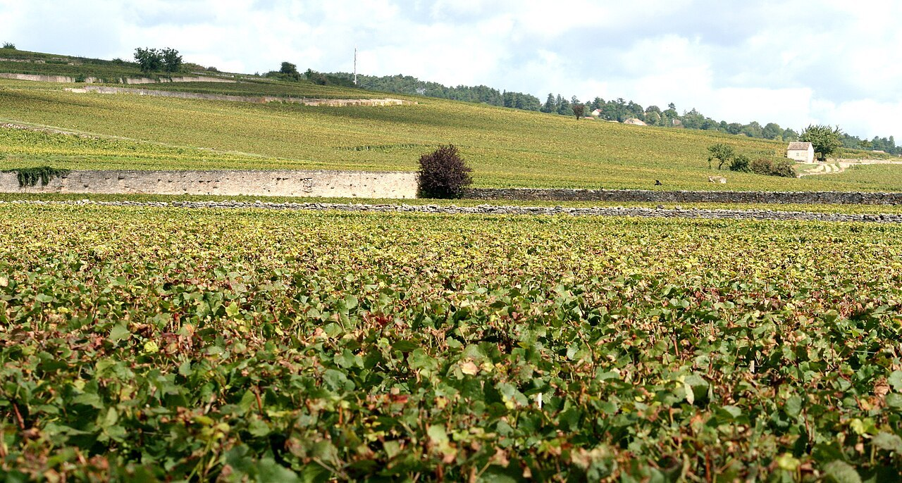

# 博讷丘

博讷丘（Côte de Beaune）是勃艮第金丘南段、从 Ladoix-Serrigny 延伸至 Santenay 的葡萄酒产区。与夜丘以黑皮诺为主不同，博讷丘以霞多丽白葡萄酒闻名，但它同样出产优质黑皮诺红酒；8 个特级园中，只有 Corton 以红葡萄酒为主，这一结构使它在勃艮第的分级地图上格外特殊。

图：博讷丘。摄影：Côte de Beaune, Burgundy vineyard。署名：Megan Mallen，CC BY 2.0，来自 Wikimedia Commons（[来源](https://commons.wikimedia.org/w/index.php?curid=13670776)）。

## 定义与范围

博讷丘不是单一 AOC，而是一组村庄与地块的集合。它与上博讷丘合计约有 5,000 公顷葡萄园，包含 25 个 AOC：1 个上博讷丘产区、16 个村庄级产区与 8 个特级园；村庄级之下还有约 300 个一级园。

名称上还有一处容易混淆的地方：“Côte de Beaune”是一个位于伯恩公社高处的独立 AOC，而“Côte-de-Beaune-Villages”是覆盖多个公社的区域性 AOC，两者并非同一层级。购买时若只看到“Côte de Beaune”，需要进一步确认是哪一个。

博讷丘的 AOC 结构呈明显的金字塔：区域级、村庄级、一级园与特级园四层，酒标上的地名越具体，通常意味着越小的地块与越高的价格。与夜丘相比，博讷丘的村庄级产区更多，白葡萄酒的村庄名也更容易被消费者记住。

## 从拉多瓦到桑特奈

博讷丘的葡萄园沿金丘南段的东坡展开，北起 Ladoix-Serrigny，南至 Santenay。沿途的村庄级产区包括 Ladoix、Aloxe-Corton、Pernand-Vergelesses、Savigny-lès-Beaune、Chorey-lès-Beaune、Beaune、Pommard、Volnay、Monthélie、Auxey-Duresses、Saint-Romain、Meursault、Puligny-Montrachet、Chassagne-Montrachet、Saint-Aubin 与 Santenay。

坡面仍以侏罗纪石灰岩与泥灰岩为主，但南段更宽、更平缓，土层厚度与黏土比例高于夜丘。坡顶排水快，坡腰土层适中，坡底积土更多；这种分布使同一村庄内的白葡萄酒与红葡萄酒都能找到合适地块。

博讷丘的气候同样受大陆性影响，生长季温暖，但春霜与夏末冰雹是主要风险；年份差异因此不仅体现在成熟度，也体现在产量。坡面朝东有助于早晨升温、减少霜害，这是金丘葡萄园普遍选择东坡的原因之一。

## 8 个特级园中唯一的红

博讷丘的 8 个特级园分别是 Corton、Corton-Charlemagne、Charlemagne、Montrachet、Chevalier-Montrachet、Bâtard-Montrachet、Bienvenues-Bâtard-Montrachet 与 Criots-Bâtard-Montrachet。除 Corton 外，其余都以霞多丽白葡萄酒为主。

Corton 位于 Aloxe-Corton 背后的科通山，是博讷丘唯一以红葡萄酒为主的特级园；同一座山上还有以白葡萄酒闻名的 Corton-Charlemagne。这种“一山两特级、红白分工”的结构，在勃艮第非常少见，也让 Corton 成为理解博讷丘红白双轨的入口。

Corton 特级园内部还分为 Clos du Roi、Bressandes、Renardes 等地块，红葡萄酒的风格从紧实到柔顺不等；Corton-Charlemagne 则集中在山顶的白色泥灰岩上。同一座山的分层，正好说明勃艮第“地块大于酒庄”的逻辑。

## 霞多丽与白葡萄酒

[霞多丽](ref:chardonnay)是博讷丘白葡萄酒的主导品种，Meursault、Puligny-Montrachet 与 Chassagne-Montrachet 是最具代表性的村庄。石灰岩带来酸度与矿物感，泥灰岩与黏土则提供厚度与果味；坡位与土层差异，使相邻地块的白葡萄酒可以有完全不同的质地。

博讷丘的白葡萄酒通常比夜丘红酒更饱满，年轻时带柑橘、白花与榛子气息，陈年后出现蜂蜜、烤面包与矿物层次。顶级特级园产量很小，价格高昂，但村庄级与一级园仍提供了相对可及的入口。

白葡萄酒的酿造通常包括低温发酵、搅桶（bâtonnage）与橡木桶陈年；搅桶增加酒泥接触，带来奶油与坚果质地，新桶则提供香料与结构。是否搅桶、桶的比例与陈年时长，是 Meursault 与 Puligny 风格差异的重要来源。

## 伯恩的酒商与拍卖

伯恩（Beaune）是博讷丘的行政与交易中心，也是勃艮第酒商（négociant）制度的核心。酒商从多个所有者手中购买葡萄或酒液，在自己的酒窖中完成发酵、陈年与装瓶；这种模式让小地块的葡萄得以进入市场，也让酒商品牌与地块品牌各自成立。

伯恩济贫院（Hospices de Beaune）的拍卖是产区每年的重要事件，拍卖所得用于医院与慈善。酒商制度与拍卖共同构成博讷丘的交易生态：前者连接土地与市场，后者把年份表现转化为公开价格。

伯恩的酒商制度可追溯到中世纪，但现代形态在 18 至 19 世纪成形；酒商把分散的小地块葡萄集中起来，使消费者能够买到特定村庄或地块的酒。酒商酒的质量取决于来源与酒窖管理，不能一概而论。

## 一级园与村庄

约 300 个一级园分布在 16 个村庄级产区中，名称常直接写在酒标上。Pommard 与 Volnay 以红葡萄酒为主，Meursault 与 Puligny 以白葡萄酒为主，Aloxe-Corton 兼有红白，Saint-Aubin 则以性价比较高的白葡萄酒著称。

一级园之间也有层级：靠近特级园、坡位更好的地块通常更贵，酒标上的地块名越具体，越能帮助判断位置。与夜丘相比，博讷丘的一级园数量更多、分布更广，选择空间也更大。

著名一级园包括 Volnay 的 Caillerets、Pommard 的 Rugiens、Meursault 的 Perrières 与 Puligny 的 Pucelles；这些地名在酒标上通常紧随村庄名出现，是判断具体位置的第一手线索。

## 饮用与选购

白葡萄酒适合在较低温度下饮用，搭配海鲜、禽类与奶油质地菜肴；红葡萄酒则适合禽类、猪肉与中等浓度奶酪。Corton 的红酒结构较强，需要比 Volnay 更长的陈年；Corton-Charlemagne 与 Montrachet 的白酒则可以在瓶中发展数十年。

选购时核对生产者、村庄、一级园或特级园名与年份。酒商酒与酒庄酒都合法，但风格与价格逻辑不同；看到“négociant”字样时，应关注酒商的历史与来源，而不是直接把它等同于低质量。

对照阅读：[法国](ref:france)、[霞多丽](ref:chardonnay)。

**关键事实。**

| 项目 | 内容 |
| --- | --- |
| 一句话定位 | 勃艮第金丘南段、从 Ladoix-Serrigny 延伸至 Santenay 的白葡萄酒核心产区，与上博讷丘合计葡萄园约 5,000 公顷，含 25 个 AOC，其中 16 个村庄级、8 个特级园与约 300 个一级园；霞多丽是白葡萄酒的主导品种，8 个特级园中只有 Corton 以红葡萄酒为主，伯恩则是酒商制度与拍卖交易的中心 |
| 所属 | 法国 |
| 国家代码 | FR |

**来源与边界。** 本页关于「博讷丘」的关键事实，主要由以下来源交叉核对：Bureau Interprofessionnel des Vins de Bourgogne（勃艮第 AOC 分级体系与博讷丘在区域框架中的位置）、Cité des Climats et vins de Bourgogne（博讷丘与上博讷丘约 5,000 公顷、25 个 AOC、16 个村庄级、8 个特级园与约 300 个一级园的数据；从 Ladoix-Serrigny 至 Santenay 的村庄名单、Corton 与 Corton-Charlemagne 的分布及石灰岩-泥灰岩土壤描述）、OIV（补充核对条目背景、术语与制度口径）。价格、批次与状态会变，涉及这些字段时以页面所列来源的最新版本为准。正文为项目自写，来源只作核验，不复制原文。

## 参考资料

- [法国](ref:france)：AOC 制度与国家级产区框架。
- [勃艮第](ref:burgundy)：金丘、气候与分级体系的整体背景。
- [霞多丽](ref:chardonnay)：博讷丘白葡萄酒的主导品种。
- [黑皮诺](ref:pinot-noir)：Corton 等红葡萄酒的品种基础。
- [白葡萄酒](ref:white-wine)：静止白葡萄酒的类别与酿造概览。
- [风土](ref:terroir)：坡位、土层与地块差异。

## 相关图像

图：Burgundy vineyards near Beaune, France。图片：Mark Gorzynski，CC BY-SA 4.0，via Wikimedia Commons（[原图页面](https://commons.wikimedia.org/w/index.php?curid=65061583)）。关联图像：博讷丘。

图：黑皮诺。图片：Cjp24，Public domain，via Wikimedia Commons（[原图页面](https://commons.wikimedia.org/wiki/File:Grape_near_Sancerre.jpg)）。关联图像：博讷丘。
