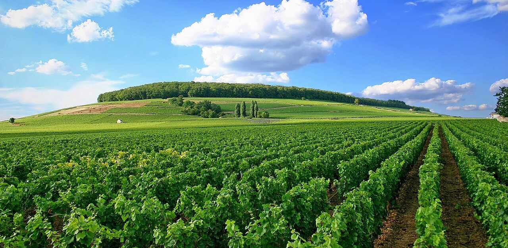

# 夜丘

夜丘（Côte de Nuits）是勃艮第金丘北段的红葡萄酒核心产区，葡萄园从第戎以南的 Marsannay-la-Côte 一直延伸到科尔戈隆，绵延约 40 公里。这里集中了 24 个特级园，黑皮诺占种植面积约 95%，是理解勃艮第红葡萄酒分级与“climat”概念最直接的一站。

图：夜丘。摄影：Côte de Nuits Wéngert。署名：Original: Stefan Bauer, http://www.ferras.at Modification: The original uploader was Cornischong at Luxembourgish Wikipedia.，CC BY-SA 2.5，来自 Wikimedia Commons（[来源](https://commons.wikimedia.org/w/index.php?curid=21196224)）。

## 定义与范围

夜丘不是单一 AOC，而是一组产区与村庄的集合。它与上夜丘合计约有 3,000 公顷葡萄园，包含 39 个 AOC：1 个上夜丘产区、14 个村庄级产区与 24 个特级园；村庄级之下还有约 120 个一级园。

行政上，夜丘属于金丘省，北接第戎，南邻博讷丘。它与博讷丘的分界大致在科尔戈隆与 Ladoix-Serrigny 之间。由于产区名称、村庄名与地块名层层叠加，酒标上的信息需要逐层拆读。

需要强调的是，夜丘作为区域性 AOC 的产量并不大，市场上更常见的是村庄级与地块级酒款；因此，把“夜丘”当成一个统一品牌来理解，会掩盖村庄之间的差异。夜丘的村庄级产区多以村庄名直接命名，这也是消费者最容易入手的一层信息。

## 从第戎到科尔戈隆的石灰岩坡

夜丘的葡萄园沿一条南北走向的侏罗纪石灰岩坡展开，坡面朝东，面向索恩平原。石灰岩与泥灰岩的交替，加上坡面不同位置的土层厚度，构成勃艮第所说的“climat”：同一坡面上，排水、日照与成熟节奏可以细到几行葡萄的差别。

坡顶多为浅层石灰岩，排水快、成熟早；坡腰土层较厚，保水与排水较平衡；坡底积土与冲积物更多，成熟较晚。夜丘的许多特级园位于坡腰中段，正是因为这里兼顾了光照、排水与降温。

坡向与海拔的微小变化会改变日照时长与昼夜温差；夜丘的坡面多朝东南，早晨受光、午后不过热，有利于黑皮诺保留酸度与细腻香气。

## 24 个特级园

夜丘的 24 个特级园分布在 Gevrey-Chambertin、Morey-Saint-Denis、Chambolle-Musigny、Vougeot、Flagey-Échezeaux 与 Vosne-Romanée 等村庄。最知名的包括 Chambertin、Chambertin-Clos de Bèze、Musigny、Bonnes-Mares、Clos de Vougeot、Échezeaux、Grands-Échezeaux、Richebourg、La Tâche、Romanée-Conti 与 Romanée-Saint-Vivant。

Clos de Vougeot 是其中面积最大的特级园之一，约 50 公顷，由西多会修士在中世纪开垦，围墙至今仍在。它的地块跨越坡顶到坡底，因此同一特级园内部的成熟差异很大，这也是同一酒庄不同地块酒款风格不同的原因。

特级园的命名多来自修道院、地主或地块形状；名称本身不描述风格，真正决定风格的是坡位与土层。阅读酒标时，特级园名比村庄名更具体，也更接近“这块地”的实际信息。

## 一级园、村庄级与“climat”

在夜丘的分级中，特级园之下是一级园，再往下是村庄级与区域性 AOC。村庄级酒标通常写村庄名，一级园在村庄名后加“Premier Cru”与地块名，特级园则直接写特级园名，不再标村庄。

“climat”是勃艮第对特定地块的称呼，强调长期形成的土壤、坡向、微气候与人类耕作方式的组合。夜丘的 24 个特级园本身就是最著名的一批 climat；一级园中也有大量被单独命名的小地块，酒标上的地名往往比村庄名更能说明风格。

climat 的边界由历史耕作与所有权固化，今天的酒标仍按这套边界标注；这也是勃艮第地块地图如此复杂的原因。一级园之间也有明显层级，靠近特级园的地块往往更贵，地块名越具体，越能帮助判断位置。

## 黑皮诺与 95% 的种植比例

夜丘的种植以[黑皮诺](ref:pinot-noir)为绝对主体，约占 95%；白葡萄品种只在少数村庄与地块出现。黑皮诺对温度与土壤变化敏感，皮薄、色浅、单宁细，因而夜丘的酒通常以香气、质地与复杂度取胜，而不是靠酒体。

Marsannay 是夜丘唯一正式允许生产桃红葡萄酒的村庄级产区，这一例外说明“夜丘 = 红酒”只是总体印象。多数夜丘红酒在年轻时展现红樱桃、覆盆子与花香，陈年后转向蘑菇、落叶与香料。

黑皮诺对产量敏感，夜丘的酒庄普遍控制产量以换取浓度；过高产量会让酒体变薄，香气也失去层次。特级园面积合计不大、产量稀少，这也是其价格高企的结构性原因。

## 酿造与陈年

夜丘的红酒多在中性橡木桶中陈年，新桶比例通常低于博讷丘的顶级白葡萄酒；目的是让黑皮诺的香气与质地保持清晰。[橡木桶](ref:oak-ageing)的作用在这里更多是提供微氧化与结构，而不是增加烘烤味。

夜丘红酒的发酵温度通常较低，浸渍时间较长但提取温和；酒庄常在橡木桶中完成苹果酸-乳酸发酵，以柔化酸度。过度烘烤或高比例新桶会掩盖果香，因此桶的选择往往比桶的数量更关键。

优质夜丘红酒通常在五到十年进入适饮期，特级园可以陈放更久。由于单宁细、酸度高，配餐时适合禽类、蘑菇、野味与中等浓度的奶酪；过重的酱汁会掩盖其香气。

## 酒标与选购

酒标上的 Côte de Nuits 可以是区域性 AOC，也可以作为村庄名的前缀；更重要的是看村庄名、一级园或特级园名。核对年份、酒精度、装瓶者与地块拼写，避免把“Côte de Nuits-Villages”与具体村庄级产区混淆。

特级园价格高、产量小，购买时应区分“特级园”与“一级园”标签；同一村庄内，一级园与特级园的价格差距可能很大，地块位置与年份仍是核心变量。

同一特级园由多家酒庄持有，酒标上的生产者与地块拼写同样重要；同名特级园的不同酒款，价格与风格都可能差异很大。购买前核对生产者与年份，比只看特级园名称更可靠。

对照阅读：[法国](ref:france)、[黑皮诺](ref:pinot-noir)。

**关键事实。**

| 项目 | 内容 |
| --- | --- |
| 一句话定位 | 勃艮第金丘北段、第戎以南至科尔戈隆之间的红葡萄酒核心产区，与上夜丘合计葡萄园约 3,000 公顷，含 39 个 AOC，其中 14 个村庄级、24 个特级园与约 120 个一级园；黑皮诺占种植面积约 95%，葡萄园沿约 40 公里长的侏罗纪石灰岩坡展开，特级园以 Clos de Vougeot 等为代表 |
| 所属 | 法国 |
| 国家代码 | FR |

## 参考资料

- [法国](ref:france)：AOC 制度与国家级产区框架。
- [勃艮第](ref:burgundy)：金丘、气候与分级体系的整体背景。
- [黑皮诺](ref:pinot-noir)：夜丘红酒的主导品种。
- [红葡萄酒](ref:red-wine)：夜丘的类别、单宁与酿造概览。
- [风土](ref:terroir)：climat 概念与地块差异。
- [橡木桶陈年](ref:oak-ageing)：桶陈对黑皮诺香气与质地的影响。
