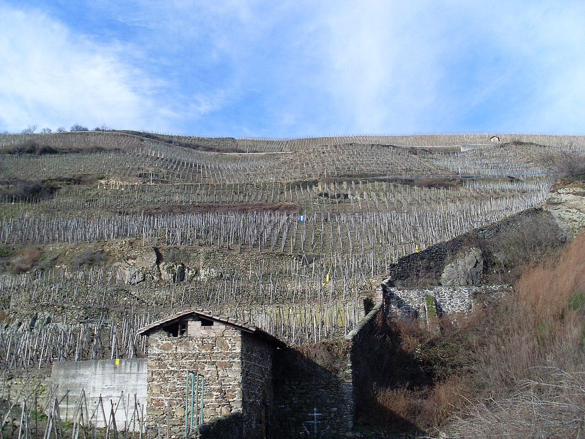

# 罗第丘

北罗讷河谷最北的红葡萄酒 AOC，位于昂皮与圣西尔-sur-le-Rhône 之间的陡坡上；以西拉为主、可少量混酿维欧尼，分“金丘”与“棕丘”两条坡带，1940 年获 AOC。

图：Côte-Rôtie：Terrasse de Côte Rôtie en hiver（Wikimedia Commons）。图片：Karen，CC BY 2.0，via Wikimedia Commons（[原图页面](https://commons.wikimedia.org/wiki/File:Terrasse_de_C%C3%B4te_R%C3%B4tie_en_hiver.jpg)）。

## 先划清「罗第丘」的边界
罗第丘是[罗讷河谷](ref:rhone)北罗讷最北端的红葡萄酒 AOC，属罗讷河谷丘特级村（Cru）序列，位于里昂以南约 40 km、罗讷河右岸，隔河面对维埃纳市南部。法定采收、酿酒与陈酿在罗讷省三个市镇境内完成：昂皮（Ampuis）、圣西尔-sur-le-Rhône（Saint-Cyr-sur-le-Rhône）与蒂潘-瑟蒙（Tupin-Semons）。产区由 1940 年 10 月 18 日的法令首次认定，最初只含昂皮与蒂潘-瑟蒙；1966 年 12 月 21 日的修订法令纳入圣西尔-sur-le-Rhône；具体地块界线由 INAO 于 1969 年 2 月 12 日审定。

2025 年 Inter Rhône 统计产区在产面积约 342 ha，登记在册的 lieu-dit（地块名）共 73 个。法定酒款仍为静止红酒：允许品种只有[西拉](ref:syrah)与[维欧尼](ref:viognier)，西拉至少占混酿的 80%，维欧尼可在西拉地块间混植、比例不超过 20%，两者一同发酵。规则要求人工采收，每公顷最低 6,000 株，最低天然酒精度 10.5%，基础单产 40 hl/ha、上限 46 hl/ha。

对消费者，AOC 名只划定大界线；真正区分风格的是地块名、坡向与生产者。酒标出现具体 lieu-dit（如 La Mouline、La Landonne）时，才能进一步判断土壤与坡位方向。

## 历史与命名

葡萄在昂皮一带已有约 2,400 年种植记载，邻近的维埃纳是罗马时期重镇，坡地栽培传统可追溯至罗马时代。Côte-Rôtie 字面意为“被晒热的坡”，指陡坡获得的长时间日照。棕丘（Côte Brune）与金丘（Côte Blonde）的分野来自当地传说：旧时领主有两位女儿，一位发色深褐、一位金棕，出嫁时各分得一条坡，两条坡由此得名。

根瘤蚜与两次世界大战之间，葡萄园一度大幅萎缩；1940 年法令把产区地位固定下来，现代复兴则与 Guigal 家族相关。Étienne Guigal 1924 年 14 岁抵达昂皮，累计酿造 67 个年份，1946 年在村中创立 Maison Guigal；1961 年年轻的 Marcel Guigal 接手管理，1973 年妻子 Bernadette 加入，儿子 Philippe 生于 1975 年，为家族第三代酿酒师；酒庄在 1980 年代初购入 Vidal-Fleury，1995 年收购昂皮城堡。

读这段历史要注意：法定边界、品种比例与单产规则在不同年代修订过，今天酒标上的产区名是多次调整后的结果；地块记忆比大产区名更稳定。

## 「罗第丘」的地理与风土
葡萄园挂在罗讷河右岸极陡的坡地上，海拔介于 180–325 m，总体朝东南，避开干冷北风，又接住南向日照；部分坡度超过 60%，机械难以进入，整地与采收长期靠人工。坡地以干砌石墙拦土，修成窄阶梯田。

气候为半大陆型，仍能受到溯罗讷河谷而上的最后一点地中海影响；本地称北风为 Bise，冬季湿冷、冷风可持续到春季，春末与初秋河谷易起雾，成熟度与病害管理都受天气牵制。

两条坡带土壤不同。北部棕丘以云母片岩为底，土壤颜色深、黏土比例高、富含氧化铁，酒体重厚、单宁结实、耐久存；南部金丘以片麻岩、花岗岩与片岩为主，浅色硅质土，易碎的砂质黏土当地称 arzel，靠干石墙（cheys）拦挡，酒更精细、花香更显，维欧尼也多种在这一带。陡坡水土流失是常态风险，石墙与梯田既是耕作设施，也是风土的一部分。

## 原料与风格

[西拉](ref:syrah)是骨架品种，维欧尼作为辅料混酿，带来白花、紫罗兰香气与圆润质地；这是少数允许白葡萄品种进入红酒混酿的法国产区之一。冷凉年份的西拉常带黑胡椒、青橄榄与烟熏气息，温暖年份更偏黑莓、树莓与甘草；好年份的酒单宁圆润后仍有结构，顶级款可陈年约 15 年。

以 Guigal 的 Brune & Blonde 为例，混酿为 96% 西拉、4% 维欧尼，葡萄藤平均树龄约 35 年，单产 37 hl/ha，发酵浸渍约 3 周，再经 38 个月橡木桶陈酿，其中 50% 为新桶。新橡木的使用在 19 世纪末根瘤蚜后一度中断，1980 年代由酒商重新带回，如今各家新桶比例与陈酿时长差异明显。

整体风格在“北罗讷西拉”谱系里偏精细：深色果味之外，香料、花香与矿物感并存；同一条坡上，棕丘偏厚重耐久，金丘偏清香细致。

## 代表生产者与酒款

Guigal 是产区最知名的家族酒庄，自有葡萄园全部位于北罗讷，共 75 ha；罗第丘名下有 La Mouline、La Landonne、La Turque 三款单一地块酒，另有 Château d’Ampuis 与跨两丘的 Brune & Blonde。其余长期被市场列为参照的还有 Jamet、Rostaing、Chapoutier、Bonnefond、Clusel-Roch、Vidal-Fleury、Delas 与 Stephan，家族小农与精品酒庄并存。

这些名字不是官方分级，而是多年市场口碑形成的参照系。单一地块旗舰款产量小、价格高，适合纵向年份比较；入门村款更易在餐厅与零售渠道找到。买前先分清酒款来自哪条坡、地块名是否上标、新桶比例与年份风格，比只记酒庄名单更有效。

## 「罗第丘」的上桌方式
罗第丘[红酒](ref:red)酒体中等到饱满，单宁随陈年转柔，适饮温度约 16–18°C；年轻结构款可提前 30–60 分钟开瓶或短暂醒酒，老酒轻柔换瓶即可。配烤红肉、酱汁炖肉、野味与熟成奶酪较稳妥，香料与胡椒气息呼应肉香；带维欧尼混酿的酒花香更显，也能搭风味较重的禽肉。

酒杯选宽口杯放大气息；不必把年轻果味长时间醒到香气散尽。本地近里昂， Lyonnais 烧肉、香肠与奶酪拼盘与产区酒共享同一套厚重饮食传统。

## 选购、标签与误区

读标先确认 AOC Côte-Rôtie，再看地块名、生产者与年份；罗第丘内部没有更细的法定等级划分，lieux-dits 是生产者与市场约定俗成的地块参照。年份差异在陡坡产区同样明显：雾、雨、北风与采收期天气都会改变成熟度，同一年份对比两家酒庄更易看出坡位与土壤差别。

常见误解有二：一是以为混进维欧尼酒会带甜，实际上维欧尼只提供香气与质地，成酒仍是干型红酒；二是以为产区酒都厚重，金丘与轻陈年份的西拉可以相当优雅。储存以阴凉稳定为先，避免高温与长期光照；开瓶后重红酒可放数天，期间注意重新封塞、冷藏。

## 「罗第丘」周边怎么走
昂皮是产区中心村落，隔河可看维埃纳的罗马遗迹，向南邻接孔德里约（Condrieu）白葡萄酒产区；从里昂出发车程约 40 km。酒旅沿罗讷河右岸坡地展开，多数酒庄品鉴需提前预约，单次品鉴 60–90 分钟，村镇之间车程 30–60 分钟，一天两三个点已从容。

采收在北半球秋季 9 月前后，酒庄最忙；周末与节庆开放时间变化大，出发前通过酒庄官网或产区工会确认预约、费用与接待语言。参观时不进入作业车间与地块，品鉴后不驾车；坡地石阶与干石墙路段不一定无障碍，带长辈先问清设施。

- 相关条目：[rhone](ref:rhone)、[syrah](ref:syrah)、[viognier](ref:viognier)、[red-wine](ref:red)、[oak-ageing](ref:oak)。

## 相关图像

图：Viognier Grape must after pressing。摄影：Ian Brown，CC BY 2.0，来自 Wikimedia Commons。。图片：Ian Brown，CC BY 2.0，via Wikimedia Commons（[原图页面](https://commons.wikimedia.org/w/index.php?curid=13317886)）。关联图像：罗第丘。

图：罗讷河谷。图片：Béa at French Wikipedia，Public domain，via Wikimedia Commons（[原图页面](https://commons.wikimedia.org/wiki/File:Thain1.jpg)）。关联图像：罗第丘。
