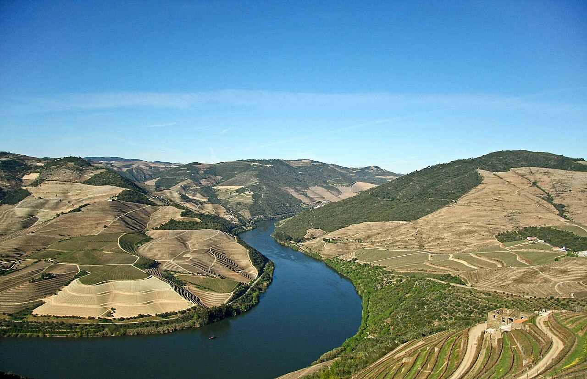

# 杜罗

杜罗（Douro）是[葡萄牙](ref:portugal)东北部杜罗河谷的葡萄酒法定产区，1756 年完成边界划定，是世界上最早的划界产区之一。产区既生产[波特](ref:porto)基酒，也生产结构紧致的干型[红葡萄酒](ref:red-wine)与[白葡萄酒](ref:white-wine)。

图：杜罗。图片：Vitor Oliveira from Torres Vedras, PORTUGAL，CC BY-SA 2.0，via Wikimedia Commons（[原图页面](https://commons.wikimedia.org/wiki/File:Rio_Douro_-_Portugal_(32615481975)_(cropped).jpg)）。

## 定义与范围

杜罗是一个法定产区，同时是波特葡萄的来源地。产区内的葡萄可以用于酿造波特，也可以用于酿造普通干型葡萄酒；两类产品的法规、工艺与市场定位不同。

理解杜罗时要区分三层：河谷是地理范围，杜罗是法定产区，波特是其中一个加强酒产品类别。把“杜罗”与“波特”等同，会忽略产区内的干型葡萄酒。

## 地理与气候

杜罗河谷位于葡萄牙东北部，河流自西班牙向东流入葡萄牙，葡萄园沿两岸陡坡分布，海拔从河面附近延伸到 700 米以上。气候属极端大陆性，夏季炎热干燥，冬季寒冷。

片岩土壤层层倾斜，排水性好但肥力低，根系必须深扎以获取水分。坡向与海拔决定日照与成熟度，河流反射的热量也会影响沿岸地块。干旱与高温是主要压力，灌溉与遮阴管理因此重要。

## 「杜罗」的时间线
杜罗的划界可追溯到 1756 年，当时为保护波特产区而设立边界与监管。此后波特贸易带动了梯田、酒窖与运输体系的发展，20 世纪又逐步建立现代法定产区规则。

历史积累的梯田景观与品种结构，使杜罗既保留了波特传统，也在 20 世纪后期发展出独立的干型葡萄酒路线。两条路线共享葡萄园，但酿造目标不同。

## 子产区

- 下科尔戈（Baixo Corgo）：位于产区西部，海拔较低、降雨较多，成熟较早，产量相对高。
- 上科尔戈（Cima Corgo）：位于中段，围绕皮尼昂一带，坡地陡峭、气候更干燥，是波特与优质干红的核心。
- 杜罗高级区（Douro Superior）：位于最东部，靠近西班牙边境，气候最干燥、最炎热，葡萄成熟度高。

三个子区不是等级高低，而是气候与地形的差异。同一品种在西部与东部可以表现出不同的酸度、果味与酒体。

## 「杜罗」的品种与风格坐标
红葡萄以 Touriga Nacional、Touriga Franca、Tinta Roriz、Tinta Barroca 与 Tinto Cão 为主；白葡萄包括 Malvasia Fina、Viosinho、Gouveio 与 Rabigato。原料是[葡萄](ref:grape)。

[红葡萄酒](ref:red-wine)通常颜色深、单宁中等偏强，带黑莓、紫罗兰与香料气息；[白葡萄酒](ref:white-wine)酸度高，带柑橘、白花与矿物感。近年干型杜罗红葡萄酒在国际市场的比重上升。

## 土壤与地形

土壤以片岩为主，夹杂花岗岩与冲积土。片岩易碎裂，根系可以穿透裂缝寻找水分；不同地块的片岩走向与坡度造成排水与保水的差异。

地形以陡坡梯田为特征，传统石墙梯田与近代机械化梯田并存。坡向、海拔与梯田结构决定光照与通风，也影响采收方式与产量。

## 酿造与陈年

红葡萄酒经破碎、浸渍与[发酵](ref:fermentation)，部分酒庄使用花岗岩酒槽与脚踩，部分使用温控不锈钢罐。浸渍时间与温度决定颜色、单宁与香气。

陈年可使用[橡木桶](ref:oak-ageing)，也可使用大桶或惰性容器。新桶比例、桶龄与陈年长度影响香草、香料与单宁质感；部分酒庄刻意减少新桶以保留果味。

## 酒标与年份

酒标通常标注 Douro、年份、酒精度、容量与装瓶者；部分酒款标注子区、村庄或地块。波特酒标则标注 Porto 与类别，两者不要混淆。

年份反映当年的气候条件。杜罗的年份差异主要体现在成熟度、酸度与产量，购买时应把年份与酒庄、地块一起看。

## 市场与饮用

杜罗干型红葡萄酒常见[酒精度](ref:abv)约 13%–14.5% vol，适合搭配烤肉、炖肉、菌菇与硬质奶酪，建议温度约 16–18 摄氏度；白葡萄酒建议温度约 8–10 摄氏度。

杜罗也生产[加强酒](ref:fortified-wine)，即波特，详见波特页。本页关于杜罗的内容涉及酒精饮料；过量饮酒有害健康，未成年人不应饮酒。

## 「杜罗」容易被读错的地方
第一，把杜罗等同于波特。产区也生产干型红白葡萄酒。
第二，认为杜罗只有陡坡梯田。现代地块也有机械化梯田与谷底葡萄园。
第三，认为片岩土壤意味着单一风格。坡向、海拔与年份造成明显差异。
第四，把杜罗与杜奥（Dão）混淆。两者是葡萄牙不同产区。
第五，认为杜罗红酒都必须长时间陈年。年份与酒庄风格差异很大。

杜罗河谷的价值来自片岩坡地、石墙梯田与 Touriga Nacional 等品种，既生产波特基酒，也生产结构紧致的干型红白葡萄酒。它是世界上较早完成边界划定的产区之一，但“杜罗”不等于“波特”：波特是加强酒类别，杜罗干型酒是另一条产品线。

对照阅读：[葡萄牙](ref:portugal)、[红葡萄酒](ref:red-wine)。

**关键事实。**

| 项目 | 内容 |
| --- | --- |
| 一句话定位 | 葡萄牙东北部杜罗河谷的葡萄酒法定产区，1756 年完成边界划定，是世界上最早的划界产区之一；葡萄园沿陡坡石墙梯田分布，以片岩土壤和 Touriga Nacional 等品种著称，既生产波特基酒，也生产结构紧致的干型红白葡萄酒 |
| 层级 | 其他 |
| 所属 | 葡萄牙 |
| 国家代码 | PT |

**来源与边界。** 本页关于「杜罗」的关键事实，主要由以下来源交叉核对：IVDP（杜罗产区的范围、子区、品种与陈年规则；由原条目末尾参考资料迁移，未逐条复核访问日期）、European Union（欧盟葡萄酒类别、地理标志与标签规则）、Oxford University Press（提供关于杜罗、Touriga Nacional 与 Touriga Franca 的条目；由原条目末尾参考资料迁移，未逐条复核访问日期）。价格、批次与状态会变，涉及这些字段时以页面所列来源的最新版本为准。正文为项目自写，来源只作核验，不复制原文。

**并读。** 把「杜罗」与「葡萄牙」、「波特」、「红葡萄酒」放在一起读时，先确认它们是同一层级还是上下游关系：先确认边界与法定分类，再比较气候、土壤、海拔与代表酒款。本页负责给出产区的基本坐标，对照条目补上具体案例与差异；读完再回到本页，才能分清哪些差别属于产区本身，哪些只是产地、批次或品牌选择。

## 参考资料
- [葡萄牙](ref:portugal)：杜罗所属的国家产区框架。
- [波特](ref:porto)：杜罗最著名的加强酒产品。
- [红葡萄酒](ref:red-wine)与[白葡萄酒](ref:white-wine)：杜罗的两个基本类型。
- [加强酒](ref:fortified-wine)：波特所属的类别。
- [葡萄](ref:grape)：杜罗所用葡萄的成熟度、酸度与单宁判断。
- [发酵](ref:fermentation)与[橡木桶陈年](ref:oak-ageing)：杜罗葡萄酒的基础工艺环节。
- [葡萄酒](ref:wine)：理解杜罗的类别、年份与产地规则的入口。
- [酒精度](ref:abv)：13%–14.5% vol 在标签上的含义。
