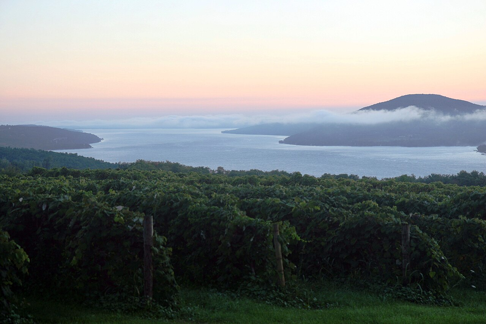

# 手指湖

手指湖是纽约州北部由十一条南北向冰川湖组成的冷凉产区，隶属于 [美国](ref:usa) 葡萄酒框架；雷司令最受国际认可，霞多丽、品丽珠与传统法起泡酒同样重要。四座大湖深水夏季储热、秋季缓释，拉长生长季；产区 1982 年成为联邦 AVA，是纽约州规模最大、酒庄最集中的葡萄酒地带。

图：Finger Lakes：Sunrise overlooking a vineyard in the Finger Lakes（Wikimedia Commons）。图片：Visit Finger Lakes，CC BY 2.0，via Wikimedia Commons（[原图页面](https://commons.wikimedia.org/wiki/File:Sunrise_overlooking_a_vineyard_in_the_Finger_Lakes.jpg)）。

## 先划清「手指湖」的边界
产区位于纽约州中部偏北、安大略湖以南，覆盖卡尤加、斯凯勒、耶茨、塞内卡、汤姆金斯等十四县，面积约 4,060 平方英里。近 150 家酒庄集中在卡南代瓜、丘卡、塞内卡、卡尤加四座最大最居中的湖周边，其余七湖种植零散。塞内卡湖最深，632 英尺、长 37.9 英里，酒庄最多；卡尤加湖深 435 英尺、长 38.5 英里；丘卡湖呈 Y 字形，深 187 英尺、长 19.88 英里；卡南代瓜湖深 262 英尺、长 16.16 英里。

酒标上的 “Finger Lakes” 是联邦地理标志，只说明葡萄来自划定十四县，不保证出自某片湖岸或坡地。产区之下有两个子 AVA：1988 年卡尤加湖 AVA 与 2003 年塞内卡湖 AVA；读到子产区名，才能进一步判断微气候与土壤方向。

## 历史与命名

葡萄史早于禁酒令。1829 年博斯特威维克牧师在哈蒙德波特教区花园种下第一片葡萄园；1860 年普莱森特谷酒厂成为美国第一家注册保税酒厂，1873 年其起泡酒在维也纳世博会获金奖，到 1900 年沿湖已有五十多家酒庄。1919 年禁酒令生效，1933 年解除，打断了多数老庄园的连续经营。

现代转折与康斯坦丁·弗兰克博士相关：他 1953 年受雇 Gold Seal 做品种试验，1958 年在丘卡湖西南坡买地嫁接欧亚品种，1962 年创立 Vinifera Wine Cellars，较早证明美国东北部能种出成熟 vinifera。1970 年前后富尼耶在塞内卡湖东岸种 20 英亩、维默在西岸种 140 英亩。1976 年《农场酒厂法》允许直销，1978 年 Glenora 成为塞内卡湖首家酒厂；1982 年 AVA 设立，三条湖岸小径于 1983、1985、1986 年开通，1988、2003 年两个子 AVA 获批；1998 年 Dr. Frank 与 Fox Run 半干雷司令在斯特拉斯堡获金奖，2023 年州级可持续认证落地。

## 「手指湖」的地理与风土
地形由冰川雕成，留下深切谷地与深水湖，周边沉积石灰岩、页岩、砾石与粉砂。葡萄园多选朝湖坡地，冷重空气顺坡入湖，降低夜霜风险，坡度改善光照与排水；浅层页岩砾石地块养分低，根系下扎，果粒小而皮厚，风味矿物感集中。

湖泊是冷凉产区能种酿酒葡萄的关键：冬季冷空气汇入湖面，春季湖水升温慢、推迟萌芽躲晚霜，秋季储热缓释推迟初霜。塞内卡湖一带生长季约 190 天，昼夜温差在积累风味的同时保留酸度。主要风险是春霜、花期风雨、采收雨与冬季低温，因此尼亚加拉、Concord、Baco Noir、Seyval Blanc 等抗寒原生与杂交品种仍保留在太冷地块，欧亚品种集中在最好的湖岸位置。

## 原料与风格

[雷司令](ref:riesling)是标志品种，种植近 1,000 英亩，200 多个品牌，年产超 20 万箱；风格从干型、半干到晚收与冰酒，干型呈青苹果、柑橘、白花与石板矿物，陈年后发展汽油、燧石与核果香气。其他白品种有[霞多丽](ref:chardonnay)、琼瑶浆、绿维特利纳、灰皮诺、长相思；部分霞多丽用于传统法[起泡酒](ref:sparkling)。

红葡萄中品丽珠种植最广，早熟耐冷凉，酒体中等，带红莓、青胡椒与草本气息；黑皮诺、梅洛、蓝佛朗克、西拉也有种植。Cayuga White、Traminette、Vidal Blanc、Vignoles、Niagara 等杂交原生品种仍占不小面积。整体风格偏冷凉精确与酸度，传统法起泡酒用雷司令、霞多丽、黑皮诺与莫尼耶皮诺调配；是否留糖、用桶与酒泥接触长短，会把同品种拉向不同方向。

## 代表生产者与酒款

Dr. Konstantin Frank 源自 1962 年创立的 Vinifera Wine Cellars，位于丘卡湖西南坡，旗舰雷司令与传统法起泡酒奠定产区声誉；Hermann J. Wiemer 扎根塞内卡湖西岸，以雷司令与黑皮诺著称；Fox Run 品种覆盖广，1998 年半干雷司令在斯特拉斯堡获奖。其余有 Ravines、Boundary Breaks、Forge Cellars、Red Newt、Wagner、Glenora、Lakewood、Hazlitt 1852，以及 1872 年创立、至今酿造教会用酒的 O-Neh-Da。

这些名字不是官方分级，而是市场多年积累的参照系。旗舰单一园雷司令产量小、价格高，适合纵向陈年比较；入门半干雷司令与混酿更容易在餐厅零售渠道找到。买前先分清干型还是带甜、果实来自哪座湖、是否单一园，比只记酒庄名单更有效。

## 「手指湖」的上桌方式
干型雷司令约 10–12°C 饮用，半干与甜型在 6–8°C；品丽珠与轻酒体红酒约 14–16°C，开瓶后稍等即可，不必长时间醒酒；起泡酒冷藏直饮，用笛形或小肚香槟杯。配餐最易对接河湖鲜鱼、烤鸡、猪肉、熟肉冷盘与沙拉，高酸[白葡萄酒](ref:white)穿过酱汁油脂，半干雷司令能接亚洲菜与轻度咖喱。

品丽珠配鸭胸、蘑菇、羊排与野味炖菜较稳妥，草本胡椒气息呼应肉香；霞多丽配白肉、奶油酱与清淡海鲜。甜型雷司令与冰酒收尾，配蓝纹奶酪、果挞或坚果甜点；起泡酒可作开胃酒配油炸咸香小食。点菜时先确认甜度与酒体，比“红酒配红肉”的简单公式可靠。

## 选购、标签与误区

读标先分辨大产区与塞内卡湖、卡尤加湖两个子 AVA，再看葡萄园或地块名。年份在冷凉产区权重很高，花期霜冻、采收雨与冬季低温都会改变产量与成熟度；甜度描述（干、半干、半甜、晚收）直接决定风格。常见误解是“产区酒都是甜的”，实际上干型雷司令已是获奖主力；另一误解是冷凉等于酒体单薄，好年份品丽珠、黑皮诺与桶陈霞多丽结构充足，干型雷司令可放十年以上。

储存上稳定阴凉比追求低温更重要，雷司令与起泡酒对运输高温和长期光照敏感。同一年份对比两家酒庄的同一品种，比跨年份乱喝更易看出湖岸与土壤差异；留意进口渠道、瓶塞状态与储存历史，避免在温度波动大的环境长期存放。

## 「手指湖」周边怎么走
酒旅沿主线展开：卡尤加湖小径 1983 年开通，是美国最早组织化葡萄酒线路；丘卡湖、塞内卡湖小径于 1985、1986 年建立，1995 年加入卡南代瓜湖小径。沃特金斯格伦是酒庄最密集落脚点，伊萨卡靠卡尤加湖北端，哈蒙德波特为丘卡湖中心，西部可借道康宁住宿。

近 150 家酒庄分散湖岸乡道间，单次品鉴 60–90 分钟，湖岸两端车程常超半小时，一天两三家预约加午餐已从容。采收季在北半球秋季 9 至 10 月，酒庄最忙；周末节庆人流集中，出发前通过官网或小径协会确认开放时间、预约与费用。参观时不进入作业车间与地块，品鉴后不驾车；土路石阶与门槛不一定无障碍，带长辈先问清设施。

- 相关条目：[usa](ref:usa)、[riesling](ref:riesling)、[chardonnay](ref:chardonnay)、[white-wine](ref:white)、[sparkling-wine](ref:sparkling)。
