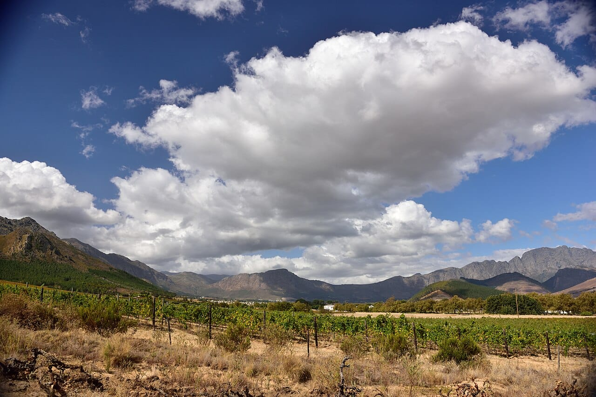
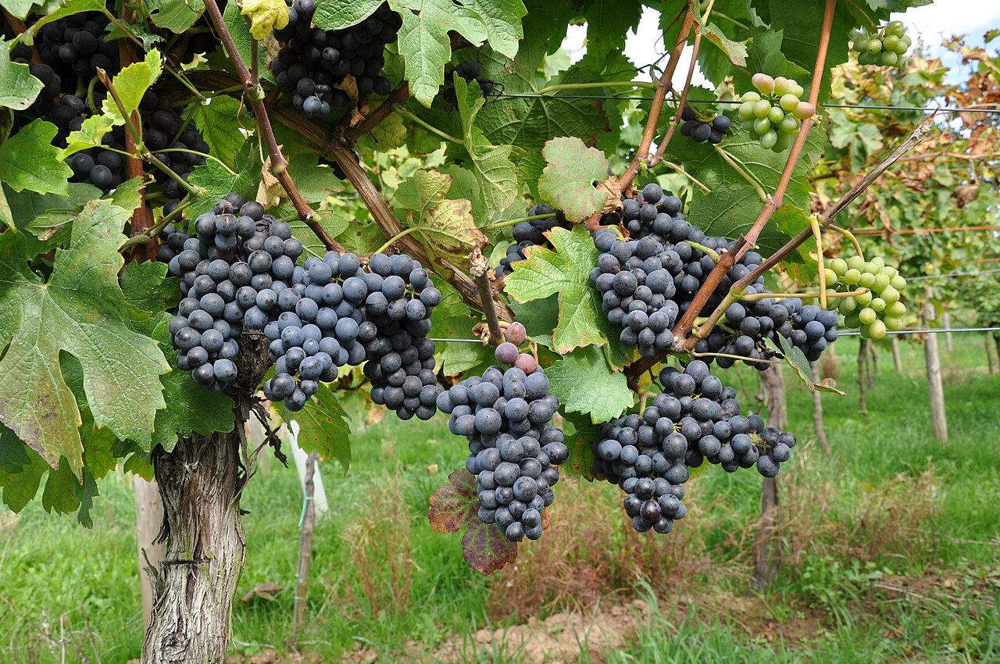

# 弗兰谷

西开普省的山谷产区，1688 年法国胡格诺派移民在此定居；以赤霞珠、皮诺塔吉、霞多丽与餐厅著称，山谷狭长、风景集中，是开普酒乡最容易自驾的产区之一。

弗朗斯胡克是南非西开普的山谷产区，1688 年胡格诺移民带来法国名字与酿酒传统；今日以精品酒庄、白葡萄酒与 Cap Classique 起泡酒著称。

图：Franschhoek：Wine Estate, Franschhoek, Western Cape, South Africa (20505659765)（Wikimedia Commons）。图片：South African Tourism from South Africa，CC BY 2.0，via Wikimedia Commons（[原图页面](https://commons.wikimedia.org/wiki/File:Wine_Estate,_Franschhoek,_Western_Cape,_South_Africa_(20505659765).jpg)）。

## 定义与边界

弗朗斯胡克是[南非](ref:south-africa)西开普省的一个山谷小镇与葡萄酒产区，名称意为“法国角”；它被山脊包围，东接 Paarl、西邻 Stellenbosch，是南非最集中的精品酒庄区之一。

弗朗斯胡克不是一个大产区，而是由山谷、山坡与小块葡萄园组成的紧密地理单元；酒庄密度高、地块小，酒标上的酒庄名与农场名往往比“Franschhoek”更重要。

它与 Stellenbosch、Paarl 共享西开普的地中海气候，但山谷地形让昼夜温差更大、成熟更慢，白葡萄酒与起泡酒的酸度更精细。

## 历史与命名

1688 年，法国胡格诺派难民抵达开普，被分配到 Franschhoek 的土地；他们带来葡萄种植、酿酒与农业技术，村庄因此得名“法国角”。

18–19 世纪，农场以混合农业为主，葡萄酒是其中一部分；20 世纪后期，精品酒庄与餐厅兴起，弗朗斯胡克从农业山谷变成南非的葡萄酒与美食目的地。

“Franschhoek”不是“法国产区”，而是南非历史的一部分；酒庄名常保留胡格诺姓氏（如 La Motte、Boschendal），读历史时要把法国渊源与南非风土分开。

胡格诺移民带来的不只是酿酒技术，还有葡萄修枝、灌溉与石砌酒窖的做法；La Motte、Boschendal 等农场的建筑与园林，至今保留 18 世纪开普荷兰风格。

## 地理与风土

弗朗斯胡克山谷由 Berg River 与山脊围成，海拔约 300–500 米；地中海气候，冬季降雨、夏季干燥，山脉阻挡海风，昼夜温差大。

土壤以花岗岩、砂岩与冲积土为主，山坡排水好、谷底更肥沃；朝南坡更凉、成熟更慢，适合 Chardonnay、Pinot Noir 与 Semillon；朝北坡更暖，适合 Cabernet Sauvignon 与 Syrah。

山谷风与山影是关键：下午的谷风降温，延长成熟期；山影减少暴晒，保留酸度。干旱与火灾是风险，灌溉与冠层管理决定产量与质量。

弗朗斯胡克的山谷走向大致东西向，山脊挡住南来的湿风，谷底更热、山坡更凉；这种“山谷内外”的差异，让同一品种在不同地块可以相差两周成熟。

山谷的夜风来自山脊下沉的冷空气，夏季午后降温明显；酒农利用这一点保留 Chardonnay 与 Pinot Noir 的酸度，也让 Cabernet 不至于过熟。

## 原料与风格

弗朗斯胡克以 Chardonnay、Chenin Blanc、Semillon、Pinot Noir、Cabernet Sauvignon 与 Syrah 为主；白葡萄酒带柑橘、白花、坚果与矿物，红葡萄酒带黑醋栗、樱桃、雪松与香料。

Cap Classique 起泡酒是当地特色：用 Chardonnay 与 Pinot Noir 二次发酵，酒泥陈年带来面包与坚果。部分酒庄做甜酒与加强酒，但精品干白与起泡酒更代表产区。

弗朗斯胡克的 Chardonnay 通常经橡木桶与酒泥搅拌，带柑橘、白花、榛子与奶油；Chenin Blanc 更偏黄苹果、蜂蜜与湿石；Semillon 给混酿增加蜡质与坚果。

红葡萄酒方面，[赤霞珠](ref:cabernet)（Cabernet Sauvignon）带黑醋栗、雪松与石墨；Pinot Noir 更轻、更红樱桃；Syrah 带黑莓、胡椒与紫罗兰。Cap Classique 的 Chardonnay/Pinot Noir 混酿，常有面包、杏仁与柑橘。

弗朗斯胡克的风格关键词是“山谷精细度”：不是巴罗萨式的力量，也不是 Stellenbosch 式的结构，而是中等酒体、清晰酸度与较长余味。

## 代表生产者与酒款

La Motte、Boschendal、Haute Cabrière、Grande Provence、Chamonix 等是弗朗斯胡克的代表；La Motte 的 Chardonnay、Haute Cabrière 的 Cap Classique、Boschendal 的 Chenin Blanc 风格各异。

这些酒庄多为历史农场转型，酒标常标酒庄名与农场名；读背标的品种、年份与酿造方式，比只看“Franschhoek”更能判断风格。

Haute Cabrière 以 Cap Classique 与 Pinot Noir 闻名；La Motte 的 Chardonnay 与 Shiraz 走经典路线；Boschendal 的 Chenin Blanc 更日常；Grande Provence 与 Chamonix 则把酒庄、餐厅与旅游结合。

这些酒庄的价格跨度大，酒标常标“Estate”或“Farm”；读背标的品种、年份、酒泥陈年与橡木比例，比看酒庄建筑更能判断酒的质量。

## 上桌方式

白葡萄酒 10–12°C，[红葡萄酒](ref:red) 16–18°C，Cap Classique 6–8°C；白葡萄酒配海鲜、沙拉、鸡肉与轻奶酪，红葡萄酒配烤肉、野味与硬质奶酪，起泡酒配开胃菜与油炸食物。

弗朗斯胡克的红葡萄酒不适合过度冰镇；白葡萄酒可以稍凉，但不要冰到失去坚果与矿物。

弗朗斯胡克的白葡萄酒适合配开普马来菜、咖喱、海鲜与水果；红葡萄酒配烤肉、野味与硬质奶酪；Cap Classique 配生蚝、鱼子酱与油炸食物。山谷酒庄的餐厅常做“酒+餐”搭配，提前预约比临时到店更稳。

## 选购与误区

买弗朗斯胡克白葡萄酒，先看品种与年份；买 Cap Classique，看酒泥陈年时间与是否单一园。价格高可能来自酒庄历史与旅游定位，不一定代表风土更强。

常见误读：把 Franschhoek 当成法国产区；以为它只有红酒；以为旅游区就等于高价低质。它是南非山谷，酒庄规模小、风格多样。

弗朗斯胡克的酒庄密度高，但并非所有酒庄都种葡萄：部分酒庄只做品鉴、餐饮与活动，酒款来自邻近农场。买之前看背标的“Wine of Origin”与产区，不要只看庄园名字。

价格高可能来自旅游定位、餐厅与历史建筑，不一定代表酒质；同一年份、同一品种，不同酒庄的差异可能很大。先试单瓶，再考虑整箱。

Cap Classique 的酒泥陈年时间从 9 个月到 5 年以上不等；酒标上的“Méthode Cap Classique”说明二次发酵工艺，不代表陈年长度。买起泡酒时，看除渣日期与酒泥陈年，比看酒庄名气更有用。

## 参见

- [南非](ref:south-africa)：西开普产区与法规。
- [赤霞珠](ref:cabernet)：弗朗斯胡克的红葡萄。
- [皮诺塔吉](ref:pinotage)：南非标志红葡萄。
- [红葡萄酒](ref:red)：红葡萄的发酵与结构。
- [白葡萄酒](ref:white)：白葡萄的发酵与风格。

**关键事实。**

| 项目 | 内容 |
| --- | --- |
| 一句话定位 | 西开普省的山谷产区，1688 年法国胡格诺派移民在此定居；以赤霞珠、皮诺塔吉、霞多丽与餐厅著称，山谷狭长、风景集中，是开普酒乡最容易自驾的产区之一 |
| 层级 | 省/大区 |
| 所属 | 南非 |
| 国家代码 | ZA |

**来源与边界。** 本页关于「弗兰谷」的关键事实，主要由以下来源交叉核对：SAWIS（南非葡萄酒产区、酒类登记与产业框架）、South African Tourism（南非葡萄酒产区的旅行与地理背景）、OIV（葡萄酒定义与全球生产框架）等 4 条来源。价格、批次与状态会变，涉及这些字段时以页面所列来源的最新版本为准。正文为项目自写，来源只作核验，不复制原文。

## 相关图像

图：皮诺塔吉。图片：Please note: This photo can be reproduced. Please quote the source as indicated below: Doris Schneider, Julius Kühn-Institut (JKI), Federal Research Centre for ，CC BY-SA 4.0，via Wikimedia Commons（[原图页面](https://commons.wikimedia.org/wiki/File:VIVC9286_PINOTAGE_Full_plant_3638.jpg)）。关联图像：弗兰谷。

图：Vineyards in the Cederberg - South Africa。摄影：Ltz Raptor，CC BY-SA 3.0，来自 Wikimedia Commons。。图片：Ltz Raptor，CC BY-SA 3.0，via Wikimedia Commons（[原图页面](https://commons.wikimedia.org/w/index.php?curid=4647540)）。关联图像：弗兰谷。
