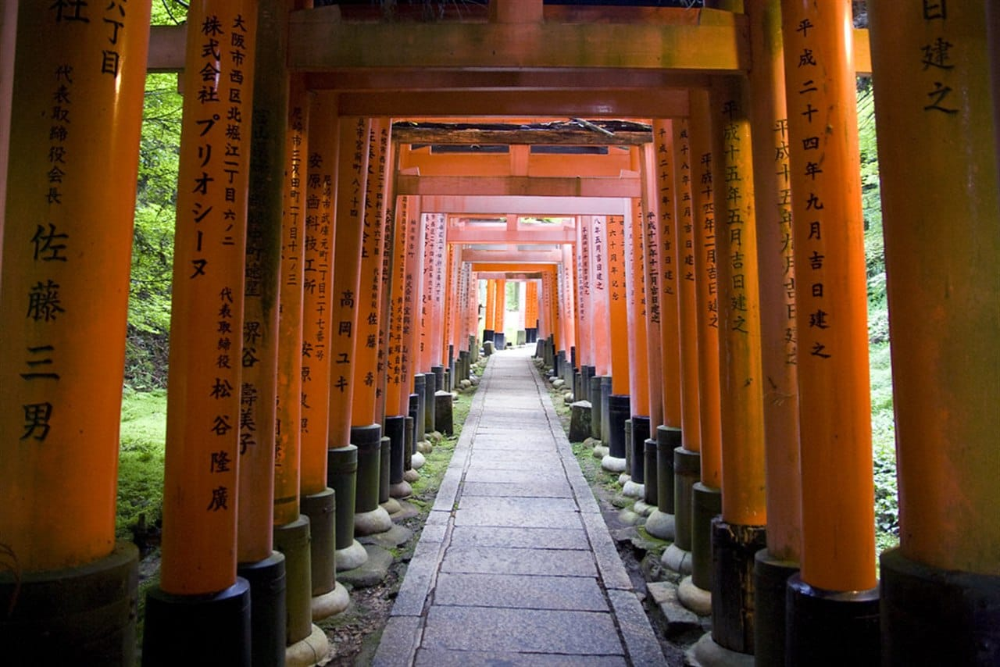
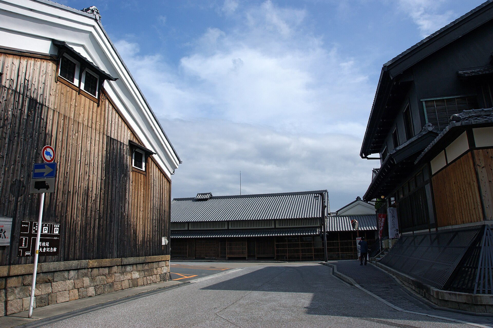
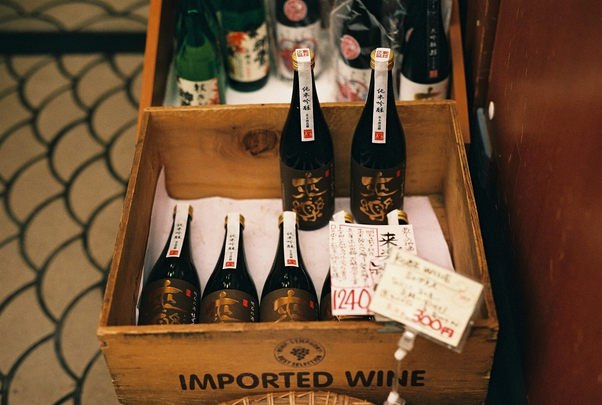

# 伏见

伏见是京都府京都市南部的清酒产地，核心是伏见区沿宇治川、濠川分布的酒藏聚落。它不是一个独立的县，也不是葡萄园式的法定产区，而是以“伏水”、酒藏建筑与船运历史形成的产地名声。理解伏见，要把它与京都府其他酒乡、与兵库滩五乡的水质和风格对照起来看。

图：伏见。摄影：Fushimi Inari-taisha, Kyoto。署名：Dimitry B，CC BY 2.0，来自 Flickr / Openverse（[来源](https://www.flickr.com/photos/61533954@N00/33775913145)）。

> **先给结论**
> **一句话：** 这页判断伏见的风味与旅行价值，以及怎么安排。
>
> - **适合谁：** 正在比较伏见与其他产区、准备买酒或安排旅行的人。
> - **不适合谁：** 只想要“哪个产区最贵”的结论、不关心风格和年份的人。
> - **先看这两点：**
>   - 伏见的参观可以按“水—船—藏—馆”的顺序安排：先看御香宫神社与濠川，再沿十石舟航线看酒藏外观，最后进入月桂冠大仓纪念馆或黄樱纪念馆。
>   - 伏见的产地范围首先要与行政区划区分。

## 定义与范围

伏见的产地范围首先要与行政区划区分。伏见区是京都市的一个区，而伏见酒造组合的藏元名单还涵盖城阳等邻近地区；组合页面把“伏见・城阳”列为同一组酒藏聚落。因此，酒标上的“伏见”可能指伏见区内的酒藏，也可能泛指这一带的清酒传统，具体要看藏元与组合信息。

伏见以清酒为主，原料是[稻米](ref:rice)与水，工艺属于并行复[发酵](ref:sake)。它与[日本](ref:japan)其他清酒产区的差别，不在原料种类，而在水源、城市空间与历史积累。伏见酒藏多沿濠川、宇治川布局，酒藏、船码头与商家在同一片街区里生长，这种“酒藏即街景”的形态是伏见最直观的特征。

## 伏水与运河

伏见的水在当地写作“伏水”。桃山丘陵的雨水渗入地下，沿水脉在山麓涌出，形成丰富的伏流水；御香宫神社的“御香水”是其中最有名的涌泉之一，也被列入日本名水百选。伏见酒造组合明确把这里的水质描述为含有钾、钙等成分的中硬水，而不是纯粹的软水。

这一点常被误读。伏见的水比滩五乡的宫水柔和，矿物质含量较低，因而酒体常显得细腻、圆润；但它并非“零硬度”的软水。把伏见简单说成“软水产地”，会忽略中硬水对酵母营养、发酵速度与酒体骨架的实际作用。对酿造而言，水的硬度、铁含量与矿物质比例，比“软”或“硬”的标签更重要。

运河把水与运输连在一起。濠川在 1594 年伏见城筑城时开凿，引宇治川水作为外濠；江户时期，三十石船从大坂沿河进入京都，伏见是水路与陆路的交接点。今天濠川上的十石舟成为观光航线，游客从水面看到的酒藏、柳树与旧仓库，正是当年酒运网络留下的城市剖面。[伏见酒造组合](ref:water)对水源的解释，与[月桂冠](ref:gekkeikan)对濠川景观的记录，可以互相印证这条“水—船—酒藏”的线索。

## 酒藏群与博物馆

伏见的酒藏群以大型企业与中小藏元并置。月桂冠的创业可追溯到 1637 年，初代大仓治右卫门从笠置来到伏见开酒屋；其大仓纪念馆由旧酒藏改建，位于濠川沿岸，是理解伏见酒藏建筑与近代酒造史的主要入口。黄樱纪念馆（お酒の資料館・河童資料館）位于伏见区塩屋町，免费入馆，用模型、道具与影像展示旧式酒造工程，并把黄樱的河童形象与广告史并置展示。

两家纪念馆的叙事重点不同：月桂冠偏向企业史、酒造用具与伏见酒藏景观；黄樱偏向酒造工程的普及与大众文化。把它们当作“伏见酒藏博物馆”的两种切面，比只看一家更完整。伏见酒造组合的藏元名单还包括金鵄正宗、玉乃光、松本酒造（桃の滴）、藤岡酒造（蒼空）等，说明伏见并非只有大厂，小酒藏的限量酒与生酒同样构成产地的多样性。

酒藏建筑本身也是遗产。白壁、海鼠壁、红瓦与临河仓库，配合狭窄街道与水路，形成适合参观步行的尺度。参观时要注意，酒藏是生产场所，不是主题公园；是否开放、是否需预约、是否有试饮，都要以各藏元与纪念馆的当日公告为准。

## 吟醸的早期现场

伏见与“吟醸”的关系，常被简化成“发源地”。更准确的说法是：伏见是吟醸技术早期实践与品评传播的重要现场。月桂冠的资料记载，1889 年伏见的酒造家举办品评会，有 35 社出品；1894 年新潟酒造家岸五郎在《酒造のともしび》中使用“吟醸”一词；1906 年《醸造協会誌》出现“吟醸酒”的表述；1907 年日本醸造协会主办第一次全国清酒品评会。这些节点说明，“吟醸”是明治时期各产区在品评会竞争中逐步普及的用语，而不是某一地一家的孤立发明。

现代[吟醸酒](ref:ginjo)的标签规则来自国税厅《清酒的制法品质表示基准》：吟醸酒须使用精米步合 60% 以下的白米、米麹与水，或在此基础上加入酿造酒精；大吟醸则要求精米步合 50% 以下。吟醸造り强调低温（约 5–10 摄氏度）与长期（约 30 天以上）发酵，以生成苹果、香蕉般的吟醸香。伏见的酒藏在明治以后长期参与品评与技术创新，这让“吟醸”在伏见不只是一个商品名，而是一套可以被讲述、被展示、被比较的工艺传统。

## 酿造与水

伏见清酒的风格不能用单一形容词概括。中硬水、低温发酵与不同酒母带来从轻快到醇厚的谱系：有的酒以吟醸香和清爽收口为主，有的酒保留米香与鲜味，适合温饮。伏见的酒藏也使用生酛、山废与速酿等不同[酒母](ref:kimoto)路线，酒母选择影响酸度、鲜味与发酵风险，不构成等级高低。

在原料与标签层面，清酒的特定名称有硬性门槛：米麹使用比例须达到白米重量的 15% 以上；使用酿造酒精时，酒精重量不得超过白米重量的 10%；纯米酒只能以白米、米麹与水为原料。这些数字是判断酒标的第一层依据，比“伏见”二字更能说明一款酒的实际类别。伏见的水与米提供了风格底色，但最终风味仍取决于精米步合、酒母、酵母、温度管理与是否加热处理。

## 参观与饮用

伏见的参观可以按“水—船—藏—馆”的顺序安排：先看御香宫神社与濠川，再沿十石舟航线看酒藏外观，最后进入月桂冠大仓纪念馆或黄樱纪念馆。这样能把水源、运输与建筑连成一条线，而不是把博物馆当成孤立景点。试饮后不要驾车；未成年人不应饮酒，过量饮酒有害健康。

饮用方面，吟醸类适合稍低温度，纯米与醇厚型可以尝试常温或温热。伏见酒常被拿来与京都料理搭配，清淡的汤豆腐、渍物、烤鱼与寿司都能承托其细腻感；但“伏见酒一定偏甜”是过度概括，辛口、酸度高的酒款同样常见。购买时先看特定名称、精米步合与酒母，再按料理与温度选择。

## 常见误区

第一，把伏见等同于整个京都府。伏见只是京都市南部的一个酒藏聚落，京都府还有洛中、伏见、丹波、丹后、宫津、福知山等不同酒乡。

第二，把“伏水”当成纯软水。伏见酒造组合的水质说明明确使用中硬水表述；它比滩五乡的宫水柔和，但不是零矿物质的水。

第三，把伏见说成吟醸的唯一发源地。更准确的表述是早期品评与技术传播的重要现场，吟醸用语的文献初见分布在多个产区与刊物。

第四，认为伏见只有大型酒藏。组合名单中有多家中小藏元，产品线覆盖本酿造、纯米、吟醸、生酒与限量酒。

第五，把“伏见”当成质量等级。地名说明产地与历史，不直接决定精米步合、酒母或风味；酒标上的特定名称与工艺信息才是更具体的判断依据。

对照阅读：[日本](ref:japan)、[吟酿](ref:ginjo)。

## 参考资料

- 伏見酒造組合「伏見の水」：https://www.fushimi.or.jp/guide/water.html
- 伏見酒造組合「伏見と酒の歴史」：https://www.fushimi.or.jp/guide/history.html
- 伏見酒造組合「酒蔵・蔵元紹介」：https://www.fushimi.or.jp/brewery/
- 月桂冠「『吟醸』のあゆみ」：https://www.gekkeikan.co.jp/enjoy/sake/industry/industry04.html
- 月桂冠大倉記念館「界わいの景観」：https://www.gekkeikan.co.jp/enjoy/museum/fushimi/sightseeing/
- 黄桜「黄桜記念館 Kappa Gallery」：https://kizakura.co.jp/restaurant/country/memorial/index.html

## 相关图像

图：月桂冠大仓纪念馆相关实景照片。图片：663highland，CC BY 2.5，via Wikimedia Commons（[原图页面](https://commons.wikimedia.org/wiki/File:Gekkeikan_Okura_Sake_Museum02s4592.jpg)）。关联图像：伏见。

图：吟酿相关实景照片。图片：halfrain，CC BY-SA 2.0，via Wikimedia Commons（[原图页面](https://commons.wikimedia.org/wiki/File:%E7%B4%94%E7%B1%B3%E5%90%9F%E9%86%B8_(Junmai_Ginjo)_(15656231855).jpg)）。关联图像：伏见。
