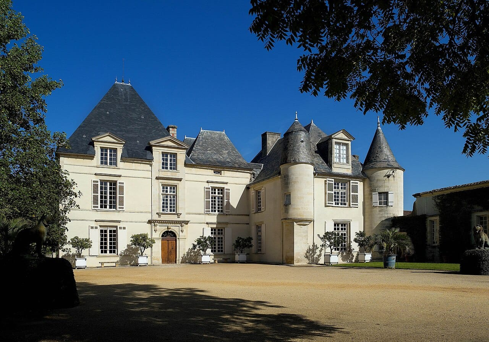

# 格拉夫

格拉夫是波尔多左岸南部的历史产区，从波尔多市郊向南延伸到朗贡一带；名字来自砾石（graves），红白兼产，以 1953 年格拉夫分级著称，佩萨克-雷奥良 1987 年从中独立为更严格的红白 AOC。

图："格拉夫"地区的一处实景。图片：BillBl，CC BY 2.0，via Wikimedia Commons（[原图页面](https://commons.wikimedia.org/wiki/File:Haut_Brion_exterior.jpg)）。这张照片来自"格拉夫"产区内已核实条目，用于说明当地风貌，不是格拉夫的全区域地图。

## 先划清「格拉夫」的边界
格拉夫位于加龙河左岸、波尔多城东南方，沿河谷上游向南延展约五十公里，直抵朗贡附近。它是波尔多少数红白葡萄酒并重的产区：红酒以赤霞珠、梅洛、品丽珠为主，白酒以长相思、赛美蓉与密斯卡岱调配。格拉夫与梅多克隔加龙河相望，是左岸最早被贵族与教会开垦的地带之一；葡萄园从城市近郊一直排到河谷上游，距河远近决定砾石厚薄与排水。

1987 年 9 月 9 日，紧邻波尔多市区的北部地带单独成为佩萨克-雷奥良 AOC，覆盖今天约 1,860 公顷、56 家酒庄；南部仍沿用 Graves AOC，乡村地块更多、风格与价格带更宽。标签上的“Graves”与“Pessac-Léognan”不是一回事，前者范围更大，后者是更严格的北部子产区。

## 历史与命名

格拉夫是波尔多酿酒史最悠久的地带之一：Haut-Brion 庄园 1525 年由 Jean de Pontac 建立，17 世纪起在伦敦市场成名；1855 年分级中，它是唯一不在梅多克的一级庄。1953 年，应格拉夫产区防御工会请求，INAO 设立格拉夫分级，红酒先行，1959 年补入干白。17 世纪波尔多酒随英国贸易路线出口，Haut-Brion 是最早在伦敦被点名的庄园之一；教会与修道院在格拉夫保留了早期葡萄园记录。

分级共 16 家列级庄：7 家红酒、3 家白酒、6 家红白兼产；分级只有一个层级、不分高低，也不重审。16 家全部位于今天的佩萨克-雷奥良。Haut-Brion 同时出现在 1855 与 1953 两份名单上，是唯一被两次分级的波尔多酒庄。分级产生前，格拉夫红酒在波尔多酒商体系中早已享有声誉；分级把公认的优质庄园固定下来，但没有像 1855 那样分成多级阶梯。

## 「格拉夫」的地理与风土
产区名字来自土壤：加龙河沉积形成的砾石台地，混合卵石、燧石、黏土、砂与铁磐（alios），台面排水快、根系深入底土。高地砾石受光好、春季升温快，低洼黏土地块偏凉、保水。气候受海洋影响，温和多雨，坡度与台面决定排水与成熟节奏。砾石是冰河与河流搬运的卵石，夏季蓄热、夜间散热，帮助葡萄成熟；石块间隙排水快，根系被迫深扎，产量低而风味集中。

北部佩萨克-雷奥良紧邻城市，砾石台地连片，森林成行分隔葡萄园；南部 Graves 乡村地块土壤更杂，黏土比例更高，酒款更朴素、性价比更突出。加龙河小支流（Peugue、Eau Bourde 等）围出的谷地很少受洪涝，葡萄根系可向下找水。

## 原料与风格

红酒骨架为赤霞珠 (ref:cabernet)、梅洛与品丽珠，少量小维多；白酒由长相思 (ref:sauvignon)、赛美蓉与密斯卡岱调配，常经橡木桶发酵与酒泥陈酿。佩萨克-雷奥良红酒约占产区产量的 85%，白酒约占两成，白酒以复杂度、新鲜酸度与陈年潜力见长。梅洛占比随地块黏土比例提高而增加，赤霞珠在砾石多的台地更为主导；白酒常混酿以互补酸度、油润与香气，密斯卡岱增加香气层次。

格拉夫红酒通常黑果、雪松与矿物气息，单宁结构清晰；好年份可陈年十余年。白酒从清爽柑橘到蜂蜜、榛子与橡木香料不等，赛美蓉带来圆润，长相思提供酸度与花香。南部 Graves AOC 的酒款以日常饮用为主，果香直接、单宁柔和。橡木桶发酵、酒泥搅拌与新桶比例决定白酒是清新矿石路线还是丰满奶油路线；红酒浸渍时间与橡木陈酿影响单宁细腻度。

## 代表生产者与酒款

佩萨克-雷奥良的列级庄包括 Haut-Brion、La Mission-Haut-Brion、Pape-Clément、Smith Haut Lafitte、Domaine de Chevalier、Carbonnieux、Haut-Bailly、Malartic-Lagravière 等；Haut-Brion 葡萄园约 52.82 公顷，红葡萄品种为 46% 梅洛、42% 赤霞珠、11% 品丽珠、1% 小维多，白葡萄为 52% 赛美蓉、48% 长相思。Domaine de Chevalier 以红白双款见长，Carbonnieux 是格拉夫干白代表之一；La Mission-Haut-Brion 与 Haut-Brion 相邻，风格以结构与集中度著称。

南部 Graves 还有家族酒庄、合作社与性价比庄园，名气不及北部列级庄，但适合寻找日常波尔多。这些名字不是跨产区排名；列级庄之间也按红酒、白酒与地块风格区分，购买时先分清 AOC 层级、品种比例与生产者。合作社与家族小酒庄在南部承担日常产量；同一列级庄常分正牌与副牌，副牌年份更年轻、价格更低。

## 「格拉夫」的上桌方式
红酒适饮 16 至 18 摄氏度，白酒 10 至 12 摄氏度；年轻果味款不必久醒，结构强的列级红可提前半小时到一小时透气。杯型选波尔多杯或中等肚径通用杯；白酒用窄口白杯聚拢花香，陈年白酒可稍提前开瓶醒香。

红酒配烤牛排、羊排、炖牛肉与硬奶酪；白酒配烤禽、奶油酱海鲜、芦笋与软质奶酪；格拉夫白酒的酸度与矿物感适合搭配牡蛎与鱼虾，甜型苏岱产自格拉夫范围内，配蓝纹奶酪与干果。

## 选购、标签与误区

读标签先分清 Graves 与 Pessac-Léognan：后者是 1987 年独立的北部 AOC，列级庄全在其中；格拉夫分级 16 家不分等级排序，不等于 1855 梅多克式的一级到五级阶梯。标签上的列级名（Cru Classé de Graves）只对应 1953/1959 名单，购买时核对酒庄名拼写与 AOC 边界；年份对波尔多红白都很关键。

常见误区是把“格拉夫”等同于名庄区，或认为南部 Graves 与北部列级庄同级。南部酒款以年轻饮用为主，不必久藏；列级陈年款应选好年份，并留意储存条件与瓶塞状态。

## 「格拉夫」周边怎么走
波尔多市区向西南即进入佩萨克-雷奥良，车程十几分钟；南部 Graves 乡村沿加龙河河谷与朗贡方向展开，酒庄间车程 20 至 50 分钟。品鉴多需预约，单次 60 至 90 分钟，一天两三家加午餐从容。

产区靠近波尔多老城与圣埃美隆方向的旅游线路，可结合城市餐厅、奶酪店与河滨步道；采收季（9 至 10 月）酒庄最忙，开放时间提前确认。列级庄参观多为预约制，部分只接待品鉴预约。
- 相关条目：[bordeaux](ref:bordeaux)、[cabernet-sauvignon](ref:cabernet)、[sauvignon-blanc](ref:sauvignon)、[red-wine](ref:red)、[white-wine](ref:white)。
- 格拉夫列级庄参观多需提前预约，出行前可在佩萨克-雷奥良产区委员会或酒庄官网核对当年开放时间与品鉴预约方式。

对照阅读：[波尔多](ref:bordeaux)、[长相思](ref:sauvignon)。

## 相关图像

图：长相思相关实景照片。图片：Geolina163 + 1971markus，CC BY-SA 4.0，via Wikimedia Commons（[原图页面](https://commons.wikimedia.org/wiki/File:HBLA_Klosterneuburg_Sauvignon_Blanc_2.jpg)）。关联图像：格拉夫。

图：Cabernet Sauvignon grapes from Château Cos D'Estournel。图片：Megan Mallen，CC BY 2.0，via Wikimedia Commons（[原图页面](https://commons.wikimedia.org/w/index.php?curid=13318021)）。关联图像：格拉夫。
