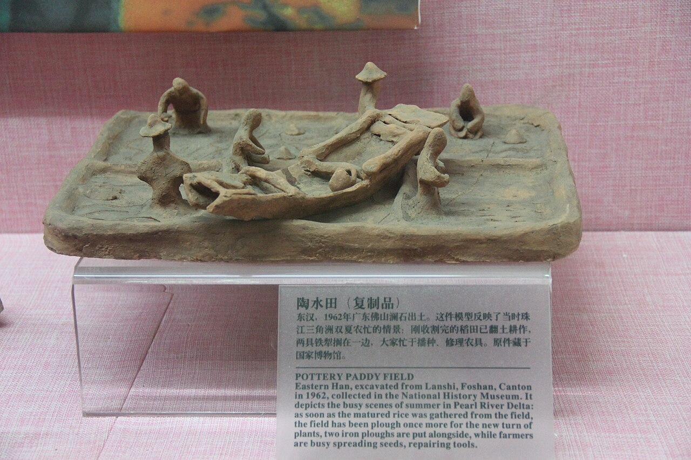
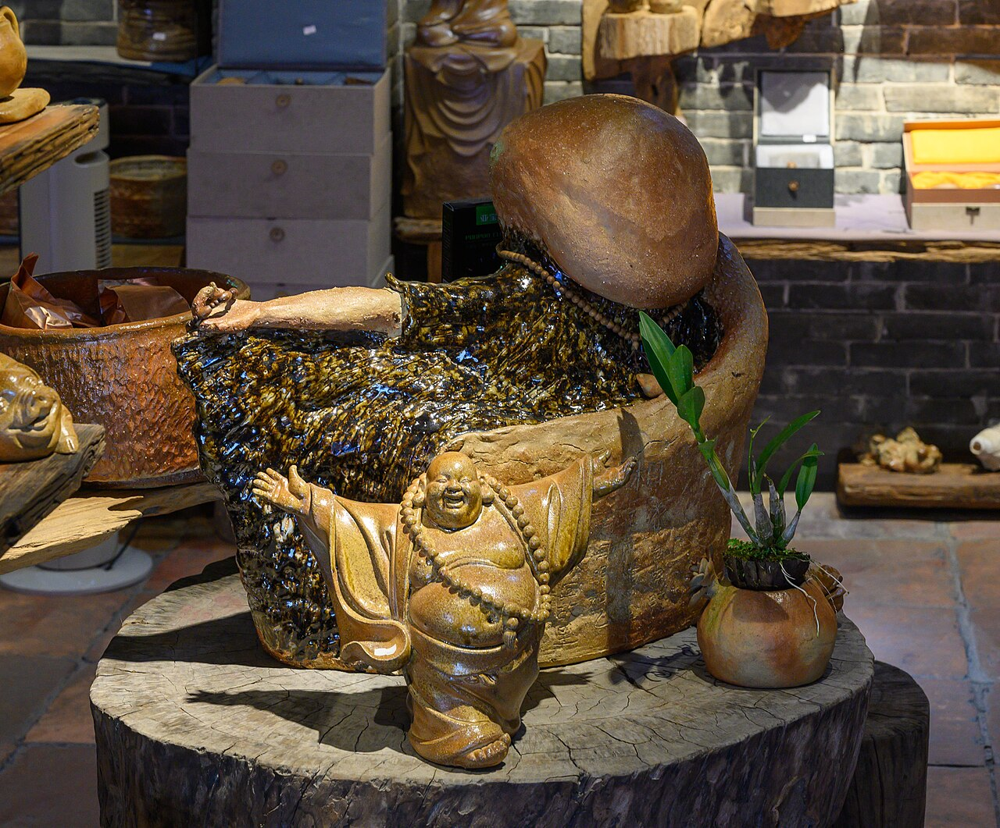
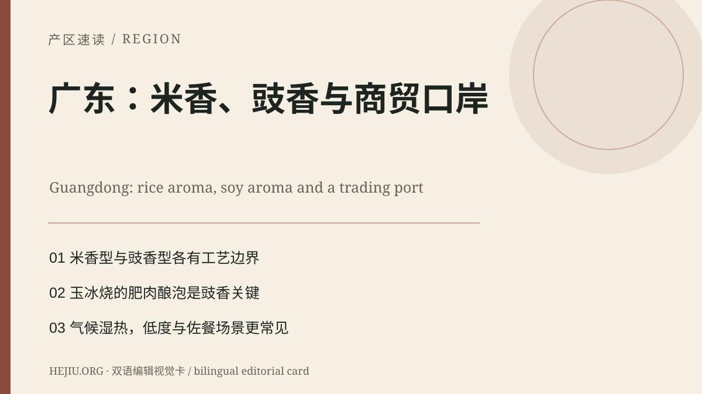

# 广东省

广东位于中国南部，北靠南岭，南临南海，珠江三角洲是人口与产业最密集的区域。与北方以高粱、小麦为主的白酒产区不同，广东的酒类传统更贴近稻作农业：大米、糯米与本地水源，构成了米香、豉香与甜型黄酒的基础。

广东酒的另一个特点是“低度、日常、配餐”。玉冰烧、九江双蒸与客家娘酒，常出现在家庭餐桌、早茶、节庆与烹饪场景，而不是只在商务宴席上出现。理解广东酒，不能只用“白酒”的框架，还要把米酒与黄酒放进来。

图：东汉陶制稻田模型，华南稻作农业与米酒传统的物证。图片：Gary Todd from Xinzheng, China，CC0，via Wikimedia Commons（[原图页面](https://commons.wikimedia.org/wiki/File:Eastern_Han_Pottery_Rice_Paddy_Field_(10075468314).jpg)）。

## 地理与气候

广东属亚热带—热带季风气候，高温多雨，湿度大，夏长冬暖。珠江三角洲河网密布，粤东、粤北与粤西则以山地丘陵为主。稻米是主要作物，沿海与内河交通便利，形成了密集的城镇与饮食网络。

高温高湿对发酵与贮存是双刃剑：微生物活跃，发酵速度快，但杂菌控制与酒体稳定性更难。传统米酒作坊常依靠经验控制温度与酸度，现代酒厂则用恒温车间、过滤与灭菌来稳定品质。气候影响工艺，但不会自动决定风味。

图：佛山南风古灶，岭南窑业与器物文化的历史现场。图片：xiquinhosilva，CC BY 2.0，via Wikimedia Commons（[原图页面](https://commons.wikimedia.org/wiki/File:Nanfeng_Kiln_39152-Foshan_(49042868786).jpg)）。

## 历史脉络

广东的酿酒传统与稻作、客家迁徙、广府饮食和沿海贸易有关。米酒在家庭与节庆中广泛使用，客家娘酒更与生育、节庆和待客礼俗相连。20 世纪以后，石湾玉冰烧、九江双蒸等品牌完成工业化，成为广东米酒与豉香型白酒的代表。

改革开放后，广东成为全国酒类消费与流通中心，进口葡萄酒、啤酒、洋酒与本地米酒同时存在。本地酒厂在保持传统风味的同时，也面临年轻消费者、低度化与餐饮场景变化的挑战。

## 香型与风格

广东最具识别度的白酒是[豉香型](ref:chi)。豉香型以大米为原料，酒体玉洁冰清，豉香独特，入口醇和，回味较长；它与中国北方以高粱、小麦为主的浓香、清香、酱香形成鲜明对照。[米香型](ref:rice-aroma)则更清、更甜，强调米香与爽净，九江双蒸是常见代表。

[客家娘酒](ref:yellow)属于甜型黄酒或米酒传统，以糯米、酒曲发酵而成，甜度高、酒精度低，常用于产妇调理、节庆与烹饪。它和[米酒](ref:rice)不是同一个分类层级：米酒可以指原料与工艺，黄酒是更具体的饮料酒类别。把三者混在一起，会看不清广东酒的结构。

图：广东：米香、豉香与商贸口岸。项目自制双语视觉卡，示意性编辑图，不作为实景照片。

## 原料与工艺

广东米酒以[大米](ref:rice)与[糯米](ref:glutinous)为主，使用[水](ref:water)与酒曲完成糖化、[发酵](ref:fermentation)与[蒸馏](ref:distillation)。豉香型白酒的独特之处，在于基酒陈酿与后续处理形成的豉香；米香型更强调米饭糖化、低温发酵与清蒸清烧的干净感。

[制曲](ref:qu)与[勾调](ref:blending)决定了酒体的稳定度。传统米酒常用小曲，现代酒厂则用纯种曲或复合曲控制风味。标签上的原料、酒精度、糖度与执行标准，比“古法”“手工”等词更能说明一瓶酒是什么。

图：发酵把淀粉转化为酒精与风味物质，是白酒工艺的中间环节。图片：Tjhackmann，CC BY-SA 4.0，via Wikimedia Commons（[原图页面](https://commons.wikimedia.org/wiki/File:Phylogenetic_tree_of_bacteria_and_archaea,_highlighting_those_that_carry_out_fermentation.png)）。

## 代表酒款与地方记忆

石湾玉冰烧是豉香型白酒的代表，产自佛山石湾，以大米为原料，酒体清澈、豉香明显。九江双蒸是米香型米酒的代表，产自佛山南海九江，常见于家庭烹饪与日常饮用。客家娘酒则分布在梅州、河源、惠州等客家地区，品牌化程度不一，更多以地方作坊与家庭酿造存在。

广东还有啤酒、葡萄酒与进口烈酒消费市场。广州、深圳、珠海等城市的酒吧与餐饮场景，让广东成为观察中国酒类消费趋势的前沿。但本地传统米酒的价值，不在于“高端化”，而在于它与粤菜、早茶与家庭生活的连接。

## 市场与饮用

广东的饮酒场景高度分化：早茶与家常菜配米酒、黄酒；商务宴请与夜宵配啤酒、白酒或洋酒；节庆与礼俗用客家娘酒。粤菜讲究清、鲜、嫩、滑，配酒时不必一味追求高度：米香型、低度豉香与黄酒可以配白切鸡、清蒸鱼与点心；口味重的烧腊、卤味可以配豉香或浓香白酒。

米酒与黄酒开瓶后容易氧化，应冷藏并尽快喝完；豉香型白酒可以常温避光保存，但长期存放仍要注意密封与瓶口清洁。饮用时控制总量，不要用甜型米酒掩盖酒精摄入。

## 法规与产区保护

广东白酒、米酒与黄酒生产受食品安全法规与国家标准的约束。GB/T 15109-2021 对白酒工业术语、制曲、发酵与蒸馏等环节有定义；GB/T 17204-2021 对饮料酒分类与术语有规定。豉香型、米香型等名称的使用需要符合相应标准；阅读酒标时，要区分原料、糖度、酒精度与生产商。

## 气候与酒类结构

| 区域 | 气候与地貌 | 主要酒类 | 买酒时看什么 |
| --- | --- | --- | --- |
| 珠江三角洲（广州、佛山、江门） | 河网平原，高温多雨 | 豉香、米香、黄酒 | 香型、原料、糖度 |
| 粤东（梅州、河源、惠州） | 山地丘陵，客家聚居 | 客家娘酒、米酒 | 甜度、酒精度、保存 |
| 粤北（韶关、清远） | 山地，冬季较冷 | 米酒、地方小曲酒 | 原料与生产商 |
| 粤西（湛江、茂名） | 沿海台地，湿热 | 米酒、啤酒 | 渠道与新鲜度 |
| 沿海城市 | 城市消费集中 | 进口酒、啤酒、米酒 | 标签与来源 |

这张表是宏观对照，不能替代酒厂的具体工艺。广东同一地市也可能同时存在传统米酒作坊与现代化酒厂。

## 常见误区

第一，广东只有米酒。广东有豉香型白酒、米香型米酒、客家娘酒与啤酒、葡萄酒消费市场。

第二，豉香型就是酱油味。豉香是酒体陈酿与工艺形成的复合香气，不是加入酱油。

第三，米酒都很甜。米香型可以从干到甜，标签上的糖度与酒精度才是判断依据。

第四，客家娘酒只是产妇酒。它也是节庆、待客与烹饪用酒，具体用途因家庭与地区而异。

第五，低度酒不会醉。低度不等于低风险，饮用总量与速度才是关键。

## 豉香、米香与餐桌逻辑

广东的米香型与豉香型常被放在同一张桌子上比较：九江双蒸以米香型的清、甜、爽为主，玉冰烧则在米香基底上多了一层豉香与脂香，入口更圆、回味更厚。客家娘酒属于黄酒系统，甜度与糯米的处理方式又把它带到另一条线。三者的共同点是低度、顺口、适合配粤菜，但并不是同一种酒。

配餐时，白切鸡、清蒸鱼、白灼虾适合米香型，清甜的酒体不会压住海鲜；烧鹅、叉烧、煲仔饭适合豉香型，脂香与豉香能接住肉类的油润；客家娘酒可以温到 40–50°C，配酿豆腐、盐焗鸡与甜点，甜度高的版本更适合作为餐后酒。不要在重辣菜面前强行用低度米酒“解辣”，辣度会放大酒精感。

价格上，日常米酒与豉香酒多在几十到两三百元，礼盒与年份款可以到数百元；客家娘酒的价格更多取决于糯米、年份与手工工艺。购买时看清“白酒”“黄酒”“配制酒”的类别，别把甜型配制酒当成传统米酒；也要核对糖度、酒精度与保质期。

到访广东可以把佛山南风古灶、九江双蒸博物馆与客家围屋串起来：佛山看豉香与陶器，九江看米香与双蒸工艺，梅州看客家娘酒的生活场景。参观前查官方开放信息，品鉴活动以当期预约为准。

## 按菜选酒的三条捷径

第一条，看菜的油润度。清蒸、白灼与汤类选米香型，豉香型留给烧鹅、叉烧与煲仔饭；如果一桌既有海鲜又有烧味，先开一瓶米香型，再用豉香型接后半段。第二条，看甜度。咕噜肉、蜜汁叉烧与甜点会放大酒的苦味，选半甜或甜型娘酒更稳；如果酒是干型，先吃一口咸鲜菜再喝。第三条，看温度。米香型与豉香型都可以轻微冰镇到 15–18°C，娘酒温到 40–50°C；不要把同一瓶酒在冰与热之间来回切换。

## 常见问题

**豉香型白酒是什么味道？** 它以大米为原料，酒体清澈，豉香明显，入口醇和，回味较长。豉香来自工艺与陈酿，不是加入酱油或豆豉。

**玉冰烧和九江双蒸有什么区别？** 玉冰烧是豉香型白酒的代表，九江双蒸更接近米香型米酒。两者的香型、原料处理与典型饮用场景不同，买的时候看标签。

**客家娘酒怎么喝？** 可以温热后小杯饮用，也常用于烹饪与节庆待客。它的甜度与酒精度因产品而异，开瓶后应冷藏。

**广东米酒能存放多久？** 米香型白酒可以常温避光保存，但米酒与黄酒开瓶后容易氧化，应冷藏并尽快喝完。具体保质期看标签。

**广东只有低度酒吗？** 不是。广东有低度米酒、黄酒，也有高度白酒、啤酒与进口烈酒，酒精度跨度很大。

## 延伸阅读

- [中国](ref:china)：广东省在中国酒类地理中的位置。
- [豉香型](ref:chi)与[米香型](ref:rice-aroma)：广东白酒的两条主线。
- [黄酒](ref:yellow)：客家娘酒在饮料酒分类中的位置。
- [大米](ref:rice)、[糯米](ref:glutinous)与[水](ref:water)：广东米酒的基础原料。
- [制曲](ref:qu)、[发酵](ref:fermentation)、[蒸馏](ref:distillation)与[勾调](ref:blending)：理解广东米酒的工艺词。
- [白酒](ref:baijiu)：把豉香型放回中国白酒的整体框架。

**关键事实。**

| 项目 | 内容 |
| --- | --- |
| 一句话定位 | 珠江三角洲与粤东山地共同构成的华南省份，豉香、米香与客家娘酒并存 |
| 层级 | 省/大区 |
| 所属 | 中国 |
| 国家代码 | CN |
| 代表线索 | 石湾玉冰烧、九江双蒸、客家娘酒 |

**来源与边界。** 本页关于「广东省」的地理、香型与工艺信息，主要由广东省人民政府、国家标准全文公开系统、中国酒业协会与《The Oxford Companion to Spirits and Cocktails》交叉核对。品牌历史、产品线与价格会变，涉及这些字段时以企业官方当期信息为准。正文为项目自写，来源只作核验，不复制原文。
